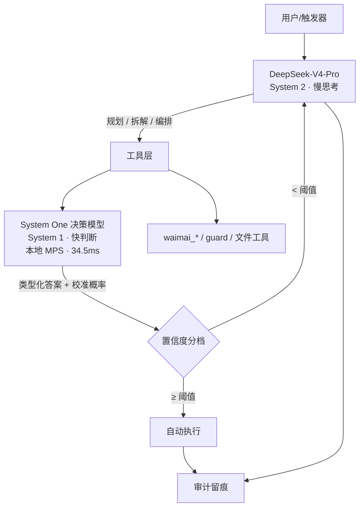

# DeepSeek × System One 决策模型：整合可行性分析 v1

> 日期：2026-10-03 · 实机：Mac16,10 (Apple M4) / 24 GB / 126 GB 可用磁盘
> 验证环境：`~/systemone-lab/venv`（Python 3.12.13，opendecider 0.5.0，torch 2.14.1，MPS 可用）
> 口径：【实测】= 本机跑出来的；【文档】= 官方文档；【第三方】= 外部来源；【推断】= 我的判断

---

## 0. 结论先行

**可行，而且本机已端到端跑通。但正确的架构不是"让 DeepSeek 变成 Jev"，而是快慢分工。**

| # | 判断 | 结论 | 依据 |
|---|---|---|---|
| 1 | 用 **DeepSeek 官方 API** 直接做 System One 打分 | ❌ **不可行** | logprobs 值恒为 `0` / `-9999`，`top_logprobs` 恒空，issue 仍开放【第三方】 |
| 2 | **DeepSeek 规划 + 本地开源 System One 决策** | ✅ **完全可行，已实测** | 本机三路径全通，P50 34.5ms【实测】 |
| 3 | 让 **DeepSeek 自报置信度再分档路由** | ❌ **不可行** | RLHF 训练出的模型系统性过度自信——这正是 RLCD 被发明出来要解决的问题【文档】 |
| 4 | 用 **Laya** 做置信度路由 | ❌ **不可行** | 其置信度几乎不区分对错：最有把握 70%/50% 上准确率仅 0.543/0.550【第三方】 |
| 5 | 本机硬件承载 | ✅ **宽裕** | nano(0.8GB) 单问题 P50 34.5ms；4B 走 Ollama GGUF 亦可【实测】 |

**一句话**：DeepSeek 保持 System 2（规划、编排、长上下文、视觉），把高频原子判断交给本地 System One 模型，两者通过 MCP 或 HTTP 对接。**DeepSeek 侧一行模型代码都不用改。**

---

## 1. 硬约束：为什么不能让 DeepSeek 自己变成 System One

### 1.1 Jev 类模型的机制前提

System One 模型之所以能做到"并行采样 + 校准概率"，靠的是**单次前向 + 读候选 token 的 logits/logprobs**，跳过自回归解码循环。要复现这套机制，必须同时满足三个条件：

1. **能访问候选位置的 logprobs 或 logits**
2. **候选能映射到（近似）单 token**
3. **概率经过校准训练**（这是 RLCD 的职责）

条件 1 是硬门槛。没有它，后面两条无从谈起。

### 1.2 DeepSeek 官方 API 的 logprobs 状态

【第三方】GitHub `deepseek-ai/DeepSeek-V3.2-Exp` **Issue #49**（2025-11-30 开，**至今 Open，无 label、无 assignee**）：

> "The API returns token-level logprobs, but the values are **always either 0 or -9999**, and **`top_logprobs` is consistently empty**."

**含义**：官方 API 即使传 `logprobs: true, top_logprobs: N`，也**拿不到有信息量的分布**——返回的要么是选中 token 的 `0`（即概率 1.0），要么是 `-9999`（即概率≈0）。**这不足以做任何形式的候选打分或校准**。

### 1.3 三条退路及其代价

| 退路 | 做法 | 代价 | 判断 |
|---|---|---|---|
| **A. 提示词让 DeepSeek 输出单字母** | 让模型输出 "A"/"B" | 能拿到**类型化答案**，但**拿不到概率分布 → 没有校准**。而校准正是 System One 的全部价值 | ⚠️ 只解决"格式"，不解决"决策可靠性" |
| **B. 走支持 logprobs 的第三方托管** | 经 DeepInfra 等有 log-probs 的服务调 DeepSeek | 换了一整套服务栈（凭证、计费、SLA），且**本机未实测** | ⚠️ 理论可行，未验证 |
| **C. 本地跑 DeepSeek 权重** | 自托管 | DeepSeek 权重规模远超 24GB 内存 | ❌ 不现实 |

> **结论**：DeepSeek 在这套架构里的正确位置是 **System 2（慢思考/规划/编排）**，不是 System 1。

---

## 2. 本机实测（本报告的核心证据）

### 2.1 软硬件基线【实测】

| 项 | 值 |
|---|---|
| 机型 | Mac16,10（Apple **M4**），10 核 |
| 内存 | 24 GB（当前空闲约 49%） |
| 磁盘可用 | 126 GB |
| Python | 3.12.13（uv 管理的解释器；**系统 python3 是 3.9.6，不满足 opendecider 的 ≥3.10**） |
| Node | v25.9.0 |
| torch | 2.14.1（**MPS 可用 = True**） |
| 已装 | opendecider **0.5.0**、mcp 2.2.0 |
| 本机推理后端 | Ollama（在线）、LM Studio（在线） |

### 2.2 后端 logprobs 能力矩阵【实测 + 文档交叉】

这是**决定后端选型的唯一关键实测**：

| 后端 | logprobs | 实测证据 | 判断 |
|---|---|---|---|
| **Ollama** | ✅ **完整可用** | 实测拿到 `B`(0)、`A`(-22.01)、`C`(-22.18)、`b`(-22.59)、`" B"`(-23.23) 的完整 `top_logprobs` 分布 | ✅ **选它** |
| **LM Studio**（Apple Silicon） | ❌ **不返回** | 实测两次请求（含排除推理模型的 token 干扰）响应中**完全没有 `logprobs` 字段** | ❌ 不可用 |
| **DeepSeek 官方 API** | ❌ **无信息量** | 值恒 `0`/`-9999`，`top_logprobs` 恒空（issue #49） | ❌ 不可用 |

> **LM Studio 的失败有官方解释**——opendecider 文档原文：「Load the GGUF build in LM Studio **on a Mac** too: its **MLX engine returns no log-probabilities**. For MLX, use the MLX builds instead.」【文档】
>
> 即 macOS 上 LM Studio 走 MLX 引擎，**不返回 logprobs 是其设计限制**，不是配置问题。这与我的实测完全吻合。

### 2.3 端到端实测结果【实测】

**路径 1：进程内 Python**

```
from opendecider import load
model = load("manjunathshiva/opendecider-nano")
model.system_one(state, questions)
```

真实输出（客服工单）：

| 问题 | 类型 | 答案 | 概率分布 |
|---|---|---|---|
| department | choice | **billing** | billing 0.927 / other 0.040 / technical 0.033 |
| urgency | score | **2 = blocking** | 2: 0.604 / 1: 0.305 / 0: 0.091（期望值 1.512） |
| churn_risk | noul | **0.922** | true 0.922 / false 0.078 |

**"被重复扣费 + 威胁退订" → 账单部门、阻塞级紧急、流失风险 0.92** —— 三个判断一次调用、各自独立、都带校准概率。

**路径 2：HTTP `/v1/systemone`（Jev 兼容协议）**

| 测试 | 结果 |
|---|---|
| 无 token | **HTTP 401**（鉴权生效） |
| 带 token 单条 | **HTTP 200**，返回完整概率 + confidence |
| 批量 3 条 | **HTTP 200，耗时 116 ms**（约 39 ms/条） |
| 批量分类正确性 | "重复扣费"→billing 0.889 ✅ · "应用崩溃"→technical 0.937 ✅ · "发票在哪"→billing 0.897 ✅ |

**路径 3：MCP server over stdio**

```
opendecider mcp --model manjunathshiva/opendecider-nano --device mps
```
【实测】CLI 确认存在三个子命令：`serve` / `mcp` / `bench-speed`；`mcp` 为 **stdio 传输**——与 DSH `mcp-station` 已支持的 `blackboard-mcp` 同构。

### 2.4 延迟实测【实测】

| 场景 | P50 | P90 | 说明 |
|---|---|---|---|
| 首次推理（含 MPS 编译） | 1314 ms | — | 仅第一次 |
| 单问题 choice | **34.5 ms** | 36.3 ms | 12 次采样 |
| 三问题合并调用 | **56.3 ms** | 67.1 ms | 8 次采样 |
| HTTP 批量 3 条 | 116 ms | — | 含 HTTP 开销 |

> **对比**：DeepSeek 一次 chat completion 通常是**秒级**。34.5ms 意味着**可以放进 agent 循环的每一轮**而不显著拖慢。这正是"廉价到可以被持续咨询"的量化含义。

### 2.5 一个必须知道的环境坑【实测】

**HuggingFace Hub 本机不可达**：

| 端点 | 结果 |
|---|---|
| `huggingface.co` | ❌ HTTP 000，12s 超时 |
| **`hf-mirror.com`** | ✅ **HTTP 200，0.97s** |
| `modelscope.cn` | ✅ 302（可达） |

**解法**：`export HF_ENDPOINT=https://hf-mirror.com`。设置前模型加载直接 `ConnectTimeout` 失败，设置后 18 分钟完成 9 个文件下载。**这一步不做，后面全部走不通。**

---

## 3. 推荐架构：快慢分工



**分工原则**：
- **DeepSeek 负责**：任务规划、DAG 拆解、跨工具编排、长上下文理解（1M）、复杂推理、视觉（`deepseek-v4-flash-vision-exp`）
- **System One 负责**：高频、原子、可枚举的单维判断——分类 / 选择 / 评分 / 真伪
- **分界线**：**"一个有经验的人一秒能拍板"的判断交给 System One**；需要多因素权衡、需要查阅、需要生成的，留给 DeepSeek

> 这与我们上一轮调研的 Raven harness 结论完全一致：**Harness 的价值在于组装这套分工**。APUS 的表述可直接引用——"昂贵的大模型负责规划等慢思考，高频原子化的快判断交给轻量决策模型，**负责组装与调度这套分工的工程层，业界称为 Harness**"。

---

## 4. 三条集成路径（均已实测）

### 路径 A：MCP server —— **推荐**

```bash
opendecider mcp --model manjunathshiva/opendecider-nano --device mps
```

- **对接方式**：往 `~/.dsh/mcp-station/servers.json` 加一条 `transport: "stdio"` 记录，与现有 `blackboard-mcp` 完全同构
- **优点**：DSH 侧零代码；进程隔离；模型常驻内存避免每次加载；MCP 工具面自动暴露给所有预设
- **注意**：stdio 服务随 DSH 生命周期启停；nano 常驻约 1GB 内存

### 路径 B：HTTP `/v1/systemone` —— **最通用**

```bash
opendecider serve --model manjunathshiva/opendecider-nano --port 8010
```

- **优点**：**Jev 协议原生兼容**（官方称用 TypeSafe 自家 SDK `@typesafe-ai/sdk` 0.6.0 换 base URL 即可，零代码改动）；有 `/batch` 批量端点、`/metrics` Prometheus、`/health` 探针、bearer 鉴权、请求限流
- **实测批量 3 条 116ms**，适合"一批工单一次问完"
- **注意**：需自行管理进程（建议 launchd 常驻，与本机其他服务同规格）

### 路径 C：Ollama GGUF 后端 —— **省内存**

```bash
ollama pull hf.co/manjunathshiva/opendecider-small-GGUF:Q8_0
opendecider serve --model ollama:hf.co/manjunathshiva/opendecider-small-GGUF:Q8_0
```

- **优点**：复用已有 Ollama；Q8_0 与全精度**同答案率 1975/2000**，准确率 0.669 vs 0.671（几乎无损）【文档】
- **实测前提**：**Ollama 的 logprobs 已确认可用**（见 §2.2）
- **限制**：**每题最多 26 个选项**（OpenAI 兼容服务最多返回 20 个 logprobs）
- **注意**：**不要走 LM Studio**——macOS 上 MLX 引擎不返回 logprobs

---

## 5. 置信度分档路由：价值到底有多大

这是整套架构**唯一值得投入的理由**。opendecider 官方在 2,000 条业务决策上的实测【文档】：

| 自动化门槛 | 自动化比例 | 被自动化部分的准确率 | 转人工比例 |
|---|---|---|---|
| 全部 | 100% | 0.796 | 0% |
| p ≥ 0.5 | 76% | 0.873 | 24% |
| **p ≥ 0.6** | **51%** | **0.941** | 49% |
| p ≥ 0.7 | 32% | 0.972 | 68% |
| p ≥ 0.8 | 21% | 0.998 | 79% |
| p ≥ 0.9 | 13% | 0.996 | 87% |

**读法**：门槛设 0.6，**一半的决策可以全自动、且准确率 94%**，另一半转人工。

**跨模型对照（最有说服力的部分）**：

| 基准 | 模型 | 全部 | 最有把握 70% | 最有把握 50% |
|---|---|---|---|---|
| typed-decisions | opendecider-small-td | 0.792 | 0.893 | **0.949** |
| typed-decisions | opendecider-nano | 0.796 | 0.894 | 0.943 |
| typed-decisions | opendecider-large-td | 0.801 | 0.901 | 0.947 |
| typed-decisions | **TypeSafe Jev 1.13** | 0.754 | 0.839 | 0.882 |
| general (200) | **TypeSafe Jev 1.13** | 0.730 | **0.829** | 0.860 |
| general (200) | opendecider-large-td | 0.750 | 0.807 | 0.870 |
| general (200) | **Laya** | 0.545 | 0.543 | **0.550** |

**两条关键结论**：
1. 在专业决策上，**本地开源 nano 的分档效果（0.943）优于闭源 Jev（0.882）**
2. **Laya 的置信度几乎不区分对错**（0.545 → 0.543 → 0.550，三条几乎水平）——**这直接否决了 Laya 作为路由依据**。上一轮调研中 Laya 的校准问题是实锤，不是理论担忧。

> **官方对阈值的告诫**："Choose the threshold on a few hundred of your own labelled decisions: the right value depends on your data, your questions and **the cost of a wrong automatic action**."

---

## 6. 映射到我们已有的场景

| 现有场景 | 现在怎么做的 | 可交给 System One 的判断 | 收益 |
|---|---|---|---|
| `waimai_alerts` 新订单告警 | 逐条 LLM 处理 | 告警类型归类（choice）+ 紧急度（score） | 34ms/条，成本近零 |
| `waimai_review` 评价 | LLM 生成分类 | 情感/问题类型/是否需回复（choice + noul） | 批量 116ms/3 条 |
| `waimai_voice` 意图路由 | LLM 解析 | 意图分类（choice），选项=已有工具名 | 消除"选了不存在的工具" |
| IM 客服消息 | 规则 + LLM | 是否超时需介入（noul）/ 诉求类型（choice） | 可全量跑，不再抽样 |
| `guard_*` 门控 | 布尔通过/不通过 | **Score 原语**（风险分级，可落在刻度之间） | 从两态升级为分级 |
| `im-window` / 页面异常 | 规则匹配 | 页面是否正常（noul）/ 异常类型（choice） | 快速判定 |
| `price-analysis` | 规则 | 调价是否异常（noul）/ 异常程度（score） | 辅助而非替代 |

**最自然的第一个落点**：`waimai_voice` 意图路由。因为它的选项集**已经是封闭枚举**（一个固定的工具名列表），天然满足"输出空间调用前枚举"，且错了代价可控。

---

## 7. 风险与约束（必须一并给出）

| # | 约束 | 影响 | 应对 |
|---|---|---|---|
| 1 | **DeepSeek API 无可用 logprobs** | 不能把 DeepSeek 用作打分后端 | 接受快慢分工；不追求单一模型统一 |
| 2 | **LM Studio(macOS/MLX) 无 logprobs** | 不能用现有的 LM Studio 做后端 | 用 Ollama；官方文档亦确认此为 MLX 限制 |
| 3 | **HuggingFace 本机不可达** | 模型无法下载 | `HF_ENDPOINT=https://hf-mirror.com`（实测 0.97s 可达） |
| 4 | **24GB 内存竞争** | LM Studio 若加载 qwen3.8-27b，再加 System One 模型会吃紧 | nano 常驻约 1GB 可接受；避免同时加载大模型 |
| 5 | **26 选项上限**（OpenAI 兼容后端） | 选项多的场景受限 | 进程内 PyTorch 后端支持 256 选项 |
| 6 | **必须用官方训练的模型** | 随便拿个 Qwen 走 GGUF 路线不work——OPENDECIDER 的提示词是为其专用 checkpoint 训练的 | 只用 `opendecider-*` 权重 |
| 7 | **校准是本机表现，不是通用保证** | 官方基准的标签来自教师模型，本身不完美 | **必须在自己几百条已标注数据上重测阈值** |
| 8 | **`opendecider-client` 未发布到 PyPI** | README 提到的轻量包在 0.5.0 索引中不存在（**文档站版本领先于发布**） | 用主包；或等版本 |
| 9 | **Ollama 原生决策端点提示词不同** | 0.35.1+ 自带 decision endpoint，但"builds a different prompt...which costs them several points" | 走 opendecider 包而非原生端点 |
| 10 | **nano 的绝对准确率 0.796** | 不是替代 DeepSeek，是**过滤 + 分档** | 低置信度一律回流 DeepSeek |

---

## 8. 建议路线

| 阶段 | 动作 | 工作量 | 验证方式 |
|---|---|---|---|
| **P0** | 固化环境：`HF_ENDPOINT` + 专用 venv + `opendecider mcp` 挂进 `mcp-station/servers.json` | 小（本报告已完成前置） | `servers.json` 状态转 `ready` + 工具列表非空 |
| **P1** | 选一个只读场景做对照：**`waimai_voice` 意图路由**，System One vs 现有 LLM 路由，各跑 200 条真实指令 | 中 | 准确率对照 + P50 延迟 + **置信度分桶准确率** |
| **P2** | **标定阈值**：人工标注 200–300 条真实样本，画出"自动化比例 × 准确率"曲线，定下各操作的阈值 | 中 | 产出曲线图 + 阈值决策表 |
| **P3** | 推广到 `waimai_alerts` / `waimai_review`；批量端点用于离线全量重跑 | 中 | 成本对照 + 覆盖率 |
| **P4** | 若需 >26 选项或更高准确率，升级到 `opendecider-small-td`（4B，可走 Ollama GGUF 或进程内） | 小 | 同 P1 对照 |

**明确不做**：
- ❌ 不试图用 DeepSeek 复现 System One（API 层不支持）
- ❌ 不用 Laya 做置信度路由（实测置信度无区分度）
- ❌ 不用 LM Studio 做后端（macOS 无 logprobs）
- ❌ 不用 LLM 自陈置信度做分档（这正是 RLCD 要解决的问题）

---

## 9. 复现命令（本报告全部实测步骤）

```bash
# 0. 关键：HF 镜像（不设则下载超时）
export HF_ENDPOINT=https://hf-mirror.com

# 1. 环境（注意用 3.12，系统 python3 是 3.9 不满足 ≥3.10）
PY312=~/.local/share/uv/python/cpython-3.12.13-macos-aarch64-none/bin/python3.12
mkdir -p ~/systemone-lab && $PY312 -m venv ~/systemone-lab/venv
~/systemone-lab/venv/bin/python -m pip install "opendecider[serve,mcp]"

# 2. 进程内调用
~/systemone-lab/venv/bin/python -c "
from opendecider import load
m = load('manjunathshiva/opendecider-nano')
print(m.system_one('I was charged twice, please refund.',
  {'dept': {'type':'choice','instructions':'Which department?',
            'criteria':{'billing':'payments, refunds','technical':'bugs'}}})['answers'])"

# 3. HTTP（Jev 兼容）
OPENDECIDER_API_KEY=local-token ~/systemone-lab/venv/bin/opendecider serve \
  --model manjunathshiva/opendecider-nano --port 8010
curl -s localhost:8010/v1/systemone -H 'Authorization: Bearer local-token' \
  -H 'content-type: application/json' \
  -d '{"state":"I was billed twice.","questions":{"team":{"type":"choice","instructions":"Which team?","criteria":{"billing":"payments","technical":"bugs"}}}}'

# 4. MCP（挂 DSH）
~/systemone-lab/venv/bin/opendecider mcp --model manjunathshiva/opendecider-nano --device mps
```

---

## 10. 证据来源

| 来源 | 类型 | 用途 |
|---|---|---|
| 本机实测（本会话） | 【实测】 | 硬件基线、logprobs 矩阵、端到端三路径、延迟、HF 可达性 |
| [opendecider 文档站](https://manjunathshiva.github.io/opendecider/) — serve / HTTP API / confident-automation / model-servers | 【文档】 | 协议规格、限制值、准确率与分档表、MLX 无 logprobs 说明 |
| [opendecider GitHub](https://github.com/manjunathshiva/opendecider) | 【文档】 | 安装方式、GGUF 一致性数据 |
| [DeepSeek-V3.2-Exp Issue #49](https://github.com/deepseek-ai/DeepSeek-V3.2-Exp/issues/49) | 【第三方】 | DeepSeek API logprobs 不可用的直接证据 |
| [DeepSeek Chat Completions API 文档](https://api-docs.deepseek.com/api/create-chat-completion) | 【文档】 | 模型名（deepseek-flash / deepseek-v4-pro）、thinking、reasoning_effort、response_format |
| `~/dsh-collab/docs/system-one-models-Jev-Laya-CLM-调研-v1.md` | 前序产出 | Laya 校准问题、RLCD 原理、Jev 架构反推 |

---

*本次实测建立的 `~/systemone-lab/` 环境可保留复用；serve 进程已清理，8010 端口已释放。*
