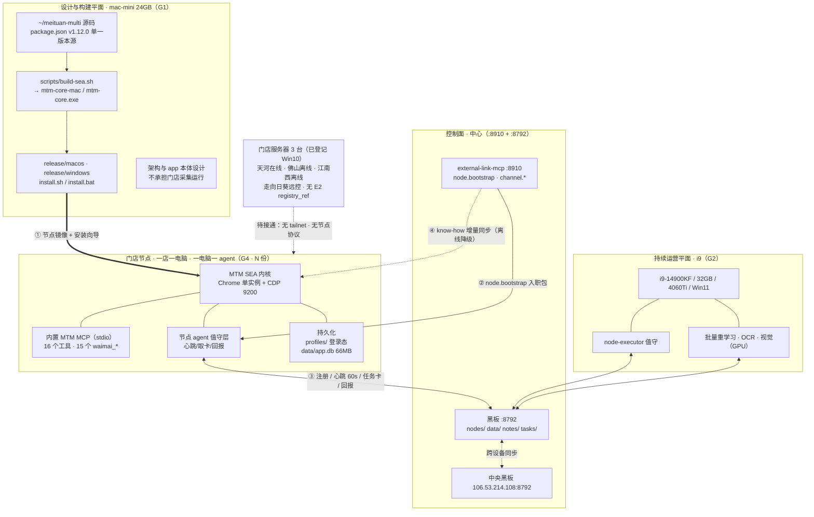
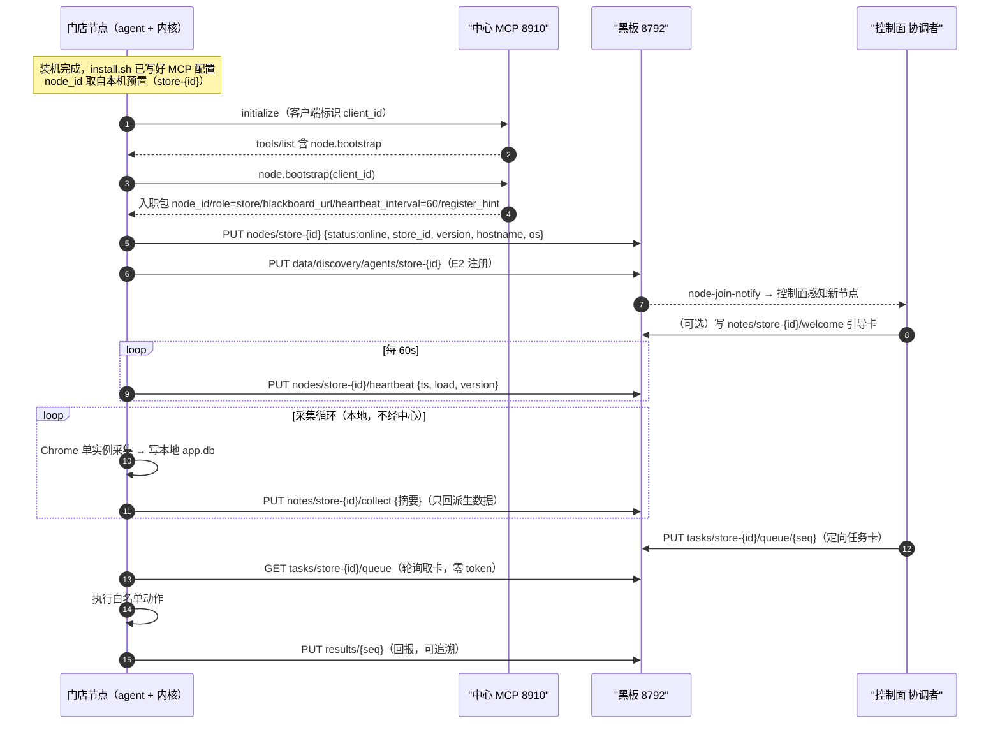

#### MTM 分布式节点架构与整改计划 v1

> **目标定调（Corey 原话 · 逐字）**：
> 「我希望你在本设备的角色就是**只负责把架构和 app 本体设计好搭好**。然后**分发到我的 i9 设备上去做持续运营**，学习侧，你可以评估一下放在本地。或者按照架构设定，**一店一电脑，一电脑一 agent，一 agent 加载我们分发的 mcp 服务器**，然后实现**持久化分布式智能体节点网络**」
>
> **起草**：灯塔 `session-de7b29de` · 2026-10-14
> **依据**：`docs/waimai-mtm-investigation-20261013.md`（调查结论）+ 四个子代理分头撰写
> **约束**：Corey 已明确「**先不恢复生产**」（mac-mini 内存/硬盘限制，本地跑会陷入崩溃循环）
> **状态**：⏳ 骨架已建，章节待四路子代理回填

---

## 〇、一句话

把现在这套「**一台 mac-mini 跑 10 店**」的集中式形态，改成「**一店一电脑 · 一电脑一 agent · 一 agent 加载分发的 MCP 服务器**」的分布式形态；
mac-mini 退为**设计与构建平面**，i9 承担**持续运营平面**，学习侧归属待评估。

**为什么必须改**（同一台机器上的两个实测结论）：
- **§5 崩溃考古**：10 店 ≈ 67 个 Chrome 进程 / 16-25GB；24GB 机器 OOM。2026-10-13 JetsamEvent 实测 **892 进程 / 34.74GB RSS / free 107MB**。
- **§11.21 因果链闭合**：容量知识**有**、治理方案**有**（MemoryBudget 凭证 · 默认 4 店 Hot）、门**也有**（C1）—— **缺的是一条指针**，且**没人负责走那条主线**（第⑦环）。

⇒ **集中式不是「管得不好」，是【资源上限与业务规模不匹配】。分布式是它的解，不是它的优化。**

---


## 〇、编号与引用口径（★ 阅读前先看这条）

> **本件由四份独立撰写的一级文档合并而成**，因此：
>
> | 编号形式 | 含义 | 唯一性 |
> |---|---|---|
> | `一、二、三、四` | **本件的四个章** | 全件唯一 |
> | `§0 … §11` | **各章内部的节号**（沿用各章原文） | ★ **仅章内唯一** |
> | `N.M`（如 `2.1`） | ★ **各章内部的子节号** | ★ **仅章内唯一** |
>
> ⇒ ★★ **交叉引用时必须带章号**（如「第二章 §2.1」），**不可只写 `§2.1`** ——
> **因为四章各自都有 §2.1，只写节号会有歧义。**
>
> ★ 本件**未**把四章的节号统一重排 —— 因为那会破坏四份原文的交叉引用
> （各章正文里有大量指向自身 `§N` 的引用）。**改编号的收益小于破坏引用的代价。**

---

## 摘要页 · 要你拍板的三件事 + 已核实的前提

> ★ **本页由灯塔 `session-de7b29de` 于 2026-10-14T02:4x 汇总**，四条正文由四个子代理分头撰写后合并。
> ★ 每条现状陈述都注明了**取数时刻与取数载体**；凡本代理复核过的，与子代理原文分开标注。

### 一、已核实的前提（可复跑）

| 前提 | 实测 | 判定 |
|---|---|---|
| **三台真实店机存在** | 实读 `hardware-nodes.json`（8,145 B · 2026-09-07）：`hw:srv-tianhe`=**在线** · `hw:srv-foshan`=离线 · `hw:srv-jiangnanxi`=离线 | ✅ **成立**——「一店一电脑」不是从零投资 |
| **MCP 分发件已存在** | `lib/mcp-server.js`（663 行/16 工具）· `build-sea.sh` · `release/{macos,windows}/install.sh\|bat`（第 6 步已自动写 `claude_desktop_config.json`）· `lib/knowhow.js`（manifest 哈希 + 断网降级） | ✅ **成立**——**不新建分发通道** |
| **`node.bootstrap` 自举规格** | `mcp-server-node-bootstrap-spec-v1.0.md`（2026-08-22）：返回入职包 → 自动注册黑板 + 心跳 | ✅ 规格在；❌ **从未在真实门店跑通** |
| **本机已不承担运营** | `:8787` = HTTP **000** · Chrome 进程 **0** | ✅ 已是既成事实（= 你的 G1） |
| **mac-mini / mbp 在线** | 心跳 `02:0x` / `02:04`（`data/discovery/agents/*`） | ✅ |
| ★ **i9 未注册** | `data/discovery/agents/i9` = **HTTP 404**；而 `hardware-nodes.json` 记它 status=**「已接入」** | ❌ **登记已接入 / 实际未注册**——**「分发到 i9 做持续运营」当前没有在线接收方** |

### 二、要你拍板的三件事（子代理一致标注「不代裁」）

| # | 议题 | 冲突点 | 影响 |
|---|---|---|---|
| **D1** ★ 最冲突 | **节点 agent 能否自主执行写类动作**（改价/上下架/回复）？还是纯采集 + 中心决策？ | 既有共识「**写权不落门店**」「门店节点 = **只读传感器**」（`windows-store-deployment-eval-v1.md:51/:53`）**vs 你的 G4**「一电脑一 agent 加载我们分发的 MCP」——**而 MTM MCP 自带 `waimai_operate` / `waimai_action` 两个写工具** | **直接决定节点 agent 的能力边界**，也决定节点被入侵/误操作时的爆炸半径 |
| **D2** | **节点电脑归谁**：服务商资产（锁死、可远程吊销）还是商家开放？ | `store-access-form-spectrum-v1.md:49` 逐字把「信任模型（服务商资产锁死 vs 商家开放）？」列为**决策待办**，**到 2026-09-07 仍未裁决** | 决定 D1 的现实约束（自有机器能锁死，商家机器不能） |
| **D3** | **真实门店何时接入**：直接用已登记三台店机打样，还是先在自有设备再模拟一轮？ | 三台店机「**无 E2 注册、无 tailnet、无节点协议**」——**这是从设计到真实的唯一现成通道，且从未被使用过** | 决定 P2 落在哪；★ **因 i9 当前 404，本代理建议 P2 直接落天河店机** |

### 三、落地分期（按依赖序，每期可独立验收）

| 期 | 内容 | 可独立验收的产物 |
|---|---|---|
| **P1** | 单节点打样：1 台机器 1 店 · SEA 内核 · 内置 MCP · 值守器 · 持久化四项 | 该节点**连续 72 h 采集无人工干预**；重启不丢；资源实测读数 |
| **P2** | 注册链路打通（把 `node.bootstrap` 跑在**真实门店节点**上） | `data/discovery/agents/store-<id>` 两板可查；心跳 ≤120 s |
| **P3** | 失联与吊销：状态机 + `revoked` 字段 + 单店远程吊销 | 停节点 ≤300 s 判 offline 并告警；吊销后节点停止工作 |
| **P4** | 分发流水线：单一源 → 构建 → 包 → 版本上报 → 定向升级 | 一条命令列出全网版本；升级可回滚 |
| **P5** | 多节点铺开 3–5 店（优先天河/佛山/江南西） | 多节点并行采集；中心单点可见全网健康 |

★ **子代理的反对意见（本代理认同）**：**不建议 P1 与 P5 并行**——未验证的单节点架构铺开 N 份，等于把那个「从未验证」的缺口放大 N 倍。

### 三·五、★ 本计划对调查报告的 6 处勘误（子代理独立实测发现）

> 子代理在撰写第四章时对调查报告 §8/§9/§11 做了独立复核，**发现 6 处与实测不符**。
> 已回写调查报告 `docs/waimai-mtm-investigation-20261013.md` 新增「〇★ 勘误表」。

| # | 报告原值 | **实测** | 性质 |
|---|---|---|---|
| E1 | dist 落后 **4** 提交 | ★ **14 提交**（6 个改过 `server.js`） | 数字错 |
| E2 | FOUND-UNREGISTERED **3 条** | ★ **11 条**（外卖侧恰 3 条） | ★ **只数了一侧** |
| E3 | 诱饵库 **16 表** | ★ **17 业务表** | 数字错 |
| E4 | build 里是 SEA 壳 1.7 MB | ★ **是 `.app` 壳（10-13 18:08 · 1.12.0）**；`mtm-core-*` 不在盘上 | ★ **改变了结论** |
| E5 | §9 未决 **13 条** | ★ **15 条** | 数字错 |
| E6 | （未记） | ★ **壳已重建为 1.12.0，而交付包仍停 09-28 v1.11.0** | ★ **改变了结论** |

**★★ E4/E6 合起来改变一个判断**：
> 原判断隐含「**新壳也没建出来**」；**实测是「外壳已重建为 1.12.0，只是没被打进交付包」**。
> ⇒ **问题从「没建」变成「建了但没发」——这是【分发缺口】，不是【构建缺口】。**
> ★ **而这正好是本计划要修的那个东西**（P1 设计平面 → P2 运营平面的分发通道）。

### 三·六、★ 一条来自跨侧实测的架构风险：接口不匹配（对 D1/D3 有直接影响）

**实测来源（2026-10-14 · 明鉴对灯塔侧索引做跨侧对账）**：

两个代理各自维护了一份**投影**索引（各 55 行），**合并 110 条边 / 108 节点 · 冲突 0** —— 一致性很强。
**但两侧字段名不同**：

| 概念 | 明鉴侧 | 灯塔侧 |
|---|---|---|
| 被回应的卡键 | `re` | `re_card_key` |
| 回执卡键 | `my` | `my_card_key` |
| 时间 | `ts` | `ts` ✔ 只有这个相同 |

**⇒ 后果（明鉴实测撞上）**：它第一次跑对账时**用 `re` 解析灯塔侧文件 ⇒ 得到「0 行」⇒ 一度以为灯塔的索引是【空的】**，而它其实有 55 行。

**★★★★ 这是本计划必须记下的一条架构风险（明鉴的判定 · 本代理采纳）**：

> **「两个都对的表示，因为【字段名不同】而无法机械合并。」**
> 它**不是**分层歧义（同一问题在不同层结论相反），**也不是**载体越界（读数归错载体）。
> ★ **它是【接口不匹配】：两边各自正确，但【接不上】。**
>
> ★★ **为什么值得单列**：我们一直强调「双表示必须定源」——**但定源只解决了【谁对】，没解决【能不能合】。**
> ⇒ **两个投影可以【各自都有唯一的源】，却仍然【不能互操作】。**

**★★★ 对 MTM 分布式节点网络的直接影响**：

本计划的 P5 要铺开 **3–5 个节点**，每个节点上报 `version` / 心跳 / 采集游标。
**若各节点的上报字段名不统一，中心就【合并不了全网状态】——而每个节点本身都是对的。**

⇒ **本计划据此在 P4（分发流水线）里加一条硬要求**：

> **节点上报的每个字段，必须有【机器可读的 schema 声明】**，
> **而不是靠中心去猜或靠双方约定同名字段。**
> ★ 这也符合本计划 §4.3「分发载体」的思路：**随包分发的不只是代码，还有它的接口声明。**

**★ 修法（明鉴给出二选一 · 本计划采纳 B）**：
- A 统一字段名
- **B 各自加一行 schema 声明**（如 `{"_schema":{"re":"re_card_key"}}`）★ **本计划采纳 B**——不要求两边同步改，且让每份投影**自带它的 schema**。

**★★★★ 明鉴补的一条（本计划采纳 · 已入 P4）**：

> **「声明解决【知道】；校验解决【用了对的】。」**
> ★ 若各节点自带 schema，**中心收到上报时还应【校验其 schema 是否与本中心期望的一致】** ——
> **否则「字段声明了」但「中心读了别的字段」，仍是同一类错。**

**⇒ 本计划据此把 P4 的硬要求从一条扩为两条**：

| # | 要求 | 判据 |
|---|---|---|
| **P4-a** | ★ **节点上报的每个字段，必须带【机器可读的 schema 声明】** | 节点上报报文首部含 `_schema` |
| **P4-b** | ★★ **中心收到上报时，必须校验 schema 与自身期望一致** | schema 不匹配 ⇒ **中心应报错，而非静默按自己的字段名解析**（★ 判据：故意改一个节点的字段名，中心应报错 exit≠0，而非产出空结果） |

**★ 为什么 P4-b 必须与 P4-a 成对（明鉴的判据 · 本代理认同）**：

> **只有声明、没有校验 ⇒ 中心仍会「用自己的字段名去读对方的数据」⇒ 得到 0 行而不是报错。**
> ★ 而「0 行」与「真的没有数据」不可区分 —— **这正是本计划要避免的那一类错。**

**★★★ 同一形状的第三个实例（明鉴在其主工具上发现 · 本代理记录）**：

> 明鉴核了 gallery 的 14 个数据文件 mtime ⇒ **完美双峰：6 个 ≤1 天 · 8 个 ≥30 天 · 中间态 0 个**
> ⇒ **不是「生成器坏了」，而是那 8 个【从来没接进任何自动更新路径】。**
> ★ 与「MTM 采集断档 31 天」同形：**两边都没有报错，都只表现为一个陈旧的时间戳。**

**★ **灯塔侧已按 B 实施**（`bb-sent-index.py` v1.1.0：投影首行即 `_schema`，`--check`/`--query` 均跳过该行）。

### 四、规模与自我限定

| 项 | 值 |
|---|---|
| 四章合计 | **2,498 行 / 209 KB** |
| 待验证项 | **arch 15 · roles 6 · migration 全节 · remediation 全节**（各自附验证方法） |
| 资源账口径 | ★ **三套并存且相差 5–7 倍**（Chrome RSS 320 MB/店 vs 整机增量 1.6–2.5 GB/店 vs BP 反推 2 GB/店）——**引用时必须带口径** |
| 单机硬上限 | **3–4 店**（已有两次实测崩溃：09-06 free 70 MB；10-13 Jetsam 34.74 GB / 892 进程） |
| 节点建议配置 | 起步 **8 GB**、推荐 **16 GB**；单节点预算 **5–7 GB**（★ **推算值，非实测**） |

★ **本件不宣布任何事项已闭合。** 凡标「待验证」者，未验证前不得作为已成立事实引用。

---

## 一、目标架构

> **起草**：架构设计子代理（mac-mini）· 2026-10-14
> **性质**：**目标架构设计** —— 定义「应该长成什么样」与「怎么验收」，不含施工授权
> **证据纪律**：凡陈述现状者均附文件路径／命令／实测读数；凡不能当场核验者标「**待验证**」并给出验证方法
> **实测环境快照**：mac-mini · 物理内存 `sysctl -n hw.memsize` = **24.0 GB**（2026-10-14 本代理实测）

---

### §0 用户原话与目标翻译

> 「我希望你在本设备的角色就是**只负责把架构和 app 本体设计好搭好**。然后**分发到我的 i9 设备上去做持续运营**，学习侧，你可以评估一下是否放在本地。或者按照架构设定，**一店一电脑，一电脑一 agent，一 agent 加载我们分发的 mcp 服务器**，然后实现**持久化分布式智能体节点网络**」

| # | 目标 | 一句话判据 |
|---|---|---|
| **G1** | 本机（mac-mini）= **设计与构建平面** | 本机**不常驻任何门店采集**；它的产出物是**版本包 + 架构文档**，不是运营数据 |
| **G2** | i9 = **持续运营平面** | i9 常驻运行，承担跨店批量任务；本机停机不影响运营 |
| **G3** | 学习侧 = **待评估**（本机／i9／分布式） | 需给出归属判定与判据（见 §9） |
| **G4** | 节点形态 = **一店一电脑 · 一电脑一 agent · 一 agent 加载我们分发的 MCP 服务器** | 单店节点可**零人工干预**完成：装机 → 自举 → 注册 → 采集 → 回报 |
| **G5** | 终态 = **持久化分布式智能体节点网络** | 节点**重启不丢**（登录态/游标/待办），**换机可迁移**，**中心可见全节点健康** |

★ **本设计的一条总原则（由 G4 的「我们分发」四字推出）**：
**节点不是「装一个软件」，节点是「一套被分发的节点镜像」** —— 分发单元必须是**单一可版本化的物**，而不是「在节点上按步骤手工配置」。本机已存在的 `~/meituan-multi/release/{macos,windows}/install.sh|install.bat` 正是这个「单一物」的雏形（见 §6.2）。

---

### §1 现状基线（实测，非推断）

#### 1.1 已建成、必须复用（**不要重新发明**）

| 组件 | 实测状态 | 证据 |
|---|---|---|
| MTM app 本体 | ✅ 运行过 · `server.js` **87,823 B** · `lib/` **74 个文件** · `package.json` version **1.12.0** | `ls -la ~/meituan-multi/server.js`；`ls ~/meituan-multi/lib/ \| wc -l`；`cat ~/meituan-multi/package.json` |
| **MTM 自带 MCP 服务器** | ✅ **已存在** · `lib/mcp-server.js` **663 行** · stdio JSON-RPC · **零依赖** · 暴露 **16 个工具**（`TOOLS` 数组实测 **15 个 `waimai_*` + 1 个 `mtm_health`**） · `MTM_BASE` 可指向**远程总控** | `head -20 ~/meituan-multi/lib/mcp-server.js`；`grep -n "name:" lib/mcp-server.js`（工具表 L191–237） |
| **SEA 单文件内核构建** | ✅ **已存在** · 产出 `mtm-core-mac` / `mtm-core.exe` | `~/meituan-multi/scripts/build-sea.sh`（用法见其 `:3-5`） |
| **安装向导（分发载体）** | ✅ **已存在** · `release/macos/install.sh` **11,209 B**（7 步）· `release/windows/install.bat` **5,784 B** | `ls -la ~/meituan-multi/release/macos/`；`grep -n "step" release/macos/install.sh` |
| 节点自举协议 | ✅ 规格 v1.0 已定（2026-08-22）：`node.bootstrap` 返回入职包 → 客户端自动注册黑板 + 心跳 | `~/dsh-collab/research/cost-governance/mcp-server-node-bootstrap-spec-v1.0.md` |
| 中心 MCP 服务器 | ✅ 运行 · SSE/Streamable HTTP :8910 · **实测 HTTP 401（= 活着且要求鉴权）** | `curl -s -o /dev/null -w "%{http_code}" http://127.0.0.1:8910/` ⇒ `401`（2026-10-14 本代理实测） |
| 总线桥 bus-bridge | ✅ 常驻 :8791 · **实测 HTTP 401** | `curl … http://127.0.0.1:8791/` ⇒ `401`（同上） |
| 黑板 | ✅ 运行 · **实测返回 KV 列表** | `curl -s http://127.0.0.1:8792/data/` ⇒ `{"limit":null,"list":{"data/ack/92623479":…}}`（同上） |
| 中央黑板 | ✅ 独立实例 | `~/dsh-collab/devices/SOP-计算密集型任务移交-i9.md` §四（`http://100.120.203.20:8792`）；archive 实测中枢板有 `i9/mac-mini/mbp` 三节点：`~/dsh-collab/docs/archaeology-store-node-rollout-20261012.md` §三 |
| 通用节点值守执行器 | ✅ **已交付** · `node-executor.py` **11,609 B** · 纯标准库 HTTP 轮询 · **零 token 值守** · 动作白名单 `shell/info/status/ollama/scan` | `~/dsh-collab/scripts/node-executor.py:2-30` |
| 门店节点智能体（脚本） | ✅ **已交付** · 每店 E2 注册 + **30–60s 心跳** + 采集写 `notes/store-<id>/` | `~/dsh-collab/windows-trial/store-reader-agent.py:4-7`（经 `docs/archaeology-store-node-rollout-20261012.md` §A3 定位） |
| 门店域权隔离 | ✅ **已进生产代码** · `store-reader-<id>` 只写本店键前缀 | `~/dsh-collab/comm-server/comm_domains.py:192-198`（同上 §A1） |
| 黑板原生支持门店节点 | ✅ `PUT /nodes/<id>` 支持 `store` 类型（`store_id/code/location/type`）+ `GET /stores` | `~/dsh-collab/scripts/blackboard-server-v0.6.py:8,344`（同上 §A2） |
| 多租户网关分级 PoC | ✅ **实跑 9/9 PASS**（含 `403 tenant boundary` / `approval_required`） | `~/dsh-collab/scripts/tier-gate-test.py`（同上 §A5） |
| 网关安全自检 | ✅ **实跑 7/7 PASS**（含跨租户 403、内部工具零泄露） | `~/dsh-collab/scripts/gateway-security-check.py`（同上 §A6） |
| **租户知识分发客户端** | ✅ **已存在** · `lib/knowhow.js`：云端拉 know-how（场景 SOP／判断阈值）→ 暴露为 MCP **prompts/resources**；**manifest 哈希增量同步 + 本地缓存 + 断网可用旧版 + 只读** | `head -20 ~/meituan-multi/lib/knowhow.js` |
| 租户注册与上报客户端 | ✅ **已存在** · `lib/tenant.js` **319 行**：`owner\|agency\|merchant` 三型 · 注册取 token · 心跳 5 min · 上报 60 min · **本地脱敏后只上报派生数据** · **可一键关闭** · 失败不阻塞 | `head -30 ~/meituan-multi/lib/tenant.js` |
| 门店服务器（真实存在） | ⚠️ **3 台已登记**：天河（在线）/ 佛山（离线）/ 江南西（离线），Win10，**走向日葵远控，无 E2 `registry_ref`** | `~/dsh-collab/data/blueprint/gallery/hardware-nodes.json`（经 archive 补一·补四定位） |

#### 1.2 已确认的缺口（**不是空白，是未接通**）

| # | 缺口 | 证据 | 影响 |
|---|---|---|---|
| **N1** | **没有任何真实门店跑过节点**：本地板 `data/discovery/agents/` 仅 `mac-mini, mbp`；中枢板仅 `i9, mac-mini, mbp`；`store-{2,7,8}` **两块板均 404** | archive §三「不成立」第 1 条（活体实测） | G4 的**注册链路在门店侧从未验证**（此前只在 `i9-sim` 模拟中通过） |
| **N2** | `nodes/store-01` 是**伪门店节点**（`hostname=CoreydeMac-mini.local`, `os=Darwin`） | 同上第 2 条 | 节点身份**可被冒名**（见 §8.4 待验证项） |
| **N3** | 唯一那件「规模化投放必备的接入自助工具」`node-onboard-gui.py` **硬编码圈一语义**（Tailscale 内网 IP `100.120.203.20` + 要求节点有 bash/文件/CLD + 默认授予写权） | `~/dsh-collab/scripts/node-onboard-gui.py:67,75,99,107`（archive 补二·2 逐字） | **门店节点用不了** |
| **N4** | 门店**单店远程吊销**仅一处一笔带过（`store-access-form-spectrum-v1.md:36`），**无实现、无规程、无测试** | archive §七「单店可吊销」行 | 节点投放到不受控环境后**无法关机** |
| **N5** | 节点重启/失联处理：`node.bootstrap` 规格**未定义失联后的行为**（仅有 `heartbeat_interval: 60`） | `mcp-server-node-bootstrap-spec-v1.0.md` 全文（无失联节） | 需本设计补（§8.3） |
| **N6** | MTM 面板**当前未运行**：`:8787` 实测 `http_code=000` | `curl -s -o /dev/null -w "%{http_code}" http://127.0.0.1:8787/`（2026-10-14 本代理实测） | 「本机已不承担运营」实际上**已经发生**，可视为 G1 的既成事实 |

---

### §1.3 灯塔复核（2026-10-14T02:2x · 本代理实测 · 与 §1.1/§1.2 的历史读数分开）

> ★ **本节由灯塔 `session-de7b29de` 对本件做独立复核后补入。目的：把【历史登记读数】与【当前实测】分开** ——
> 按今晚立下的纪律：**读数必须附【取数时刻 + 取数载体】。**

| 项 | 本件原文 | **灯塔实测（2026-10-14 02:2x）** | 判定 |
|---|---|---|---|
| **三台店机存在性** | §1.1 称「3 台已登记：天河/佛山/江南西」（引 `hardware-nodes.json`） | ✅ **成立**。实读 `~/dsh-collab/data/blueprint/gallery/hardware-nodes.json`（8,145 B · 2026-09-07 16:06）：`hw:srv-tianhe`=**在线** · `hw:srv-foshan`=**离线** · `hw:srv-jiangnanxi`=**离线** | ★ **原文成立**（节点 id 是 `hw:srv-*`，非「天河店」字样） |
| **`nodes/store-01` 伪门店节点** | §1.2 N2 称其为伪节点（`hostname=CoreydeMac-mini.local`） | ❌ **当前不存在**。`data/nodes/store-01` = **HTTP 404** · `data/nodes/` = **total 0**（空命名空间） | ★★ **应标为【历史读数】**，非当前事实 |
| **i9「已接入」** | §1.1/§1.2 引 `registry_ref` | ❌ **登记与实测不符**。`hardware-nodes.json` 记 `node-pci9` status=**已接入**、ref=`E2:data/discovery/agents/i9`；**而 `data/discovery/agents/i9` = HTTP 404**（mac-mini=200 心跳 02:10 · mbp=200 心跳 02:04） | ★★★ **必须修正：i9 处于【登记已接入 / 实际未注册】** |
| **本机采集状态** | §1.2 N6 称 `:8787` = 000 | ✅ **成立**。实测 `:8787` = HTTP **000** · Chrome 进程 **0** | ★ 原文成立 |

#### ★★★ 对 D3 的直接影响（重要）

**§10.2 D3 说「三台店机是从设计到真实的唯一现成通道」——复核后成立，且可以立刻用。**

但 **i9 的 404 使另一个前提不成立**：
- **G2「分发到 i9 做持续运营」当前【没有在线接收方】。**
- ⇒ **P2（注册链路打通）不应假定 i9 可用**；若 i9 短期上不了线，**P2 应直接落在真实店机（天河在线）上**，或先修 i9 的注册。

#### ★★ 复核方法（可复跑）

```bash
# 三台店机登记
python3 -c "import json;print([n for n in json.load(open('$HOME/dsh-collab/data/blueprint/gallery/hardware-nodes.json'))['value']['nodes'] if 'srv' in n.get('id','')])"
# i9 / mac-mini / mbp 注册实况
for n in mac-mini i9 mbp; do printf "%-10s %s\n" "$n" "$(curl -s -o /dev/null -w '%{http_code}' http://127.0.0.1:8792/data/discovery/agents/$n)"; done
# nodes 命名空间
curl -s http://127.0.0.1:8792/data/nodes/ | head -c 120
```

★ **本复核不改变 §2–§11 的任何设计结论** —— 只修正 §1.1/§1.2 中两处【历史读数被写成当前事实】的表述。

---

### §2 设计问题一：节点粒度 —— 「一店一电脑」还是多店？

#### 2.1 资源账（**三套读数，口径不同，必须分开引用**）

| 口径 | 读数 | 换算 | 证据（取数时刻 + 载体） |
|---|---|---|---|
| **A · Chrome 进程 RSS** | 10 实例 = **3.2 GB**；扩到 16 实例需 **+2.4–3.9 GB** | ≈ **320 MB/店** | `~/meituan-multi/docs/waimai-mtm-investigation-20261013.md:850`（原文读数，08-17 17:07） |
| **B · 整机增量** | 10 店吃 **16–25 GB** | ≈ **1.6–2.5 GB/店** | 同上 `:854`（09-24 09:18） |
| **C · 反推值（既有 BP）** | 「反推**真实内存占用约 2GB/店**，而最初直觉估计是 300–500MB/店，**低估了约 4 倍**」 | **2 GB/店** | `~/dsh-collab/data/industry/FLOWERNET-BP-MASTER-v2.md:1263` |

★ **口径 A 与 B/C 相差约 5–7 倍**。同一台机器、同一批店，差异只能来自 **Chrome 之外的部分**（截图轮询 GPU 压力、面板 Node 进程、SQLite、日志）。
★ 佐证：`lib/mosaic.js` 限流为 `tick 1000ms、batchMax 4、perStoreMs = clamp(2500, n*400, 12000)` —— **每秒最多批量截 4 店，单店 2500–12000 ms**，这是持续的 GPU/内存压力（investigation `:861`）。

**进程口径（实测常态）**：10 店 = **16 个常驻窗口**（6 个美团店双窗口：商家首页 + IM 工作台）· **10 个 profile** · **10 个 CDP 端口（9200–9209）** · **67–79 个进程**（同上 `:857`）。
**崩溃实证**：09-06 19:13 —— 24 GB 机器 **free ≈ 70 MB** 且 10 店 **≈67 个 Chrome 进程**（同上 `:852`）；10-13 17:08 —— **JetsamEvent：892 进程 / 34.74 GB RSS / 空闲 107 MB**（`/Library/Logs/DiagnosticReports/JetsamEvent-2026-10-13-170807.ips`，本代理实测该文件存在，492,142 B）。

★ **诚实限定**：在 10-13 那次 Jetsam 中 Chrome 只占 **4.5%（1,553 MB / 15 进程）**，因为彼时采集已停；真凶是 Notion + CLD + WebKit + Python + 飞书 + 黑板的堆叠（investigation `:929-931`）。**因此「Chrome 是元凶」不成立；「Chrome 是在已吃紧的机器上再加 3–4 GB 的那一块」成立**。

#### 2.2 单店节点资源预算（**一店一电脑**）

| 组成 | 预算 | 依据 |
|---|---|---|
| 操作系统 | 4–5 GB | macOS/Windows 常规占用 |
| Chrome 单实例（美团双窗口：商家首页 + IM 工作台） | **0.35–0.8 GB** | 口径 A 的 320 MB/实例，双窗口按 2× 上浮 |
| MTM SEA 内核 + 面板 | **0.2–0.5 GB** | `lib/mcp-server.js` 零依赖 SEA；Node 常规占用 |
| SQLite（app.db）+ 日志 | **0.1–0.3 GB** | `app.db` 实测 **68,857,856 B（≈66 MB）**：`ls -la "~/Library/Application Support/外卖门店多平台管理/data/app.db"`（本代理实测） |
| 节点 agent（见 §3 选型） | **+0.05–0.15 GB**（瘦）/ **+0.2 GB 常驻但峰值 4–6 GB**（CLD） | 见 §3.2 实测读数 |
| **合计（瘦 agent 方案）** | **≈ 5–7 GB** | 推算 |
| **合计（CLD agent 方案）** | 常驻 **≈ 5–7 GB**，峰值可达 **10–13 GB** | 推算 |

#### 2.3 结论与判据

| 决议 | 内容 |
|---|---|
| **D-节点粒度** | **采纳「一店一电脑」为**推荐形态**（对应 G4），但明确其**成本含义**：每店一台机器 = 每店一份 OS 许可 + 一份硬件 + 一份运维面 |
| **多店阈值** | 若某台机器承担多店，**硬上限 3–4 店**（按口径 B/C 的 2 GB/店 × 4 = 8 GB，留出 OS 与峰值余量）。**10 店/机的现存做法必须退役** —— 它已有两次实测崩溃（09-06 free 70 MB；10-13 Jetsam 34.74 GB） |
| **节点最小配置** | **8 GB 内存 / 4 核**（跑 1 店 + 瘦 agent）—— 与用户 09-28 05:00 原话一致：「商家电脑如果是 8GB 笔记本，得改成**按需启动 1-2 店**的轻量模式」（investigation `:855`） |
| **节点推荐配置** | **16 GB / 8 核**（跑 1 店 + CLD agent 峰值余量 + 截图监控墙） |
| **口径统一** | 节点容量规划**一律按口径 C（2 GB/店）**，因为它是整机增量、且已被既有 BP 采用；口径 A 仅用于「Chrome 单进程调优」 |

**判据（可核验）**
1. 单节点机器在 **1 店满负荷采集 + agent 运行**下，`memory_pressure` / 可用内存 **≥ 2 GB**（不得逼近 swap）。
2. 单节点 **Chrome 进程数 ≤ 12**（1 店双窗口的合理上限，对照常态 67–79 进程 / 10 店 ≈ 6.7–7.9 进程/店）。
3. 连续运行 **72 h 无 OOM**；与 09-06 / 10-13 两次已知崩溃对照。
4. **待验证**：「5–7 GB / 单店（瘦 agent）」这一合计值是**推算**，非实测。**验证方法**：在一台闲置机器（或 VM）上只装 1 店 SEA 内核 + Chrome 单实例 + `node-executor.py`，跑 24 h，取 `vm_stat` / 任务管理器峰值，与 2 GB/店 口径对照。

---

### §3 设计问题二：节点上的 agent 是什么形态？

#### 3.1 两种候选

| | **A · CLD 会话 agent** | **B · 轻量常驻进程（`node-executor.py` 形态）** |
|---|---|---|
| 形态 | 完整 DSH 会话，加载 persona + MCP 工具 | 纯 Python 标准库 HTTP 轮询，**零 LLM token** |
| 现成件 | `~/.dsh/.agent-presets/mbp-node/`（MBP 侧已部署实证） | `~/dsh-collab/scripts/node-executor.py`（11,609 B，已交付） |
| 实测内存 | **空闲 RSS 仅 159–161 MB**（`~/.cld/logs/memory-trend.json` 2026-10-13T17:44–17:46，本代理实测尾部 3 条）；**崩溃时 5,576 MB**（Jetsam 17:08：主 4,264 + renderer 1,180） | **待验证**（Python 标准库轮询进程，预计 50–150 MB） |
| Token 成本 | 每次决策消耗 token | **零 token 值守**（取到任务卡才可能调模型） |
| 决策能力 | 有（可自主判断、可调 MCP 工具） | 无（只执行白名单动作：`shell/info/status/ollama/scan`） |
| 成熟度证据 | MBP `mbp-node` **全自动闭环**（总线桥端到端 done 5 / failed 0） | **门店节点蓝图 3.0 定位：「每节点一个执行器，零 token 值守」**（`node-executor.py:11`） |

#### 3.2 结论：**分层，不是二选一**

```
节点 agent = 瘦执行器（常驻） + CLD 会话（按需拉起）
                │                      │
       心跳/取卡/回报/采集循环      异常判断 / 复杂运营动作 / 人机对话
       零 token · 永远在线          有 token · 按需唤醒 · 峰值可用后回收
```

| 层 | 承担 | 形态 | 依据 |
|---|---|---|---|
| **值守层（常驻）** | 心跳 60s · 轮询任务卡 · 执行白名单动作 · 回报 · **采集循环守护** | `node-executor.py`（Python 标准库，跨平台 Win/macOS/Linux） | 其自述「纯 HTTP 轮询（不耗 LLM token）；取到卡才执行」`:3-5`；设计要点含「单执行器原则（避免双执行器抢卡）」「心跳/轮询分离」`:12-16` |
| **决策层（按需）** | 复杂运营动作 · 异常复盘 · 与中心对话 | CLD 会话（persona = 门店节点角色） | 空闲 RSS 实测 **159–161 MB** ⇒ **常驻成本低**；但峰值 5.6 GB ⇒ **必须有回收门** |

★ **CLD 空闲仅 160 MB 而峰值 5.6 GB，是「按需」这一决议的核心依据** —— 它说明常驻本身不贵，贵在**它一旦开始干活就按 GB 计**，因此节点上**必须限制并发会话数为 1**。

#### 3.3 agent 加载 MCP 服务器后的能力边界

节点 agent 加载两套 MCP，**能力边界按来源切分，不按工具名切分**：

| MCP 来源 | 传输 | 提供的能力 | 边界（硬约束） |
|---|---|---|---|
| **节点内置 MTM MCP**（`lib/mcp-server.js`，stdio） | 本地进程 | **16 个工具**（15 个 `waimai_*` + `mtm_health`）：`waimai_state` / `waimai_alerts` / `waimai_report` / `waimai_review_daily` / `waimai_traffic` / `waimai_keywords` / `waimai_charge` / **`waimai_operate`** / **`waimai_action`** / `waimai_order_export` / `mtm_health` … | **只能操作本机 8787 面板**（`MTM_BASE` 默认 `http://127.0.0.1:8787`）；**写类工具默认演练**（`waimai_operate` 描述逐字：「默认演练不点击，yes=true 才真正执行」） |
| **中心 MCP**（`external-link-mcp` :8910，SSE/Streamable HTTP） | 远程 | `node.bootstrap`（入职包）· `node.heartbeat` · `channel.*`（跨会话/跨设备通信） | **不提供采集能力**；节点**不通过它**操作任何门店页面 |

★ **能力边界一句话**：**「节点 agent 能做的运营动作，全部来自它自己加载的 MTM MCP；中心 MCP 只负责身份、目录与通信，不负责操作。」**
★ 这条边界的**安全含义**：节点侧**不存在**「被中心远程指挥去点击某个页面」的默认通路；跨设备动作需走 §8 的任务卡协议 + §4 的鉴权门。

**判据**
1. 节点 agent 的 MCP 列表中，**只有 1 个 MTM stdio server 实例**（防多重加载导致抢 CDP 端口）。
2. 写类工具（`waimai_operate` / `waimai_action`）在节点上**默认 `dry-run`**；实测须给出「不带 `yes` 时不产生点击」的负例证据。
3. 值守层**单执行器**：实测节点上 `node-executor.py` 进程数 **= 1**（其设计要点第 4 条明确「单执行器原则（避免双执行器抢卡）」）。
4. **待验证**：`node-executor.py` 在**门店单店硬件（8 GB）**上的常驻 RSS。**验证方法**：`ps -o rss= -p $(pgrep -f node-executor.py)` 连测 24 h 取峰值（本机 `ps` 当前受沙箱拒（`bash: /bin/ps: Operation not permitted`），需在节点本地执行）。

---

### §4 设计问题三：MCP 服务器的分发机制（两方案取舍）

#### 4.1 两方案

| | **方案 A · 内置二进制（随包分发）** | **方案 B · 远程连接中心 MCP** |
|---|---|---|
| 分发物 | SEA 单文件内核 `mtm-core-mac` / `mtm-core.exe` + `install.sh`/`install.bat` | 一个 URL + token（`https://…/mcp`） |
| 节点侧依赖 | 一台机器 + 一个安装包 | **持续可用的网络** + 中心**永不宕机** |
| 断网可用性 | ✅ **完全可用**（采集、面板、本地库全在本地） | ❌ 不可用 |
| 升级方式 | 重发安装包（可带版本号比对） | **改中心即全网生效** |
| 版本漂移风险 | ⚠️ N 个节点可能 N 个版本 | ✅ 无漂移 |
| 数据主权 | 数据留在节点本地 | 数据经中心，**合规与带宽风险** |
| 现有件 | ✅ `build-sea.sh` + `release/{macos,windows}/install.*` **已存在** | ✅ `external-link-mcp :8910` **已运行**（实测 401） |
| 门店适配性 | ✅ 与「门店瘦采集」共识一致（`data/registry/windows-deploy-consensus-20260906`：推荐形态 **B 门店瘦采集 + 集中管理**） | ⚠️ `node-onboard-gui.py` 的圈一硬编码说明**自助接入只做在圈一**（archive 补二·2） |

#### 4.2 结论：**双模 —— 本地内置承担数据面，中心承担控制面**

```
┌─ 数据面（本地内置 MCP，stdio）───────┐   ┌─ 控制面（中心 MCP，远程）────────┐
│ MTM MCP：16 个工具（15 waimai_*）   │   │ node.bootstrap：身份/角色/黑板地址│
│ 浏览器采集 · 面板 API · 本地 app.db   │   │ node.heartbeat · channel.*       │
│ ★ 断网可用 · 数据不出节点             │   │ knowhow 同步 · 任务卡派发         │
└──────────────────────────────────────┘   └──────────────────────────────────┘
```

**为什么不是单选**：
- 选 A 不选 B 会丢掉 ✅ 已运行的 :8910 与已定的 `node.bootstrap` v1.0；
- 选 B 不选 A 会**违反物理事实** —— 采集必须操作**节点本地的 Chrome**，远程 MCP 无法替代；
- 二者边界清晰（数据面本地 / 控制面中心），**无重叠能力**，因此叠加不产生冲突。

#### 4.3 「分发」的具体载体（三件物，全部已有雏形）

| 分发物 | 内容 | 现状 | 通道 |
|---|---|---|---|
| **① 节点镜像** | `mtm-core-{mac,exe}` + `public/` + `MTM 外卖管理.app`/`MTMShell` + `AppIcon.icns` | ✅ `build/` 实测含 `MTMShell` 79,624 B、`mtm-shell.exe` 6,063,616 B、`AppIcon.icns` 1,668,867 B（本代理实测 `ls -la ~/meituan-multi/build/`） | `release/{macos,windows}/` → U 盘／网盘／远程推送 |
| **② 安装向导** | 7 步：环境检测 → 复制文件 → **租户配置** → 装启动器 → 连通性自检 → **配置 AI 客户端 MCP** → 完成 | ✅ `install.sh` 实测存在（11,209 B）；**第 6 步自动写 `claude_desktop_config.json` / `.cursor/mcp.json`**，且 `env: {"MTM_MODE": "mcp"}` | 随镜像 |
| **③ 知识/方法论** | 场景 SOP · 行业知识 · 判断阈值 | ✅ `lib/knowhow.js`：**manifest 哈希增量同步 + 本地缓存 + 断网用旧版 + 只读** | 中心 → 节点（唯一「远程内容分发」通道） |

★ **③ 是本次设计的一个关键发现**：`knowhow.js` 已经实现了**「中心改一次、全网节点下次同步生效」**的内容分发语义，且**自带降级**（「拉不到就用缓存；无缓存则降级为仅工具模式」）。**本设计不新建内容分发通道，直接复用 ③。**

**判据（分发）**
1. 节点镜像有**单一版本号来源**：`install.sh:28` 逐字注释「版本从包内 `package.json` 读取（硬编码会漂移成『显示的版本 ≠ 实际内核版本』）」⇒ **禁止在安装脚本里硬编码版本**。
2. 每个节点在黑板 `nodes/<id>` 上报 `version` 字段，控制面能**枚举全网版本分布**（判据：一条命令列出全部节点及其 version）。
3. know-how 同步可**离线降级**：断网时节点仍能用上一版 know-how 工作。
4. **待验证**：`knowhow.js` 的 manifest 哈希比对**在真实中心不可达时**是否真的走缓存分支。**验证方法**：断网重跑节点启动，观察 `knowhow-cache/` 是否被读取、以及是否降级为「仅工具模式」。
5. **待验证**：SEA 内核**首次部署到真实门店 Windows 机器**是否成功。**验证方法**：README 已给出「一键部署成功（不需工程师到店）」为 FLOWERNET 验收项之一（`FLOWERNET-BP-MASTER-v2.md:1215`），**该验收从未在真实门店执行过**（archive §三）。

---

### §5 设计问题四：持久化 —— 状态存哪、重启不丢、换机可迁移

#### 5.1 状态清单（**六类，各自的落盘位置已实测确认**）

| # | 状态 | 落盘位置 | 证据 | 迁移方式 |
|---|---|---|---|---|
| **P1** | **登录态**（最关键） | `<MTM数据根>/profiles/<slug>/`（Chrome `--user-data-dir`） | `lib/chrome.js:17` `PROFILES_DIR = path.join(DATA_ROOT, "profiles")`；`:89` `--user-data-dir=${dir}`；实测本机现存 `profiles/s2`、`profiles/s3` | **整目录冷迁**（见 §5.2 红线） |
| **P2** | **业务数据** | `<MTM数据根>/data/app.db` | 实测 `app.db` = **68,857,856 B（≈66 MB）** + `app.db-shm` + `app.db-wal` | 冷备 app.db（连同 wal/shm） |
| **P3** | **采集游标** | `<MTM数据根>/data/*cursor*.json` | 实测 `learning-cursor.json`（47 B）、`vocab-extract-cursor.json`（101 B） | 随 P2 一起迁 |
| **P4** | **账号权威源** | `<MTM数据根>/data/account-registry.json` | `lib/account-registry.js:22` `REG_FILE = path.join(ROOT, "data", "account-registry.json")`；其头部逐字注明「**仅** 2026-09-02 佛山错登事故后建立」「登录取号/预填/告警 **必须** 走本库自检索, 禁止硬编码/单字段取号」 | **按店裁剪**（只带本店账号行） |
| **P5** | **节点身份与心跳** | 黑板 `nodes/<id>` + `nodes/<id>/heartbeat` | `node.bootstrap` 规格 `register_hint` 逐字；archive §A8 实测存量键 `nodes/store-2/heartbeat` 等 | **不需要迁移**（节点重建时重新注册即得新身份） |
| **P6** | **know-how 缓存** | `<MTM数据根>/knowhow-cache/{prompts,resources,judgment}/ + manifest.json` | `lib/knowhow.js` 头部逐字（缓存路径） | 不需迁移（可重新同步） |

#### 5.2 三条持久化红线

1. **登录态不可在运行时复制**：Chrome profile 含 `Cookies` / `Login Data` / `Local Storage`，运行中复制会得到**半写状态**。**必须在 Chrome 进程全停后冷拷贝整个 profile 目录。**
2. **登录态与机器绑定关系未知 ⇒ 必须按「换机 = 重新登录」兜底设计**。
   ★ **待验证**：cookie 是否与硬件指纹绑定（导致换机后**必然掉登录**）。**验证方法**：在一台干净机器上还原 `profiles/<slug>/` 目录后启动，**实测是否仍需扫码**；对照物是既有判定「**Warm cookie 依赖常驻**」与未过的门控「**内存治理 Lean4 方案（C1 门控未过：京东/抖音 Warm cookie 持久性实测）**」（investigation `:865`）。
   ⇒ **若换机必须重新登录，则「换机可迁移」的承诺须降级为「换机后需一次性重新扫码」**，这必须在 SOP 里写死，不能默认顺利迁移。
3. **app.db 是单点**：`app.db` 66 MB 是**全部业务数据的唯一副本**。节点形态下它落在每台门店电脑上 ⇒ **必须有异地回传**（否则机器损坏 = 该店历史全失）。回传通道复用 `lib/tenant.js` 的上报能力（**已内建脱敏 + 可关闭 + 失败不阻塞**）。

#### 5.3 判据

1. **重启不丢**：节点断电重启后，**无需人工干预**恢复：Chrome 自动拉起 → 登录态仍在（或按 §5.2 红线 2 明确走重新登录流程）→ 采集游标接续。
   ★ **待验证**：本机现存 `profiles/s2`、`profiles/s3` 在**冷重启后**是否仍保有登录态。**验证方法**：冷启动 Chrome 指向 `profiles/s2`，实测是否落到登录页。
2. **换机可迁移**：`{app.db, data/*cursor*.json, profiles/<该店slug>/, 该店 account-registry 行}` **四项**可在新机器上一键还原。
3. **数据不丢**：`app.db` 有**每天至少一次**的异地副本；判据 = 在新机器上能用该副本启动并查到最近 24 h 的订单记录。
4. **凭据不落节点**（若沿用「门店=只读传感器」的既有共识）：`store-access-form-spectrum-v1.md:36` 逐字「③凭据加密+远程吊销(E2)」与 `windows-store-deployment-eval-v1.md:51` 逐字「**写权不落门店**」—— ★ **但这两条与 G4「一店一电脑 + 一 agent 加载 MCP」存在张力**，**须显式对账**（见 §10 D3）。

---

### §6 设计问题五：控制面／数据面分离

#### 6.1 平面划分（与 G1/G2 对齐）

| 平面 | 归属 | 承担 | 不承担 | 验收 |
|---|---|---|---|---|
| **设计与构建平面** | **mac-mini**（G1） | 架构 · app 本体源码 · SEA 构建 · 发布包 · 版本策源 | **门店采集运行** · **7×24 值守** | 本机 `:8787` 面板**不常驻**（当前实测 `http_code=000`，已是既成事实） |
| **持续运营平面** | **i9**（G2） | 跨店批量任务 · 重学习 · OCR/视觉（GPU）· 分布式调度 | ✅ 依据：SOP §二默认归属表——「图片 OCR → i9（GPU + glm-ocr 专用模型）」「视觉标注 → i9」「大模型推理 7B+ → i9（本机内存不足）」 | i9 停机不导致门店节点停采（节点自治） |
| **节点平面** | **一店一电脑**（G4） | 本店采集 · 本店面板 · 本店 agent · 本店本地库 | 跨店决策 · 全局学习 | 单节点可**断网独立运行**采集循环 |
| **控制面** | 中心 MCP :8910 + 黑板 :8792 | 身份/角色/目录 · 任务卡派发 · 心跳汇集 · know-how 源 | ❌ **不代理门店页面操作** | 控制面宕机时，节点**继续采集**（只停止派发） |

#### 6.2 分发通道（**四条，全部复用既有件**）

| # | 通道 | 传输物 | 既有件 | 频率 |
|---|---|---|---|---|
| **①** | **Git（源码）** | `~/meituan-multi` 全量源码 + `CHANGELOG.md` | 实测 `.git/` 存在、`CHANGELOG.md` 19,606 B | 每次发布 |
| **②** | **发布包（部署）** | `mtm-core-*` + `install.sh`/`install.bat` + `使用说明.md` | `release/macos/`（6 文件）· `release/windows/`（5 文件）· `build/`（AppIcon/MTMShell/mtm-shell.exe） | 每次发布 |
| **③** | **身份与登记（黑板）** | `data/registry/*` · `nodes/<id>` · `data/discovery/agents/<id>` | 黑板 :8792 实测可达 | 持续 |
| **④** | **内容（know-how）** | `knowhow-cache/manifest.json` + prompts/resources/judgment | `lib/knowhow.js`（哈希增量 + 离线降级） | 持续 |
| **⑤** | **大文件交付** | 数据集/报表 | genebank `http://100.120.203.20:8801/shared/`（`task-handoff.py` 用之） | 按需 |

#### 6.3 版本管理

```
package.json (v1.12.0)  ← 唯一版本源（install.sh:28 明令禁止硬编码）
        │
        ├──→ build-sea.sh 注入 → mtm-core-mac / mtm-core.exe
        ├──→ release/{macos,windows}/ 包内 package.json 同源
        └──→ 节点运行后上报 → 黑板 nodes/<id>.version
                                    │
                          控制面 diff → 版本分布表 → 定向升级名单
```

**判据**
1. **单一版本源** —— ✅ **已实测成立**：`grep -rn "1\.12\.0" ~/meituan-multi --include=*.sh --include=*.js --include=*.json`（排除 `node_modules`）**全仓仅 1 处命中，即 `./package.json`**（本代理 2026-10-14 实测）。⇒ **版本号确实单一来源，未违反 `install.sh:28` 的既有纪律**。
2. **版本可枚举**：一条命令输出全部节点 `{node_id, version, last_heartbeat}`；据此可判「谁落后」。
3. **升级可回滚**：每个节点保留**上一版内核**（`mtm-core-mac.prev` 形态），升级失败可秒回。
4. **本机不承担运营**（G1 判据）：本机 `:8787` 面板在交付后**不启动**；且本机**不注册任何 `store-*` 节点身份**。

---

### §7 设计问题六：网络拓扑图



**判据**
1. 图中**每一条实线边**都对应一个已在 §1.1 登记为「已存在」的件；**每一条虚线边**都对应 §1.2 的一个已确认缺口。
2. 「设计与构建平面」到「门店节点」之间**只有分发边（①），没有运行时依赖边** —— 判据：切断 mac-mini，节点仍能采集。

---

### §8 设计问题七：节点注册 / 心跳 / 失联处理

#### 8.1 规格基线（`node.bootstrap` v1.0，逐字）

入职包字段（`mcp-server-node-bootstrap-spec-v1.0.md:28-41`）：

```json
{ "node_id": "i9", "role": "internal",
  "blackboard_url": "http://<宿主IP>:8792",
  "roles_catalog": { "hr": "…", "coordinator": "…", "device": "…" },
  "heartbeat_interval": 60,
  "register_hint": "PUT nodes/<node_id> {status:online}，周期 PUT nodes/<node_id>/heartbeat" }
```

服务器侧要点（同上 `:50-56`）：接入即注入 · **黑板地址从配置项取（勿硬编码）** · 角色目录从 `registry/agent_profiles` 派生（缓存 1h）· 鉴权沿用 SSE_TOKEN · **入职包脱敏（不含内部敏感路径/凭据）**。

#### 8.2 完整时序（含本设计新增的节点身份要求）



#### 8.3 失联处理（**规格中缺失，本设计补齐**）

| 状态 | 判定条件 | 控制面动作 | 节点侧动作 |
|---|---|---|---|
| **在线** | 心跳 ≤ `2 × heartbeat_interval`（即 **≤120 s**） | 正常派发 | 正常轮询 |
| **疑似失联** | 心跳 > 120 s 且 ≤ 300 s | **停止派发新任务**；在黑板标 `nodes/<id>.status = stale`；**不告警** | 继续重试心跳（指数退避，上限 300 s） |
| **确认失联** | 心跳 > 300 s | 标 `offline` + **发告警**（走 `channel.*` 到值班角色） | 继续重试；**采集循环不受影响**（本地自治） |
| **节点重启** | 重新 `PUT nodes/<id> {status:online}` | **无需人工**：心跳自动恢复 | 恢复采集游标（P3）→ 继续 |
| **节点被替换** | 同一 `store_id` 出现**不同 `hostname`** 的注册 | ★ **必须人工确认**（防伪节点，见 N2） | — |
| **节点被吊销** | 控制面主动置 `revoked` | 停止派发 + 拒绝其上报 | 节点下次同步时收到 `revoked` → 停止工作（**★ 待验证：规格中无此字段**） |

**三条硬约束**
1. **控制面失联不得导致节点停采** —— 采集循环是**本地循环**（本地 Chrome + 本地 app.db），不依赖 :8910 / :8792。判据：拔掉节点网线 24 h，`app.db` 中记录条数仍在增长。
2. **心跳与采集分离** —— `node-executor.py` 设计要点第 5 条逐字「心跳/轮询分离（心跳保活 + 轮询取卡）」。
3. **单执行器** —— 同条第 4 条逐字「单执行器原则（避免双执行器抢卡）」。

**判据**
1. **注册可复现**：新节点从零到 `data/discovery/agents/store-<id>` 可查、`nodes/store-<id>/heartbeat` 有更新，**全程零手动配置**（除首次装包）。
   ★ **注意**：此验收**在规格 v1.0 的验收清单里写的是「i9 CLD 连接」**（`:60-63`），**不是门店节点**。门店侧的同一验收**至今未做过**（§1.2 N1）。**这是本项目最重要的一条待验证。**
2. **失联可判**：人为停掉一个节点，控制面在 **≤300 s** 内将其标记为 `offline` 并告警。
3. **重启无人工**：节点刻意重启，**无人为操作**下 5 min 内回到 `online`。
4. **★ 待验证（N5）**：规格无失联节、无 `revoked` 字段。**验证方法**：读 `mcp-server-node-bootstrap-spec-v1.0.md` 全文（已在 §1.1 引用，66 行，无失联语义）；本设计的 §8.3 表**属新增设计，需中心侧实现后回写规格 v1.1**。

---

### §9 G3 评估：学习侧放哪儿？

#### 9.1 先分清「学习」指什么（**本项目里有两个不同的学习**）

| 学习类型 | 内容 | 现有件 | 资源画像 |
|---|---|---|---|
| **L-A · 会话学习** | IM 话术/评价/成交的学习与评估 | `lib/learning/`（8 文件：`im.js` **23,406 B**、`im-history.js` 13,270 B、`review.js` 5,229 B、`evaluate.js` 1,700 B、`settle.js` 3,360 B、`page.js`、`index.js`） | **轻**（文本 + 本地库） |
| **L-B · 平台结构学习** | 页面结构变更检测 → 重学习 → 更新语义库 | `lib/site-adapt-sync.js`：链路逐字「每日 `detectAll` → 发现变更 → 重学习 → 更新 `docs/platform-structure.md`（语义库）→ 同步 Obsidian raw → 供 `waimai_kb_query` 检索」 | **轻-中** |
| **L-C · 视觉/OCR 学习** | 图片 OCR、花型/配色/包装标注 | 无本机实现（已明确禁用） | **重**（须 GPU） |

#### 9.2 归属判定

| 类型 | **归属** | 理由（含证据） |
|---|---|---|
| **L-C 视觉/OCR** | **i9**（唯一归属） | ✅ **已有裁定**：`SOP-计算密集型任务移交-i9.md` §二默认归属表——「图片 OCR/文字提取 → **i9**（GPU + glm-ocr 专用模型）」「视觉标注（花型/配色/包装）→ **i9**」；§六边界「❌ 本机不跑 OCR/视觉计算（内存不足，会崩）」；起因逐字「34 图 OCR 因本机内存不足（余量 ~156MB，需 >8GB）无法执行 + LM Studio 视觉模型跑崩」 |
| **L-B 平台结构学习** | **设计平面（本机）产出方法论 + 运营平面（i9/中心）执行批量重学习**；**节点只上报「检测到变更」** | 学习结果是**全局资产**：一次学成，**全网节点共用**（`docs/platform-structure.md` 单份 → 通过 know-how 通道分发）。若放节点，会产生 **N 份不一致的语义库**，且平台改版时 **N 个节点各自重学 = N 倍成本**。★ 与既有共识一致：`windows-store-deployment-eval-v1.md:107` 逐字「**一套协议通吃**：门店节点/i9/MBP/未来第三方…**不造门店私有栈**」 |
| **L-A 会话学习** | **节点侧只做「采集与落库」，学与评估在运营平面（i9/中心）** | `lib/learning/im.js` 23 KB 是**算法**不是**数据**；节点只需把 IM 会话落进本地 `app.db`（其实测存在：`data/chat_records.db` **3,031,040 B**）。★ **已实测**：学习模块**当前不在节点启动路径上**（见 §9.3 判据 4），因此这一归属**无需新增开关即已成立** |

#### 9.3 结论

> **学习侧 = 分布式采集 + 集中学习。**
> 节点**不做**学习决策，只做**采集与上报**；**学习资产（语义库 + know-how）由设计平面产出、经中心分发、全网共用**；**重计算（OCR/视觉）归 i9**。

**判据**
1. 节点上**不存在**学习产物文件（`docs/platform-structure.md` 只在中心/设计平面存在）；节点只上报变更信号。
2. 平台改版后，**全网节点的行为一致性** —— 中心更新一次语义库，节点下次 know-how 同步后行为一致（判据可核验：抽样 3 个节点的 `knowhow-cache/manifest.json` 哈希相同）。
3. 重计算任务**不发往节点** —— 判据：节点任务卡队列中无 `ocr`/`vision` 类任务（对照 `task-handoff.py --task-type ocr/annotate/vision` 的既有分流）。
4. **节点侧不加载学习模块** —— ✅ **已实测成立**：`server.js` 顶层 `require` 清单（L15–L31，共 20 项）**无 `learning`**；全仓加载 `lib/learning/*` 的只有两处 —— `lib/comm-archive.js:12,385` 与 `lib/comm-biz.js:103`；而**这两个模块自身不被 `lib/` 或 `server.js` 中任何文件 `require`** ⇒ **学习模块不在节点启动路径上**（本代理 2026-10-14 实测）。⇒ 结论：**节点当前已天然不学习，无需新增开关**。

---

### §10 分层落地与必须裁决的三件事

#### 10.1 落地分期（**按依赖序，每期可独立验收**）

| 期 | 内容 | 依赖 | 可独立验收的产物 |
|---|---|---|---|
| **P1** | **单节点打样**：1 台机器（1 店）· SEA 内核 · 内置 MCP · `node-executor` 值守 · 持久化四项 | 无 | 该节点连续 72 h 采集无人工干预；重启不丢；资源实测读数 |
| **P2** | **注册链路打通**：把 `node.bootstrap` + 注册 + 心跳**真正跑在门店节点上**（补 N1） | P1 | `data/discovery/agents/store-<id>` 两块板均可查；心跳 ≤120 s |
| **P3** | **失联与吊销**：实现 §8.3 状态机 + `revoked` 字段 + 单店远程吊销（补 N4/N5） | P2 | 停节点 ≤300 s 判 offline 并告警；吊销后节点停止工作 |
| **P4** | **分发流水线**：版本单一源 → 构建 → 包 → 节点上报 version → 版本分布表 → 定向升级 | P1 | 一条命令列出全网节点版本；升级可回滚 |
| **P5** | **多节点铺开**：3–5 店实测（优先已登记的三台门店服务器：天河/佛山/江南西） | P2+P3+P4 | 多节点并行采集；中心单点可见全节点健康 |

★ **不建议 P1 与 P5 并行** —— 未验证的单节点架构铺开 N 份，等于把 N1 那个「从未验证」的缺口放大 N 倍。

#### 10.2 必须裁决（**本设计不代裁**）

| # | 议题 | 为什么必须由你定 |
|---|---|---|
| **D1** | **节点写权边界**：节点 agent 是否允许**自主执行写类动作**（改价/上下架/回复）？还是**纯采集 + 中心决策**？ | 既有共识是「**写权不落门店**」（`windows-store-deployment-eval-v1.md:51`）「门店节点=**只读传感器**」（`:53`），但 **G4 说「一电脑一 agent 加载我们分发的 MCP 服务器」**，而 MTM MCP **自带 `waimai_operate`/`waimai_action` 两个写工具**。★ **二者直接冲突，必须对账。** |
| **D2** | **节点电脑归谁**：服务商资产（锁死、可远程吊销）还是商家开放？ | `store-access-form-spectrum-v1.md:49` 逐字把「**信任模型（服务商资产锁死 vs 商家开放）？**」列为**决策待办** —— ★ **到 2026-09-07 仍未裁决**（archive §七「两处明确未决」第 1 条） |
| **D3** | **真实门店何时接入**：先在三台**已登记**的门店服务器（天河**在线**/佛山离线/江南西离线）上做 P2，还是先在自有设备（i9/MBP）上再模拟一轮？ | 三台门店服务器**已真实存在并登记**，但「**无 E2 注册、无 tailnet、无节点协议**」（archive 补四）。**这是从「设计」到「真实」的唯一一条现成通道，且从未被使用过。** |

#### 10.3 风险（不美化）

| 风险 | 说明 | 缓解 |
|---|---|---|
| **把「模拟通过」当成「真实通过」** | `windows-trial` 三店 E2 注册当年报告 ✅，**今日两板 404**（archive §三 ❓1：证据冲突，缺审计日志） | **P2 必须在真实机器上重跑**，且以「活体注册表可查」为唯一判据 |
| **节点身份可冒名** | `nodes/store-01` 实为 mac-mini 本机占位（`hostname=CoreydeMac-mini.local`） | 注册时校验 `hostname`/`os`/`store_id` 三元；同 `store_id` 换 `hostname` 触发人工确认 |
| **登录态换机即失效** | 「Warm cookie 依赖常驻」+ C1 门控未过（`京东/抖音 Warm cookie 持久性实测`，investigation `:865`） | §5.2 红线 2：SOP 写死「换机需一次性重新扫码」 |
| **单机 10 店的旧做法复现** | 已有两次实测崩溃（09-06 free 70 MB；10-13 Jetsam 34.74 GB / 892 进程） | §2.3：单机硬上限 3–4 店；节点起步 8 GB |
| **节点 66 MB `app.db` 是单点** | 机器损坏 = 该店历史全失 | 复用 `lib/tenant.js` 上报（**已内建脱敏 + 可关闭 + 失败不阻塞**）做异地副本 |
| **分发出的 N 个节点版本漂移** | 无中央版本表则无法判断谁落后 | §6.3：`package.json` 单一源 + 黑板 `nodes/<id>.version` |

---

### §11 待验证清单（汇总 · 每条附验证方法）

| # | 待验证项 | 为什么不确定 | 怎么验证 |
|---|---|---|---|
| **V1** | 单店节点合计 **5–7 GB**（瘦 agent） | 推算值，非实测 | 闲置机器/VM 跑 1 店 24 h，取内存峰值 |
| **V2** | `node-executor.py` 常驻 RSS | 未实测 | 节点上 `ps -o rss=` 连测 24 h（本机 `ps` 被沙箱拒） |
| **V3** | 换机后登录态是否需要重新扫码 | Warm cookie 依赖常驻；C1 门控未过 | 干净机器还原 `profiles/<slug>/` 后启动，看是否落登录页 |
| **V4** | `profiles/s2`、`profiles/s3` 冷重启后登录态是否还在 | 未实测 | 冷启动 Chrome 指向该 profile 观察 |
| **V5** | `knowhow.js` 断网时是否真走缓存分支 + 降级为「仅工具模式」 | 代码语义已读，行为未实测 | 断网重跑节点启动，观察 `knowhow-cache/` 读取与降级日志 |
| ~~**V6**~~ | ~~版本号是否真的单一来源（无硬编码）~~ | ✅ **已实测成立（2026-10-14）** | `grep -rn "1\.12\.0" ~/meituan-multi --include=*.sh --include=*.js --include=*.json` ⇒ **全仓仅 1 处命中：`./package.json`** |
| ~~**V7**~~ | ~~`lib/learning/*` 是否被节点启动路径加载~~ | ✅ **已实测成立（2026-10-14）** | `server.js` 顶层 require（L15–L31，20 项）无 learning；唯一加载者 `comm-archive.js`/`comm-biz.js` 自身无人 require ⇒ **不在启动路径** |
| **V8** | `node.bootstrap` 在**门店节点**上能否跑通（规格验收只在 i9 上做过） | N1：真实门店零部署 | P2 期在真实机器上重跑，以活体注册表为判据 |
| **V9** | `revoked` 字段与失联状态机是否需中心侧新增实现 | 规格 66 行内无失联语义 | 读规格全文 + 中心侧代码核对；补规格 v1.1 |
| **V10** | SEA 内核在真实门店 **Windows** 机器上的首次部署 | 从未在真实门店执行过 | 用 `build/mtm-shell.exe`（实测 6,063,616 B 已产出）在门店机实测 |
| **V11** | 门店单店硬件上 `waimai_operate` 的 `dry-run` 是否真的不点击 | 代码描述如此，门店侧未验 | 门店节点上不带 `yes` 调用，检查 CDP 无点击事件 |
| **V12** | 三台门店服务器（天河/佛山/江南西）的**实际网络可达性**与 tailnet 加入条件 | 登记表仅记「向日葵远控」，无 E2 ref | 逐台测 `ping`/`curl` 黑板，记录可用通道 |

---

*本件为**目标架构设计**。★ 不宣布任何事项已闭合。★ 凡标注「待验证」者，均给出验证方法，未验证前不得作为已成立事实引用。*

---


## 二、现状 → 目标迁移路径

> **本件定位**：外卖 MTM（门店多平台管理）从「一台 mac-mini 跑 10 店」迁移到「分发到 i9 / 一店一电脑一 agent」的可执行路径。
> **调查基线**：`dsh-collab/docs/waimai-mtm-investigation-20261013.md`（3,580 行）+ `dsh-collab/docs/waimai-side-history-index-20261013.md`（879 行）
> **本件实测时刻**：2026-10-14 02:0x–02:2x CST（本机 = mac-mini）
> **标注口径**：**已实测**（本件亲自取得读数，附命令/文件:行）· **推断**（有据但未直证）· **待验证**（附验证方法）

---

### 零、目标与硬约束

#### 0.1 用户原话（逐字）

> 「我希望你在本设备的角色就是**只负责把架构和 app 本体设计好搭好**。然后**分发到我的 i9 设备上去做持续运营**，学习侧，你可以评估一下是否放在本地。或者按照架构设定，**一店一电脑，一电脑一 agent，一 agent 加载我们分发的 mcp 服务器**，然后实现**持久化分布式智能体节点网络**」

#### 0.2 目标拆解为四件事

| # | 目标 | 本件中的落点 |
|---|---|---|
| ① | 本机（mac-mini）只做架构与 app 本体 | 本机卸掉 10 店运行时（§四.1） |
| ② | 分发到 i9 做持续运营 | 阶段 P2/P3（§三） |
| ③ | 学习侧放哪：本地还是 i9 | §二.4（**已有既定归属，可直接裁决**） |
| ④ | 一店一电脑 · 一电脑一 agent · agent 加载分发的 MCP | 阶段 P4（§三） |

#### 0.3 硬约束（用户已明确）

| 约束 | 出处 | 对本路径的强制影响 |
|---|---|---|
| **先不恢复生产** | 用户指令 | **本路径不得包含「先恢复再迁移」**。全路径不含任何 `resume-collect.sh` 生产恢复动作；生产恢复是**迁移完成后的独立决策**，不是迁移的前置条件 |
| **本机不承担持续运营** | 用户原话；理由：内存/硬盘限制 → 崩溃循环 | 本机**不设为**任何持续运营拓扑的一环；不设计「本机兜底接管」的回滚（回滚点是**停在原地**，不是**恢复 10 店**） |

#### 0.4 一个必须先摆明的有利事实（已实测）

**「先不恢复生产」这条约束在本项目里几乎不产生额外业务代价**，因为生产**已经停了一个月**：

| 读数 | 值 | 命令/出处 |
|---|---|---|
| 商品订单数据最后日期 | **2026-09-13** | `sqlite3 "file:…/data/app.db?mode=ro" "select max(date) from order_sales;"` → `20260913` |
| IM 客户消息最后时间 | **2026-09-14** | `select max(last_client_at) from im_sessions;` → `2026-09-14T15:10:00.000Z` |
| 采集暂停通知 | **2026-09-14** | 黑板 `data/ops/beacon-collect-paused-20260914`（v2，逐字「⏸️ 采集已暂停（用户指令）」） |
| 面板 8787 | **DOWN** | `lsof -nP -iTCP:8787` → 无输出；`curl -m5` → `http_code=000` |
| 云端聚合指标最后时间 | **2026-10-13T09:43:05Z** | 见 §一.3 |

⇒ **迁移的边际风险不是「数据再断多久」，而是「会不会把已经断了的状态弄成不可恢复」**。本路径的全部回滚设计围绕这一点（§三 P1 的登录态与库快照）。

---

### 一、现状盘点（逐项带证据）

#### 1.1 集中式形态：一台机器跑 10 店（已实测）

| 组件 | 现状 | 证据 |
|---|---|---|
| 宿主 | **Corey的Mac mini** · `Mac16,10` · **24 GB**（`25769803776`）· 10 核 · macOS 26.6.2 (25G83) | `scutil --get ComputerName`；`sysctl -n hw.model hw.memsize hw.ncpu`；`sw_vers` |
| 店铺注册 | **10 店**（6 美团 + 2 京东 + 2 抖音） | `select id,name,port,channel from stores;`（§1.1.1） |
| CDP 端口段 | **9200–9209**，一店一口 | `select port from stores;` |
| 面板 | 8787（`node server.js`，`MTM_DATA_DIR` 指向 Application Support） | `~/meituan-multi/restart-panel.sh`（已读） |
| 云端汇聚 | 8899（`~/mtm-cloud/server.js`） | `launchd com.mtm.cloud.plist`；`lsof -iTCP:8899` → node PID 1171 LISTEN |
| 磁盘 | 460 Gi · 已用 358 Gi · **可用 81 Gi · 82%** | `df -h` |
| 其中 Docker | **38 G** | `du -sh ~/Library/Containers/com.docker.docker` |
| 交付目录 | 2.2 G（含 4,011 项 exports） | `du -sh "…/外卖门店多平台管理"` |

##### 1.1.1 十店清单（已实测，`select * from stores`）

| store_id | 名称 | 端口 | 渠道 | profile | 备注（逐字节选） |
|---|---|---|---|---|---|
| 2 | 天河3号店-初蘅天河 | 9201 | meituan | `s2` + `s2-send` | 自运营 |
| 3 | 天河店2号-体育东 | 9202 | meituan | `s3` + `s3-send` | 「**当前停业中**；登录态已保存」 |
| 4 | 江南西店 | 9203 | meituan | `s4` | 闪购为主，2026-05 开始营业 |
| 6 | 客村店/越秀店 | 9200 | meituan | `s6` | 物理门店 8/15 由越秀迁至客村 |
| 7 | 佛山禅城店 | 9204 | meituan | `s7` | 2026-06 底开始营业 |
| 8 | 天河1号店-守白鲜花 | 9205 | meituan | `s8` | 花店 |
| 9 | 佛山禅城-京东 | 9206 | jd | `s9` | 花递 |
| 11 | 天河守白-京东 | 9207 | jd | `s11` | — |
| 12 | 天河抖店 | 9208 | douyin | `s12` | 花递 |
| 13 | 天河抖音觅趣守白 | 9209 | douyin | `s13` | 花满堂 |

> **★ 一处分发清单的坑（已实测）**：`profiles/` 目录里另有 **`s10`、`s14`** 两个 profile，但 `stores` 表**没有** id=10/14 的行 ⇒ 它们是**孤儿 profile**。分发清单必须**由 `stores` 表派生**，不能 `ls profiles/`，否则会把孤儿一起发出去。

#### 1.2 资源实测（报告 §5 取数复核 + 本次现况）

##### 1.2.1 报告 §5 的历史读数（**引用，非本次实测**）

| 时间 | 读数 | 出处 |
|---|---|---|
| 09-06 19:13 | 24 GB 机器 free **~70 MB** / 10 店 **≈67 Chrome 进程** | 报告 §5.1 |
| 09-11 15:51 | **swap used 14.79 / 16 GB，仅剩 1.59 GB** | 报告 §5.1 |
| 09-24 09:18 | **10 店吃 16–25 GB 内存** + 9200–9209 端口段 | 报告 §5.1 |
| 常态窗口 | **16 个常驻窗口**（6 个美团店双窗口 + 4 个京东/抖音单窗口） | 报告 §5.1 |
| **2026-10-13 17:08 JetsamEvent** | **892 进程 / 34.74 GB RSS / free 107 MB / compressor 7.4 GB / 累计压缩 34.3 亿次** | 报告 §5.3 |

**★ 报告 §5.3 自身已诚实修正**：该 JetsamEvent 中 **Chrome 仅占 4.5%（1,553 MB / 15 进程）**，因为那时采集已停；当次堆叠大户是 Notion 6,036 MB + CLD 5,576 MB + WebKit 4,074 MB + Python 2,429 MB + 飞书 2,017 MB + rust-blackboard 1,860 MB。
⇒ **准确表述**：Chrome 多窗口是「在已经吃紧的机器上再加 3–4 GB 的那一块」，不是单独元凶。

##### 1.2.2 本次实测现况（**已实测**）

| 项 | 读数 | 命令 |
|---|---|---|
| Chrome 进程（**门店口径**） | **0** | `pgrep -f "user-data-dir=.*外卖门店多平台管理/profiles" \| wc -l` → `0`；`lib/platform.js:117` 的 `chromeInstancePattern()` 同款 → `0` |
| Chrome 进程（**泛匹配，会假阳性**） | **7** ← **不可用作判据** | `pgrep -f "Google Chrome" \| wc -l` → `7`（详见下方「★ 读数口径陷阱」） |
| CDP 9200–9209 | **全部 000（无监听）** | `for p in $(seq 9200 9209); do curl -m2 http://127.0.0.1:$p/json/version; done` |
| 系统内存 | **free 71%**（Page free 54,193 × 16 KB ≈ 847 MB 可回收池之上） | `memory_pressure` |
| load average | **7.61 / 7.66 / 7.25**（uptime 5:43） | `uptime` |
| `ps` | **沙箱拒绝**：`/bin/ps: Operation not permitted` | — |

> **★ `ps` 被沙箱拒绝（已实测）**：本件所有进程读数改用 `pgrep` / `lsof` / `launchctl print` 取得，不走 `ps`。**凡本件声称「某进程不存在」处，均已用可用的替代探针复核**，未以「`ps` 没输出」为据。

> **★ 一处必要的诚实声明**：**「10 店 ≈ 67 进程 / 16–25 GB」本次无法复现**（Chrome 现为 0）。该值属**引用**，其一手来源是报告 §5.1 所引的 `data/ops/beacon-review-mtm-memory-lean4-20260906.md`（逐字「实测证据（当前机器 24GB）· 10 店 Chrome ≈ 67 进程」）。**本件不把它当作本次实测**。

#### 1.3 生产现状：本次独立复核（**已实测，与报告 §8.1 完全吻合并有两处细化**）

##### 1.3.1 四项关键读数

| 项 | 报告 §8.1（10-13 20:40） | **本次实测（10-14 02:1x）** | 判定 |
|---|---|---|---|
| 8787 面板 | DOWN（HTTP 000） | **DOWN**（`lsof -iTCP:8787` 无输出；`curl` `http_code=000`） | ✅ 复核一致 |
| 10 店 Chrome 进程 | 0 | **0** | ✅ 复核一致 |
| `collect_enabled` | false | **false** | ✅ 复核一致 |
| `events` 最后写入 | `2026-10-13T09:38:05Z`（17:38 CST） | **`2026-10-13T09:38:05.452Z`** | ✅ 复核一致 |
| 云端 8899 | UP | **UP**（`/health` → `{"ok":true,"service":"mtm-cloud","version":"1.0.0","tenants":2}`） | ✅ 复核一致 |
| 生产库 | 66 MB · events 47,437 · order_sales 22,690 · im_sessions 6,961 · actions 98 · point_usage 0 | **68,857,856 B（65.7 MB）· events 47,437 · order_sales 22,690 · im_sessions 6,961 · actions 98 · point_usage 0** | ✅ **五项计数逐项一致** |

`collect_enabled` 双处取值：`~/meituan-multi/config.json:138` = `"collect_enabled": false`；实盘 `~/Library/Application Support/外卖门店多平台管理/config.json:103` = `false`。

##### 1.3.2 ★★ 细化一：`events` 的最后一条不是「采集事件」，且**只有 store 2 走到 10-13**

```
sqlite3 -header "file:…/app.db?mode=ro" "select id,store_id,ts,type from events order by id desc limit 5;"
47437|2|2026-10-13T09:38:05.452Z|chrome_launch     ← 最后一条是「拉起 Chrome」的噪声，不是数据
47436|2|2026-10-13T08:44:19.341Z|biz_page_guard
47435|2|2026-10-13T08:44:17.493Z|chrome_launch
47434|2|2026-10-13T08:33:38.037Z|chrome_launch
47433|13|2026-09-27T23:15:15.886Z|store_status
```

各店「最后一条**非** `store_status` 事件」（= 真实采集动作的末次）：

| store_id | 1 | 2 | 3 | 4 | 5 | 6 | 7 | 8 | 9 | 10 | 11 | 12 | 13 | 14 |
|---|---|---|---|---|---|---|---|---|---|---|---|---|---|---|
| 末次 | 08-16 | **10-13** | 09-27 | 09-27 | 08-16 | 09-27 | 09-27 | 09-27 | 09-27 | 08-16 | 09-27 | 09-27 | 09-27 | 08-16 |

##### 1.3.3 ★★★ 细化二：9 店的「09-27T23:15:15」是**一次批量播种，不是采集**

```
sqlite3 "…" "select store_id,type,count(*) n,min(ts),max(ts) from events
          where ts like '2026-09-27T23:15:15%' group by store_id,type;"
→ 每店恰好 2 行（order_change + store_status），9 店共 18 行，
  全部落在 2026-09-27T23:15:15.794Z → .886Z，跨度 92 毫秒
```

**92 毫秒内为 9 个店各写 2 行**——这是**一次性回填/结算写**，不可能是一轮真实采集。⇒ **修正**：**真实采集实际在 09-27 之前就已停止**；10-13 的 `09:38:05` 只是 store 2 孤店的 `chrome_launch` 噪声。

**与业务数据的交叉印证（两条独立数据源同向）**：

| 数据源 | 最后日期 | 命令 |
|---|---|---|
| `order_sales`（订单/商品，按 `date`） | **20260913** | `select max(date) from order_sales;` |
| `im_sessions`（IM 客户消息，按 `last_client_at`） | **2026-09-14** | `select max(last_client_at) from im_sessions;` |

⇒ **业务数据断档约 30 天，且早于报告 §8.1 所记的「17:38 停摆」。** 报告 §8.1 的「采集自 17:38 起无新数据」是**对 `events` 表最后写入的正确读数**，但**不等于「业务数据从 17:38 才断」**——两者相差 30 天。

##### 1.3.4 云端汇聚层的真实状态（**已实测，且发现一个诱饵库**）

| 项 | 读数 |
|---|---|
| 云端租户 | **2**：`chuheng-001`（初蘅自营 · enterprise · active · stores_count 10 · **last_heartbeat `2026-10-13T10:22:57.011Z` = 18:22 CST**）· `test-agency-002`（测试代运营 · basic · **从无心跳**） |
| metrics | **59** 行 · max(ts) = **`2026-10-13T09:43:05.180Z`** |
| details | **135** 行 |
| billing | 3 行 |
| **orders / credit_ledger / deliverables** | **0 / 0 / 0** |

**★★★ 诱饵库实例（本次新发现，报告未记）**：

| 路径 | 大小 | 表数 | 判定 |
|---|---|---|---|
| `~/mtm-cloud/cloud.db` | **0 字节**（mtime 10-13 18:28） | **0** | **诱饵**（空文件） |
| `~/mtm-cloud/data/cloud.db` | 192,512 B（+ **WAL 4,132,392 B 未 checkpoint**） | **11** | **实盘** |

**判定依据是代码，不是猜测**：`~/mtm-cloud/server.js:37-38` 逐字

```js
const DATA_DIR = path.join(ROOT, "data");
const DB_PATH = path.join(DATA_DIR, "cloud.db");
```

⇒ 服务读的是 `data/cloud.db`；仓库根那个 0 字节 `cloud.db` **不被任何代码引用**。

> **⚠️ 这是本项目**第二类**「诱饵库」**：报告 §9.2 与 `data/registry/mtm-data-dir-default-split-decoy-20260914` 已记过第一类（`~/meituan-multi/data/app.db` = 260,240 B / mtime 2026-10-03 vs 实盘 68,857,856 B，本件已独立复核该诱饵确实存在且陈旧）。**迁移的任何备份/分发脚本都必须以显式路径取库，禁止依赖相对路径或默认值。**

#### 1.4 七环因果链：哪些环已闭合（报告 §11.21）

| 环 | 内容 | 状态 | 证据 |
|---|---|---|---|
| ① 容量知识**已写成** | 24 GB / 67 进程 / 大头在 Chrome 树 | ✅ **有** | `data/ops/beacon-review-mtm-memory-lean4-20260906.md` |
| ② 治理方案**已设计** | MemoryBudget 凭证 · **默认 4 店 Hot** · P0/P1/P2 | ✅ **有** | `data/ops/mtm-memory-lean4-plan-20260906` |
| ③ 方案**与主线连线** | `stages` 内指针 | ❌ **无指针**（`mtm-memory`/`ref`/`link`/`容量`/`4店`/`Hot` 全 0 次） | 报告 §11.21 第三层 |
| ④ 方案**门控通过** | C1：京东/抖音 Warm cookie 持久性实测 | ❌ **C1 未过** | 报告 §5.1 / §9.1 |
| ⑤ 实际运行状态 | 应为「默认 4 店 Hot」 | ❌ **实际 10 店全 Hot**（与设计相反） | 报告 §11.21 第五环 |
| ⑥ 结果 | — | ❌ **OOM / 机器重启** | 报告 §5.3 JetsamEvent |
| ⑦ 责任人可解析 | `d3-2` 应有 `owner` | ❌ **`stages` 的 d3-2 无 owner 字段**（同表 owner 出现 27 次） | 报告 §11.21 第七环 |

**⇒ 七环中仅 ①② 闭合（2/7）；③④⑤⑥⑦ 全部未闭合。**

报告采纳的精确表述（§11.21）：

> 「不是缺知识，也不是单点断链 —— 是【知识→设计→连线→门→执行】五段链条上，**后四段全部未闭合**。」

**★ 本件对该结论的一处推进（推断）**：⑤「10 店全 Hot」之所以能长期存在，其**结构性条件正是「集中式」本身**——因为 10 店共处一台机器，才存在「哪些店 Hot、哪些店 Warm」这个需要被治理的分配问题。**若目标形态是「一店一电脑」，则该机器上恒有 1 店 ⇒ 「Hot/Warm 预算」这一问题空间直接消失。**
⇒ **推断（有据未直证）**：报告 §9.1 列为「结构性矛盾（未解）」第一条的「**保登录 vs 省内存**」，是**集中式形态的产物**，不是能力的绝对限制。验证方法见 §三 P4 的验收判据。

#### 1.5 ★★★ 迁移安全性实测：会自动拉起 Chrome 的作业当前是**已解除**的

这是迁移能否成立的第一前提。报告 §5.2 矛盾六记：**「仅 bootout 会被自愈重载 → 必须 bootout + disable」**。

##### 1.5.1 会拉起 Chrome 的三个作业（**已实测：全部 bootout，探针含负控**）

| label | 周期/机制 | 行为 | launchd 加载态 | `print-disabled` |
|---|---|---|---|---|
| `com.laodeng.teacherday.watchdog` | **每 180 s** | 8787 无响应→拉起面板；4 主力店 CDP 掉线→`POST /api/stores/{2,4,6,7}/launch` | **Could not find** ✅ | `disabled` |
| `com.sysops.waimai.watchdog` | **每 60 s** | 8787 连败 2 次→`nohup bash desktop/run.sh`（拉起完整面板+Chrome） | **Could not find** ✅ | `disabled` |
| `com.dsh.waimai.bad-review-scheduler` | **`KeepAlive: true`** | 常驻自愈 | **Could not find** ✅ | `disabled` |

命令与读数（`launchctl print gui/501/<label>` → `Could not find service … in domain for user gui: 501`）。

**★ 负控（证明探针本身有效，不是「查什么都查不到」）**：
`launchctl print gui/501/com.dsh.waimai.observe-review` → **`state = not running`**（**已加载**）。
⇒ 同一个探针在「已 bootout」上答 `Could not find`、在「已加载」上答 `state = …`，**读数可区分**。

##### 1.5.2 四个仍为 `enabled` 的作业：**逐个验证后判定为「无法拉起 Chrome」**

`launchctl print-disabled gui/501` 里仍有 4 个 `=> enabled`，但**逐个查其行为后均属惰性**：

| label | 调度 | 程序 | 是否会拉起 Chrome | 判据 |
|---|---|---|---|---|
| `com.dsh.waimai.observe-review` | `StartInterval 1800`（30 min） | `scripts/observe-bad-review.js` | **否** | 只 `fetch http://127.0.0.1:${port}/json/list`（`lib/review.js:30`）**消费已有 CDP**，不发起 Chrome |
| `com.dsh.waimai.daily-bad-review` | `StartCalendar {Hour:10,Minute:0}` | `scripts/daily-bad-review.js 30` | **否** | 全文 grep `launch/ensure/chrome/restart/8787/json/list` = **0 命中** |
| `com.dsh.hr.waimai-audit.daily` | `StartCalendar {Hour:9,Minute:20}` | `dsh-collab/scripts/waimai-audit.py` | **否** | 其文件头自述**明令禁止** `subprocess / eval / exec / pkill / launchctl unload`；只读 8787 alerts |
| `com.dsh.cron.waimai.watchdog` | `StartInterval 600` | `sysops-cron.py run waimai.watchdog` | **否（内层已关）** | `~/.dsh/sysops/tasks.json` 内 `waimai.watchdog | enabled = False` |

**★ 最硬的一条活体证据**：`~/meituan-multi/logs/observe-review.log` **正在每 30 分钟写一行**，且 **从 09-14 到今（10-14 02:09）每一行都是四店 `ERR`**：

```
- 2026/10/13 20:39:24 | 初蘅:ERR | 客村:ERR | 江南西:ERR | 佛山:ERR
…（每 30 分钟一行，连续 30 天）…
- 2026/10/14 02:09:27 | 初蘅:ERR | 客村:ERR | 江南西:ERR | 佛山:ERR
```

⇒ 它**在跑、但拿不到 Chrome、静默失败**。**「enabled」≠「会拉起 Chrome」**——本件据此判定：**拉起 Chrome 的路径已全部断开，且已稳定维持约 30 天**（与 Chrome=0 / 8787 DOWN 的现况互证）。

**⇒ 对迁移的意义：P1「冻结」这一步的**大部分工作已经完成**，且已被 30 天的稳定性验证。P1 的任务不是「去停」，而是「把已停的事实**固化 + 加验证 + 留回滚点**」。**

**★ `pause-collect.sh` 是本项目已有的同类操作（已实测存在）**：`~/meituan-multi/scripts/pause-collect.sh` 内含 **12 个 label** 的 `bootout + disable` 双保险，注释逐字「★ bootout + disable 双保险：仅 bootout 会被『自愈』重新 bootstrap（2026-09-14 实测）」。对应恢复脚本 `resume-collect.sh`。

---

### 二、目标形态与已存在的分发载体

#### 2.1 ★★ 一个决定性事实：**跨平台层与「门店终端」形态在代码里已经预留好了**

`~/meituan-multi/lib/platform.js` 文件头逐字：

> ```
>  * 跨平台兼容层（lib/platform.js）
>  * 让 MTM 同时支持 macOS（自用/总控）与 Windows（商家门店终端）
> ```

已实现并**已实测**（读文件）：

| 覆盖项 | Windows 分支 | 行 |
|---|---|---|
| 数据目录 | `%APPDATA%\外卖门店多平台管理`（优先 `MTM_DATA_DIR`） | `platform.js:24-31` |
| Chrome 探测 | 三条 `Program Files` 候选 + **注册表兜底** + **Edge 兜底** | `platform.js:43-68` |
| 进程管理 | `taskkill /F /PID` ↔ `pkill`；PowerShell `Get-CimInstance` ↔ `pgrep` | `platform.js:83-113` |

`IS_WIN = process.platform === "win32"`（`platform.js:16`）· `IS_MAC`（:17）。

⇒ **「一店一电脑（Windows 商家门店终端）」不是要新建的架构，而是 `lib/platform.js` 已声明的目标形态。** 迁移是**激活**它，不是发明它。

#### 2.2 分发载体（**已实测存在，不必从零造**）

`~/Desktop/` 下四个交付目录（`ls -la` 实读）：

| 载体 | 内容 | 大小 | 日期 |
|---|---|---|---|
| `~/Desktop/MTM-Windows/` | `mtm-core.exe` **87,664,640 B** · `mtm-shell.exe` **6,063,616 B** · `install.bat` · `config.template.json` · `mtm-windows-v1.11.0.zip` **35,903,478 B** · `使用说明.md` | ≈ 129 MB | 09-28 14:59 |
| **`~/Desktop/MTM-MCP-Windows/`** | **`mtm-mcp.exe` 87,145,472 B** · `mtm-mcp-windows.zip` 33,223,045 B · `mtm-config.json.example` · `配置说明.md` | ≈ 120 MB | 09-28 04:57 |
| `~/Desktop/MTM-macOS/` | `mtm-core-mac` 112,572,256 B · `MTM-外卖管理-1.11.0-signed.zip` · `install.sh` · `uninstall.sh` | ≈ 149 MB | 10-05 |
| `~/meituan-multi/build/mtm-shell.exe` | Windows 壳 | **6,063,616 B** | 09-28 13:41 |

> **★ `MTM-MCP-Windows/mtm-mcp.exe` 就是「一 agent 加载我们分发的 MCP 服务器」的现成交付物。** 其 macOS 侧源实现 `lib/mcp-server.js`（已实测，读文件）：
> - 传输：**stdio（换行分隔 JSON-RPC 2.0）**，**零依赖**（注释逐字「便于 SEA 单文件打包」）
> - 后端指向**可配置**：`MTM_BASE` 环境变量 > 同目录 `mtm-config.json` 的 `{base}` > 默认 `http://127.0.0.1:8787`
> - **19 个工具**：`waimai_state / alerts / alert_handle / report / issues / traffic / keywords / review_daily / charge / capabilities / operate / action / order_export / scenarios / kb_query / mtm_health` 等
> - 已内建 **Claude Desktop / Cursor** 的配置写入路径（Windows 用 `%APPDATA%`）
>
> ★ 注释逐字写明后端「**支持指向远程总控**」⇒ **「门店本地面板」与「远程总控」两种装配由同一个二进制支持**，无需改码。

#### 2.3 ★ 交付包落后一个版本（**已实测，分发前必须重打包**）

| 项 | 版本 | 出处 |
|---|---|---|
| 源码仓 `~/meituan-multi` | **v1.12.0** · HEAD `e5af21b` | `package.json`；`git log --oneline -3`（`e5af21b docs: …`） |
| Desktop 交付包 | **v1.11.0** | 目录名 `mtm-windows-v1.11.0.zip` / `mtm-macos-v1.11.0.zip` |
| `dist/` Electron 壳副本 | server.js **1,445 行**（落后 4 提交、缺 5 个接口） | 报告 §8.2（本件未复测行数） |

⇒ **P2 的第一个动作必须是重打包到 v1.12.0**，否则分发出去的门店终端缺 5 个接口。

#### 2.4 学习侧放哪：**已有既定归属，可直接裁决**

`~/dsh-collab/devices/SOP-计算密集型任务移交-i9.md`（v1.0 · 2026-08-27）已给出**默认归属表**（逐字）：

| 任务类型 | 执行节点 | 理由 |
|---|---|---|
| 图片 OCR（文字提取） | **i9** | GPU + `glm-ocr` 专用模型 |
| 视觉标注（花型/配色/包装） | **i9** | GPU + `moondream`/`llava` |
| 图像分析 / 视觉理解 | **i9** | 同上 |
| 大模型推理（7B+） | **i9** | 本机内存不足（跑崩过） |
| 摄取管道 / 归档 / 解析结构化 | mac-mini | 非计算密集 |

**★ 两条必须同时呈现的反向证据（否则会误判）**：

| 证据 | 内容 | 影响 |
|---|---|---|
| 学习系统会话 | `a3bc8cba` **自 09-10 06:45 后无记录**（报告 §8.3） | 学习侧**当前无活跃执行体** ⇒ 「放哪」是**规划题而非迁移题** |
| 本机视觉模型 | 已废：`notes/collab/coordinator-vision-model-disabled` 逐字「**不再本地运行任何视觉模型**」（LM Studio 跑崩设备，实测） | ⇒ **「学习侧放本地运行模型」这条路已被实测否掉**，与 SOP 同向 |

⇒ **裁决建议（与用户「你可以评估一下」相对应）**：
**学习侧的模型/OCR/视觉推理 → i9（GPU-CUDA，SOP 已定）；学习侧的摄取/归档/结构化 → 随骨架留在 mac-mini；但两者都排在运营迁移之后（P5+），不作为本路径的验收条件。**
理由：学习侧无活跃执行体（`a3bc8cba` 已停），迁移它**不产生任何即时业务收益**，且会把本已复杂的运营迁移与一个停摆的链路耦合。

#### 2.5 目标拓扑（本件推荐）

```
┌─────────────────────────────┐         ┌──────────────────────────────┐
│  mac-mini（本机）· 24 GB      │         │  i9（PC-i9）· 32 GB           │
│  角色：架构 + app 本体        │  分发   │  100.118.15.71                │
│  ✅ 源码仓 / 打包 / 蓝图       │ ──────► │  角色：持续运营节点（首批）    │
│  ✅ 智能体网络协调 / 黑板      │  genebank│  · Chrome 单店多开 + CDP      │
│  ❌ 不跑 10 店运行时           │  8801    │  · 面板本机 8787（单机自足）   │
└─────────────────────────────┘         │  · mtm-mcp.exe（agent 加载）   │
                                          └──────────────────────────────┘
                                                       │ 逐店下沉（P4）
                                                       ▼
                     ┌──────────────┬──────────────┬──────────────┐
                     │ 门店电脑 A    │ 门店电脑 B    │ 门店电脑 C    │
                     │ 1 店 + 1 面板 │ 1 店 + 1 面板 │ 1 店 + 1 面板 │
                     │ + 1 agent     │ + 1 agent     │ + 1 agent     │
                     │ + mtm-mcp.exe │ + mtm-mcp.exe │ + mtm-mcp.exe │
                     └──────┬───────┴──────┬───────┴──────┬───────┘
                            └──────────────┴──────────────┘
                                 上报（租户 token）→ 云端 8899 汇聚
                                 协同 → 黑板 8792 / genebank 8801
```

**已存在的节点网络底座（已实测，无需新建）**：

| 通道 | 端点 | 本次实测 |
|---|---|---|
| 黑板 KV | `127.0.0.1:8792/data/` | **200** |
| 黑板 KV（Tailscale 侧） | `100.120.203.20:8792/data/` | **200** |
| genebank 共享 | `127.0.0.1:8801/shared/` | **200** |
| 云端汇聚 | `127.0.0.1:8899` | **200** |
| external-link MCP（SSE） | `*:8910` | **401**（缺 token，服务在听） |
| verdaccio | `*:4873` | 在听 |
| agent-bus 桥 | `8790/bus/` | **000（DOWN）** |

节点登记：`dsh-collab/devices/device-registry.md` 已登记 `node-macmini` / **`node-pci9`（i9-14900KF · 4060 Ti · Docker+WSL2 · 已接入）** / `node-mbp`。

---

### 三、迁移路径（四阶段）

> **全阶段共同约束**：① 不含 `resume-collect.sh`（先不恢复生产）；② 本机不设兜底接管；③ 任一阶段失败 = 停在原地，不新建任何「临时恢复 10 店」的动作。

#### P1 · 冻结与可回滚（把「已停」变成「可验证的已停 + 有回滚点」）

**阶段目标（一句话）**：在**不动任何运行时**的前提下，把「生产已停、且不会被自愈拉起」这一事实固化为可复验读数，并留下唯一的、含登录态的回滚点。

##### 动作

| # | 动作 | 命令/路径 |
|---|---|---|
| 1 | **固化 disarm 证明**（三作业 bootout + 4 作业惰性） | 见下「验收判据」的命令，输出存档 |
| 2 | **★ 用 `.backup` 而非 `cp` 备份实盘库** | `sqlite3 "file:…/data/app.db?mode=ro" ".backup /backup/app-$(date +%F).db"` |
| 3 | **★ 云端库必须连 WAL 一起备** | `data/cloud.db` **+ `cloud.db-wal` 4,132,392 B**（**WAL 未 checkpoint，单拷 .db 会丢 WAL 内数据**） |
| 4 | **备份全部分发单位 profile**（登录态） | `tar -czf profiles-$(date +%F).tgz "…/profiles/"`（2.2 G 级，按店可选） |
| 5 | **登记「哪个是源库」**（消除两类诱饵） | 写 `data/registry/`：`cloud.db` 0 B 诱饵 · `~/meituan-multi/data/app.db` 260,240 B 诱饵 |
| 6 | **记录整机基线读数** | `df -h` · `memory_pressure` · `uptime` · `launchctl print-disabled` |
| 7 | **确认 `resume-collect.sh` 存在且未被触发**（回滚点声明） | `ls -la ~/meituan-multi/scripts/resume-collect.sh` |

##### 验收判据（可核验读数 / 命令）

| # | 判据 | 命令 | 期望 |
|---|---|---|---|
| A1 | 三个 Chrome 拉起者均已 bootout | `for l in com.laodeng.teacherday.watchdog com.sysops.waimai.watchdog com.dsh.waimai.bad-review-scheduler; do launchctl print gui/$(id -u)/$l; done` | **三条均为 `Could not find service`** |
| A2 | **负控**（证明判据 A1 可区分） | `launchctl print gui/$(id -u)/com.dsh.waimai.observe-review` | **`state = not running`**（有应答） |
| A3 | 三作业处于 disabled | `launchctl print-disabled gui/$(id -u) \| grep -E "waimai\|laodeng"` | 三者为 `=> disabled` |
| A4 | 内层调度已关 | `python3 -c "import json,os;print([t['enabled'] for t in json.load(open(os.path.expanduser('~/.dsh/sysops/tasks.json')))['tasks'] if t.get('name')=='waimai.watchdog'])"` | **`[False]`** |
| A5 | 运行时确为停 | `curl -m2 -o /dev/null -w "%{http_code}" http://127.0.0.1:8787` · `pgrep -f "Google Chrome" \| wc -l` | **`000`** · **`0`** |
| A6 | 备份可用且行数正确 | `sqlite3 /backup/app-$(date +%F).db "select count(*) from order_sales; select count(*) from events;"` | **`22690`** · **`47437`** |
| A7 | 云端备份含 WAL 内数据 | `sqlite3 /backup/cloud.db "select count(*) from tenants; select count(*) from metrics;"` | **`2`** · **`59`** |
| A8 | 自愈观察（覆盖 180 s 周期） | 采样 4 点（50/100/150/200 s）记录 Chrome 与 8787 | **四点均为 `Chrome=0` / `8787=000`** |

> **A8 是本项目已验证过的同一手法**（`beacon-collect-paused-20260914` 逐字：「验证：200 秒观察（覆盖 180s 周期）50s/100s/150s/200s 四点采样：MTM=0 · Chrome=0 · 8787=0 ✅」）。

##### 回滚点

| 项 | 回滚物 |
|---|---|
| 库 | `/backup/app-<date>.db` · `/backup/cloud.db`（**含 WAL**） |
| 登录态 | `profiles-<date>.tgz`（**恢复登录态的唯一载具**） |
| 作业 | `~/meituan-multi/scripts/resume-collect.sh`（**已存在；本路径不触发**） |
| 代码 | `~/meituan-multi` HEAD `e5af21b`（git 可退） |

##### 风险

| 风险 | 评估 | 缓解 |
|---|---|---|
| **★ 备份丢 WAL** | **高**：`cloud.db-wal` 4,132,392 B 未 checkpoint；`cp cloud.db` 会静默丢这部分 | 用 `.backup` / 停写后连 WAL 三件套一起拷；A7 验收 |
| 备份期间写 | **低**：采集已停 30 天，写入源不存在（A5 已验证） | — |
| 误触恢复 | **低**：`resume-collect.sh` 只能人工触发 | P1 不调用它 |

**⇒ P1 对「生产停摆时长」的影响：0。** P1 全程**不改变任何运行时状态**（本就已停），只做只读取证 + 备份。

---

#### P2 · 单店最小闭环（i9 承载 1 店，端到端打通）

**阶段目标（一句话）**：在 i9 上用**一个店**跑通「面板 + Chrome + 采集 + MCP + agent 调用」的完整闭环，证明跨平台路径成立。

##### 动作

| # | 动作 | 命令/路径 |
|---|---|---|
| 1 | **重打包到 v1.12.0**（消除落后一版） | `cd ~/meituan-multi && npm run package`（`scripts/package-app.sh`）→ 产物校验为 v1.12.0 |
| 2 | i9 部署 Windows 包 | 分发 `~/Desktop/MTM-Windows/`（`install.bat`）至 i9；**保留壳二进制不改**（见风险 R3） |
| 3 | ★ **数据目录显式化**（防诱饵） | i9 侧设 `MTM_DATA_DIR`（**不依赖默认值**）；核 `lib/platform.js:24` 的 `%APPDATA%` 分支 |
| 4 | **只发试点店的 profile** | 从 `stores` 表派生清单（**禁止 `ls profiles/`**，见 §1.1.1 孤儿）；只解 `s<?>-<试点店>` |
| 5 | i9 侧改端口/店铺注册 | 只注册试点 1 店，`base_port` 避开 9200–9209 冲突段 |
| 6 | **部署 `mtm-mcp.exe`** | `mtm-config.json` = `{"base":"http://127.0.0.1:8787"}`；agent 侧按 stdio 加载 |
| 7 | **接通上报** | `config.json` 的 `tenant` 段（`server_url` → 云端 8899；`token` 0600，**不落文档**）；`enabled` 按需 |
| 8 | 端到端调用 | agent 经 `mtm-mcp.exe` 调 `mtm_health` → `waimai_state` → `waimai_report` |

##### 验收判据

| # | 判据 | 命令 | 期望 |
|---|---|---|---|
| B1 | 交付包版本一致 | i9 侧读 `package.json.version` | **`1.12.0`**（= 源码仓） |
| B2 | 面板起得来 | `curl -m5 http://127.0.0.1:8787/api/state` | HTTP 200 + `stores` 长度 = **1** |
| B3 | **登录态免登（关键）** | i9 侧起 Chrome 后看试点店页面 | **无需人工扫码/登录** ← 见风险 R1 |
| B4 | CDP 可交互 | `curl -m2 http://127.0.0.1:<port>/json/version` | HTTP 200 |
| B5 | **MCP 服务器可用** | agent 调 `mtm_health` | 返回面板连通 + 版本 |
| B6 | 采集产出真实数据 | `select count(*) from events where store_id=<试点>;` | 迁移后**新增**行数 > 0，且 `ts` 晚于迁移时刻 |
| B7 | **上报到云端** | 云端 `select last_heartbeat from tenants where id='chuheng-001';` | 时间戳**更新**为近期 |
| B8 | 内存占用达标 | i9 侧任务管理器 / `tasklist` | 单店总占用 **≪ 16–25 GB**（§四.1 判据） |

##### 回滚点

| 项 | 回滚物 |
|---|---|
| i9 侧 | 卸载（`release/windows/` 有说明；macOS 侧对应 `uninstall.sh`）——**i9 侧独立可退，不影响本机** |
| 本机侧 | **无需回滚**：P2 不改本机运行时（本机仍处冻结态） |
| 库 | 仍用 P1 备份；i9 单店库与实盘库**分离**，不写回本机实盘 |

> **★ P2 的回滚之所以干净，正因为「先不恢复生产」这条约束**：本机不必为 i9 的失败做任何补偿动作。

##### 风险

| # | 风险 | 评估 | 缓解 |
|---|---|---|---|
| **R1** | ★★ **登录态（cookie）可能已过期** | **高 · 待验证**。设计是「关窗不退登录 → 进程常驻」（`--enable-background-mode`，`lib/chrome.js:98`），而 profile 落在磁盘、**最近写入多为 2026-09-28**（16 天前；`s2` 为 10-13 20:02）⇒ 免登能力**未直证** | B3 验收；若失效则需人工重登（**这是迁移最大的人力成本项，须先算清店数×登录工时**） |
| **R2** | ★ **C1 门控仍未过** | **高 · 已实测未过**。报告 §9.1：「京东/抖音 Warm cookie 持久性实测」未完成 ⇒ **P2 试点必须只选美团店**，把京东/抖音留到 P4 | 见 §四.2 选店判据 |
| **R3** | Windows Go 壳**源码已丢失**（仅存二进制） | **中 · 已实测**（报告 §9.2）。i9 侧壳**只能复用、不能修改** | P2 不改壳；若需改壳则须先补源码（**待验证**：`~/meituan-multi/shell/` 只有 `main.m`（macOS Objective-C），未见 Go 源） |
| **R4** | i9 是 **Windows**，`--enable-background-mode` 等 flag 在 Win 上的行为未实测 | **中 · 待验证** | B4/B6 验收；若离屏冻结不一致，回退到「显示窗口 + 不最小化」 |
| **R5** | 迁移窗口撞上游作业 | **低**：`daily-bad-review`（10:00）与 `waimai-audit`（09:20）均已判为**不拉起 Chrome**（§1.5.2），但会写日志/触碰 8787 | 避开 09:20 / 10:00 即可 |
| **R6** | i9 C 盘仅剩 **7 GB**（2026-08-17 实测） | **中** | 安装目录指定到 E 盘（1.25 TB 空闲；`notes/i9/mac-migration-proposal-20260911` 记 E: 992 GB 空闲）——**须重测现值（待验证）** |

---

#### P3 · 双轨并行 + 分批切换（3–4 店上 i9，本机不参与）

**阶段目标（一句话）**：在 i9 上把试点扩到 3–4 店，用**真实运营读数**证明 i9 可承担持续运营，同时保持本机零运营负载。

##### 动作

| # | 动作 | 命令/路径 |
|---|---|---|
| 1 | 按 §四.2 判据选定第 2–4 店（**仍限美团**） | 派生自 `stores` 表 |
| 2 | 逐店解 profile + 注册 + 端口分配 | 与 P2 同法，一店一 profile 一端口 |
| 3 | **建 i9 侧护栏**（防重演本机 OOM） | 设 CPU/内存预算；对照 `mtm-memory-lean4-plan` 的「MemoryBudget 凭证」思路，**在 i9 上落实 Hot 店数上限** |
| 4 | **监控对象修正**（报告 §5.5 的教训） | 监控**进程树总量**，不监控单进程 RSS——报告实测 `memory-trend.json` 36,818 条只测 CLD 主进程（历史 max **342 MB**），而崩溃在 renderer 侧（**4,268 MB**） |
| 5 | 上报对账 | 逐店核对云端 `metrics` / `details` 增量 |
| 6 | **本机侧保持冻结** | 复核 P1 的 A1–A5 判据不变 |

##### 验收判据

| # | 判据 | 期望 |
|---|---|---|
| C1 | i9 承载店数 | **3–4 店**同时在线，面板 `stores` 长度相符 |
| C2 | 数据新鲜度 | i9 侧 `events` / `order_sales` 有**迁移后新增**且 `date` 递增 |
| C3 | 云端汇聚增长 | `metrics` / `details` 由 **59 / 135** 增长；`chuheng-001.last_heartbeat` 持续更新 |
| C4 | **内存护栏未破** | i9 内存峰值 < 预算；**不得出现第二次 Jetsam 类事件** |
| C5 | 本机零负载 | 本机 `pgrep -f "Google Chrome"` = **0**，8787 = **000**（与 P1 基线一致） |
| C6 | 停摆不叠加 | 迁移期间**不产生新的**数据缺口记录（对照 §四.3 的补采窗口） |

##### 回滚点

| 项 | 回滚物 |
|---|---|
| i9 侧 | 逐店下线；库备份仍有效（i9 库与实盘**分离**） |
| 本机侧 | **无需回滚**（本机未参与） |
| 订单/评价 | 平台侧数据不受影响，恢复后可补采（`beacon-collect-paused-20260914` 逐字：「平台侧数据不受影响，恢复后可补采」） |

##### 风险

| # | 风险 | 评估 | 缓解 |
|---|---|---|---|
| **R7** | ★ **i9 变大 = 单点故障** | **中**：i9 若塌，3–4 店同停 | 这是**过渡态**，所以 P4 必须做（一店一电脑消除单点）；C4 内存护栏是本阶段的核心闸门 |
| **R8** | i9 与 mac-mini 的**数据同步方向**未定义 | **中 · 待验证**：两库会分叉（cloud 汇聚 or 双向？） | **建议单向**：门店/i9 → 云端 8899 汇聚（`tenant` 上报管道已存在）；**不建议**双向同步实盘库 |
| **R9** | 迁移窗口内的数据缺口 | **中** | 见 §四.3：缺口是**已存在**的（30 天），迁移**不得叠加**；补采窗口须显式登记 |

**⇒ P3 对「生产停摆时长」的影响：不叠加已有缺口，但需显式登记补采窗口（§四.3）。**

---

#### P4 · 收敛为分布式节点网络（一店一电脑一 agent）

**阶段目标（一句话）**：把 i9 上的多店拆成「一店一电脑一 agent」，每台门店电脑加载分发的 `mtm-mcp`，形成持久化分布式智能体节点网络。

##### 动作

| # | 动作 | 命令/路径 |
|---|---|---|
| 1 | 定义**门店终端标准装**（可复用 P2 的产物） | `mtm-core.exe` + `mtm-shell.exe` + `install.bat` + **1 个 profile** + `mtm-mcp.exe` |
| 2 | ★ **单店容量声明**（解决 Hot/Warm 死结） | 每台只注册 **1 店**；对照报告 §5.1「10 店 ≈ 67 进程」⇒ 单店 ≈ **6–7 进程**（**推断**，见下） |
| 3 | **MCP 分发**（用户目标③） | 每台门店电脑：`mtm-mcp.exe` + `mtm-config.json`（`base` → 本机 8787）；agent 以 stdio 加载 |
| 4 | **节点登记** | 逐台写 `dsh-collab/devices/device-registry.md`（口径：接入即登记、变更即更新） |
| 5 | **持久化** | 节点身份 + 库 + 知识随节点落盘；跨节点协同走黑板 8792 / genebank 8801 |
| 6 | i9 降为**协调/汇聚节点** | i9 不再承载多店运行时，只做分发、聚合与兜底调度 |

##### 单店容量推算（**推断，标注其据**）

| 步骤 | 值 | 依据 |
|---|---|---|
| 10 店 Chrome 进程 | **≈67** | `beacon-review-mtm-memory-lean4-20260906.md`（引用，报告 §5.1） |
| ⇒ 单店 | **≈6.7 进程** | 67 ÷ 10（**推断**：假定进程数近似线性） |
| 10 店内存 | **16–25 GB** | 09-24 09:18 读数（引用） |
| ⇒ 单店 | **≈1.6–2.5 GB** | ÷10（**推断**，同上） |
| ⇒ 结论 | **一台 8 GB 门店电脑可承载 1–2 店** | **推断**；与报告 §5.1「商家电脑如果是 8GB 笔记本，得改成**按需启动 1-2 店**的轻量模式」（09-28 05:00 逐字）**同向** |

**★ 该推断若成立，则报告 §9.1 列为「结构性矛盾（未解）」第一条的「保登录 vs 省内存」在本形态下自动消解**——因为永不出现「需要同时物化 10 店」的场景（方案 `mtm-memory-lean4-plan` 要求「默认 4 店 Hot」，单店形态下 1 店 < 4 店）。

##### 验收判据

| # | 判据 | 期望 |
|---|---|---|
| D1 | 每台节点注册店数 | **= 1** |
| D2 | 每台节点 agent 加载 MCP | `mtm_health` 在本机 8787 上返回 200 |
| D3 | 节点可独立存活 | 断网/关掉其他节点后，本节点采集与面板仍工作 |
| D4 | 节点登记完整 | `device-registry.md` 中每台有 node id / 角色 / 接入状态 / 验证方式 |
| D5 | 云端可见全部租户/节点 | 8899 管理台租户列表含各节点店数、心跳、指标数 |
| D6 | **单节点内存峰值** | 落在 §四.1 声明的单店预算内 |
| D7 | 京东/抖音店（4 店）**先解 C1** | 未过 C1 前，这 4 店**不进入** P4 |

##### 回滚点

| 项 | 回滚物 |
|---|---|
| 单节点 | 该节点独立卸载；其余节点不受影响（这正是本形态相对 P3 的**收益**） |
| 全局 | 回退到 P3 的 i9 多店形态；再退到 P1 冻结态 |

##### 风险

| # | 风险 | 评估 | 缓解 |
|---|---|---|---|
| **R10** | ★ **一店一电脑的硬件成本 × 10** | **高（商业）**：4 家店时是 4 台；`docs/store-access-form-spectrum-v1.md`（引用，索引 §八）已定**门店接入形态谱系**：A 远程 → B U盘钥 → C **带屏盒（商家常驻）**，且进硬件化需**四项 gate 全满足**（含**硬件预算批准**） | **不自行拍板硬件化**；P4 前必须先过该 gate。**★ 注：该谱系文档本件未能定位到实体文件（`~/meituan-multi/docs/store-access-form-spectrum-v1.md` → No such file）⇒ 档位与 gate 四项须回原始出处核验（待验证）** |
| **R11** | C1 未过 ⇒ 4 店（2 京东 + 2 抖音）不可迁 | **高 · 已实测未过** | P4 只覆盖 6 美团店；4 店留在最后，先补 C1 实测 |
| **R12** | 4 店（9/11/12/13）在 `order_sales` **0 行** | **中 · 已实测**（`select count(*) from order_sales where store_id in (9,11,12,13)` → 空） | 这 4 店**无商品数据管道**；迁移它们前须先解决导出链路，否则「迁移完成」无法用数据验证 |
| **R13** | 节点数增长后协同乱 | **中** | 沿用 `agent-comm-portal-20261002.md` 的三种发送语义与门（R036 通道变更治理门） |

---

### 四、迁移期间的取舍

#### 四.1 现有 10 店要不要继续在 mac-mini 上跑到迁移完成？

##### 用户已明确裁定（逐字）

> 「本机不承担持续运营，因为内存/硬盘限制会陷入崩溃循环」

##### 本件的复核：**该裁定有实测支撑，且已是既成事实**

| 判据 | 读数 | 出处 |
|---|---|---|
| 内存 | 24 GB / 10 店吃 16–25 GB；09-11 swap **14.79/16 GB 仅剩 1.59 GB** | 报告 §5.1 |
| 硬盘 | **82% 已用，可用 81 Gi**；Docker 独占 **38 G** | 本次 `df -h` / `du -sh` |
| 崩溃 | `~/.cld/logs/crash-reason.log` **1,012 条**；09-04 一天 **19 次** | 报告 §5.4 |
| Jetsam | 10-13 17:08：**892 进程 / 34.74 GB / 24 GB 机器 / free 107 MB** | 报告 §5.3 |
| 现状 | **本机其实已经不在跑了**（Chrome 0 / 8787 DOWN / collect_enabled false） | 本次实测 §1.3 |

##### ⇒ 裁决：**不继续跑，且不需要「恢复到跑」这一步**

理由（三条）：

1. **数学上不该跑**：24 GB 承载 16–25 GB 的 10 店，且要叠加 Notion 6.0 GB + CLD 5.6 GB + WebKit 4.1 GB 等（报告 §5.3 当次画像）⇒ 结构性不可持续。
2. **事实上没在跑**：已冻结 30 天（§1.3.3），本机**当前不承担任何运营**。**「不继续跑」不需要任何动作，只需要不改动。**
3. **与「先不恢复生产」同向**：两个约束指向同一动作（保持冻结），**不冲突**。

**⇒ 迁移期间本机的运营负载目标：0（维持现状）。本机不做「兜底接管」，也不做「临时恢复」。**

> **★ 一处必须并列的成本**：本机停跑意味着 **30 天订单/评价/流量缺档持续**（§1.3.3）。这个成本**已经发生**，不因迁移而增加或减少；迁移的影响只体现在「何时开始补采」（§四.3）。

#### 四.2 首批试点选几店、选哪几店？

##### 4.2.1 选店判据（四条，均可由库读数派生）

| 判据 | 为什么 | 数据来源 |
|---|---|---|
| **J1 · 渠道 = 美团** | 京东/抖音的 **C1（Warm cookie 持久性）未实测通过**（报告 §9.1）⇒ 迁它们风险不可控 | `stores.channel` |
| **J2 · 有近 14 天 GMV** | 迁移后要能用**真实业务读数**验收；无业务流的店验不出「持续运营」 | `order_sales` 近 14 天窗口 |
| **J3 · GMV 量级中低** | 迁移失败的业务代价 ∝ GMV；首批应选**失败代价最小**的店 | `sum(order_discounted)/count(distinct date)` |
| **J4 · 门店沿革单纯** | 有门店迁移/改名史的店，历史数据归属有歧义，会污染验收 | `stores.note` |

##### 4.2.2 按判据的实际排序（**已实测数据**）

近 14 天窗口锚 `20260913`（= 库内最大 `date`），窗口 `20260830–20260913`（**含端点 15 天**，SQL 用 `date(max(date) , '-14 day')`；下表列的 `days` 读数即 15 天，本文按「近 14 天」简称）：

| store_id | 店名 | 渠道 | 14 天 GMV | 日均 | 订单末日期 | IM 末次 | **J1** | **J2** | **J3** | **J4** |
|---|---|---|---|---|---|---|---|---|---|---|
| **4** | 江南西 | meituan | **73,829** | **4,922** | 2026-09-13 | 09-14 | ✅ | ✅ | ❌ **最高** | ✅ |
| **7** | 佛山禅城 | meituan | **42,500** | **2,833** | 2026-09-13 | 09-14 | ✅ | ✅ | 🟡 中 | ✅ |
| **2** | 初蘅天河 | meituan | **40,659** | **2,711** | 2026-09-13 | 09-14 | ✅ | ✅ | 🟡 中 | ✅ |
| **6** | 客村/越秀 | meituan | **34,034** | **2,269** | 2026-09-13 | 09-14 | ✅ | ✅ | ✅ **最低** | 🟡 **有沿革**（8/15 越秀→客村） |
| 8 | 守白鲜花 | meituan | — | — | **2026-05-10** | 09-14 | ✅ | ❌ **数据止于 05-10** | — | ✅ |
| 3 | 天河2号-体育东 | meituan | — | — | **2026-07-31** | 09-10 | ✅ | ❌ | — | 🟡 **「当前停业中」** |
| 9 / 11 | 佛山禅城-京东 / 守白-京东 | **jd** | **无 order_sales** | — | — | — | ❌ **C1 未过** | ❌ | — | — |
| 12 / 13 | 天河抖店 / 觅趣守白 | **douyin** | **无 order_sales** | — | — | — | ❌ **C1 未过** | ❌ | — | — |

##### 4.2.2.1 被排除的店及理由（逐店）

| 店 | 排除理由（带读数） |
|---|---|
| 9 / 11 / 12 / 13 | **C1 未过**（京东/抖音 warm cookie 未实测）；且 `order_sales` **0 行** ⇒ 无验收基线 |
| 8 守白 | `order_sales` 止于 **2026-05-10**（约 5 个月前）⇒ J2 不过，验不出「持续运营」 |
| 3 天河2号 | `stores.note` 逐字「**当前停业中**」；`order_sales` 止于 2026-07-31 ⇒ 无真实订单流 |
| 4 江南西 | 14 天 GMV **最高（73,829 / 日均 4,922）** ⇒ J3 不过。**应排在最后切换** |

##### 4.2.3 ⇒ 首批选店建议

| 批次 | 店数 | 选店 | 理由 |
|---|---|---|---|
| **首批（P2）** | **1 店** | **store 6 · 客村/越秀** | J3 最优（日均 **2,269**，四店最低）；J1/J2 均过；J4 的「越秀→客村」沿革**已由 `stores.note` 显式记载**——note 逐字「物理门店 2026-08-15 前为越秀店（**历史订单数据对应越秀门店**），8/15 迁移至客村」⇒ 歧义**已被登记显式标注**（注：该 note **未**含「用户确认」字样；含「用户确认」的是 store 4 的 note），据此判定可接受 |
| **次批（P3 扩到 3–4 店）** | +2 店 | **store 2 · 初蘅天河**（日均 2,711）+ **store 7 · 佛山禅城**（日均 2,833） | 沿 GMV 升序推进，逐级加压 |
| **末批** | store 4 · 江南西 | 日均 **4,922**（最高） | **最后切**，前批验完再动 |

> **★ 待验证（影响选店，须先确认）**：**现场可达性**。按店名可推「2/4/6/8 广州 · 7/9 佛山」（**推断**，仅据店名），但本件**未核实物理地址**。若首批要求工程师能最快到场，则应在「客村（广州）」与「佛山禅城」之间按**实际距离**重排。**验证方法**：读 `stores.note` 全文 / 问店主；本件未做。
> **★ 备选方案**：若首批要求**零业务风险**优先于验收价值，可改用 **store 3（停业中）**——但它**验不出真实运营**，故本件**不推荐**它作首批，仅可作**装机/通路验证**（非业务验收）。

#### 四.3 数据连续性：迁移期间订单/评价/流量缺档怎么处置

##### 4.3.1 缺档的**真实边界**（**已实测**，比报告记载更早）

| 数据 | 最后日期 | 出处 | 缺口（至 10-14） |
|---|---|---|---|
| 订单/商品（`order_sales`） | **2026-09-13** | `select max(date) from order_sales;` | **≈31 天** |
| IM 会话（`im_sessions`） | **2026-09-14** | `select max(last_client_at) from im_sessions;` | **≈30 天** |
| 云端汇聚指标（`metrics`） | **2026-10-13T09:43:05Z** | 云端库 `max(ts)` | ≈17 小时 |
| 云端心跳（`chuheng-001`） | **2026-10-13T10:22:57Z**（18:22 CST） | `tenants.last_heartbeat` | ≈16 小时 |
| 事件流（`events`） | 10-13T09:38:05Z（**仅 store 2，且是 `chrome_launch`**） | §1.3.2 | — |

##### 4.3.2 逐类处置

| 数据类 | 能否补采 | 处置 | 依据/待验证 |
|---|---|---|---|
| **订单/商品销售** | ✅ **能**（报表下载支持日期范围） | 迁移**完成后**按窗口一次性补采，落在**单一节点**上执行 | 报告 §9.2 记「报表导出 skill：12 类报表通用导出（浏览器直下/异步任务）」；**待验证**：实际可回补的最早日期（平台侧保留期未知） |
| **评价** | 🟡 **部分** | 同报表管道 | `review_daily.json`（09-09）与 `reviews.db`（09-01）均在实盘；**待验证**评价明细的可回补深度 |
| **IM 会话** | ❌ **基本不能**（无历史回补接口） | **承认缺口**；IM 只能实时采。缺口 = 09-14 至今 | **待验证**：是否有平台侧会话导出（本件未找到证据） |
| **流量分析** | ❌ **不能**（页面实时抓取） | **承认缺口** | `waimai_traffic` 为实时抓取（`lib/` 页面解析）；**待验证**是否有历史报表 |
| **事件流** | ❌ **无意义**（本就是本机内部事件） | 不需补 | `events` 的 `biz_page_guard` 等是本机机制事件 |

##### 4.3.3 三条连续性纪律

| # | 纪律 | 具体做法 |
|---|---|---|
| 1 | **迁移不得叠加新缺口** | P2/P3 的验收 C6：迁移期间**不产生新的**、由迁移动作导致的缺口记录；补采窗口**显式登记**到 `data/registry/` |
| 2 | **补采必须有单一执行者** | 补采与迁移**不并发**（避免两处同时导航商家页 → 重演报告 §5.2 的「评价采集打断订单采集」，守卫事件 `biz_page_guard` 累计 **430 次**） |
| 3 | **缺口要写在库里，不写在聊天里** | 每段缺口落 `data/registry/` 卡（含起止时刻 + 数据类 + 是否可补）；这直接回应报告 §11.20/§11.21 的「登记断层」——**缺口若只落在会话里，就等于不存在** |

##### 4.3.4 「先不恢复生产」下的补采时序（**与约束一致**）

```
现在 ──────────────────────────────────────────────────────────►
  │ 冻结（不恢复）        │ 迁移（P1→P4）              │ 迁移完成后
  │ 缺口持续累积（已 30 天）│ 缺口不叠加（C6 验收）       │ 一次性补采（可补类）
  │                       │                            │ 不可补类：登记为永久缺口
```

**★ 关键**：**补采排在迁移之后**，因此**不需要为了补采而提前恢复生产**——这正是「先不恢复生产」可以与本路径共存的原因。

---

### 五、诚实标注汇总

#### 5.1 已实测（本件亲自取得读数）

| # | 结论 | 证据 |
|---|---|---|
| 1 | 本机 = Corey的Mac mini · Mac16,10 · **24 GB** · 10 核 · macOS 26.6.2 | `scutil` / `sysctl` / `sw_vers` |
| 2 | **8787 DOWN / 8899 UP** | `lsof -iTCP:8787`（无）/ `lsof -iTCP:8899`（node 1171 LISTEN）/ `curl` |
| 3 | **10 店 Chrome 进程 = 0；CDP 9200–9209 全 000** | `pgrep -f "Google Chrome"` / 十次 `curl /json/version` |
| 4 | `collect_enabled = false`（两处） | `~/meituan-multi/config.json:138` · 实盘 `config.json:103` |
| 5 | 实盘库 `68,857,856 B`；events **47,437** · order_sales **22,690** · im_sessions **6,961** · actions **98** · point_usage **0** | `sqlite3` 五条 count + `ls -la` |
| 6 | `events` 末条 = `2026-10-13T09:38:05.452Z` **`chrome_launch`（store 2）** | `order by id desc limit 5` |
| 7 | **9 店 09-27T23:15:15 是 92 ms 批量播种**（每店 2 行，9 店 18 行） | `group by store_id,type` + min/max 跨度 |
| 8 | `order_sales` 止于 **20260913**；`im_sessions` 止于 **2026-09-14** | 两条 `max()` |
| 9 | 近 14 天 GMV：4=**73,829** · 7=**42,500** · 2=**40,659** · 6=**34,034** | `where date >= strftime(…)` 窗口查询 |
| 10 | store 3「**当前停业中**」；store 3 止于 07-31；store 8 止于 **05-10** | `select * from stores` / `max(date)` |
| 11 | 京东/抖音 4 店 `order_sales` = **0 行** | `where store_id in (9,11,12,13)` |
| 12 | **云端诱饵库**：`~/mtm-cloud/cloud.db` = **0 B / 0 表**；实盘 = `data/cloud.db` 192,512 B + **WAL 4,132,392 B** | `ls` + 副本 `sqlite3 .tables` + `server.js:37-38` |
| 13 | 云端 tenants **2** · metrics **59** · details **135** · billing **3** · orders/credit_ledger/deliverables **0** | 副本 `sqlite3` |
| 14 | 云端 metrics 末条 `2026-10-13T09:43:05.180Z`；`chuheng-001` 心跳 `2026-10-13T10:22:57.011Z` | 同上 |
| 15 | **三个 Chrome 拉起者全部 `Could not find`**（须 bootout + disable） | `launchctl print gui/501/<label>` ×3 |
| 16 | **负控成立**：`observe-review` 同探针答 `state = not running` | 同上 |
| 17 | **4 个 `enabled` 作业均不能拉起 Chrome**（逐个查程序） | `lib/review.js:30`（只消费 CDP）/ `daily-bad-review.js` grep 0 命中 / `waimai-audit.py` 自述禁 `subprocess`·`pkill` / `sysops/tasks.json` 内 `enabled=False` |
| 18 | `observe-review.log` **每 30 分钟一行、连续 30 天全 ERR** | `tail -12` |
| 19 | `pause-collect.sh` 存在，含 12 label 的 `bootout + disable` | `cat` 实读 |
| 20 | 分发载体存在：`MTM-Windows`（`mtm-core.exe` 87,664,640 B / `mtm-shell.exe` 6,063,616 B）· **`MTM-MCP-Windows/mtm-mcp.exe` 87,145,472 B** · `MTM-macOS` | `ls -la` ×3 |
| 21 | 源码 **v1.12.0 / HEAD `e5af21b`** vs 交付包 **v1.11.0** | `package.json` / `git log` / zip 文件名 |
| 22 | `lib/platform.js` 已实现 Windows 分支（`IS_WIN` :16 · `dataDir` :24 · `chromePath` :43 · `taskkill` :83）；头注「macOS（自用/总控）与 **Windows（商家门店终端）**」 | 读文件 |
| 23 | `lib/mcp-server.js` = stdio · 零依赖 · `MTM_BASE` 可指远程 · 19 工具 | 读文件 |
| 24 | `lib/window.js:133` 用 **CDP `Browser.setWindowBounds`** 实现 `left:-4000`（**非 AppleScript**） | 读文件 |
| 25 | `lib/chrome.js:98` `--enable-background-mode` | grep |
| 26 | 磁盘 `358Gi/460Gi`（**82%**）· 可用 **81 Gi** · Docker **38 G** | `df -h` / `du -sh` |
| 27 | 每店 profile = **80–408 MB**（分发单位）；`s4` 408 M 最大 · `s2-send`/`s3-send` 为发送窗 | `du -sh profiles/*` |
| 28 | `profiles/` 内 **`s10`/`s14` 为孤儿**（`stores` 表无 10/14） | `ls` vs `select id` |
| 29 | 节点底座在线：黑板 8792 **200** · genebank 8801 **200** · 云端 8899 **200** · MCP SSE 8910 **401** · **agent-bus 8790 `000`（DOWN）** | 六次 `curl` |
| 30 | `ps` 被沙箱拒绝（`/bin/ps: Operation not permitted`）⇒ 全程改用 `pgrep`/`lsof`/`launchctl print` | 实测 |

#### 5.2 推断（有据未直证）

| # | 推断 | 据 | 怎么验 |
|---|---|---|---|
| I1 | **单店 ≈ 6.7 Chrome 进程 / 1.6–2.5 GB** ⇒ 8 GB 门店机可载 1–2 店 | 67 进程 ÷ 10；16–25 GB ÷ 10（线性近似） | i9 单店运行时实测进程树与内存（P2 验收 B8） |
| I2 | **「保登录 vs 省内存」是集中式形态的产物**，单店形态下自动消解 | I1 + 方案要求「默认 4 店 Hot」> 单店 1 店 | P4 D6：单节点峰值落在单店预算内 |
| I3 | 「2/4/6/8 广州 · 7/9 佛山」 | 仅据店名 | 读 `stores.note` 全文 / 问店主（本件未做） |
| I4 | 首批选 **store 6 客村**（日均 GMV 最低，2,269） | J3 数据 + J4 沿革已被 note 登记 | 若改判据权重（如现场可达性优先）则需重排 |
| I5 | 09-27 的 92 ms 批量写是「回填/结算」，非采集 | 9 店 × 2 行落在 92 ms 内 | 查生成该写的脚本（本件未定位） |

#### 5.3 待验证（含验证方法）

| # | 待验证项 | 为什么重要 | 验证方法 |
|---|---|---|---|
| **V1** | ★★ **profile 内 cookie 是否仍有效（免登）** | **决定迁移的人力成本**：若失效，每店需人工重登 | i9 侧用 P1 备份的 profile 起 Chrome，看试点店是否免登（P2 验收 B3）。**这是全路径最该先做的一项** |
| **V2** | ★ **C1 门控**：京东/抖音 Warm cookie 持久性 | 4 店（9/11/12/13）能否迁的总闸 | 按报告 §5.1 所述 C1 门控定义做实测——本件未做，**报告 §9.1 亦记「未完成」** |
| **V3** | i9 C 盘剩余（08-17 记账 7 GB） | 安装位置决策 | i9 侧 `dir C:\` / `Get-PSDrive` 重测现值 |
| **V4** | Windows Go 壳源码是否真的只剩二进制 | 影响 i9 侧可维护性 | `~/meituan-multi/shell/` 只有 `main.m`（macOS）；**待查全盘 Go 源**；报告 §9.2 记「已丢失（仅存二进制）」 |
| **V5** | `--enable-background-mode` 等在 Windows 上行为 | 免登与离屏渲染的基础 | P2 验收 B3/B4 |
| **V6** | 平台侧报表可回补的**最早日期** | 决定补采窗口上限 | 按 `report-export` skill 试导出边界日期 |
| **V7** | IM 是否存在平台侧历史导出 | 决定 IM 缺口是否永久 | 查平台报表清单（本件未找到证据） |
| **V8** | `docs/store-access-form-spectrum-v1.md` 实体位置与 gate 四项 | P4 硬件化的前置 gate | `~/meituan-multi/docs/` 下**该文件不存在**（实测）；须回索引 §八所引出处核验 |
| **V9** | i9 承载多店时的实际内存曲线 | P3 内存护栏的阈值 | i9 侧进程树监控（**须监控总量而非单进程**，见报告 §5.5 教训） |
| **V10** | 「迁移不得叠加缺口」能否量化 | P2/P3 的 C6 验收 | 迁移前后各取一次 `max(date)` / `max(last_client_at)` 对照 |

#### 5.4 本件**明确未做**的事（避免被读成已做）

| # | 未做 | 说明 |
|---|---|---|
| 1 | **未实施任何迁移动作** | 本件只出路径；P1–P4 均未执行 |
| 2 | **未恢复生产，也未触碰冻结态** | 全程只读；`resume-collect.sh` 未被调用 |
| 3 | **未在 i9 上做任何实测** | 本机侧全部读数；i9 侧数据**全部引用**（08-17 的评估报告与 device-registry） |
| 4 | **未复现「10 店 ≈ 67 进程 / 16–25 GB」** | Chrome 现为 0，无法复现；已标为引用（§1.2.2） |
| 5 | **未做 C1 门控实测** | 报告 §9.1 亦记为未完成 |
| 6 | **未验证 cookie 有效性（V1）** | 全路径**最关键**的待验证项，须在 P2 第一步做 |
| 7 | **未核实门店物理地址** | 影响首批选店的「现场可达性」维度 |
| 8 | **未定位 09-27 批量写的生成脚本** | 推断 I5 未闭环 |

---

### 附：本件所用命令速查（可复跑）

```bash
# ── 现状复核（只读） ──────────────────────────────
lsof -nP -iTCP:8787                                  # 期望：无输出（DOWN）
curl -s -m5 -o /dev/null -w "%{http_code}\n" http://127.0.0.1:8899/health   # 期望 200
pgrep -f "Google Chrome" | wc -l                     # 期望 0
for p in $(seq 9200 9209); do curl -s -m2 -o /dev/null -w "$p %{http_code}\n" \
  http://127.0.0.1:$p/json/version; done             # 期望全 000
grep -n collect_enabled ~/meituan-multi/config.json \
  "$HOME/Library/Application Support/外卖门店多平台管理/config.json"

# ── 实盘库（★ 显式路径，不走默认值） ────────────────
DB="$HOME/Library/Application Support/外卖门店多平台管理/data/app.db"
sqlite3 "file:$DB?mode=ro" "select max(ts) from events;"
sqlite3 "file:$DB?mode=ro" "select max(date) from order_sales;"
sqlite3 "file:$DB?mode=ro" "select max(last_client_at) from im_sessions;"
sqlite3 -header -column "file:$DB?mode=ro" \
  "select store_id,count(*) n,max(ts) last_ts from events group by store_id order by store_id;"

# ── 云端（★ 实盘在 data/，根目录那个 0 B 是诱饵） ────
sqlite3 "$HOME/mtm-cloud/data/cloud.db" "select count(*) from tenants; select count(*) from metrics;"

# ── 冻结态验证（P1 验收 A1–A4） ───────────────────
for l in com.laodeng.teacherday.watchdog com.sysops.waimai.watchdog \
         com.dsh.waimai.bad-review-scheduler; do
  launchctl print gui/$(id -u)/$l 2>&1 | grep -m1 -E "state =|Could not find"; done
launchctl print gui/$(id -u)/com.dsh.waimai.observe-review 2>&1 | grep -m1 state  # 负控
launchctl print-disabled gui/$(id -u) | grep -E "waimai|laodeng"

# ── P1 备份（★ .backup 而非 cp；云端须含 WAL） ──────
sqlite3 "file:$DB?mode=ro" ".backup /backup/app-$(date +%F).db"
cp "$HOME/mtm-cloud/data/cloud.db" "$HOME/mtm-cloud/data/cloud.db-wal" "$HOME/mtm-cloud/data/cloud.db-shm" /backup/
sqlite3 /backup/app-$(date +%F).db "select count(*) from order_sales;"   # 期望 22690
```

**本件结束。** 全路径以「先不恢复生产」为约束，不包含任何生产恢复动作；本机运营负载目标为 0（维持现状）。

---


## 三、三平面角色切分 + 学习侧归属评估

> 章节归属：花店生意演进 · 分布式智能体节点网络规划
> 取证日期：2026-10-14 · 取证方式：本机实读 + 黑板实查 + 仓库实测
> 证据纪律：本文所有事实性断言均附来源；**三手转引的数字单独标注**，不得作独立决策依据（依 `docs/waimai-mtm-investigation-20261013.md` §11.16 的证据链声明）

### 〇、用户的切分意图（原话逐字）

> 「我希望你在本设备的角色就是**只负责把架构和 app 本体设计好搭好**。然后**分发到我的 i9 设备上去做持续运营**，学习侧，你可以评估一下是否放在本地。或者按照架构设定，**一店一电脑，一电脑一 agent，一 agent 加载我们分发的 mcp 服务器**，然后实现**持久化分布式智能体节点网络**」

拆成三个平面：

| 平面 | 承担者 | 职责边界（用户口径） |
|---|---|---|
| **P1 设计/构建平面** | mac-mini（本机） | 只做架构 + app 本体设计搭建 |
| **P2 运营平面** | i9 + 未来各店节点 | 持续运营 |
| **P3 学习侧** | **待评估**（本机 / i9 / 分布式） | 用户明确要求评估归属 |

本文只回答三件事：P3 归属、P1/P2 具体边界、一店一电脑形态下的 agent 角色。**不写通用方法论。**

---

#### 一、P3 学习侧归属评估

### 1.1 先定性：本项目里「学习侧」到底指什么

「学习侧」在本项目**不是一个抽象职能，而是一个有 session id、有别名、有数据归属、有权限裁定的具体主体**。

**主体身份（实查）**：

| 项 | 值 | 来源 |
|---|---|---|
| session id | `a3bc8cba` | 调查报告 §8.3 / §11.15 |
| 落地代号 | **「知了」** | §11.15 别名考证（其自身压缩摘要自我归责时即用此名） |
| 三角定位 | 采集端（de7b29de 灯塔）→ **沉淀端（a3bc8cba 学习系统）** → 执行端（aa528267 老登） | §11.15 逐字 `notes/collab/ack-a3bc8cba`：**「外卖探索/学习 = a3bc8cba，运营 aa528267 只确定性执行」** |
| 最后活跃 | **2026-09-10 06:45，此后无记录，状态「未知」** | §8.3 三角三方状态表 |
| 蓝图挂载 | `d4-1` 属主 = **知了**（数据飞轮线） | 调查报告 §11.21 引 `works` 表 |

**它实际干什么（逐份计划文档实读，非推测）**：

| # | 任务族 | 具体内容 | 来源文档 |
|---|---|---|---|
| A | **报表导出/采集** | 12 类报表参数全破解 + 通用导出器 `lib/report-export.js`；通道分 `taskList` 异步（2-4min）与浏览器直下 | `new-learning-plan-v3.md` 〇节；`learning/learn-to-tool-pipeline-20260823.md` §三 |
| B | **历史会话归档** | `comm-archive --all`：工作台全量历史会话 + 实时 im_sessions 导入 + 订单时段遍历 → comm.db | `multi-store-learning-plan.md` §二 |
| C | **页面理解 / 操作手册** | `learn-page`：京东秒送 3 页 + 抖店 3 页深度理解 → 操作手册入 KB | `new-learning-plan-v2.md` §一 A |
| D | **经营分析产出** | 商品生命周期/大促效应/补贴效率/四维健康度模型/评价售后联动/流量渠道拆分 | `new-learning-plan-v3.md` §一 A–D |
| E | **客户沟通聚类** | SCENE_RULES 场景库、范本库、标准话术库、RFM 分层、回复时效 | `new-learning-plan-v2.md` §一 B–D |
| F | **学习→工具封装** | `scripts/learn-to-tool.js` 五步：扫描成果→校验矩阵→注册原语→黑板交付运营→状态 | `learn-to-tool-pipeline-20260823.md` §二 |
| G | **视觉标注** | `learning/feature-library/annotate-*.csv/json`（花型/配色标注） | 本机实查 `~/dsh-collab/learning/feature-library/`（10 项 annotate 产物） |
| H | **语音运营 P4/P5** | 阻塞于 `No LM Runtime found for model format 'gguf'` | 调查报告 §9.2 遗留项 |

**关键定性**：F 是学习侧的核心价值机制 —— 它把「探索成果」变成**可复用原语并交付运营**（已注册 9 个 `report_export_*` 原语，id 1981-1990）。所以学习侧**不是纯消费型分析岗，而是能力生产线**：它的产物是「运营智能体可以确定性调用的工具」。

**权限边界（Corey 亲自裁定 · 逐字）**：

> `[09-01 07:03]`「你只是学习智能体，**你的权限应该仅限于我授权过的废弃账号守白**，用于学习和测试，**为什么会跨过其他门店账号**」
> `[09-01 07:08]`「**学习侧不保留跨店分析能力**」
> `[08-28 04:33]`「学习逻辑下，**不要动初蘅这种主力门店**」

**⇒ 这三条裁定直接决定了学习侧的架构归属**：学习侧**没有跨店权限**，只有守白沙盒（9205，`wmPoiId=28964828`）。这从权限根源上排除了「学习侧集中在一台机器上操作所有店」的可能。

**⚠️ 已登记的未解矛盾（本文必须如实指出，不得掩盖）**：

| 矛盾 | 甲方证据 | 乙方证据 |
|---|---|---|
| 学习侧能否跨店 | `[09-01 07:08]`「学习侧不保留跨店分析能力」（收权） | `new-learning-plan-v3.md` §一 A.3 明确要做「**门店结构对比**：4 店商品结构差异」；`multi-store-learning-plan.md` §三.3 要出「**多店汇总报告（跨店对比）**」（扩权） |

调查报告 §9.1 第 3 条已登记此矛盾：「学习系统权限口径反复 —— `[08-25]` 扩到全账号 → `[09-01]` 收回仅守白，会话内无收敛」。

**本文给出的架构解法（见 §1.4）**：把「跨店聚合」从学习侧**剥离到 P2 运营平面（i9）**。学习侧只做单店沉淀，跨店对比归运营平面。这样同时满足收权裁定与跨店价值，且不需要 Corey 再裁一次。

### 1.2 学习负载画像（算什么、算力特征）

**结论先行：学习侧 = 重采集（浏览器/网络/IO）+ 极轻分析（毫秒级 SQL）+ 少量 GPU（已归 i9）。它不是算力密集型负载。**

**分层画像**：

| 层 | 任务 | 算力特征 | 硬依赖 | 实测证据 |
|---|---|---|---|---|
| **采集层**（重） | A 报表导出、B 会话归档、C 页面理解 | **浏览器 CDP 驱动**；CPU 中、**内存重**、网络 IO 重、磁盘写中 | ① **该店登录态**（cookie/浏览器窗口）② **营业时间门控 08:00-22:00** ③ 平台风控 | v3 §三：「采集需营业时间（08:00-22:00 门控）+ 浏览器在线」 |
| **分析层**（极轻） | D 分析、E 聚类 | **SQLite 查询级**；CPU 毫秒、内存可忽略 | 本地已落库的数据 | **价格分析 69ms**（`order_sales` 20,733 行）· **补贴核查 185ms** ★三手转引 |
| **封装层**（轻） | F learn-to-tool | 脚本级：扫描 + 矩阵校验 + 原语注册 | 无 | `learn-to-tool-pipeline §二` 五步 |
| **重算层**（GPU） | G 视觉标注、H LLM 推理 | **GPU** | CUDA / 视觉模型 | **已按 SOP 移交 i9**；H 曾因本机无合适 LM runtime 阻塞 |

**内存画像（最关键的一条实测）**：

> 调查报告 §11.21 引 `beacon-review-mtm-memory-lean4-20260906.md`：**「24GB / 10 店 ≈ 67 进程 / 大头在 Chrome 树」**

⇒ **学习侧的内存成本几乎全部来自「同时开几个店的浏览器窗口」，而不是来自「算分析」。** 这条实测是整个归属决策的支点：**决定学习侧放哪的，不是算力，是它必须贴近谁的浏览器登录态，以及谁的内存扛得住 Chrome 树。**

**⚠️ 容量矛盾未解**（调查报告 §9.1 第 1 条）：`--enable-background-mode` 保登录 = 内存永不回收；治理方案 Lean4（`mtm-memory-lean4-plan-20260906`：MemoryBudget 凭证 · **默认 4 店 Hot**）**C1 门控未过**（京东/抖音 Warm cookie 持久性未实测），且**实际以 10 店全 Hot 运行，与方案要求的 4 店 Hot 相反**。

### 1.3 三个候选落点逐项对比

**候选定义**：① 本机（mac-mini，P1）② i9（P2 中枢运营节点）③ 分布式（各店节点采集 + i9 汇聚）

| 维度 | ① 本机 mac-mini | ② i9 | ③ 分布式节点 | 判据来源 |
|---|---|---|---|---|
| **算力** | M4 / 10 核 / Metal 4 | **i9-14900KF / 24 核 + RTX 4060 Ti 8GB** | 店机异构：天河店 Xeon E5-2680v2、佛山 E5-2666v3、江南西 i5-6500 | `device-assets.md` §一/§一关联设备 |
| **内存** | **24GB，交换 28.7G used（近满）**；10 店≈67 进程主因 | **32GB**（余量足） | 天河店 **64GB** / 佛山 32GB / 江南西 16GB | `device-assets.md` §二；§11.21 |
| **数据就地性** | ❌ 差：本机**不持有**任何店的合法登录态（学习侧权限仅守白沙盒） | ❌ 差：i9 亦非店登录态持有者 | ✅ **最优**：采集必须该店登录态，节点天然就地 | `[09-01 07:03]` 裁定；v3 §三 |
| **网络往返** | 每店数据须跨机回本机 → 全量原始数据上行 | 同上（较本机略优，i9 内网稳定） | ✅ **最小**：原始数据不出店；仅摘要/报告上行 | 架构推论（见 §1.5） |
| **隐私** | ❌ 全店原始会话集中本机 | ❌ 同上 | ✅ **最优**：客户会话/手机号不出店；符合 `[09-01 07:08]`「不保留跨店分析」 | Corey 裁定 |
| **成本** | ❌ 隐性高：本机磁盘 **90% 满（379Gi/460Gi，剩 46Gi）**、负载 **22-28（2.2-2.8× 过载）** | ✅ 已在线、已装 dsh 0.1.0-rc.5 headless、无需新购 | ⚠️ 中：`一店一电脑` 需店侧硬件；**部分店机实测离线**（佛山/江南西 ⚪） | `device-assets.md` §二/§一关联设备 |
| **可迁移性** | ✅ 高（就是开发机） | ⚠️ 中：Windows 侧脚本需适配 | ✅ 高：节点化后单店可独立替换 | `SOP-计算密集型任务移交-i9.md` §二 |

**关键事实校正（必须写入，防误判）**：**「一店一电脑」不是全新投资 —— 店机已经存在**。`device-assets.md` 向日葵设备列表实测发现三台店侧机器（天河店 Xeon E5-2680v2/64GB/GTX 1050 Ti **在线**；佛山店 / 江南西店 **离线**）。这意味着 P2 的节点池有存量硬件基础，**瓶颈是离线可用性而非采购**。

### 1.4 结论 + 判据

#### 结论：**不是三选一，是分层归属 —— 学习侧采「分布式」，但本机（P1）不承担学习侧任何一层。**

**分层归属表**：

| 学习层 | 归属 | 理由（判据） |
|---|---|---|
| **采集层**（A/B/C） | **各店节点就地** | ① 需该店登录态，本机/i9 均非合法持有者（`[09-01 07:03]`）② 内存成本=Chrome 树（§11.21：24GB/10店≈67 进程），就地即分摊到各店内存 ③ 符合「一店一电脑，一电脑一 agent」用户设定 |
| **分析/沉淀层**（D/E/F） | **i9** | ① 分析为毫秒级 SQL，算力需求近乎为零，i9 32GB/24 核完全富余 ② 学习产物（原语）**直接交付运营**，而运营平面就在 i9，交付路径最短（`learn-to-tool` 第④步「黑板交付运营」）③ **跨店聚合归此层**，解决 §1.1 收权矛盾 |
| **重算层**（G/H 视觉/大模型） | **i9 GPU** | 已按 `SOP-计算密集型任务移交-i9.md` §二确立：OCR/视觉标注/7B+ 推理 = i9；本机**明文不做**（「❌ 本机不跑 OCR/视觉计算（内存不足，会崩）」「❌ 本机不加载大模型推理」） |
| **本机（P1）** | **零承担** | ① 负载 2.2-2.8× 过载、交换 28.7G used、磁盘 90%（`device-assets.md` §二）② 承担持续学习 = 持续运营，**直接违反用户 P1 边界**（「只负责把架构和 app 本体设计好搭好」） |

**⚠️ 迁移缺口（当前实态与目标不一致，必须点明）**：

当前 mac-mini 上挂着 `灯塔 de7b29de` 的 role =「**灯塔-mac-mini-外卖采集统筹**（含 SEA 内核构建、双平台交付、面板身份分化、云端人效）」（调查报告 §11.19），**即本机此刻正在承担跨 10 店的持续采集**。这正是用户要终止的形态，也是 §9.1「三角三条腿共用同一批 Chrome、同一份库、同一台机器」的崩溃根因。

⇒ **P1 边界的落地=一次搬迁工程**（本机 10 Chrome → 各店节点），不是一句声明。**此搬迁的排期与风险评估不在本章范围，标记为 P1→P2 交接前置项。**

#### 判据：什么样的证据会让我改变结论

| # | 若观测到 | 则结论改为 | 观测方式 |
|---|---|---|---|
| 1 | 平台风控实测证明「异地 IP 集中采集 10 店不触发风控/不掉登录态」 | 采集层可**集中到 i9 单点**（仍不是本机） | 分店登录态持久性对照实测（即 Lean4 C1 门控那项待验） |
| 2 | 本机负载降至 **<10**（1× 核数）且磁盘 **<70%** 且交换 **<8G** | 分析层可回本机（**采集层仍必须就近**） | `uptime` / `vm.swapusage` / `df` 每日快照 |
| 3 | 学习侧主任务转为大规模视觉/模型训练（G/H 升为主项） | 全层归 i9 GPU（已为现状） | `learning/feature-library/` 产物增速 vs 分析报告增速 |
| 4 | 某店节点内存 <8GB | 该店采集降级为「单店串行 + 不保活」 | `device-assets.md` 店机实测 |
| 5 | 「一店一电脑」未能落地（店机持续离线，如佛山/江南西实测 ⚪） | 采集层被迫回退本机多窗口 = **回到已实证崩溃形态**，须先解 §9.1 保登录 vs 省内存矛盾 | 向日葵 `device_info` 周检 |
| 6 | 学习侧跨店权限被 Corey 明确收回且不可外移 | **跨店聚合层一并取消**（当前方案已把它外移到运营平面，风险已缓释） | 会话原文 |

**判据 1 与 5 是最高风险项**：它们决定分布式方案是否有退路。**两者均为「待验证」。**

### 1.5 若为分布式：学习数据如何从各店节点汇聚

**汇聚原则：原始数据不出店，只上行结构化摘要 + 报告 + 原语定义。**

```
店节点 N（store-<id>）
  ├─ 采集（该店登录态 + 营业时间门控）→ 店节点本地库（comm.db 按店分片）
  ├─ 单店分析（毫秒级 SQL）→ 单店报告 + 原语候选
  └─ 上行（仅摘要/报告/原语，不含客户原始会话）
        │  黑板 KV + genebank shared
        ▼
i9（P2 运营平面 · 汇聚与跨店聚合）
  ├─ 跨店聚合（★ 归运营平面，不归学习侧 —— 化解 §1.1 收权矛盾）
  ├─ learn-to-tool 封装 → 原语注册 → 交付运营
  └─ 异常/需求上行 → P1（mac-mini）
```

| 汇聚要素 | 方案 | 既有资产（复用，不新建） |
|---|---|---|
| 上行通道 | 黑板 KV | `http://100.120.203.20:8792`（`SOP-计算密集型任务移交-i9.md` §四） |
| 大文件交付 | genebank 共享目录 | `http://100.120.203.20:8801/shared/`（同上） |
| 任务派发 | `tasks/i9/queue/<ts>-<key>` | 同上 |
| 通知 | `notes/i9/*` | 同上 |
| 移交台账 | `data/handoffs/<ts>-<key>` | 同上（可追溯） |
| **节点自举** | `node.bootstrap` 返回入职包 → 客户端自动注册黑板+心跳 | `mcp-server-node-bootstrap-spec-v1.0.md`（4 步验收，见 §2.3） |
| 节点发现 | `data/discovery/agents/<device>`（会话级在线，schema v1） | `device-assets.md` §四（2026-09-06 E2，实测 mac-mini=3 会话 / i9=1） |
| 数据归属 | 学习侧专属写 `comm.db`；`kb_docs` 可写；`im_sessions` **只读** | `multi-store-learning-plan.md` §四；调查报告 §11.15 数据归属声明 v1.0 |
| 同源互斥 | 同店同时只跑一个采集任务，`agent_light` 红灯排队 | `learning-completion-plan.md` §五 |

**汇聚数据的最小字段集（防「跨店分析」违规）**：`store_id` + `date` + `schema_version` + 聚合指标（不含客户 id / 手机号 / 会话原文）。原始会话**永不出店**，跨店对比在 i9 仅基于聚合指标完成。

**⚠️ 待验证**：i9 作为「运营平面」持有跨店聚合结果，是否被 `[09-01 07:08]`「学习侧不保留跨店分析能力」覆盖 —— **本文判断不覆盖**（该裁定主体是「学习智能体」，运营平面本就按店数收费、必然跨店），但**Corey 未就此区分明确表态**，标记**待验证**。

---

#### 二、P1 设计平面与 P2 运营平面的边界

### 2.1 P1 产出什么（实测形态，不写抽象）

**P1 的产物是「可安装的 repo + 安装包 + MCP 服务器」，不是「部署动作」。**

| 产物类型 | 实测形态 | 证据 |
|---|---|---|
| **源码仓** | git 仓 `git@github.com:coreyleung-art/meituan-multi.git`；`name=waimai-store-manager`，`version=1.12.0` | 本机 `~/meituan-multi` 实测 `git remote -v` + `package.json` |
| **安装包（macOS）** | `dist/外卖门店多平台管理.app` + `dist/外卖门店多平台管理.dmg`（**211 MB**） | 本机 `ls -la dist/` 实测 |
| **分发目录（可交付形态）** | `release/macos/`：`install.sh` + `uninstall.sh` + `双击安装.command` + `使用说明.md` + `mtm-config.json` | 本机 `find release/` 实测 |
| **分发目录（Windows）** | `release/windows/`：`install.bat` + `config.template.json` + `mtm-config.json` + `使用说明.md` | 同上 |
| **打包脚本（产出即代码）** | `scripts/package-app.sh` · `package-dmg.sh` · `build-release.sh` · `build-sea.sh` · `build-shell-mac.sh` · `assemble-release.sh` | 本机 `ls scripts/` 实测 |
| **MCP 服务器** | `external-link-mcp` :8910（SSE/Streamable HTTP）；含 `node.bootstrap` 自举协议 v1.0 | `mcp-network-progress.md` §一；`mcp-server-node-bootstrap-spec-v1.0.md` |
| **节点装机介质** | `CLD Setup 0.3.2.exe`（144 MB，已在 `datasets/shared/`） | 本机 `ls datasets/shared/` 实测 |
| **能力规格文档** | 如 `mcp-server-node-bootstrap-spec-v1.0.md`（规格→交外联集成） | 规格件 §尾「交外联集成」 |
| **一键安装** | `install.sh` **支持非交互模式**（提交记录 `848e227 feat(install): install.sh 支持非交互模式（一键安装的前提）`） | 本机 `git log` 实测 |

**⇒ P1 交付的是「版本 + 包 + 规格」，交付物本身可版本化、可回滚、可复现。**

**P1 同时产出的还有「能力规格」而非仅是代码**：`learn-to-tool-pipeline` 把学习成果注册为原语（已 9 个 `report_export_*`，id 1981-1990），**原语库即产品目录**（CHANGELOG 1.12.0：「点价绑定到每条原语 —— 原语库即产品目录，新增原语 = 目录加一项」）。**原语定义属 P1 产出**（它是能力本体），**原语调用属 P2**。

### 2.2 P2 接收什么、怎么接收

| 接收项 | 通道 | 状态 | 证据 |
|---|---|---|---|
| **代码/版本** | `git push origin`（GitHub）→ 节点 `git pull` | ✅ 在用 | 本机 `git remote -v` |
| **安装包/分发目录** | rsync / genebank `http://100.120.203.20:8801/shared/` | ✅ 在用 | `SOP-…-移交-i9 §三.1` |
| **MCP 服务器接入** | `external-link-mcp` :8910 SSE，Tailscale 内任意设备可调 | ✅ 实测（i9 经 Tailscale 远程 `tools/list` + `channel.status` 通过） | `device-assets.md` §四 |
| **节点自举（入职包）** | `node.bootstrap(client_id)` → 返回 node_id / role / blackboard_url / roles_catalog / heartbeat_interval / register_hint | ⚠️ **规格已出，落地待验**（`mcp-network-progress.md` 未列该项为已生效） | 规格件 §验收 |
| **任务派发** | `tasks/i9/queue/<ts>-<key>` + `notes/i9/coordinator-task-<key>` | ✅ 在用 | `SOP-…-移交-i9 §三` |
| **跨设备消息/执行** | bus-bridge 8791 + webhook 8790；`bus.send` 实测闭环「下发→执行→回传」 | ✅ 已闭环（2026-08-18：MBP 回传 Darwin 系统信息） | `mcp-network-progress.md` §四 |

**版本管理**：
- 单一来源 = git 仓 + `CHANGELOG.md`（当前 **1.12.0**）
- 节点侧配置独立：`mtm-config.json` / `config.template.json`（**配置不随代码走**，避免 P1 覆盖节点本地配置）
- **⚠️ 缺灰度机制**：实测未见节点分组的版本钉子/灰度通道。当前 `node.bootstrap` 的 `roles_catalog` 只带角色 id，**不带版本**。⇒ 节点按版本分组灰度属**待建设**。

**⚠️ 已知易错点（必须写入，是实测教训）**：`lib/store.js` 的 `DATA_ROOT` 在 require 时读环境变量 —— **必须在 require 前设置 `MTM_DATA_DIR`，否则写错库**（曾写进 `Library/Application Support/0/`）。来源：`learn-to-tool-pipeline-20260823.md` §五.1。**分发到节点时该环境变量是安装脚本的硬要求。**

### 2.3 P1 的验收判据（P2 上跑起来算什么算交付成功）

**已有明文验收标准，直接复用（`mcp-server-node-bootstrap-spec-v1.0.md` §验收）**：

1. i9 CLD 连接 → 调 `node.bootstrap` → **拿到入职包**
2. 按 `register_hint` 注册黑板 → `node-join-notify` 检测 → `agent.online` 事件 → **自动告知**
3. **心跳 60s** → `nodes/i9/heartbeat` 更新
4. **全程零手动配置**（除首次 MCP server 接入）

**P1 验收判据（本章建议的具体化，全部可空跑）**：

| # | 判据 | 判定方式 | 当前状态 |
|---|---|---|---|
| V1 | 目标节点从零到「agent 在线且被感知」，**零手动配置** | 上述 4 步全绿 | i9 部分达成（DSH 节点已通，`node.bootstrap` 待验） |
| V2 | 业务闭环可跑通：接单/改价/导出等原语在节点上**确定性执行** | 实调原语 + 回读结果 | ✅ 已有 9 原语 + 面板 8787 |
| V3 | 节点侧数据落对库 | 核对 `MTM_DATA_DIR` 生效，写库路径正确 | ⚠️ 历史踩坑点，须列为验收项 |
| V4 | **P1 不因交付被反向拉入运营** | P1 侧无该节点的采集/定时任务 | ⚠️ **当前未达标**（本机仍挂 10 店采集统筹，见 §1.4） |
| V5 | 节点故障可被 P1 观测（否则无法迭代） | 故障经黑板回传 P1 | 通道在（`notes/mac-mini/`），机制待验 |

**「P2 上跑起来」的严格定义**：节点 agent **在线 + 心跳新鲜 + 至少一条业务原语确定性执行成功 + 数据落对库**。四条缺一不算交付。

### 2.4 P2 向 P1 回传什么、用什么通道

| 回传内容 | 通道 | 证据 / 价值 |
|---|---|---|
| **故障/异常** | `notes/mac-mini/`（显式 `to: mac-mini`） | `SOP-…-移交-i9 §五.2`「i9 完成后写黑板 `notes/mac-mini/`（to: mac-mini）汇报」 |
| **执行回报** | 同上 + `data/iterations/` 归档 | `SOP-…-移交-i9 §五.3` |
| **移交台账** | `data/handoffs/<ts>-<key>` | `SOP-…-移交-i9 §三.4` |
| **需求（新原语/新报表）** | `tasks/i9/queue/` 反向派单（或 `notes/`） | `learn-to-tool-pipeline` ④「黑板交付运营」的反向 |
| **学习结果** | `data/learning/` + `data/ops/report-export-delivery` + KB（`kb-sync`） | `learn-to-tool-pipeline §二` ④⑤；`new-learning-plan-v3 §二`「每步完成自动落链（kb-sync + KB 入库 + 黑板 `data/learning/`）」 |
| **★ 采纳率回收（最关键）** | `data/ops/*` 采纳记录 | **蓝图门 `d3-3` 明文：「采纳率≥90% 才自动」**（黑板 `data/blueprint/stages` 实测 gate 字段）。⇒ **没有采纳率回传，d3-3「决策-执行闭环」永远无法过门。** 这是 P2→P1 最高价值的回传项 |
| **节点健康** | `nodes/<id>/heartbeat` + `data/discovery/agents/<device>` | `device-assets.md` §四（会话级在线） |

### 2.5 哪些事 P1 绝不做

依据用户原话「本设备的角色就是**只负责把架构和 app 本体设计好搭好**」+ 已有明文禁令：

| 绝不做 | 依据 |
|---|---|
| ❌ 本机不跑 OCR / 视觉计算 | `SOP-…-移交-i9 §六`「本机不跑 OCR/视觉计算（内存不足，会崩）」 |
| ❌ 本机不加载大模型推理 | 同上「本机不加载大模型推理（LM Studio 视觉模型跑崩教训）」 |
| ❌ 计算密集型任务不在本机排队等待 | 同上「直接移交 i9」 |
| ❌ 不做日常接单 / 改价 / 售后回复 | 用户 P1 边界；执行归运营平面 |
| ❌ 不承担学习侧采集与分析 | **本文结论 §1.4** |
| ❌ 不挂持续运营类定时任务 | 用户 P1 边界；且与「本机不承担持续运营」直接冲突 |
| ❌ 不做跨店运营决策执行 | 决策执行归 P2；P1 只交付能力 |
| ✅ **可以做**：架构设计、repo 开发、打包、规格编写、原语定义、节点自举协议、验收 | 用户原话「把架构和 app 本体设计好搭好」 |

**⚠️ 当前违规实态（必须整改）**：本机挂着 `灯塔-mac-mini-外卖采集统筹`（10 店实时采集与监控）—— 这**违反**本文 P1 边界与用户原话。列为 P1 边界落地第一整改项。

---

#### 三、一店一电脑形态下的 agent 角色

### 3.1 店节点上的 agent 是什么

**身份（node_id 与注册）**：

| 项 | 方案 | 依据 |
|---|---|---|
| 节点身份 | `node_id`（如 `store-9205` / `i9`），由 `node.bootstrap` 返回 | `mcp-server-node-bootstrap-spec-v1.0.md` |
| 注册 | `PUT nodes/<node_id> {status:online}` + 周期 `PUT nodes/<node_id>/heartbeat` | 规格件 `register_hint` 逐字 |
| 心跳 | **60s** | 规格件 `heartbeat_interval: 60` |
| 在线发现 | `data/discovery/agents/<device>`（**会话级**，比设备级更细） | `device-assets.md` §四（2026-09-06 实测 mac-mini=3 会话 / i9=1） |

**★ 本次实测（2026-10-14 · 黑板直查，一手）**：

| 键 | 结果 | 含义 |
|---|---|---|
| `data/discovery/agents/mac-mini` | ✅ **200**，`hb_age_s=13`（心跳新鲜），9 个服务在册（`agent-way v1.5.26` / `bb-card-send v1.2.5` / `node-bridge v1.4.2` 等），3 个会话（星桥/明鉴/HR司库） | P1 宿主在线 |
| `data/discovery/agents/i9` | ❌ **404 not found**（键写法合法，内容不存在） | **i9 节点当前未注册** |

⇒ **「分发到 i9 做持续运营」当前缺一个在线节点。** 这是 P2 落地的前置缺口，不是文档问题：`device-assets.md` 记录的 i9=1 会话是 **2026-09-06** 的历史读数，**今已不在**。P2 落地第一步应为**把 i9 节点重新拉上线并完成 `node.bootstrap` 自举**，否则 §2.2 的所有分发通道虽有，却无接收方。
| 角色目录 | 从 `registry/agent_profiles` 派生（可缓存 1h） | 规格件 §服务器侧实现要点 3 |

**能力（MCP 加载清单，全部为已有资产）**：

| 类 | 加载项 | 来源 |
|---|---|---|
| 报表采集 | `report_export_*` **9 个原语**（商品/门店财务/门店成交/配送费/问题订单/流量明细/分类销售/商品销售/售后订单），id 1981-1990 | `learn-to-tool-pipeline §四` |
| 会话归档 | `comm-archive` · `learn-im-history` | `multi-store-learning-plan.md` §二 |
| 页面理解 | `learn-page` | `new-learning-plan-v2.md` §一 A |
| 运营动作 | 原语库（接单/拒单/上下架/改价/改折扣/售后回复/评价回复/查询订单/查询折扣/开关店/跳转） | `waimai_capabilities` 工具面 |
| 同源互斥 | `agent_light` / `agent_lock`（同店串行，红灯排队） | `learning-completion-plan.md` §五 |
| 节点自举 | `node.bootstrap` / `node.heartbeat` | 规格件 |
| 黑板/总线 | 黑板 KV 8792 · bus-bridge 8791 · webhook 8790 · `external-link-mcp` 8910 | `mcp-network-progress.md` §一 |

**约束（硬门）**：
- **营业时间门控** 08:00-22:00（`new-learning-plan-v3.md` §三）
- **高险动作默认 dry-run**，须 `confirmed=true` / `yes=true` 才真执行并审计（`waimai_action` / `waimai_operate` 工具语义）
- **同店同时只跑一个任务**（`multi-store-learning-plan` §四；`learning-completion-plan` §五）
- **学习侧权限仅守白沙盒**（9205），禁动主力店（初蘅天河 9201）（`[09-01 07:03]` / `[08-28 04:33]`）
- 窗口生命周期归节点本机（避免调查报告 §9.1 第 4 条「职责矩阵与实际不符」重演：矩阵写窗口=灯塔，老登实际自建 window/focus 工具，直接导致采集断流）

### 3.2 它和「运营人员」的关系

**人效数据（★三手转引 · 依 §11.16 声明仅作量级参考，不可作独立验证源）**：

| 对象 | 数据 | 来源 |
|---|---|---|
| **老登（现行运营）** | 「日常 **6-8 店/人**…峰值需降至 **2-3 店/人**…**瓶颈不在接单在异常响应**」 | 调查报告 §11.16 |
| 同源效率 | 「接单省 **~98%** 盯屏 · 改价省 **60-80%** · 大促备货省 **~80%**」 | 同上 |
| **行业锚点（Corey 亲述 `L106533`）** | 餐饮代运营 **60 店/人**；鲜花最高效率 **1:20**，**游刃有余 10-12 店/人** | 调查报告 §11.19（1） |
| 学习侧省时 | 报表导出省 **2-4 小时/店/月**；教师节备战省 **3-5 小时/节日** | §11.16 ★三手转引 |

**⇒ 关系定性：agent 替代的是「盯屏与执行」，运营人员收敛为「异常响应 + 采纳决策」。**

判据就是老登自述的瓶颈定位：**「瓶颈不在接单在异常响应」**。这话决定了 agent 的角色边界 ——
- agent 承担：**确定性执行**（接单/改价/备货/导出/归档）+ **异常发现**（`waimai_issues`：拒单率周红线/超时未动/窗口掉线/高峰积压）
- 人承担：**异常处置 + 采纳判定**（`d3-3` 需回采采纳率）

**「一店一 agent」的量化意义**：若一店一 agent 承担确定性执行，人的负载从 6-8 店/人 向行业锚点 **10-12 店/人（鲜花游刃有余）** 迁移。但注意：**用户口径是「峰值需降至 2-3 店/人」** —— 峰值场景仍需人密度，说明 agent 当前替代的是**日常稳态**而非**峰值**。**⇒ 一店一 agent 的目标不是立即把人效推到 12 店/人，而是把日常稳态从 6-8 提到 10-12，把人力集中到峰值。** 此推断与 `d3-3`「人工基线→半自动建议→采纳率回收评估→达标(≥90%)自动」四阶段吻合：**当前处第 1-2 阶段**。

### 3.3 它和「代运营企业 / 商家」两个产品对象的关系

**双角色矩阵（调查报告 §11.2 逐字引用 · 产品战略书 §3.1）**：

> ★ 口径声明（§11.17）：「代运营版 / 商家版」是**灯塔 2026-09-27 自撰战略书的命名**，非 Corey 历史用语。历史等价表述为「面向外卖商家 / 面向商家的代运营服务商」（Corey 原话）或「栈3 商家向 / 栈4 服务商向」。

| 维度 | **代运营版** | **商家版** |
|---|---|---|
| 一句话 | 「让 1 个运营管 50 家店」 | 「不会运营？AI 帮你运营」 |
| 核心价值 | **人效** | **能力替代** |
| 主用户 | 专业运营人员 | 老板/店长（非专业） |
| 产品形态 | **8787 面板**（密集信息+批量） | **对话式 AI**（说话就行） |
| 定价 | 按店数/坐席 | 按月费 |
| 数据角色 | **高质量标注源** | **规模消费端 + 采纳数据** |

**制度层表达**：**栈4 ops**（服务商向·阶梯收费）↔ **栈3 merchant**（商家向·订阅 **¥99-499/月**）

**最硬的一条边（图谱 `edges[37]`）**：`mtm → laodeng-app distinct_from`，逐字 desc ——「定位区分: **代运营作业 vs 商家触达壳**」。**图谱层面把外卖侧切成【作业层 vs 触达层】，所有外卖资产登记都服从这条切分。**

**⇒ 店节点 agent 与两个产品对象的对应关系（本章结论）**：

```
一店一电脑 = 一电脑一 agent = store-node
        │
        ├── 服务【代运营版 / 栈4 ops】：节点 = 作业层
        │     · 载体：mtm（代运营作业层工具，distinct_from laodeng-app）
        │     · 界面：8787 面板（密集信息 + 批量）
        │     · 数据角色：高质量标注源 ⇒ 节点采集的标注/采纳数据即产品资产
        │     · 计价锚：按店数/坐席
        │
        └── 服务【商家版 / 栈3 merchant】：节点 = 触达壳宿主
              · 载体：laodeng-app（商家触达壳；协议 v1.1 不接真实后台）
              · 界面：对话式 AI（说话就行）
              · 数据角色：规模消费端 + 采纳数据
              · 计价锚：¥99-499/月
```

**关键区分（决定节点架构，不可混淆）**：

| | 代运营版节点 | 商家版节点 |
|---|---|---|
| 是否接真实平台后台 | ✅ **接**（这是作业层定义） | ❌ **不接**（协议 v1.1 明示） |
| 是否持有店登录态 | ✅ 持有 | ❌ 不持有 |
| 数据流向 | 店 → 节点 → 运营平面（i9） | 商家 ← 触达壳（无真实数据回写） |
| 归属平面 | **P2 运营平面** | 触达层（Demo/展示，非本文 P1/P2/P3 三平面内的作业链） |

**⚠️ 由此推出的一条架构结论**：**「一店一电脑」只对代运营版成立**。商家版既然是「不接真实后台的触达壳」，它**不需要店节点**（无登录态、无采集、无真实数据回写）。把两者混在同一条节点链上，会重演报告 §11.3 明令禁止的混淆（「mtm / laodeng-app / merchant-ops-ai 三件不同的东西」）。**此结论与 §11.2 的 `distinct_from` 边一致，证据等级为「图谱+战略书」，非 Corey 直接裁定 —— 标记待确认。**

---

#### 四、待验证清单（诚实边界）

| # | 待验证项 | 为何重要 | 验证方式 |
|---|---|---|---|
| 1 | **i9 节点当前未注册**（`data/discovery/agents/i9` = **404**，本次实测） | P2 无接收方，全部分发通道空转 | 拉 i9 上线 → `node.bootstrap` 自举 → 回读该键变 200 |
| 1b | `node.bootstrap` 是否已落地生效 | 整套「一电脑一 agent 零配置接入」的支点 | i9 侧实调 + 回读 `data/discovery/agents/i9` |
| 2 | 平台风控对「异地集中采集」的态度 | 决定采集层是否有集中退路（§1.4 判据 1） | Lean4 C1 门控：京东/抖音 Warm cookie 持久性实测 |
| 3 | 学习侧跨店聚合外移到 i9 是否被 Corey 认可 | 化解 §1.1 收权矛盾（§1.5 待验证） | 问 Corey 一句 |
| 4 | 「一店一电脑」只对代运营版成立（§3.3）是否成立 | 决定是否要为商家版建节点 | Corey 确认 |
| 5 | 店机离线可用性（佛山/江南西实测 ⚪） | 决定分布式方案是否有落地硬件（§1.4 判据 5） | 向日葵 `device_info` 周检 |
| 6 | 学习侧数字（69ms / 185ms / 省 2-4 小时） | 均系**三手转引**，非一手实测 | 回原始会话逐条核验（调查报告已列「待补」） |
| 7 | 节点版本灰度机制缺失 | 交付 10+ 店节点时无灰度即无安全升级路径 | 建设 `node.bootstrap` 携带版本 + 节点分组 |
| 8 | 学习系统 `a3bc8cba` 当前是否存活 | 09-10 后无记录，其沉淀资产归属未定 | `agent_peers` / 黑板实际探测 |

**已确认的一手证据（本文赖以成立）**：设备资产（`device-assets.md`，含 i9/店机硬件实测）· 分发与移交通道（`SOP-…-移交-i9`，含 genebank/黑板地址）· MCP 网络台账（`mcp-network-progress.md`，含 bus 闭环实测）· 自举验收规格（`node-bootstrap-spec-v1.0`，4 步）· 学习侧任务清单与边界（4 份学习计划，含数据归属与红绿灯）· 本机仓库实测（git/package.json/dist/release/scripts）· 黑板 `data/blueprint/stages` 门控字段实测。

---

*本章依据用户 2026-10 分工原话与上述实测证据编写。凡标「待验证」者不得作为决策依据；三手转引数字必须维持其来源标注。*

---


## 四、MTM 整改行动计划

> 产出时刻：2026-10-14 · 施测机：mac-mini（MBP）
> 证据基础：《外卖多平台管理项目 · 完整调查报告》`~/dsh-collab/docs/waimai-mtm-investigation-20261013.md`（3580 行）
> 本计划全部读数为本机**复核实测**；凡引用报告结论处均标章节号，凡与报告不符处标「★ 与报告不符」。

---

### 零、边界与前置约定

#### 0.1 本计划的服务对象（用户定调 · 原话）

> 「我希望你在本设备的角色就是**只负责把架构和 app 本体设计好搭好**。然后**分发到我的 i9 设备上去做持续运营**，学习侧，你可以评估一下是否放在本地。或者按照架构设定，**一店一电脑，一电脑一 agent，一 agent 加载我们分发的 mcp 服务器**，然后实现**持久化分布式智能体节点网络**」

据此，本计划按三个平面归属，并在此定义（后文每条只写平面代号）：

| 代号 | 平面 | 物理落点 | 本计划占比 |
|---|---|---|---|
| **P1** | 设计平面 | 本机（MBP）· 架构与 app 本体 | 整改主力 |
| **P2** | 运营平面 | i9 设备 · 持续运营（分发后） | 只定判据，不本机执行 |
| **学习侧** | 学习平面 | 待裁决（留本地 / 上 i9 / 上云） | 只出裁决表，不上马 |

#### 0.2 硬约束（不与之冲突）

用户已明确「**先不恢复生产**」（原因：mac-mini 内存/硬盘限制，本地跑会陷入崩溃循环）。

**本计划不含任何以「恢复 8787 面板 / 恢复采集 / 拉起 10 店 Chrome」为前置的步骤。** 全部 P1 项的验收判据均可在**生产停摆状态下**复跑；凡需要运行态才能取得读数的项，一律归 P2 平面并标「待验证」，且**不被任何其他项依赖**。

本机现状锚点（本次实测，作为「不恢复生产」下仍可作业的证明）：

| 项 | 读数 | 命令 |
|---|---|---|
| 8787 面板 | HTTP **000**（DOWN） | `curl -s -o /dev/null -w '%{http_code}' --max-time 5 http://127.0.0.1:8787/` |
| 云端 8899 | HTTP **200**（UP） | 同上换端口 |
| 黑板 8792 | HTTP **200**（UP） | `curl -s -o /dev/null -w '%{http_code}' http://127.0.0.1:8792/data/` |
| Chrome 9200–9209 监听 | **0** 行 | `lsof -nP -iTCP:9200-9209 -sTCP:LISTEN \| wc -l` |
| `collect_enabled` | **false** | 仓库 `config.json:138` 与运行配置同值 |

#### 0.3 本次复核的两处环境限制（影响判据可复跑性）

1. **本机 rg（ripgrep）未安装** ⇒ 任何基于 `rg` 的「0 命中」都是**假零**（报告 §11.12 坑一）。本计划全部复核**使用 BSD `grep` / `find`**，判据命令亦同。
2. **`ps` 被本次沙箱拒绝**（`Operation not permitted`）⇒ **Chrome 进程数在本计划内不可判**，改用「端口监听数 = 0」作为等价读数。标记为**待验证**项。

#### 0.4 判据写法（贯穿全篇，见 R26）

本计划所有验收判据一律写成 **`rc` 先落地** 形式：

```
cmd >/tmp/o 2>&1; rc=$?; cat /tmp/o
```

禁止 `cmd | head; echo $?` —— 后者取的是管道末段（`head`）的退出码。该陷阱**逐字写在** `~/dsh-collab/rules-registry/RULES.md`（第 270 行 · §R030 详情），且标着「同型 3 次」。

---

### 一、整改项清单

#### 1.0 索引（27 项）

| 编号 | 一句话 | 平面 | 优先级 | 依赖 |
|---|---|---|---|---|
| R01 | dist 壳内 `server.js` 陈旧（锁定在 v1.7.0） | P1 | 阻断性 | — |
| R02 | 交付包 v1.11.0 从未安装 · 无交付台账 · 组装后不回读 | P1→P2 | 阻断性 | R03 |
| R03 | 版本号三处并存无单一来源 | P1 | 结构性 | — |
| R04 | Windows 壳 Go 源码丢失（只能冻结登记） | P1 | 优化性 | R02 |
| R05 | git 23 提交全在 09-28 后 · 无 tag 基线 | P1 | 结构性 | — |
| R06 | 「build SEA 原生壳 1.7 MB」读数对象错标 | P1 | 阻断性 | R02 |
| R07 | 真库/诱饵库并存 + 4 个 0 字节陷阱文件 | P1→P2 | 阻断性 | — |
| R08 | 旧 Electron 壳 470 MB 去留 | P1 | 优化性 | R01 |
| R09 | 11 件蓝图产物 FOUND-UNREGISTERED（外卖侧 3 件） | P1 | 阻断性 | R10 |
| R10 | 资产层与蓝图层归属口径不一致 | P1 | 结构性 | R09 |
| R11 | 执行三主体在治理层 0 登记 | P1 | 结构性 | — |
| R12 | 容量知识与主线 d3-2 无指针（七环 ③） | P1 | 阻断性 | — |
| R13 | C1 门控未过 + 运行态与设计相反（七环 ④⑤） | P1→P2 | 结构性 | R12 |
| R14 | `stages` 无 owner 而 `works` 有（七环 ⑦） | P1 | 阻断性 | R12 |
| R15 | 保登录 vs 省内存（结构性矛盾，未解） | P1→P2 | 优化性 | R13 |
| R16 | 屏幕外 vs 可交互（IM 发送管道） | P1→P2 | 优化性 | — |
| R17 | 学习侧权限口径反复无收敛 | 学习侧 | 结构性 | — |
| R18 | 职责矩阵与实际不符（采集断流） | P1→P2 | 结构性 | R11 |
| R19 | 企微 webhook 空值静默跳过 | P1→P2 | 结构性 | — |
| R20 | 评价采集独立 target（跨职能冲突） | P1→P2 | 结构性 | R25 |
| R21 | 发送窗扩展 9214–9217 待拍板 | P2 | 优化性 | R12,R13 |
| R22 | Docker 38 GB 未处理 | P2 | 优化性 | R25 |
| R23 | 教师节人操监控实际失败（仅 1 条） | P1→P2 | 结构性 | R14 |
| R24 | 学习侧三项（无账号 / LLM 不可用 / 403） | 学习侧 | 优化性 | R25 |
| R25 | 学习侧是否留本地（先出裁决表） | 学习侧 | 优化性 | — |
| R26 | 判据写法门（本计划自身可假绿） | P1 | 阻断性 | — |
| R27 | 四个载体的门（门要建在错误发生的地方） | P1 | 结构性 | R02,R11,R14,R19 |

---

#### A 组 · 交付与版本控制（P1）

##### R01 · dist 壳内 `server.js` 陈旧

| 字段 | 内容 |
|---|---|
| **编号** | R01 |
| **问题** | `~/meituan-multi/dist/外卖门店多平台管理.app/Contents/Resources/app/server.js` = **1445 行** · mtime **2026-09-28 10:56** · sha256 前 16 位 `789cd35169d91b95`；仓库根 `server.js` = **1705 行** · mtime 2026-09-29 13:51。5 个接口在 dist 副本中出现 **0 次**、在根版中出现 1–2 次：`/api/identity`(0/1) · `/api/advice`(0/2) · `/api/client-report`(0/1) · `/api/batch-action`(0/1) · `/api/recommend`(0/1)。两份整体 diff = 284 行差异（dist 独有 12 / 根版独有 272）。 |
| **根因** | **报告未定位**（§8.2 只记现象）。依报告 §1.8「观察成立 ≠ 根因已定位」，保持「观察正确、根因待查」。<br>★ **本计划实测追加**（非报告结论）：dist 副本的 sha256 与提交 **`8940db0`**（09-28 10:59 · `feat: AI 建议面板页 + 人效看板 v1.7.0`）**逐字一致** ⇒ 该副本是一次 09-28 10:56 的**拷贝快照，内容锁定在 v1.7.0**，此后**未回灌**。 |
| **动作** | ① 把 `dist/` 整体移出仓库（见 R08）；② 新增 `~/meituan-multi/scripts/check-dist-freshness.sh`：若 `dist/**/server.js` 存在，则比对它与 `git show HEAD:server.js` 的 sha256，不等即 `exit 1` 并打印两侧 sha16；不存在则 `exit 0`。 |
| **验收判据** | `bash scripts/check-dist-freshness.sh >/tmp/o 2>&1; rc=$?` → **dist 存在时 `rc=1`** 且输出含两个不同 sha16；**dist 移除后 `rc=0`**。 |
| **归属平面** | P1 设计平面 |
| **依赖** | 与 R08 合并裁决（删 dist / 留 dist 两案都要维护这条断言） |
| **回滚点** | `dist/` **不删只移**至 `~/Desktop/MTM-archive/dist-20261014/`，需要时移回；脚本为新增文件，删除即回滚 |

##### R02 · 交付包 v1.11.0 从未安装 · 无交付台账 · 组装后不回读

| 字段 | 内容 |
|---|---|
| **编号** | R02 |
| **问题** | ① `~/Desktop/MTM-Windows/package.json` = `{"name":"mtm-terminal","version":"1.11.0"}`；`~/Desktop/MTM-macOS/mtm-macos-v1.11.0.zip`（09-28 15:08）与 `MTM-外卖管理-1.11.0-signed.zip`（10-05 23:59）同为 **v1.11.0**；仓库 `package.json` = **1.12.0**。② 安装位 `~/Applications/MTM-Terminal` **不存在**；`~/Applications/` 与 `/Applications/` 下**无任何 MTM app**。③ `scripts/assemble-release.sh` 只写包**不回读**（第 30 行取 `VERSION` 后直接打包）。 |
| **根因** | 报告 §8.2 记「交付包 v1.11.0（落后）· **本机从未安装**」，**未定位根因**。★ 本计划实测追加：该脚本头部自述「交付包原先只存在于 `~/Desktop`，加功能后容易漏同步（2026-09-28 就漏过 `public/`）」——即**交付通道与构建产物之间无一致性检查**，与本次 v1.11.0/v1.12.0 落差同型。 |
| **动作** | ① **不重装**（与 §0.2 一致），把两个 v1.11.0 包在台账中标 `superseded`；② 新增 `~/meituan-multi/docs/delivery-ledger.md`，字段 = 包名 / 版本 / 组装时刻 / sha256 / 是否分发 / 首装位 / 回读证据；③ `scripts/assemble-release.sh` 末尾追加**组装后回读断言**：`unzip -p <zip> 'MTM*/package.json'` 的 version 必须等于 `node -p "require('./package.json').version"`，不等则 `exit 1`。 |
| **验收判据** | `unzip -p ~/Desktop/MTM-macOS/mtm-macos-v1.11.0.zip 'MTM*/package.json' >/tmp/o 2>&1; rc=$?` → `rc=0` 且 `/tmp/o` 中 version = **1.11.0**（证「陈旧」这一事实）；`grep -c '^|' docs/delivery-ledger.md` ≥ 4（表头 + ≥3 行）。 |
| **归属平面** | P1（台账与断言）/ **P2**（分发与首装验证） |
| **依赖** | **R03**（先定版本号来源，否则台账登记哪个号无判据） |
| **回滚点** | 台账为新增文件，删除即回滚；`assemble-release.sh` 改动前先 `guard_backup`，回滚 = 用备份覆盖 |

##### R03 · 版本号三处并存无单一来源

| 字段 | 内容 |
|---|---|
| **编号** | R03 |
| **问题** | `~/meituan-multi/package.json` = **1.12.0**；`~/Desktop/MTM-Windows/package.json` = **1.11.0**；`build/MTM 外卖管理.app/Contents/Info.plist` 的 `CFBundleVersion` 与 `CFBundleShortVersionString` = **1.12.0**。三处三个来源，且互相不同步。 |
| **根因** | 报告未定位。★ 本计划实测的一条关键事实：**该壳于 2026-10-13 18:08 被重建为 1.12.0**，而两个交付包仍停在 **09-28** 的 v1.11.0 ⇒ **壳已重建但从未进入交付包**。报告 §8.2 未记录这次重建。 |
| **动作** | ① 锁定版本号唯一来源 = 仓库 `package.json`（`assemble-release.sh:30` 已如此取值 ✓）；② 补齐**壳**这一环：`scripts/build-shell-mac.sh` 生成 Info.plist 的版本须从 `package.json` 注入；③ 组装断言追加 `plutil -extract CFBundleVersion raw "<包内 app>/Contents/Info.plist"` 等于 `package.json` 版本。 |
| **验收判据** | `plutil -extract CFBundleVersion raw "build/MTM 外卖管理.app/Contents/Info.plist" >/tmp/o 2>&1; rc=$?; cat /tmp/o` → `rc=0` 且为 `1.12.0`；`node -p "require('./package.json').version"` → `1.12.0`（**当前两值已相等**，本判据现即应通过；其价值在**组装后重跑**时会暴露壳与包的落差）。 |
| **归属平面** | P1 |
| **依赖** | 无 |
| **回滚点** | Info.plist 由构建脚本生成，重跑 `scripts/build-shell-mac.sh` 即回滚 |

##### R04 · Windows 壳 Go 源码丢失

| 字段 | 内容 |
|---|---|
| **编号** | R04 |
| **问题** | 仅存二进制两处：`build/mtm-shell.exe`（`PE32+ executable (console) x86-64` · **6,063,616 B** · 09-28 13:41）与 `~/Desktop/MTM-Windows/mtm-shell.exe`（同尺寸 · 09-28 14:59）。全盘（排除 `~/go/pkg/mod` 与 `~/Library`）**`.go` 文件 = 0 · `go.mod`/`go.sum` = 0**。 |
| **根因** | 报告 §9.2 记「**已丢失**（仅存二进制）」，未定位根因。 |
| **动作** | ① 两个 exe 的 sha256 + 对应提交（`53079bd` 双平台一键安装器 / `04f4e2a` macOS 原生壳）登记进 R02 台账，标「源码缺失 · 二进制冻结 · **禁止据此改功能**」；② 重建路径登记为**待立项**（本计划不执行）。 |
| **验收判据** | **负向判据**（用于证伪「源码其实还在」）：`find ~ -maxdepth 6 -name '*.go' -not -path '*/go/pkg/mod/*' -not -path '*/Library/*' >/tmp/o 2>&1; rc=$?; wc -l </tmp/o` → **0**；台账内两个 exe 行均含 sha256。 |
| **归属平面** | P1 |
| **依赖** | R02 |
| **回滚点** | 纯登记，无写操作 |

##### R05 · git 前 6 周无版本控制

| 字段 | 内容 |
|---|---|
| **编号** | R05 |
| **问题** | `git rev-list --count HEAD` = **23**；首提交 `ec5ae86` = **2026-09-28 07:13**（`chore: 初始化版本管理基线（v1.1.0）`）；末提交 `e5af21b` = 2026-10-08 03:50。项目最早文件 `README.md` mtime = **2026-08-16 19:55** ⇒ **08-16 → 09-28 共 42 天（≈6 周）无版本控制**。无 tag：`git describe --tags` → `fatal: No names found`。 |
| **根因** | 报告 §8.2 记「项目前 6 周无版本管理」，未定位根因。 |
| **动作** | ① 对当前 HEAD 打基线 tag `v1.12.0`，使 `git describe` 可用；② 在 R02 台账每条已分发产物上标注其对应提交（v1.11.0 包 → `b59f2b9`）。 |
| **验收判据** | `git describe --tags >/tmp/o 2>&1; rc=$?; cat /tmp/o` → `rc=0` 且输出 `v1.12.0`（当前为 `rc!=0` 的 fatal）；`git tag \| wc -l` ≥ **1**。 |
| **归属平面** | P1 |
| **依赖** | 无 |
| **回滚点** | `git tag -d v1.12.0` |

##### R06 · 「build SEA 原生壳 1.7 MB」读数对象错标 ★ 与报告不符

| 字段 | 内容 |
|---|---|
| **编号** | R06 |
| **问题** | 报告 §8.2 写「`build` SEA 原生壳 **1.7 MB** · 已退出」。**实测：1.7 MB 的对象是 `build/MTM 外卖管理.app`**（Oct 13 18:08 · `CFBundleVersion` 1.12.0 · `du -sh` = **1.7M**）；而 SEA 内核 `mtm-core-mac`/`mtm-core.exe` 在 `build/` 与 `/tmp/mtm-build` 中**均不存在**（`scripts/build-sea.sh:68/71` 期望产出该二名）。⇒ **1.7 MB 对应的不是 SEA 内核，是重建的壳**。 |
| **根因** | 报告未定位。属报告 §1.12「载体纪律」同型（把中间载体的读数当成目标载体的读数）。实现层不改报告，只在此登记 + 给判据。 |
| **动作** | 把 `build/` 的读数对象在 R02 台账里**逐项分列**（壳 / 内核 / 图标 / Windows 壳），此后不再以「build 产物」统称。 |
| **验收判据** | `du -sh build/* >/tmp/o 2>&1; rc=$?; cat /tmp/o` → 含 `.app`=**1.7M**、`MTMShell`=**80K**、`AppIcon.icns`=**1.6M**、`mtm-shell.exe`=**6.1M**；`ls build/mtm-core-* >/tmp/o 2>&1; rc=$?` → **`rc!=0`**（No such file）。 |
| **归属平面** | P1 |
| **依赖** | R02 |
| **回滚点** | 纯文档 |

##### R07 · 真库 / 诱饵库并存 + 0 字节陷阱文件

| 字段 | 内容 |
|---|---|
| **编号** | R07 |
| **问题** | **真库**：`~/Library/Application Support/外卖门店多平台管理/data/app.db` = **68,857,856 B（65 MB）· events=47,437 · order_sales=22,690 · im_sessions=6,961 · actions=98 · point_usage=0** ⇒ **与报告 §8.1 逐项吻合**。<br>**诱饵库**：`~/meituan-multi/data/app.db` = 266,240 B · **业务表 17 张**（含 `sqlite_sequence` 计 18）· events=**84** · order_sales=**38**。<br>★ **与报告不符**：报告 §9.2 写「**16 表**/38 行」，实测**业务表 17 张**（`select count(*) from sqlite_master where type='table' and name not like 'sqlite_%'`）；「38 行」对应 `order_sales` ✓ 一致。<br>★ 另有 **4 个 0 字节陷阱文件**：`…/外卖门店多平台管理/data.app.db`(0B) · `…/外卖门店多平台管理/data.db`(0B) · `…/data/mtm.db`(0B) · `…/data/data.db`(0B)。 |
| **根因** | 报告 §11.7 登记：`data/registry/mtm-data-dir-default-split-decoy-20260914`（09-14）——「★★★ **`MTM_DATA_DIR` 三分裂：诱饵库 38 行 vs 实盘 22,690 行**」。 |
| **动作** | ① 诱饵库与 4 个 0 字节文件**改名（移动，不删除）**，前缀 `DECOY-`；② 新增 `~/meituan-multi/docs/data-root-map.md`：一张库落点对照表（路径 / 表数 / events / order_sales / 角色 / 是否可写）；③ 每个库旁放 `README-DB-ROLE.txt` 一句话说明其角色。 |
| **验收判据** | ① `sqlite3 ~/meituan-multi/data/DECOY-app.db 'select count(*) from events' >/tmp/o 2>&1; rc=$?` → 新路径可读（`rc=0`）；② `sqlite3 ~/meituan-multi/data/app.db …` → **`rc!=0`**（原路径已空出）；③ `find ~/meituan-multi "$HOME/Library/Application Support/外卖门店多平台管理" -name '*.db' -size 0 >/tmp/o 2>&1; rc=$?; wc -l </tmp/o` → **0**；④ `data-root-map.md` 中真库行 events 列 = **47437**。 |
| **归属平面** | P1（命名与对照表）/ P2（运营侧使用规范） |
| **依赖** | **无** —— 纯文件操作，**不依赖生产运行** |
| **回滚点** | 改回原名即可；操作前先 `guard_backup` 记下改名清单 |

##### R08 · 旧 Electron 壳 470 MB 去留

| 字段 | 内容 |
|---|---|
| **编号** | R08 |
| **问题** | `dist/外卖门店多平台管理.app` = **470 M**；`dist/外卖门店多平台管理.dmg` = **202 M**；合计 **672 MB**。报告 §9.2 记「旧 Electron 壳 470 MB · **是否删除待定**」。 |
| **根因** | 报告未定位（属待拍板项）。 |
| **动作** | 与 R01 合并裁决：移出仓库到 `~/Desktop/MTM-archive/`（**移动不删除**），仓库内不再保留（同时消除 R01 的陈旧 `server.js` 隐患）；移动前先核 `grep -rn 'dist/' scripts/*.sh` 的引用，保证脚本不因目录消失而断链。 |
| **验收判据** | ① `test -d ~/meituan-multi/dist >/tmp/o 2>&1; rc=$?` → **`rc!=0`**；② `du -sh ~/Desktop/MTM-archive >/tmp/o 2>&1; rc=$?; cat /tmp/o` → ≥ **672M**；③ `for f in scripts/*.sh; do bash -n "$f" \|\| echo "SYNTAX $f"; done` → 无 `SYNTAX` 输出（语法仍通过）。 |
| **归属平面** | P1 |
| **依赖** | R01 |
| **回滚点** | 从 `~/Desktop/MTM-archive/` 移回原位 |

---

#### B 组 · 治理登记断层（P1）

##### R09 · 11 件蓝图产物 FOUND-UNREGISTERED ★ 与报告不符

| 字段 | 内容 |
|---|---|
| **编号** | R09 |
| **问题** | 快照 `~/dsh-collab/data/blueprint/gallery/static-export/api/versions.json`（mtime **2026-10-14 01:34**）实测：<br>· `blueprints` 台账键 = **10 个** → `agent-network` / `aistartup` / `banking` / `blueprint-platform` / `distributed-network` / `flowernet` / `flowernet-ops` / `flowernet-platform` / `gene-bank` / `memory-governance` ⇒ **外卖侧只有 `flowernet-ops`**（与报告 §11.8「台账仅 10 条，外卖侧只有 flowernet-ops」**一致**）。<br>· `entries` 中 `action=FOUND-UNREGISTERED` = **11 条**。<br>★ **与报告不符**：报告 §11.8 写「有 **3 条** FOUND-UNREGISTERED」，**实测共 11 条**。外卖侧恰为 3 条（`laodeng-app` v1.1 / `merchant-ops-ai` v1.0 / `mtm` v1.0），另 8 条为 `flowernet-citywar` · `flowernet-erp` · `flowernet-jv` · `flowernet-miniapp` · `flowernet-supply` · `flowernet-website` · `mingjian-toolchain` · `rule-judge`。<br>· 三件外卖侧产物正文**实存**：`data/blueprint/{laodeng-app,merchant-ops-ai,mtm}/blueprint-*-v1.0.md` ✓。 |
| **根因** | 报告 §11.8：「**三个外卖蓝图产物【早已生成】，但【版本台账从未登记】**」；§11.20 提级为「治理体系与执行体系之间的**登记断层**」。 |
| **动作** | 对 **11 条**逐条补登记，**仅补登记、不动蓝图版本号**（沿用 entries 内既有处置口径：「★ 仅补【登记】不动该蓝图版本号」）；补完重跑导出刷新快照。 |
| **验收判据** | `python3 -c "import json;d=json.load(open('/Users/coreyleung/dsh-collab/data/blueprint/gallery/static-export/api/versions.json'));print(len(d['blueprints']))" >/tmp/o 2>&1; rc=$?; cat /tmp/o` → 重导出后 ≥ **13**（含 `laodeng-app` 与 `mtm`）；同一脚本输出 `FOUND-UNREGISTERED` 计数 → **0**（或每条均带处置结论文本）。 |
| **归属平面** | P1（登记动作）/ 学习侧（口径确认：哪些该进台账） |
| **依赖** | R10（否则登进去仍与 `/api/system-assets` 冲突） |
| **回滚点** | 登记为追加 `entries`，回滚 = 追加一条撤销记录（**不删历史**） |

##### R10 · 资产层与蓝图层归属口径不一致

| 字段 | 内容 |
|---|---|
| **编号** | R10 |
| **问题** | 报告 §11.8：`/api/system-assets → mtm-panel「外卖面板 MTM」` 的 `bp = flowernet`（**而非 `mtm`**）。 |
| **根因** | 报告 §11.8 定位：「**资产层与蓝图层对同一系统的归属口径不一致**」。 |
| **动作** | 定一条口径并写入 R02 台账表头作为约定。**建议口径 = `mtm`**，依据报告 §11.3「三件不同的东西」+ §11.15 归属矩阵（`mtm` = 代运营作业层工具）；据此改资产层登记。 |
| **验收判据** | `curl -s http://<blueprint-host>/api/system-assets >/tmp/o 2>&1; rc=$?` 后解析 `mtm-panel` 条目 `bp` → 应 = `mtm`。<br>★ **待验证**：该端点内容受报告 §11.11 第 14 项影响（「`/api/sg-*` 门后内容 —— **门0 总开关 = 关** ⇒ 外卖侧 gap 条目**读不到**」）⇒ 读取前须先确认门开关状态，否则本条**记为不可判**，不得当作「未通过」。 |
| **归属平面** | P1 |
| **依赖** | R09 |
| **回滚点** | 改回 `flowernet` 并留痕 |

##### R11 · 执行三主体在治理层 0 登记

| 字段 | 内容 |
|---|---|
| **编号** | R11 |
| **问题** | 报告 §11.20（双方合取）：三条腿的 session id 在**全部 12 个外卖蓝图正文里出现 0 次**；12 个外卖侧蓝图中**唯一有腿级 `owner` 的只有 `laodeng-app`**；`notes/` 内 **0 张 `de7b29de`（灯塔）角色卡**；灯塔 5 份战略件在 `notes/` 内**无指针**。 |
| **根因** | 报告 §11.20 提级为元结论：「**这不是检索遗漏，而是『治理体系与执行体系之间的登记断层』**」——交易侧与作业层有蓝图/版本/owner，**执行三主体（采集/学习/运营）在蓝图正文 0 处**。 |
| **动作** | 为采集 / 学习 / 运营三主体各补一张角色卡（`notes/<node>/role-<主体>-<date>`），卡片须含 `session` 字段；并在三个对应蓝图正文里各加至少一处指针。 |
| **验收判据** | ① 三张卡**回读**（★ 须回读而非仅写入）：`curl -s http://127.0.0.1:8792/notes/<node>/role-<主体>-<date> >/tmp/o 2>&1; rc=$?` → `rc=0` 且 `/tmp/o` 中 `session` 字段与 `agent_peers` 的活体 id **逐字符一致**；② 12 个外卖蓝图正文中三腿 session id 出现次数 ≥ **3**（当前 0）。 |
| **归属平面** | P1（登记）/ 学习侧（自报口径） |
| **依赖** | 无 |
| **回滚点** | 卡片为新增，删除即回滚 |

---

#### C 组 · 因果链断环（§11.21 七环 · P1）

##### R12 · 容量知识与主线 d3-2 无指针（七环 ③）

| 字段 | 内容 |
|---|---|
| **编号** | R12 |
| **问题** | 本次**独立复核，与报告 §11.21 完全一致**。`data/blueprint/stages`（黑板只读回读 `HTTP 200` · **10,800 B** · 序列化 **8,017 字符**）内 `d3-2` 逐字 =<br>`{"id": "d3-2", "name": "感知闭环（外卖智能体）", "note": "面板8787 原语/告警/日报", "status": "active"}`<br>⇒ **无 `owner` 字段**；全表 `owner` 出现 **27 次**；容量/指针类词计数 **全 0**：`容量` 0 · `上限` 0 · `内存` 0 · `memory-governance` 0 · `mtm-memory` 0 · `ref` 0 · `link` 0 · `4店` 0 · `Hot` 0。<br>**而容量知识本体实存**：`~/meituan-multi/data/ops/beacon-review-mtm-memory-lean4-20260906.md`（**3,197 B** · 09-06 19:13）。 |
| **根因** | 报告 §11.21 真结论：「**不是『缺知识』，是『知识与主线断链』**」；补入第 ⑤ 环后的更准表述：「**不是缺知识，也不是单点断链 —— 是【知识→设计→连线→门→执行】五段链条上，后四段全部未闭合。**」 |
| **动作** | 给 `d3-2` 条目补三项：① `owner`（对齐 `works` 表已有的「d3-2 运营」属主，消除 §11.21「第三类脱钩」）；② 指向容量知识的**指针**（`ref` → `beacon-review-mtm-memory-lean4-20260906.md` + `mtm-memory-lean4-plan-20260906` + 蓝图 `memory-governance`）；③ **容量预算字段**（默认 4 店 Hot，与方案一致）。 |
| **验收判据** | 回读 `curl -s http://127.0.0.1:8792/data/blueprint/stages >/tmp/o 2>&1; rc=$?` 后（`rc=0`）解析：`d3-2` 条目 `owner` 非空；全文 `s.count("memory-governance")` ≥ **1**；`s.count("4店")` ≥ **1**（当前均 0）。 |
| **归属平面** | P1 |
| **依赖** | **不依赖 R13** —— 本条只修「连线」（第 ③ 环），与「门控是否通过」（第 ④ 环）是两个环 |
| **回滚点** | 改动前 `guard_backup` 落一份 `stages` 快照；回滚 = 用快照覆盖 |

##### R13 · C1 门控未过 + 运行态与设计相反（七环 ④⑤）

| 字段 | 内容 |
|---|---|
| **编号** | R13 |
| **问题** | 报告 §5.1 / §11.21：第 ④ 环「京东/抖音 Warm cookie 持久性实测」**未完成** ⇒ C1 门控未过；第 ⑤ 环**实际运行 10 店全 Hot**，与方案要求的「**默认 4 店 Hot**」**相反**。 |
| **根因** | 报告 §11.21 第 ④⑤ 环；§5.1 定性：「**保登录 vs 省内存** —— `--enable-background-mode` 保活进程 = 内存永不回收……**这是 Chrome 多窗口内存账的核心矛盾，至今无解**」。 |
| **动作** | 拆两段，**只有第二段需要运行态，且它不被任何项依赖**：<br>· **离线段（P1 · 本机可做）**：在 `d3-2` 下补一条**显式偏差条目**——「设计 = 默认 4 店 Hot；实际 = 10 店全 Hot」（**只登记偏差，不改运行态**）。这正是第 ③ 环连线的产物。<br>· **运行时段（P2 · 归分布式形态）**：C1 探针（单店 × 单平台有界取样，测 Warm cookie 持久性）。★ **明确定义：这不是「恢复生产」**——不开面板、不动 `collect_enabled`、不进 8787、取样窗口结束后立即关闭；且**本计划任何一项都不以它为前置**。未做前该门控**记为「未过」**。 |
| **验收判据** | 离线段：回读 `stages` 后 `s.count("10 店全 Hot")` ≥ **1** 且 `s.count("默认 4 店 Hot")` ≥ **1**。<br>运行时段：探针脚本输出 `warm_cookie_ttl_hours=<n>` —— ★ **待验证**（探针脚本当前**不存在**，本轮未找到任何相关文件）。 |
| **归属平面** | P1（偏差登记）/ **P2**（运行态治理） |
| **依赖** | R12 |
| **回滚点** | 偏差条目为追加，删除即回滚 |

##### R14 · 第 ⑦ 环：`stages` 无 owner 而 `works` 有（跨表脱钩）

| 字段 | 内容 |
|---|---|
| **编号** | R14 |
| **问题** | 报告 §11.21 第 ⑦ 环：`works` 表逐字「d25-3 老登 / d4-1 知了 / **d3-2 运营**」⇒ **有属主**；而本次实测 `stages` 表 `d3-2` **无 `owner` 字段**（全表 `owner` 出现 27 次，其余条目有）。同一对象**两张表里一个有主一个无主** ⇒ 报告定性为「**第三类脱钩：跨表脱钩**」。 |
| **根因** | 报告 §11.21：「**『无人负责』是【结构问题】，而『忘记看』是【人的问题】。**」——一个没有任何人负责走的主线，其链条完整与否都不会有人发现。 |
| **动作** | 除 R12 的补字段外，**本条单列**，因为它有独立完成态：需**跨表一致性检查**，补一个字段不算完。写 `~/dsh-collab/scripts/check-bp-owner-parity.py`，规则 = 「凡 `works` 表有属主的主线，`stages` 表必须有 `owner`」。 |
| **验收判据** | `python3 ~/dsh-collab/scripts/check-bp-owner-parity.py >/tmp/o 2>&1; rc=$?; cat /tmp/o` → 输出含 `mismatches=0` 时 `rc=0`；**当前应 `rc!=0`**（`d3-2` 至少 1 处不匹配）。 |
| **归属平面** | P1 |
| **依赖** | R12 |
| **回滚点** | 新增脚本，删除即回滚 |

---

#### D 组 · §9 未决项逐条落地

> ★ **与交办口径不符**：交办称「§9 未决 **13 项**」。**实测 §9.1 结构性矛盾 4 条 + §9.2 遗留项 11 条 = 15 条**。本计划按 15 条全量覆盖（下列 R15–R24）。

##### R15 · 保登录 vs 省内存（结构性矛盾，至今无解）

| 字段 | 内容 |
|---|---|
| **编号** | R15 |
| **问题** | 报告 §9.1-1：「`--enable-background-mode` 保活进程 = 内存永不回收；内存治理 Lean4 方案 **C1 门控未过**（京东/抖音 Warm cookie 持久性未实测）。**这是 Chrome 多窗口内存账的核心矛盾，至今无解。**」 |
| **根因** | 报告 §9.1-1 原文即根因；§5.1 提供实测底座（历史峰值 3.2–4.3 GB · 常态 16 窗口 / 67–79 进程 / 10 店吃 16–25 GB）。 |
| **动作** | **本计划不解决运行态**。只产出一页取舍矩阵 `~/meituan-multi/docs/memory-tradeoff-matrix.md`，列 = 方案 / 保登录效力 / 内存读数 / 依赖 / 判据。★ **决策权在用户，不在 P1**。 |
| **验收判据** | 文件存在，且含上述 **5 列**（`grep -c '^|' docs/memory-tradeoff-matrix.md` ≥ 3 且表头含 5 个字段名）。 |
| **归属平面** | P1 出矩阵 → **P2 拍板** |
| **依赖** | R13 |
| **回滚点** | 纯文档 |

##### R16 · 屏幕外 vs 可交互（IM 发送管道 8+ 轮未彻底解决）

| 字段 | 内容 |
|---|---|
| **编号** | R16 |
| **问题** | 报告 §9.1-2：「窗口移屏保渲染，但 CDP `evaluate` 冻结。IM 发送管道因此 **8+ 轮攻关未彻底解决**。」 |
| **根因** | 报告 §9.1-2 原文即现象描述；**报告未给根因定位** ⇒ **待验证**。★ 与 §11.16 灯塔 role 卡的「IM 发送管道（**六道闸门**）」对照可知：**六道闸门 ≠ 已解决**。 |
| **动作** | 归 P2（分发后在 i9 复现攻关，本地**不重启 Chrome 攻关**）；本机只做一件事：把 8+ 轮攻关的结论收敛成 `~/meituan-multi/docs/im-send-pipeline-excluded.md`（**已排除项清单**），防 P2 侧重跑。 |
| **验收判据** | 文件存在且条目数 = 报告 §9.1-2 记录的轮次数（**8+**）—— ★ **待验证**：轮次数须回原始会话逐条核准，本计划未做。 |
| **归属平面** | **P2**（复现与攻关）/ P1（清单） |
| **依赖** | 无 |
| **回滚点** | 纯文档 |

##### R17 · 学习侧权限口径反复无收敛

| 字段 | 内容 |
|---|---|
| **编号** | R17 |
| **问题** | 报告 §9.1-3：「`[08-25]` 扩到全账号 → `[09-01]` 收回仅守白，**会话内无收敛**。」 |
| **根因** | 报告 §9.1-3：口径反复且无收敛（未指定收敛载体）。 |
| **动作** | 定一处**唯一口径载体**：`~/dsh-collab/waimai-role-matrix.md`（实存 · 2,428 B · mtime 2026-08-21 01:26），把「学习侧可读账号范围」写成其中一行**可判据条款**（例：`学习侧读权 = 仅守白（store_id 8）`）。 |
| **验收判据** | `grep -n '学习侧' ~/dsh-collab/waimai-role-matrix.md >/tmp/o 2>&1; rc=$?; cat /tmp/o` → `rc=0` 且至少 1 行含明确 store 范围（数字或店名）；且**报告 §9.1-3 与矩阵两处表述必须一致** —— ★ **待验证**：本计划未做逐字比对。 |
| **归属平面** | 学习侧 + P1（载体） |
| **依赖** | 无 |
| **回滚点** | 改矩阵前 `guard_backup` |

##### R18 · 职责矩阵与实际不符

| 字段 | 内容 |
|---|---|
| **编号** | R18 |
| **问题** | 报告 §9.1-4：「矩阵写『窗口生命周期 = 灯塔』，老登实际自建 window/focus 工具，**直接导致采集断流**。」 |
| **根因** | 报告 §9.1-4 原文即根因表述：职责矩阵与实际执行脱钩 ⇒ 采集断流。 |
| **动作** | 矩阵增列「**实际实现方**」（区别于「职责归属方」），把老登自建的 window/focus 工具显式登记；对「窗口生命周期」加一行**交叉引用**指向 §9.1-4 事件，防再次分叉。 |
| **验收判据** | ① `grep -c '实际实现方' ~/dsh-collab/waimai-role-matrix.md` ≥ **1**；② 「窗口生命周期」行该列**非空**；③ 老登自建工具路径可定位 —— ★ **待验证**（报告 §8.3 记老登 09-28 07:39 后无记录，实存路径本计划未找到）。 |
| **归属平面** | P1（矩阵）/ **P2**（老登侧确认） |
| **依赖** | R11（三主体角色卡） |
| **回滚点** | 改矩阵前 `guard_backup` |

##### R19 · 企微群 webhook 待提供（空值静默跳过）

| 字段 | 内容 |
|---|---|
| **编号** | R19 |
| **问题** | 本次**复核与报告一致**：仓库 `~/meituan-multi/config.json` 的 `push` = `{"enabled": false, "webhook": "", "note": "企业微信机器人 webhook：…key=xxx"}`；运行配置 `~/Library/Application Support/外卖门店多平台管理/config.json` 同为空。报告 §9.2 记「待提供」。 |
| **根因** | 报告 §9.2 登记为「待提供」，未定位根因。 |
| **动作** | **不由 P1 代填**（凭据属用户）。只把坑位改成**显式失败**：配置加载时若 `push.enabled=true` 而 `webhook==""`，则**启动即报错退出**（现状 = 静默跳过）—— 即报告 §12.10 意义上的「**错的写法无处可写**」改造对象。 |
| **验收判据** | ① 现状：`python3 -c "import json;c=json.load(open('config.json'));assert not (c['push']['enabled'] and not c['push']['webhook'])" >/tmp/o 2>&1; rc=$?` → `rc=0`（因 enabled=false）；② 改造后注入 `{"enabled":true,"webhook":""}` 启动进程 → **`rc!=0`** —— ★ **待验证**：该校验尚未实现。 |
| **归属平面** | **P2**（凭据与启用）/ P1（校验） |
| **依赖** | 无 |
| **回滚点** | 校验为新增代码，回退提交 |

##### R20 · 评价采集独立 target

| 字段 | 内容 |
|---|---|
| **编号** | R20 |
| **问题** | 报告 §9.2 登记为「排期评估（彻底解跨职能冲突）」。 |
| **根因** | 报告 §10.1：「三方**共用全部关键资源**（Chrome 实例 / profile / 生产库 / 面板 / 机器 / 本地算力）」，且「**冲突已实际发生并被修复过**（评价采集打断订单采集 → **回导航 + URL 守卫双保险**）」。 |
| **动作** | 主路径**归分布式形态**（一店一电脑一 agent 后，评价 target 与订单 target 天然分离）。集中式下只留一条：把「回导航 + URL 守卫双保险」从散落处**抽成单一函数**，使新增采集目标默认复用。 |
| **验收判据** | `grep -rn 'URL 守卫\|urlGuard' ~/meituan-multi/lib/*.js >/tmp/o 2>&1; rc=$?; wc -l </tmp/o` → 命中集中在 **≤1 个模块**（★ **待验证**：散落处数本计划未数）。 |
| **归属平面** | **P2**（独立 target）/ P1（抽取共用守卫） |
| **依赖** | R25（学习侧归属裁决，决定评价采集落在哪个平面） |
| **回滚点** | 抽取属重构，按提交回退 |

##### R21 · 发送窗扩展 9214–9217（内存护栏分批，待拍板）

| 字段 | 内容 |
|---|---|
| **编号** | R21 |
| **问题** | 报告 §9.2 记「灯塔侧：发送窗扩展 9214–9217 · 内存护栏分批，**待拍板**」。实测底座：`config.json` 的 `base_port` = **9200**（10 店 → 9200–9209），发送窗 9214–9217 = **新增 4 个窗口**，直接加内存账。 |
| **根因** | 报告 §9.2 记「待拍板」；与 §5.1「10 店 Chrome ≈ 67 进程 —— 全量物化属实」同源（§11.21 第二层引 `beacon-review-mtm-memory-lean4-20260906.md`）。 |
| **动作** | **不与 R13 的取舍解耦就不拍板**：先把 4 窗口写成 R12 容量预算条目下的一条「**待批预算申请**」（预算 +4 Hot），交 P2 按 MemoryBudget 凭证决定。 |
| **验收判据** | ① 容量条目内该申请存在且标注「未批」；② **防「未批先加」**：`grep -c '921[4-7]' ~/meituan-multi/config.json >/tmp/o 2>&1; rc=$?; cat /tmp/o` → **0**（当前实测为 0 ✓）。 |
| **归属平面** | **P2 拍板** |
| **依赖** | R12 · R13 |
| **回滚点** | 不实施即无需回滚 |

##### R22 · Docker 38 GB 未处理

| 字段 | 内容 |
|---|---|
| **编号** | R22 |
| **问题** | 实测：`du -sh ~/Library/Containers/com.docker.docker/Data/vms` = **38G**；根卷 `df -h /` = 460Gi 总 / 12Gi 已用 / 81Gi 可用（13%）。报告 §9.2 记「**未处理**」。 |
| **根因** | 报告未定位（仅记「未处理」）。 |
| **动作** | **不在本机动手**（用户定调：本机只负责设计，运营与重资产去 i9）。产出一份搬运清单 `~/meituan-multi/docs/docker-migration-manifest.md`：镜像 / 卷 / `.vhdx` 路径 + 导出命令 + sha256 校验列。 |
| **验收判据** | ① 清单存在且 ≥1 行含 `.vhdx` 落点与 sha256 列；② **防误删**：`du -sh ~/Library/Containers/com.docker.docker/Data/vms >/tmp/o 2>&1; rc=$?; cat /tmp/o` → 仍为 **38G**。 |
| **归属平面** | **P2**（迁移执行） |
| **依赖** | R25（i9 侧是否就位） |
| **回滚点** | 纯只读清单，无写操作 |

##### R23 · 教师节人操监控实际失败

| 字段 | 内容 |
|---|---|
| **编号** | R23 |
| **问题** | 本次**复核与报告一致**：`~/meituan-multi/data/teacher-day/human-ops-2-20260909.jsonl` = **63 B · 1 条记录**（mtime 09-09 21:05）；脚本实存 4 个：`scripts/teacher-day-{human-ops,watchdog,catchup,zicai-prices}`。报告 §9.2 记失败现场为 `collector died and all store Chrome closed after ~03:50`，「**实际失败**（仅 1 条记录）」。 |
| **根因** | 报告 §9.2 给出直接原因（上引）；更深层与 §9.1-4（职责越界自建 watchdog）+ §5 内存崩塌同源。★ 报告 §11.7 另登记 `data/ops/beacon-collect-paused-20260914`：真凶 = `com.laodeng.teacherday.watchdog`，「★ **该看门狗会拉起全部 10 店 Chrome**」。 |
| **动作** | ① 该失败并入 R14 的跨表一致性检查，作为**回归样本**（监控任务也须有属主与容量账）；② `com.laodeng.teacherday.watchdog` 在 P2 平面**默认禁用**，改为按店按需拉起。 |
| **验收判据** | ① **现状读数**（用于证伪「失败已被修好」）：`wc -l < ~/meituan-multi/data/teacher-day/human-ops-2-20260909.jsonl >/tmp/o 2>&1; rc=$?; cat /tmp/o` → **1**；② P2 侧 `launchctl list >/tmp/o 2>&1; rc=$?; grep -c 'laodeng.teacherday' /tmp/o` → **0** —— ★ **待验证**：本机 launchd 状态未测（可用 `launchd_scan` 工具）。 |
| **归属平面** | P1（登记与回归样本）/ **P2**（watchdog 禁用） |
| **依赖** | R14 |
| **回滚点** | launchd 变更必须 **`bootout` + `disable` 成对**回滚 —— ★ 依报告 §5 实测教训：「仅 `bootout` 会被自愈重载 ⇒ 必须 bootout + disable」 |

##### R24 · 学习侧三项

| 字段 | 内容 |
|---|---|
| **编号** | R24 |
| **问题** | 报告 §9.2 三项：① 淘宝闪购/快手——**无账号**，快手 URL 未解析；② 语音运营 P4/P5——阻塞于 LLM 不可用（`No LM Runtime found for model format 'gguf'`）；③ `#/page/activity`、`/page/review`——**403 未解**。 |
| **根因** | 报告 §9.2 已给三项各自原因（上引），无需另找。 |
| **动作** | **归学习侧平面**（用户定调：学习侧是否留本地由评估决定 ⇒ 本计划只做「装箱」，不做「上马」）：三项各写成一条带**前置条件**的待办（账号 / 模型运行时 / 权限），前置未满足则**不开工**。 |
| **验收判据** | ① 三条待办各含「前置条件」字段且非空；② 403 复现：`curl -s -o /dev/null -w '%{http_code}' <url> >/tmp/o 2>&1; rc=$?; cat /tmp/o` → **403** —— ★ **待验证**：需登录态与确切 URL，本计划未取得。本机可核的只有环境事实：**rg 未安装**（§11.12 坑一）。 |
| **归属平面** | 学习侧 |
| **依赖** | R25 |
| **回滚点** | 纯待办文档 |

##### R25 · 学习侧是否留本地（先出裁决表）

| 字段 | 内容 |
|---|---|
| **编号** | R25 |
| **问题** | 用户原话：「学习侧，你可以评估一下是否放在本地。」这是本计划**唯一需要先出结论再动手**的一项。 |
| **根因** | 用户定调（非报告结论）。 |
| **动作** | 出「学习侧归属裁决表」：对每个学习侧组件（报表导出 12 类 / 价格分析 / 补贴核查 / 语音运营），按（算力需求 / 内存占用 / 数据敏感度 / 是否需 Chrome / 断网可用性）**五维打分**，给出「留本地 / 上 i9 / 上云」三选一建议。<br>★ **数据引用纪律**：报告 §11.16 的三腿实测数字（老登 **6-8 店/人** · 知了报表 **12 类省 2-4h/店/月** · 灯塔**六道闸门**）为 **【老登/知了 → 在各自会话报告给 Corey → 明鉴会话史 → 明鉴 E 路转引 → 本报告】的【三手转引】**，**不得压掉这一层**，且报告已注明**不可作为独立验证的数据源**（报告本人已将其「降级为线索而非证据」）。裁决表引用时必须**同行标注「三手转引」**。 |
| **验收判据** | ① 裁决表存在；② 每行含「五维打分 + 结论 + 来源标注」三部分；③ `grep -c '三手转引' <裁决表>` ≥ **1**。 |
| **归属平面** | P1 出表 → **用户裁决** |
| **依赖** | 无（可与 R22 / R23 并行） |
| **回滚点** | 纯文档 |

---

#### E 组 · 元结论落地（§12.14 / §12.21）

##### R26 · 判据写法门（本计划自身可假绿）

| 字段 | 内容 |
|---|---|
| **编号** | R26 |
| **问题** | 报告 §12.14 记录：同一条陷阱（`cmd \| sed; echo $?` 取的是**管道末段**退出码）**逐字写在共享规则库** `~/dsh-collab/rules-registry/RULES.md`（本次核实：**第 270 行 · §R030 详情**，原文含「实测把『非法键 exit 2』误判成『退出码 0 = 没报错』，一度以为工具失效」），**且已标着「同型 3 次」**——当晚仍**第 4 次复发**。⇒ 本计划若用同类写法，**全部验收判据都可能假绿**。 |
| **根因** | 报告 §12.14 元结论：「写进共享规则库」与「写进个人笔记」在阻止复发上**没有可测差异**——两者作用位置都是**人的记忆**；唯一被证明有效的位置是**结构**。 |
| **动作** | 把本计划**每一条**判据写成 `cmd >/tmp/o 2>&1; rc=$?` 形式（已全篇执行，见 §0.4），并使「`$?` 取管道末段」在本文件内**无处可写**。 |
| **验收判据** | `grep -cE '\| *(head\|tail\|grep\|sed\|cut) .*; *echo +\$?\?' /Users/coreyleung/dsh-collab/tmp/mtm-plan/remediation.md >/tmp/o 2>&1; rc=$?; cat /tmp/o` → **0**。 |
| **归属平面** | P1 |
| **依赖** | 无 |
| **回滚点** | 纯文档 |

##### R27 · 四个载体的门（门要建在错误发生的地方）

| 字段 | 内容 |
|---|---|
| **编号** | R27 |
| **问题** | 报告 §12.21 的根因更正：结构门失效的**第二种形式是【载体越界】**——「**本报告的结构门守的是【报告】，而错误发生在【卡里】**」；报告据此给出的判据（逐字）：「**这个错误发生在【哪个载体】？那个载体有门吗？**」（并给出操作化表述「**门要建在【错误会发生的地方】，而不是【错误会被记录的地方】**」）。 |
| **根因** | 报告 §12.21：不是「形式迁移」（形式无限追不上），而是**载体越界**——「**补法成本很低：表已存在，只是没被用在那个载体上**」。 |
| **动作** | 对本计划落地的判据**加一列「该错误发生的载体」**，并在**每个载体上各自装门**（不是只在计划文档里写）：<br>· 载体 = `stages` 登记 → 门 = **R14** 跨表一致性脚本<br>· 载体 = 交付包 → 门 = **R02** 组装后回读断言<br>· 载体 = `config.json` → 门 = **R19** 启动即报错<br>· 载体 = 黑板卡 → 门 = **R11** 回读字段逐项复核（非仅 HTTP 200） |
| **验收判据** | ① 本计划中「载体」标注非空的项 ≥ **4**；② 上述四门各自的可复跑命令 = R02 / R11 / R14 / R19 各自判据段的命令（本项不新增命令，只要求四门**实存**）：`for f in scripts/check-dist-freshness.sh /Users/coreyleung/dsh-collab/scripts/check-bp-owner-parity.py; do test -e "$f" \|\| echo "MISSING $f"; done >/tmp/o 2>&1; rc=$?; cat /tmp/o` → 无 `MISSING`。 |
| **归属平面** | P1 |
| **依赖** | R02 · R11 · R14 · R19 |
| **回滚点** | 纯文档 + 各依赖项自身的回滚点 |

---

### 二、优先级排序（不按报告顺序）

#### 2.1 排序判据（三档各自的定义）

| 档 | 定义（判据） | 为什么排前面 |
|---|---|---|
| **阻断性** | 不做则**后续读数或判据本身不可信**，或**它是其他项的输入**（依赖图入度 ≥ 2）。判据两条：① 该缺陷污染**读数**；② 该缺陷是**别人的输入**。 | 读数错 ⇒ 基于读数的**所有**结论错；判据假绿 ⇒ **所有**验收结论假绿。这类错**不会被任何人看见**（报告 §12.6：漏端的错必须靠硬守卫）。 |
| **结构性** | 修的是「知识→设计→连线→门→执行」五段链条里的**断环**，或让**错的写法无处可写**。完成态判据（报告 §12.10）：**「若我明天忘了这条纪律，这个错还会不会发生？」** —— 会 = 只是写对了；不会 = 才是改了结构。 | 结论会**改变**：修完同型错误**无处可发生**。 |
| **优化性** | 不改判据、不堵错路，只**降成本 / 收敛认知 / 收敛待办**。判据：做与不做，**结论不变**。 | 收益真实但不改变正确性，**可以延后**。 |

#### 2.2 三档分布

| 档 | 条目数 | 编号 |
|---|---|---|
| **阻断性** | **8** | R01 · R02 · R06 · R07 · R09 · R12 · R14 · **R26** |
| **结构性** | **11** | R03 · R05 · R10 · R11 · R13 · R17 · R18 · R19 · R20 · R23 · R27 |
| **优化性** | **8** | R04 · R08 · R15 · R16 · R21 · R22 · R24 · R25 |
| **合计** | **27** | — |

> 计数核对：8 + 11 + 8 = **27** ✓。
> ★ **R26（判据写法门）归阻断性档的理由**：它不属任何单项，而是覆盖全表判据的**判据层**——不先锁定写法，其余 26 条的「通过」都不算通过，满足阻断性判据 ①（污染读数）。在 2.3 的档内序中它列阻断性第 5 位。

#### 2.3 档内序（同一档内再排序）

| 序 | 编号 | 为什么在这个位置 |
|---|---|---|
| 1 | **R07** | 库落点是**读数的根**。真库 47,437 events vs 诱饵 84 events 之间没有机器判据（报告 §9.2 原话「**易读错库**」）⇒ 不先修，之后**任何**「我查了库」的陈述都可能指向 266 KB 的诱饵。 |
| 2 | **R12** | 报告 §11.21 判定：这是**全部诊断里分量最重的一条**——把「资源崩塌」从**认知问题**重新定性为**连线问题**。 |
| 3 | **R14** | 第 ⑦ 环：**没有属主，P1 的链条完整与否都不会有人发现**。 |
| 4 | **R09** | 台账断层使「引用版本号」无据（必须改用 `_actual`）；报告 §11.8 称之为**最大结构性缺口**。 |
| 5 | **R26** | 判据的判据。不先锁定写法，本计划 27 条判据的**通过都不算通过**。 |
| 6 | **R01** / **R02** / **R06** | 三条同属交付读数污染；R02 是 R01/R04/R06 的公共输入（依赖入度最高）。 |
| 7 | （结构性档）**R03 → R05 → R11 → R10 → R13 → R23 → R27 → R17 → R18 → R19 → R20** | R03/R05 是 R02 断言的前提；R11/R10 是登记断层的补全；R13/R23/R27 是三处「门建在错误发生的载体」；R17/R18 是口径收敛；R19/R20 是代码级硬化。 |
| 8 | （优化性档）**R25 → R15 → R08 → R04 → R22 → R24 → R16 → R21** | R25 与 R15 是**两份必须先出的裁决/矩阵**（R25 决定学习侧落点，R15 决定内存取舍，后者还反过来影响 R21）；其余为登记、装箱、搬迁类，可延后。 |

---

### 三、代码 / 交付状态整改（本部分全部为**本次独立实测复核**，非引用）

#### 3.1 复核项 ①：dist 壳读的旧 `server.js` 副本

**复核命令与读数**

```
$ cd ~/meituan-multi
$ for f in $(find . -name "server*.js" -not -path "./node_modules/*"); do
    printf "%-60s %s %8s %6s行\n" "$f" "$(stat -f '%Sm' -t '%Y-%m-%d %H:%M' "$f")" "$(stat -f '%z' "$f")" "$(wc -l < "$f")"; done
./dist/外卖门店多平台管理.app/Contents/Resources/app/server.js       2026-09-28 10:56    72953     1445行
./dist/外卖门店多平台管理.app/Contents/Resources/app/lib/server.js   2026-09-28 07:08    62050     1255行
./server.js                                                          2026-09-29 13:51    87823     1705行
./laodeng-h5/asr-server/server.js                                    2026-09-03 13:57    16149      378行

$ for ep in /api/identity /api/advice /api/client-report /api/batch-action /api/recommend; do
    printf "%-22s dist=%s root=%s\n" "$ep" "$(grep -c -- "$ep" "$DIST")" "$(grep -c -- "$ep" server.js)"; done
/api/identity           dist=0 root=1
/api/advice             dist=0 root=2
/api/client-report      dist=0 root=1
/api/batch-action       dist=0 root=1
/api/recommend          dist=0 root=1

$ D=$(shasum -a 256 "$DIST" | cut -c1-16); echo "dist sha16 = $D"
dist sha16 = 789cd35169d91b95
# 逐提交比对 → 命中 8940db0（09-28 10:59 · v1.7.0），其余 13 个提交版本均不匹配
```

**结论与差异**

| 项 | 报告 §8.2 | 本次实测 | 判定 |
|---|---|---|---|
| dist `server.js` 行数 / mtime | 1445 行 · 09-28 10:56 | **1445 行 · 2026-09-28 10:56** | ✅ 一致 |
| 缺失接口 | 缺 5 个 | dist 中 5 个接口**各 0 次** | ✅ 一致 |
| **落后提交数** | **4 提交** | **落后 14 提交**（`git rev-list --count 8940db0..HEAD` = 14；其中改动 `server.js` 的 = **6**） | ★ **与报告不符** |
| 副本内容定位 | 未给 | 与提交 **`8940db0`（v1.7.0）逐字一致** | 本计划新增读数 |
| 另存副本 | 未记 | `…/app/lib/server.js`（1255 行 · 09-28 07:08）**也是一份陈旧副本** | 本计划新增读数 |

⇒ 对应整改项：**R01**。

#### 3.2 复核项 ②：交付包 v1.11.0 与「从未安装」

```
$ cat ~/Desktop/MTM-Windows/package.json
{"name":"mtm-terminal","version":"1.11.0"}
$ ls -la ~/Desktop/MTM-macOS/ | grep zip
-rw-r--r--  24666 Oct  5 23:59 MTM-外卖管理-1.11.0-signed.zip
-rw-r--r-- 36556482 Sep 28 15:08 mtm-macos-v1.11.0.zip
$ ls -la ~/Applications/MTM-Terminal
ls: /Users/coreyleung/Applications/MTM-Terminal: No such file or directory
$ grep -n 'version' ~/meituan-multi/package.json
3:  "version": "1.12.0",
# 安装位穷举：~/Applications/MTM-Terminal · ~/Applications/MTM*.app · /Applications/MTM*.app · /Applications/MTM 外卖管理.app
#             → 全部 NOT FOUND
```

| 项 | 报告 §8.2 | 本次实测 | 判定 |
|---|---|---|---|
| 交付包版本 | v1.11.0 | **v1.11.0**（macOS 与 Windows 双平台一致） | ✅ 一致 |
| 本机是否安装 | **从未安装** | `~/Applications/MTM-Terminal` 不存在；穷举 4 处安装位全部 NOT FOUND | ✅ 一致 |
| 交付包落点 | 未记 | `~/Desktop/MTM-{macOS,Windows}/`（`assemble-release.sh:23/53` 的 `$DESKTOP` 落点） | 本计划新增读数 |
| **10-13 壳重建** | **未记录** | `build/MTM 外卖管理.app` **Oct 13 18:08 重建 · `CFBundleVersion` = 1.12.0** —— 壳已重建，**从未进入交付包** | ★ **报告缺记** |

⇒ 对应整改项：**R02**（台账 + 组装回读断言）、**R03**（版本号单一来源）。

#### 3.3 复核项 ③：git 历史

```
$ git rev-list --count HEAD
23
$ git log --reverse --format='%h %ad %s' --date=format:'%Y-%m-%d %H:%M' | head -1
ec5ae86 2026-09-28 07:13 chore: 初始化版本管理基线（v1.1.0）
$ git log -1 --format='%h %ad %s' --date=format:'%Y-%m-%d %H:%M'
e5af21b 2026-10-08 03:50 docs: 观察日志更新 + 外卖老登 iOS 设备族收敛 iPhone-only（…）
$ git describe --tags
fatal: No names found, cannot describe anything.
```

| 项 | 报告 §8.2 | 本次实测 | 判定 |
|---|---|---|---|
| 提交数 | 23 | **23** | ✅ 一致 |
| 时间范围 | 全部在 09-27/28 之后 | 首提交 **2026-09-28 07:13** ✓；末提交 2026-10-08 03:50 | ✅ 一致 |
| 前 6 周无版本控制 | 是 | `README.md` mtime **2026-08-16 19:55** → 首提交 09-28 = **42 天 ≈ 6 周** | ✅ 一致 |
| tag 基线 | 未记 | **无任何 tag**（`git describe` fatal） | 本计划新增读数 |

⇒ 对应整改项：**R05**。**注**：本次 23 提交的逐条列表已完整读取，无任何提交在 09-27 之前 ✓。

#### 3.4 复核项 ④：Windows 壳 Go 源码

```
$ find ~ -maxdepth 6 -name "*.go" -not -path "*/go/pkg/mod/*" -not -path "*/Library/*" | wc -l
0
$ find ~ -maxdepth 6 \( -name 'go.mod' -o -name 'go.sum' \) -not -path '*/go/pkg/mod/*' -not -path '*/Library/*' | wc -l
0
$ file build/mtm-shell.exe
build/mtm-shell.exe: PE32+ executable (console) x86-64, for MS Windows
$ ls -la build/mtm-shell.exe ~/Desktop/MTM-Windows/mtm-shell.exe
6063616 bytes  Sep 28 13:41  build/mtm-shell.exe
6063616 bytes  Sep 28 14:59  ~/Desktop/MTM-Windows/mtm-shell.exe
```

| 项 | 报告 §9.2 | 本次实测 | 判定 |
|---|---|---|---|
| Go 源码 | **已丢失**（仅存二进制） | 非缓存 `.go` = **0**；`go.mod`/`go.sum` = **0**；仅存 2 份同尺寸 exe | ✅ 一致 |
| 二进制落点 | 未记 | `build/mtm-shell.exe` + `~/Desktop/MTM-Windows/mtm-shell.exe`（后者亦在 `mtm-windows-v1.11.0.zip` 内） | 本计划新增读数 |

⇒ 对应整改项：**R04**。

#### 3.5 本次复核新发现（报告未覆盖，独立成项）

| # | 发现 | 读数 | 对应整改项 |
|---|---|---|---|
| 1 | **生产库落点已定位且与 §8.1 逐项吻合**——报告 §8.1 只写「生产库 66 MB」，未给路径；`/Users/…/data/` 路径在报告 §1/§附录 出现，但**诱饵库与真库的表数差异未复核** | `~/Library/Application Support/外卖门店多平台管理/data/app.db` = 68,857,856 B · events=47,437 · order_sales=22,690 · im_sessions=6,961 · actions=98 · point_usage=0 | **R07** |
| 2 | **4 个 0 字节陷阱文件**（报告未记） | `data.app.db` / `data.db`（Application Support 根）+ `data/mtm.db` / `data/data.db`（运行 data 目录）均 0 B | **R07** |
| 3 | **`…/app/lib/server.js` 第二份陈旧副本**（报告未记） | 1255 行 · 09-28 07:08 | **R01** |
| 4 | **无 tag 基线**（报告未记） | `git describe` fatal | **R05** |
| 5 | **`build/MTM 外卖管理.app` == 1.7 MB 的读数对象**（报告标为「SEA 原生壳」） | `du -sh` = 1.7M · `CFBundleVersion` 1.12.0 · 而 `mtm-core-*` 不在盘上 | **R06** |
| 6 | **仓库与运行配置的 `stores` 均为空数组** | `config.json` `stores: []`（两处皆然）· `base_port`=9200 · `panel_port`=8787 | ★ **待验证**：报告 §4/§5「10 店」的店铺清单载体**未定位**，本计划未找到承载 10 店布局的配置文件 |
| 7 | **`app.db-shm` mtime 被本次读取刷新** | 首次观测 `app.db-shm` = Oct 14 02:11，核对后确认**这是本次 `sqlite3` 读取自身造成的**（仓库 `data/app.db-shm` 同为读取时刻）⇒ **不作为证据使用** | —（记为**负控**：防后人把它读成「停摆后仍有进程写库」） |

#### 3.6 复核项汇总（与报告的差异一览）

| # | 报告原述 | 本次实测 | 章节 |
|---|---|---|---|
| 1 | §8.2「dist 落后 **4 提交**」 | **落后 14 提交**（其中 6 提交改 `server.js`） | R01 |
| 2 | §11.8「有 **3 条** FOUND-UNREGISTERED」 | **共 11 条**（外卖侧恰 3 条；台账 10 条 ✓） | R09 |
| 3 | §9.2「诱饵库 **16 表**/38 行」 | **业务表 17 张**（含 `sqlite_sequence` 计 18）/ `order_sales` 38 行 ✓ / events 84 | R07 |
| 4 | §8.2「`build` **SEA 原生壳** 1.7 MB」 | 1.7 MB 的是 **`.app` 壳**（10-13 重建 · v1.12.0）；`mtm-core-*` 不在盘上 | R06 |
| 5 | §9 未决「**13 项**」（交办口径） | **15 条**（§9.1 = 4 + §9.2 = 11） | D 组 |
| 6 | §8.2 未记 10-13 壳重建 | 壳 **10-13 18:08 重建为 1.12.0**，交付包仍停 09-28 v1.11.0 | R02/R03 |

**（一致项）**：8787 DOWN ✓ · 云端 8899 UP ✓ · Chrome 9200–9209 监听 0 ✓ · `collect_enabled: false` ✓ · 生产库 §8.1 全字段 ✓ · `dist` 470 MB ✓ · 交付包 v1.11.0 + 从未安装 ✓ · git 23 提交全在 09-28 后 ✓ · Go 源码丢失 ✓ · 教师节仅 1 条 ✓ · Docker 38 GB ✓ · §11.21 七环（`d3-2` 无 owner / 27 处 owner / 指针全 0）✓。

---

### 四、与「分布式节点网络」目标的衔接

用户定调的终局形态：**一店一电脑 · 一电脑一 agent · 一 agent 加载分发的 MCP 服务器 · 持久化分布式智能体节点网络**。

#### 4.1 三分表

| 形态 | 含义 | 整改项 | 为什么在这里做 |
|---|---|---|---|
| **① 集中式形态下做**（本机 · 现在） | 不碰 Chrome、不碰采集、不碰 8787；纯文件 / 登记 / 脚本 / 台账 | **R01 · R03 · R04 · R05 · R06 · R07 · R08 · R09 · R10 · R11 · R12 · R14 · R17 · R18 · R19 · R23(登记段) · R25 · R26 · R27** | 这些修的是**载体与登记**，与「谁在跑生产」无关。**P1 的全部产出（架构 + app 本体 + 可信读数）都在这段完成。** |
| **② 只在分布式形态下做** | 一店一电脑一 agent 后，资源天然隔离，冲突消失 | **R13（运行态段）· R15（拍板）· R16（IM 管道攻关）· R18（老登侧确认）· R20（独立 target）· R21（发送窗预算）· R22（Docker 迁移）· R23（watchdog 禁用）** | 报告 §10.1 已定性：三角三方**共用全部关键资源**，冲突已实际发生。**分布式正是这个冲突的结构解**——同一个修法在集中式下做，等于把内存账再抬一次。 |
| **③ 必须等分发通道建好** | 需要目标设备存在、且要有可信交付包才能验证 | **R02（分发与首装验证段）· R24（学习侧三项的账号/权限前置）· R25（裁决表的落地）** | 这三项的共同点：**验收对象在另一台机器上**。R02 的「组装后回读断言」可在 P1 建，但「首装位回读」必须在 P2 取证。 |

#### 4.2 与「一店一电脑一 agent」的前提对照

| 架构要件 | 现在缺什么 | 由哪条补 |
|---|---|---|
| **一店一电脑** | 本机 24 GB 跑 10 店 = 报告 §5 的崩溃根因；Docker 38 GB 占根卷 | R22（重资产迁 i9）· R15（内存取舍拍板） |
| **一电脑一 agent** | 执行三主体在治理层 **0 登记** ⇒ 谁在哪台机器上跑，**没有任何字段承载** | **R11**（三主体角色卡 + `session` 字段） |
| **一 agent 加载分发的 MCP 服务器** | 交付包可信度未建立（陈旧副本 + 无台账 + 无 tag + 版本三源）；`mtm` v1.0 蓝图/资产归属口径不一 | **R02 · R03 · R05 · R10** · 及报告 §11.15 归属矩阵的落地 |
| **持久化** | `d3-2` 主线**无 owner、无容量指针** ⇒ 主线的持久性无人负责 | **R12 · R14**（含 R14 的跨表一致性门，防再次脱钩） |
| **分布式节点网络** | 蓝图台账里 `distributed-network` 蓝图为 **v1.0 / `_actual` v1.1 · `_mismatch: true`**（实测自 `versions.json`） | ★ **待验证**：该 mismatch 是否属 `_actual` 口径问题，本计划未核 |

#### 4.3 一条必须显式声明的分界

报告 §11.21 的第 ⑤ 环把因果链从「知识到不了主线」（**传递失败**）升级为「即使知识到了，执行也没照做」（**落实失败**）。**这两个失败模式分属不同形态**：

- **传递失败（③）** → **集中式即可修**（R12 / R14 / R11：补指针、补属主、补登记）——**本机现在就能做完**。
- **落实失败（⑤）** → **只在分布式形态下才可修**（R13 / R15 / R20：运行态与设计不符，靠本机再调参只会再吃一次内存账）。

⇒ 本计划据此把所有「需要 10 店同时在线才能取得读数」的动作**全部推入 ② 或 ③**，不在本机复跑。

---

### 五、待验证清单（本计划未独立核实的事项）

| # | 待验证项 | 为什么未验 | 可用什么验 |
|---|---|---|---|
| 1 | C1 门控（Warm cookie 持久性） | 探针脚本**不存在**；且需运行态 | P2 有界探针（**非**恢复生产） |
| 2 | 报告 §10.3 引用的 `memory-trend.json` | 在 `~/dsh-collab` / `~/meituan-multi` / `~/.dsh`（深度 5）**未定位到** | 全盘按内容检索（注意禁用 `rg`，用 `grep`） |
| 3 | §9.2 学习侧三项（无账号 / LLM / 403） | 需登录态、账号与模型运行时 | 逐项前置条件满足后复现 |
| 4 | §9.1-3 权限口径与角色矩阵**是否一致** | 未做逐字比对 | `grep -n '学习侧\|守白\|全账号' waimai-role-matrix.md` 后与 §9.1-3 对照 |
| 5 | 老登自建 window/focus 工具的实存路径 | 老登会话 09-28 07:39 后无记录，盘中未找到 | `agent_peers` / 老登侧自报 |
| 6 | `com.laodeng.teacherday.watchdog` 的 launchd 当前状态 | `launchctl` 未测（`ps` 被沙箱拒绝） | `launchd_scan` 工具（只读） |
| 7 | 10 店店铺清单的配置载体 | 仓库与运行配置的 `stores` **均为空数组** | 追溯 server.js 读店逻辑 / 运行日志 |
| 8 | `#/page/activity`、`/page/review` 的 403 | 需登录态与确切 URL | 登录后 `curl -o /dev/null -w '%{http_code}'` |
| 9 | `/api/system-assets` 的 `bp` 口径实际值 | 受「门0 总开关 = 关」影响（§11.11 #14）⇒ **可能不可判** | 先确认门开关，再读；**不可判须如实记为不可判，不得记为未通过** |
| 10 | §11.16 三腿实测数字（6-8 店/人 · 12 类省 2-4h/店/月 · 六道闸门） | 报告已注明为**【三手转引】**且「**降级为线索而非证据**」，回原始会话核验列为待补 | 回老登 / 知了原始会话逐条核验 |
| 11 | Chrome 进程数 | `ps` 被本次沙箱拒绝（`Operation not permitted`） | 有权限的会话复测；本轮以「端口监听数 = 0」代替 |
| 12 | `distributed-network` 蓝图 `_mismatch: true` 的成因 | 未核 | 读 `/api/blueprints` 的 `_actual`（**不可用台账版本号**，§11.8） |
| 13 | 报告 §8.2「SEA 内核已退出」 | `mtm-core-*` 在 `build/` 与 `/tmp/mtm-build` 均不存在，无法判断「退出」指何 | 回原始会话核 `build-sea.sh` 执行记录 |

---

### 六、执行顺序（依赖拓扑 · 不含生产恢复）

```
第一批（阻断性 · 互不依赖，可并行）
  R07 库落点去诱饵 ─────┐
  R12 d3-2 连线 ────────┼─→ R14 跨表一致性门
  R26 判据写法门         │
  R05 tag 基线 ──→ R03 版本号单一源 ──→ R02 交付台账 + 回读断言 ──→ R04 冻结登记
                                              └→ R06 build 读数分列
  
第二批（结构性 · 依赖第一批）
  R11 三主体登记 ──→ R18 矩阵加「实际实现方」列
  R09 补 11 条登记 ──→ R10 归属口径统一
  R13 偏差登记（离线段）──→ R15 取舍矩阵
  R23 失败并回归样本
  R27 四门落位（依赖 R02/R11/R14/R19）
  R17 权限口径收敛 · R19 push 校验 · R20 抽取共用守卫

第三批（优化性 · 可延后）
  R25 学习侧裁决表 ──→ R24 三项装箱
  R08 旧壳归档（依赖 R01）
  R22 Docker 搬运清单 · R16 已排除项清单 · R21 发送窗预算申请（依赖 R12/R13）

→ 分发通道建好后的 P2 段：R02 首装验证 · R13 运行态 · R23 watchdog 禁用 · R22 迁移执行 · R24 前置满足
```

**第一批完成后即可宣称的边界**：判据可信（R26）· 读数指向真库（R07）· 治理层看得见证据（R09/R12/R14）· 交付号唯一（R03/R05）。**在此之前，本计划二、三批的任何「通过」均不得作为决策依据。**

---
