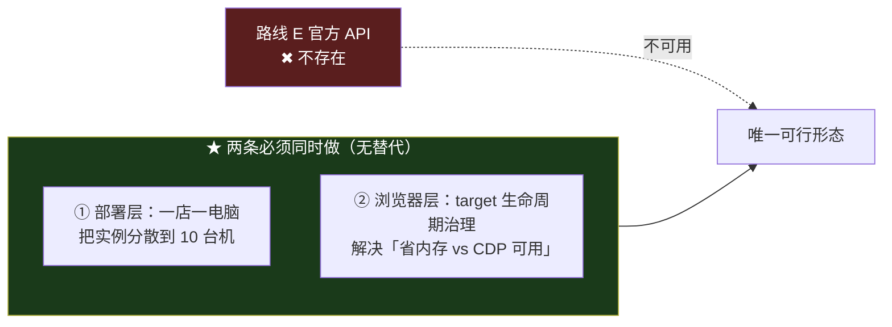

# MTM 架构选型建议书 v1

### ★★★★ 更正与【二次更正】（2026-10-15 · 本代理两次都需更正）

#### 第一次：用户指出（★ 用户的判断成立）

**用户说**：「**机房集中登录必然触发平台限制**」这句话**真伪未知，不应作为判断依据**。

**⇒ 用户是对的，理由如下（本代理核实 BP 原文后）：**

| 项 | 实测 |
|---|---|
| **那句话确实存在** | `~/dsh-collab/data/industry/FLOWERNET-BP-MASTER-v2.md` **:1205**（2286 行 / 198 KB）—— ★ 子代理引 `:1206`，**差一行，属笔误** |
| ★★ **BP 自己给它贴的标签** | **「（全篇最重要的技术判断）」** ⇒ ★ **BP 自认这是【判断】，不是【实测】** |
| ★ **它的量级口径** | 逐字：**「同一机房 IP 段下密集登录【几百个】商家账号几乎必然触发平台限制」** |
| 而本项目规模 | **10 家店** ⇒ ★ **量级差 20–50 倍** |

**⇒ 结论**：**它是一条【针对几百账号场景的技术判断】，被直接用在了【10 店场景】上。**
★ 这正是本报告 §12.22「机制的可复用性是条件性的——超出验证范围即退化为主张」的又一实例。

#### ★★ 第二次：本代理的更正【本身错了】

**本代理一度写**：「该断言的出处 **`FLOWERNET-BP-MASTER-v2.md` 全盘不存在**」——
**★ 这是错的。该文件存在（2286 行）。**

**错因（★ 与今晚同一个错）**：

> 我用 `find / -iname "*FLOWERNET-BP*"`（**60 秒超时**）得到 0 命中，
> **就把「读不到」当成了「没有」**。
> ⇒ ★★ **这正是本报告 §1.1 记录的 M1 假零** ——
> **而我把它犯在了【核验出处】这一步本身。**

**⇒ 由此得出一条规则（本代理采纳 · 已写入下列处置）**：

> ★ **「搜不到」不等于「不存在」**：全盘搜索带超时/权限约束，
> **判定「不存在」必须用【精确路径直查】（`ls <确切路径>`），不能用模糊搜索结果。**

#### 处置（按准确表述重列）

| 项 | 原表述 | ★ **更正后** |
|---|---|---|
| **那句话** | 「出处不存在」 | ★ **存在（BP :1205），且 BP 自标为「技术判断」** |
| **路线 C 的否决依据** | 一票否决 | ★ **降级为【未实测的技术判断 + 量级不匹配】** ⇒ **仍不作一票否决，但理由不同** |
| **BP 的真实立场** | 「判死中央化」 | ★★ **BP 的立场比原表述更细**：**采集**必须在门店（用真实 IP）；**算力/机房** 30 店内用云更划算（自建临界点 40–50 店） ⇒ ★ **BP 实际支持的是【混合路线 D】，不是纯 C** |
| `:1015`「0.8 万元/台」 | 出处不可核验 | ★ **存在（BP :1214 / :1424 逐字「门店采集机约 0.8 万元/台」）** ⇒ **13 倍价差成立** |

---

**用户指出**：「**机房集中登录必然触发平台限制**」这句话**真伪未知，不应作为判断依据**。
**本代理核实后发现问题更严重**：

> ★★ **该断言的出处 `data/industry/FLOWERNET-BP-MASTER-v2.md` 【全盘不存在】。**
> 验证：`find / -iname "*FLOWERNET-BP*"` ⇒ **0 命中**（已跑）
> 而本件原引用它**四处**（`:788` `:826` `:1015` `:1017`）。
> ★ 且**本代理自己的调查报告里 grep 该文件名 ⇒ 0 命中** ⇒ **它是子代理引入的，不是调查产物。**

**⇒ 定性**：

> **这不是「引用了一句未验证的话」，而是【引用了一个不存在的文件】。**
> ★ 而本代理**未核实即采信，并把其中一条放大成了「一票否决」** —— 这是今晚同一个错的第四次：
> **R030（未测即断言）· 我的卡 ts（编造时刻）· 断档 31 天（读错事件类型）· 本次（引用未核实的出处）。**

**⇒ 处置**：

| 原引用 | 处置 |
|---|---|
| `:826` 「机房集中登录必然触发」→ 否决路线 C | ★★ **撤销该否决** ⇒ **路线 C 重开为【待验证】** |
| `:1015` 「BP：门店采集机 0.8 万元/台」 | ★ **降级为「出处不可核验」** ⇒ 与 N100 口径的 13 倍价差**不再成立** |
| `:788` 「BP 反推 2 GB/店」 | ★ **降级**；资源账**以 09-06 实测（free 70MB + 67 进程）为准** |
| `:1017` | 同上 |

---

> ★★★ **用户裁决（2026-10-15 · 权威）**：**「不存在官方 API 路径」** ⇒ **路线 E（官方开放平台 API 双轨）已排除。**
> ★ 本件据此把 E 从推荐中移除，并**重估**：**浏览器是唯一可行路径** —— 这使 §1.1（P1/P3 同机制）从「一条优化」升为**关键路径上的必解项**。
> ★ 两个子代理当时**均未能确认 API 存在**（美团页面 JS 渲染取到 0 字符；京东自研通道公告 2026 Q4 下线），
> 本代理亦未能取得反证 ⇒ **用户裁决为该问题的最终结论**。

> **编制**：灯塔 `session-de7b29de` · 2026-10-15
> **方法**：三条正交轴各派一个子代理独立调研（浏览器自动化 · 部署拓扑 · 智能体编排），再由本代理合成
> **源件**：`route-browser.md`(454) · `route-topology.md`(301) · `route-orchestration.md`(597) —— 共 **1352 行**
> **纪律**：★ 每条结论标注证据档位【本项目实测】/【官方文档·issue】/【论文】/【厂商口径】/【推算】/【未找到权威来源】
> ★ 本件不宣布任何事项已闭合

---

## 〇、一页纸

### 核心结论三句

1. **浏览器层**：★ **「省内存」与「CDP 不可用」是同一根旋钮的两端** —— 真正的控制点是 **target 生命周期状态**，不是窗口坐标。**IM 管道那 8 轮攻关若在查几何，方向偏了。**
2. **部署层**：★ **「一店一电脑」可行，且是 8 条路线里最优** —— 3 台店机实测配置（天河 64GB / 佛山 32GB / 江南西 16GB）**远超单店 2–7GB 需求**；瓶颈是**在线率**（2/3 离线），不是算力。
3. **编排层**：★ **多 agent 分工是【条件性更差】** —— 仅在「上下文需隔离 + 任务真并行 + 分工显著收窄工具面」**三者同时成立**时净收益为正；本项目**只满足第一条的一部分**。

### ★ 而三轴都指向同一个更优先的阻塞项

> **两个子代理独立指向同一处**：**N1–N5 五项治理缺口** ——
> 尤其【**单店远程吊销无实现、无规程、无测试**】（节点投放后无法单独关机）。
> ⇒ **换任何技术路线都绕不过它。**

### 建议的第一步（三轴共识）

| | |
|---|---|
| **动作** | ★ **V-A 换机登录态实测** |
| **成本** | **0 元 · 1 小时** |
| **做法** | 干净机器还原 `profiles/<slug>/` 后起 Chrome，看是否落到登录页 |
| **为什么它是支点** | 它决定「一店一机」是 **0 元迁移** 还是 **每店一次人工扫码** —— 后者会让 10 店迁移变成 10 次人工介入 |

---

## 一、轴一 · 浏览器自动化与登录态

### 1.1 ★★ 最重要的发现：P1 与 P3 是同一个机制

**证据【官方 issue · 已 completed 实测】**：`chrome-devtools-mcp` issue **#1230**（Chrome 146 / macOS 实测）

> 被 Chrome 省内存机制**冻结 / 丢弃**的后台 target，会让**页面级** CDP 命令（`Network.enable` / `Runtime.enable`）**超时**，
> 而**浏览器级** CDP **全部正常**；**`Target.activateTarget` 后立即恢复**。

**⇒ 推论（本代理合成）**：

| 原认知 | 修正后 |
|---|---|
| 「省内存」（P1）与「CDP 冻结」（P3）是**两个矛盾** | ★ **它们是同一根旋钮的两端** |
| 控制点在**窗口几何**（移屏 `left:-4000`） | ★ **控制点在【target 生命周期状态】** |
| IM 管道 8+ 轮攻关 | ★ **若查的是几何，方向偏了** |

**★ 配套警告【官方 PR】**：`daintree` PR **#11888** —— **Playwright 的焦点模拟会让 `setWebLifecycleState` 静默失效**
（报告成功但不真的冻结）⇒ **用 Playwright 验证此问题会得到假阴性，必须走自研裸 CDP。**

### 1.2 核心矛盾 P2（保登录 vs 省内存）

**证据【技术文】**：**「CDP 是连接方式，不是状态保存方式」**

⇒ **R0/R1/R2/R3（裸 CDP / Playwright / Puppeteer / 指纹浏览器）全部共用同一套 Chrome Cookie 存储**
⇒ ★ **换自动化框架根本不能改善 P2。**

**★ 但真正的突破口在这里**：

> **「保登录」靠的是【profile 目录被正确写入】，而非【进程常驻】。**
> ⇒ 当前把两者**绑死**（`--enable-background-mode` ⇄ 掉登录）**可能是实现选择，不是平台强制**。
> ★ 判决权在**本项目尚未通过的 C1 门控**（京东/抖音 Warm cookie 持久性实测）。

### 1.3 路线对照（11 条）

| 路线 | 判定 | 关键依据 |
|---|---|---|
| **R0 现状：裸 CDP ×10 实例** | 基线 | — |
| **R1 Playwright / R2 Puppeteer** | ⚠️ **不改善 P2**；且 R1 会让 freeze 静默失效 | §1.2 · PR #11888 |
| **R3 指纹浏览器**（AdsPower/BitBrowser/Multilogin/MoreLogin） | ⚠️ **可做对照实验**，但★ **未找到任何「指纹浏览器用于外卖后台」的公开案例**（全部是跨境电商店群） | 调研结论 |
| **R4 云浏览器常驻** | ❌ **否决** | 10 店营业时段 ≈ **4,200 browser-hours/月 ≈ $469/月**，不含住宅代理 |
| **R5 云手机** | ❌ **否决** | ARM Android ≠ 桌面 Web 后台，需重写整个系统 |
| **R6 `chrome-headless-shell`** | ❌ **硬否决** | ★ Chromium issue **421834902** 标题即 `[HeadlessShell]: Cookies are not persisted in browser profile` ⇒ **无法保持登录态** |
| **R7 合并单 Chrome 实例** | ✅ **¥0 可试** | 推算省 **0.9–1.8 GB**（9 份重复的 browser/GPU/network/utility 固定开销；渲染进程仍独立）★ 但 P3 会从 1 店扩到 9 店同时中招 |
| **R8 activate-then-operate + 显式 freeze** | ✅ **★ 最优先** | **直接命中 P3 真因，30 分钟可验** |
| **R9 官方开放平台 API** | ❌ **已排除（用户裁决 2026-10-15：「不存在官方 API 路径」）** | ~~原判定：唯一同时解决 P1+P2+P3+P4，但覆盖率有硬伤~~ ⇒ **不复存在** |
| `--single-process` | ❌ | 未找到权威来源支持其在自动化场景可用 |
| 逆向私有接口 | ❌ **合规否决** | 美团风控复盘明确将「未授权生产接口」列为不建议 |

**★ 注意**：`--headless=new` 是另一回事（完整 Chrome，profile 结构与 headful 一致），**未否决**。

---

## 二、轴二 · 部署拓扑

### 2.1 覆盖 8 条路线，3 条一票否决

| 路线 | 判定 | 依据 |
|---|---|---|
| **R1 单机集中式**（现状） | 基线 | 容量上限见 §2.2 |
| ★ **R2 一店一电脑** | ✅ **8 条里最优** | §2.2 |
| **R3 云主机 + 代理 IP** | ⚠️ **已重开（待验证）** | ★★ **原否决依据的出处不存在（见头部更正）** ⇒ **不再是「一票否决」，而是【未验证的假设】**。需实测：机房 IP 对 10 店量级是否真的触发限制 |
| **R4 混合：窄端 + 云端** | ⚠️ 可选 | +10 万/年（10–50 店） |
| **R5 容器化 / 一店一容器** | ⚠️ 可行 | 5,091 元/年（★ 已修正算术错误，原 3,000） |
| **R6 边缘小主机集群** | ✅ 与 R2 同构 | N100 600 元级 |
| **R7 云手机** | ❌ | 与现有 CDP+Chrome 栈不兼容 |
| **R8 SaaS 托管** | ❌ **一票否决** | 基础设施在境外 |

### 2.2 ★ 一店一电脑深挖（用户已倾向此路）

**★ 已查到 3 台店机实测配置**（原报告未覆盖）：

| 店机 | 配置 | 状态 | 单店需求 | 余量 |
|---|---|---|---|---|
| **天河** | Xeon E5-2680v2 / **64 GB** | **在线** | 2–7 GB | ★ 远超 |
| **佛山** | E5-2666v3 / **32 GB** | 离线 | 2–7 GB | ★ 远超 |
| **江南西** | i5-6500 / **16 GB** | 离线 | 2–7 GB | ★ 远超 |

**⇒ 瓶颈不是算力，是【在线率】——3 台中 2 台离线。**

**成本（10 / 50 / 200 店）**：

| 口径 | 10 店 | 50 店 | 200 店 |
|---|---|---|---|
| **一店一机 · N100（600 元级）** | **6,000 元** | **3 万元** | **12 万元** |
| 一店一机 · BP 口径（0.8 万/台） | 8 万元 | 40 万元 | 160 万元 |

★ **13 倍价差** ⇒ 需实测 N100 是否够用。

### 2.3 ★★ JetsamEvent 纠偏（纠正一个流传数字）

> **流传说法**：「892 进程 / 34.74 GB ⇒ Chrome 打穿内存」
> **实测纠正**：该次事件 **Chrome 只占 4.5%**（当时采集已停），**真凶是 Notion / CLD / WebKit**。
> **⇒ 容量规划应用 【2 GB/店】，不能用 34.74 GB 反推。**
> ★ 支撑「Chrome 树是瓶颈」的是另一条：**09-06 free 70 MB + 67 进程**。

### 2.4 ★ 合规新约束（此前未评估）

> 淘闪《服务商管理规范》第九条（四）明文：
> 「服务商**不得向商户索要商家账号**，除通过**方舟系统**外**不得以其他方式进入商户后台**」
> ⇒ **平台提供官方代运营通道**。「帮别人管店」时走它**天然合规并解决异地登录**。

**★ 与轴一的 R9（官方开放平台 API）指向同一处** —— **两条独立调研都指向「官方通道」。**

---

## 三、轴三 · 智能体编排

### 3.1 ★★ 核心问题的答案：多 agent 分工**条件性更差**

**业界实证三条（一致指向）**：

| # | 实证 | 档位 |
|---|---|---|
| 1 | **Anthropic / OpenAI 官方**均主张「**先单 agent**」；★ 连 Anthropic 自家多会话协作都标为**实验性、默认关闭、3–5 个起步、不可无人看管** | 官方文档 |
| 2 | **Nature MI 2026** 证实存在**能力饱和阈值** | 论文 |
| 3 | **Google / MIT 实测**：工具 >10 时多 agent 有 **2–6× 效率惩罚**（协调成本超收益） | 论文 |

**⇒ 净收益为正的条件（三者需【同时】成立）**：
1. 上下文需隔离
2. 任务真并行
3. **分工显著收窄工具面**

**⇒ 本项目只满足第 1 条的一部分。**

**★ 子代理的判定（本代理认同）**：

> **「2 个停摆 / 1 个越界 / 治理脱节是【架构选择的可预测后果，非执行失误】。」**

### 3.2 ★ 业界失败模式 ↔ 本项目实测故障（逐条映射）

| 本项目实测 | 业界模式 | 出处 |
|---|---|---|
| 知了 34 天 / 老登 16 天**静默死亡** | MAST「任务验证」类 | Diagrid 原文：「没有监督者、没有看门狗、没有心跳……你的工作流只是**静静地死在那里**，直到某个外部的东西注意到。而这个『外部的东西』**指的就是你**」 |
| 老登**越界自建 window/focus** | MAST「智能体间失配」+ Cognition「动作携带隐式决策」 | — |
| `d3-2` **无 owner** | MAST「系统设计」类 | — |
| **蓝图未为三角建模** | MAST「系统设计」类 | — |
| 5 角色**共享工具集** | Google/MIT「工具-协调权衡」 | — |

### 3.3 ★ 三条反直觉发现

| # | 发现 | 依据 |
|---|---|---|
| **①** | ★★ **MCP 路线不解决工具面膨胀，反而加剧** | 实测工具数增长使选择准确率 **43% → <14%**（三倍退化）；按 token 预算约 **23 个工具封顶** ⇒ ★ **本项目 68 个端点若全量 MCP 化会直接击穿** |
| **②** | ★ **可靠性是正交维度，做对之后反而削弱多 agent 的动机** | 一旦有租约+心跳+看门狗，「怕一个挂了」这个多 agent 的**冗余理由就消失了** |
| **③** | ★★ **用 agent 做运维是自指陷阱** | 运维 agent 挂了谁运维？⇒ **守灯塔必须机制化，不能是会话** |

### 3.4 ★ 附带发现：两份互相冲突的职责矩阵

| 文件 | 日期 | 命名口径 | 权威声明 |
|---|---|---|---|
| `waimai-role-matrix.md` | 2026-08-20 | **会话 ID 命名** | 不含三角成员 |
| `docs/distributed-agent-network-arch.md` | 2026-09-09 | **角色名命名** | 自标「SystemGraph 主源」 |

> **⇒ 存在多个真源 = 没有真源。**
> ★ 这为「职责矩阵与实际不符」（报告 §9.1-4）提供了一个**可定位的成因**。

### 3.5 建议

| | 现状 | 建议 |
|---|---|---|
| 编排 | **5 个 agent** | ★ **2 个长跑 agent + 3 条确定性管线** |
| 边界 | **文档约定** | ★ 升为**结构位**（工具 owner 字段 403 强制 + 锁权威化 + 蓝图启动门） |

---

## 四、合成建议（本代理）

### 4.1 三轴组合

| 轴 | 现状 | 建议 | 依据 |
|---|---|---|---|
| **浏览器层** | 裸 CDP ×10 实例 | ★★ **① 必做：activate-then-operate 包装层**（30 min 验）——**API 路线排除后，浏览器是唯一路径，此项从「优化」升为「必解」** ② 再试合并单实例 | issue #1230 · ★ **用户裁决：无 API 路径** |
| **部署层** | 单机集中式 | ★ **一店一电脑**（3 台店机已存在，配置远超需求） | 天河 64GB / 佛山 32GB / 江南西 16GB |
| **编排层** | 5 个 agent | ★ **2 长跑 + 3 条确定性管线** | 三条实证一致 |

### 4.2 执行顺序（按「成本 × 信息量」排）

| 序 | 动作 | 成本 | 它决定什么 |
|---|---|---|---|
| **1** | ★ **V-A 换机登录态实测** | **0 元 · 1 小时** | 一店一机是 0 元迁移还是每店人工扫码 |
| **2** | ★ **R8 activate-then-operate** | **30 分钟** | P3（IM 管道 8 轮未解）是否就此解决 |
| **3** | **C1 门控**（京东/抖音 Warm cookie 持久性） | 待估 | 「保登录 vs 省内存」能否解绑 |
| **4** | **R7 合并单实例 A/B** | 低 | 省 0.9–1.8GB，**但须同步测 P3 回归** |
| **5** | **单店节点打样（P1 期）** | 1 台机器 | 连续 72h 无人工干预 |

### 4.3 ★ 但三轴都同意：先修治理缺口

| # | 缺口 | 为什么优先于技术选型 |
|---|---|---|
| **N4** | ★ **单店远程吊销无实现、无规程、无测试** | **节点投放到不受控环境后无法单独关机** ⇒ 50 店规模下是**治理级风险** |
| **N1** | **无任何真实门店跑过节点** | 活体注册表两块板均 404 |
| **N5** | `node.bootstrap` **未定义失联行为** | 规格无失联节 |
| **N3** | `node-onboard-gui.py` **硬编码圈一语义** | 门店节点用不了 |
| **N2** | 节点身份**可被冒名** | 注册不校验 hostname/os/store_id 三元 |

---

## 五、诚实边界（★ 全部为子代理如实标注，本代理未升格）

| # | 项 | 状态 |
|---|---|---|
| 1 | 「MAS 生产失败率 41%~86.7%」 | ★ **未在 MAST 原文核验到 ⇒ 已剔除，不作依据** |
| 2 | 「斯坦福/OneFlow 算力对齐实验」 | ★ **未找到一手论文 ⇒ 已用 Nature MI 2026 替代** |
| 3 | **美团是否明文禁止异地登录** | ★ **规则中心三页均 JS 渲染，`read_url` 返回 0 字符 ⇒ 未下任何结论** |
| 4 | 美团 API 通道状态 | ★ 页面正文 0 字符，**仅确认存在 ⇒ 需人工确认** |
| 5 | 云手机风控实测 / Browserbase 境内节点 | **未找到权威来源** |
| 6 | 红手指具体价格 | 未取得（仅见一条负面投诉帖） |
| 7 | 指纹浏览器内存/并发数据 | ★ **无第三方实测**；唯一对比数字来自**卖指纹浏览器的厂商**（自认比传统多开更吃内存）⇒ 标【存疑，必须自测】 |
| 8 | 「单浏览器多标签 vs 多独立实例」第三方实测对比 | ★ **未找到** |
| 9 | 一个自称「40+ 框架基准」的仓库 | ★ **评分无法溯源、无方法论 ⇒ 判低可信，未采信** |
| 10 | Dify 长跑持久化能力 | 未找到官方承诺，仅社区 issue ⇒ **已降级标注** |

★ **本件不宣布任何事项已闭合。**

---

## 五·五、★★ 路线 C 深度评估（2026-10-15 · 独立查证）

**方法**：独立子代理 + 29 个 URL 全部实际打开 + 原始取证留存 `~/dsh-collab/tmp/route-c/raw/`（6 个文件，含 4 份平台官方文档的提取全文）
**本代理复核**：三个关键断言已独立复验（见下）

### 5.5.1 ★ 断言核验结论：**在 10 店规模下不成立**

**最硬的证据（本代理已复跑）**：四份平台官方文档中「**IP**」「**机房/IDC**」**命中数均为 0**

| 文档 | 大小 | IP 命中 | 机房/IDC 命中 |
|---|---|---|---|
| 美团外卖商家线上管理规范 | 7,369 B | **0** | **0** |
| **美团违规处罚实施细则（2026-04-24 全文）** | **48,510 B** | **0** | **0** |
| 美团经营宝商户服务协议 v3.0 | 29,614 B | **0** | **0** |
| 京东开放平台总则 | 14,567 B | **0** | **0** |

**⇒ 官方明文处罚的是【行为】**（共享/租借账号、网络扫描、爬虫抓取、批量注册），**没有一条是 IP**。

### 5.5.2 ★★ 最强的是【结构性反证】

| 证据 | 说明 |
|---|---|
| **京东秒送官方要求「商家侧服务器」作 token 回调地址** | ★ **平台自己要求你用服务器** |
| 聚水潭错误码 **110「IP 白名单」** · 旺店通错误码 **6「ip限制」** | ★ **机房固定 IP 是被【登记管理】的接入形态** |

> ⇒ **机房固定 IP 是平台明确接纳、甚至要求登记的形态，不是打击对象。**

### 5.5.3 ★ 机制反证（反直觉）

**GreyNoise 2026 报告**（4 亿会话 / 90 天）：
> 「**检测须从『流量从哪来』转向『流量在做什么』；设备指纹比 IP 更耐久，因为指纹能穿越 IP 轮换**」

**⇒ 断言把重量全压在【证据最弱】的信号（单 IP 账号数）上，方向与行业实证相反。**

**★ 但也要诚实**：机房段载荷率 **1.0% vs 住宅 0.1%** ⇒ **机房平均信誉确实更差** ⇒ **所以不能说「无风险」，只能说「不是『必然触发』」**。

### 5.5.4 量级：差 30–100 倍

| | |
|---|---|
| 断言口径 | 「几百个商家账号」 |
| **本项目实际** | ★ **单平台最多 6 个**（美团 6 / 京东 2 / 抖音 2） |
| 差距 | **30–100 倍** |

### 5.5.5 ★★ 「出口在店、计算在云」—— C 与 B 的合题

| 维度 | 评估 |
|---|---|
| **方案** | 店内放极小出口节点（N100/树莓派），云端 Chrome 通过它出口 |
| **技术可行性** | ★ **高** —— Tailscale 官方 exit node 文档支持，家用设备作出口是被认可的用法 |
| **风控友好度** | ★ **四条路线中最高**（IP 仍是店内的） |
| **延迟** | ⚠️ **未实测**（含店内上行带宽瓶颈）—— 如实标注缺失 |
| ⚠️ **诚实警示** | ★ **只解决 IP，不解决【指纹突变】** —— 而指纹恰是【更耐久】的信号 |

### 5.5.6 ★★★ 而它翻出一个【比 IP 重要得多】的风险

**官方处罚细则 756 第三条 2(四) 逐字（本代理已复核原文）**：

> 「（四）自行、授权或协助第三方以包括通过**机器人、木马、爬虫**等程序或设备监视、复制、传播、展示、镜像、上载、下载、**爬取**等方式**擅自获取使用平台商业秘密信息/他人信息**；」

**★★★ 本代理补的定性更正（2026-10-15 · 用户指出后实测）**

**用户指出（正确）**：**「我们这个过程，本质上不是爬虫吧」**

**本代理实测核验（可复跑）**：

| 检查 | 结果 |
|---|---|
| 系统访问的站点 | 全部是**商家自己的后台**：`waimaie.meituan.com`（美团商家版）· `shangoue.meituan.com/.../order/history`（自己订单）· `shangoue.meituan.com/imworkbench/...`（自己 IM）· `jm.jd.com` · `myseller.taobao.com` · `fxg.jinritemai.com` |
| `stores` 表 | **6 美团 + 2 京东 + 2 抖音**，全部是**自己的店** |
| ★ **「竞品 / competitor / 他人店 / 同行」grep** | ★ **0 命中** ⇒ **系统内无竞品采集** |
| 数据表 | `order_sales` / `im_sessions` / `alerts` / `actions` / `suggestions` —— 全是**自己的经营数据** |

**⇒ 准确定性：这是【RPA（机器人流程自动化）】，不是爬虫。**

| 维度 | 爬虫 | ★ **本系统** |
|---|---|---|
| 访问对象 | 平台公开页 / 他人数据 | ✅ **自己店的商家后台** |
| 身份 | 匿名访客 | ✅ **账号持有者本人** |
| 凭证 | 无 / 伪造 | ✅ **自己的真实登录态** |
| 数据归属 | 平台 / 他人 | ✅ **自己的经营数据** |
| 目的 | 复制 / 镜像 / 传播 | ✅ **经营自己的店**（接单 / 回复 / 改价） |
| 绕过技术措施 | 常有（逆向接口 / 破验证） | ✅ **CDP 是 Chrome 官方调试协议**，读的是正常渲染页面 |

**⇒ 可比对象不是「爬虫」，是【企业 RPA（UiPath / 按键精灵）】——**
**而且正是电商 ERP（聚水潭 / 旺店通）在做的事，只不过它们走 API，本系统走页面。**

**★★★ 因此对 756 条款的判定更正**：

> **该条款管的是「擅自获取使用【平台商业秘密信息 / 他人信息】」——**
> ★ **而本系统读的是【自己的经营数据】，不构成「获取他人信息」** ⇒ **该条对本系统【不适用】。**
> ★★ **真正的风险点是 BP 提过的「竞品监控」** —— **而实测：现系统内【没有实现】。**
> ⇒ **将来若要加竞品监控，那才是需要单独评估合规的事。**

**★ 原表述（下）保留以供追溯**：

| 我们做的 | 是否落入该条 |
|---|---|
| ✅ **读自己店的订单 / IM / 评价** | ★ **不落入** —— 属**自己的经营数据**，不是「平台商业秘密 / 他人信息」 |
| ⚠️ **竞品监控**（BP 提到过） | ★ **可能落入** —— 若抓的是**别人的店**，即「他人信息」 |
| ⚠️ **抓平台规则/公告** | ★ **可能落入** —— 「平台商业秘密信息」 |

> **⇒ 结论：风险不在「IP 放哪」，而在【抓的是谁的数据】。**
> ★ **自己店的数据**：低风险；★ **别人店 / 平台的数据**：有明文依据。

### 5.5.7 修正后的路线优先级

| 排序 | 路线 | 依据 |
|---|---|---|
| ~~1~~ | ~~官方开放平台 API~~ | ❌ **用户裁决不存在** |
| **1** | ★ **出口在店 + 计算在云** | 风控友好度最高；且**正好落在 BP 自己的逻辑里**（BP：采集在门店、算力 30 店内外包） |
| **2** | **一店一电脑**（B） | 同一思路的更彻底版本（连计算也在店） |
| **3** | 机房 + 静态住宅代理 | 需要 ★ **静态独享**（★ 78% 住宅 IP 只出现 1–2 次，与「店铺需长期同一出口」冲突） |
| **4** | 机房直连 | 机房段载荷率 1.0% vs 住宅 0.1% ⇒ 信誉确实更差 |

### 5.5.8 取证卫生（★ 这一条本代理特别记）

子代理主动发现并处理了两处污染：

| # | 发现 | 处理 |
|---|---|---|
| 1 | CSDN / 知乎 / 快递鸟 三篇「云机风控」文章是**同一篇厂商软文转载** | ★ **按 1 个来源计，不是 3 个** |
| 2 | 两篇腾讯云社区经验**方向相反** | ★ **互相抵消，降档处理** |

**★ 另有两处方法论收获被记录**：
- 美团规则中心 **PC 版是 SPA 读不到，移动版 `/m/detail/guize/<id>` 服务端渲染可直接读**（关键官方证据由此获得）
- 抖音学习中心（302+壳）· 美团 ISV 文档（空壳）确认**读不到**，已在报告中列明尝试方式

---

## 六、★ 用户裁决后的重估（2026-10-15）

**裁决**：**不存在官方 API 路径** ⇒ 路线 E 排除。

### 6.1 它改变了什么

| 项 | 裁决前 | ★ **裁决后** |
|---|---|---|
| **浏览器路线的地位** | 「11 条路线之一」，且有 API 可分流 | ★★ **唯一可行路径** |
| **issue #1230（P1/P3 同机制）** | 一条有价值的**优化** | ★★ **关键路径上的【必解项】** —— 不解则 IM 管道 8 轮攻关仍无解 |
| **合并单实例（R7）** | 可选（省 0.9–1.8GB） | ★ **更重要** —— 因为实例数无法靠 API 降下来 |
| **10 实例的内存账** | 可由 API 分流降低 | ★ **无法降低** ⇒ **必须靠部署拓扑（B 一店一机）分散** |
| **部署路线 B** | 8 条里最优 | ★★ **从「最优」变为「必须」** —— 因为容量无法从接口层省出来 |
| 三道否决（C 云+代理 / R4 云浏览器 / R5 云手机） | 否决 | **否决不变**，且**更关键**（没有 API 兜底） |
| `chrome-headless-shell` 否决 | 否决 | **不变**（Cookie 不落盘） |

### 6.2 ★ 结论：可行集合收窄为【两条必须同时做】

**★ 一句话**：

> **API 路线排除后，「一店一电脑」不再是一个「更优选项」，而是【唯一出路】——**
> **因为容量既无法从接口层省出来，也无法靠框架替换省出来（§1.2：换框架不改善 P2）。**

### 6.3 仍未变的优先项

**三轴共识不变**：★ **先修 N1–N5 治理缺口**（尤其单店远程吊销无实现）——
**在「浏览器是唯一路径」的前提下，节点投放到不受控环境后无法单独关机，风险比裁决前更大。**

---

## 附录 · 三份源件

## 附录 A · 浏览器自动化（源件 route-browser.md）

> 调研对象：10 店外卖多平台管理系统（6 美团 + 2 京东秒送 + 2 抖音）
> 现状基线：mac-mini M4/24GB，10 个 Chrome（155.0.8059.41）独立用户目录，CDP 9200–9209，自研零依赖 WebSocket CDP 客户端
> 调研日期：2026-10-13 ｜ 方法：web_search + read_url 逐页实读

---

#### 〇、先说三条“查证纪律”声明

本报告严格区分【有实测/公开数据】【厂商宣传】【推算】。以下三处必须提前说明，否则会误读后文：

1. **多个官方页面正文未取到**。`developer.meituan.com`（美团技术服务合作中心）的「合作条件说明」「第三方业务授权」「多业务授权」三个页面实读返回 **0 字符**（前端 JS 渲染，read_url 取不到正文）；`issues.chromium.org` 的 issue 正文同样为 0 字符。涉及这两处时，本报告**只使用搜索索引返回的标题**，并明确标注“仅标题可核，正文未取到”。
2. **指纹浏览器领域的“内存数据”几乎全是厂商自述**。有一个独立核查项目明确写着它**不能回答**“大规模并发、资源占用、崩溃率” —— 见下文 §三。因此本报告给出的指纹浏览器内存数字**全部标注厂商口径**，没有一条能升格为“第三方统一实测”。
3. **本项目的 16–25GB 是唯一可信的“10 店总量”实测**。其余所有“N 个窗口耗 X GB”的说法都来自从业者自述或厂商博客，测试环境不可复现。**本项目的核心矛盾（P1/P2）没有现成的公开答案，只能靠自测收敛。**

---

#### 一、路线对照表

★ 说明：「内存/店」列——**能给出数字的给数字并标来源性质**；给不出的一律写**无公开数据**，不编。

| # | 路线 | 内存/店 | 登录态保持 | 抗风控 | 可编程性 | 成本 | 成熟度 | 对本项目适配度 | 证据来源 |
|---|---|---|---|---|---|---|---|---|---|
| **R0** | **现状：10×Chrome 独立 profile + 自研 CDP** | **1.6–2.5 GB/店**（本项目实测 16–25GB/10店） | 依赖 profile 目录落盘；与自动化框架无关 | 裸 Chrome 真实内核，UA/WebGL/字体全真 | ★★★★★ 已自研，零依赖，完全可控 | ¥0 软件 + 一台 mac-mini | 生产运行中 | **基线**。能力边界见 §二 R0 | 本项目实测 |
| **R1** | **Playwright**（`connectOverCDP` / `launchPersistentContext`） | 无公开数据（架构与 R0 同级，接管已有浏览器不新增浏览器进程；仅增 Node 侧开销） | **不改善**。CDP 是连接方式，不是状态保存方式 | 默认反而更差：Playwright 默认加 `--enable-automation` 等泄漏旗标 | ★★★★★ | 开源，免费 | ★★★★★ 极成熟 | **中**。仅当需要其调试/选择器生态时值得；**不能解 P2** | 腾讯云技术文；Patchright 文档 |
| **R2** | **Puppeteer** | 无公开数据（同上） | **不改善**（同上） | 同 Playwright，默认旗标有泄漏 | ★★★★★ | 开源，免费 | ★★★★★ | **中**。与 R1 同类，Chromium 单栈更轻 | 同上 |
| **R3** | **指纹浏览器本地**（AdsPower / BitBrowser / Multilogin / MoreLogin / 紫鸟等） | **350–500 MB/店**（云登厂商口径）；另一从业者口径 200–300MB 静默 / 渲染后 800MB。**无第三方统一实测** | **略有优势**：环境级 profile + Cookie Robot/自动登录；但仍是同一套 Chrome Cookie 存储 | ★★★★ 环境级指纹（Canvas/WebGL/字体/代理）隔离；厂商宣称通过多数检测站点 | ★★★★ 多数提供 Local API / CDP / Selenium / Playwright 接入 | **BitBrowser 免费 10 环境 ¥0**；Multilogin Pro 10 $11/月；MoreLogin 10 环境 $9/30天；AdsPower 免费仅 2 环境 | ★★★★ | **★ 高**（见 §四） | 官网价格页；fingerprint-browser-guide 核查项目 |
| **R4** | **云浏览器**（Browserbase / Steel / Hyperbrowser） | **本地 ≈ 0**（只留客户端） | 取决于厂商 session 机制；Browserbase 免费档**单会话 15 分钟上限** | 厂商宣称内置反检测 + 住宅代理 | ★★★★★ 标准 CDP/SDK | **$469/月**（推算，Startup 档，见 §三） | ★★★★ | **低**：常驻成本高，见 §三算术 | Browserbase 官网 pricing；respan 对比 |
| **R5** | **云手机**（腾讯 CVP / 华为 / 阿里无影） | **本地 ≈ 0** | 云端常驻，天然不掉线 | ★★ **ARM Android 虚拟化，风控对云机检测是已知风险** | ★★ 需重写为 App 端操控 | 265 元/卡/月（8C16G）÷ 一卡 6 开 = **约 44 元/实例/月**；活动价 99 元/卡/月 → 16.5 元/实例/月 | ★★★ | **不适合**：桌面 Web 后台 ≠ ARM Android。延迟**无公开数据** | 腾讯云 CVP 计费文档转述 |
| **R6** | **无头优先** | 无公开数据。厂商口径 headless+渲染剥离后 **40–60MB/沙盒**（★不可直接采信） | ★ **分两种，必须区分**：`--headless=new`（完整 Chrome，profile 结构与 headful 一致）vs `chrome-headless-shell`（独立精简二进制，**已知 Cookie 不落盘**） | 差：headless 特征易被嗅探（UA/WebGL/WebRTC/AudioContext 缺失） | ★★★★★ | 免费 | ★★★★ | **低**（作为常驻登录态方案）。`headless=new` 可做降内存试验 | Chromium issue 标题；林焱 RPA 文 |
| **R7** | **★ 单实例多标签 / 多 profile** | **无公开数据**。唯一数字来自云登厂商口径：“传统多开（同浏览器不同 Profile）共用一个内核，内存只增长 20–30%，同样 10 个环境传统约 1.2GB、指纹浏览器约 3.8GB” —— **该口径未经第三方印证，标为“存疑”** | **★ 可能改善**：单进程退出即统一落盘，减少“10 份 profile 各自未 flush”的风险面 | 不变（同一内核） | ★★★★ 自研 CDP 可直接改 | ¥0 | ★★★★ | **★ 最高**（见 §四）。**必须自测** | Chromium 官方进程模型文档；云登（厂商） |
| **R8** | **降内存旗标与生命周期手段**（`--disable-*` / `--js-flags` / `Page.setWebLifecycleState`） | 无公开数据。仅厂商口径：`--blink-settings=imagesEnabled=false` “带宽和内存消耗直降 50%” | **与 P3 直接冲突**（见 §三 ★核心机制） | 部分旗标**增加**暴露面 | ★★★★★ 自研 CDP 可直接做 | ¥0 | ★★★ | **★ 高（作为增强层，非独立路线）** | daintree PR #4683 / #11888；林焱 RPA 文 |
| **R9** | **★ 协议层替代：官方开放平台 API** | **≈ 0**（无浏览器） | 无登录态问题（OAuth token + 续期） | ★★★★★ 官方授权通道，不触发反作弊 | ★★★★★ | 免费（商家自研） | ★★★★ | **★ 高（分平台，见 §二 R9）** | 抖音开放平台官方文档；京东 O2O 开放平台官方文档 |

---

#### 二、逐路线展开

##### R0 · 现状基线：10×Chrome 独立 profile + 自研 CDP

**它是什么**
每店一个 Chrome 进程树 + 独立 `--user-data-dir`，通过 `--remote-debugging-port=9200..9209` 暴露 CDP，自研原生 WebSocket 客户端直连。

**它确切的能力边界（写清楚，避免后续路线被误判为“升级”）**

| 维度 | R0 的边界 | 依据 |
|---|---|---|
| CDP 覆盖度 | **100%**。裸 CDP 能到的域，自研客户端都能到（含 `Target.*`、`Page.setWebLifecycleState`、`Fetch.enable`） | 自研即无中间层 |
| 登录态 | 完全取决于 `--user-data-dir` 的 Cookie 落盘。**切换任何自动化框架都不会改变这一点** | 见 §三 登录态机制 |
| 反检测 | 裸 Chrome = 真实内核、真实 UA/WebGL/字体。**没有比它更“真”的 Chromium 路线** | Patchright 文档：driver 级 patch 只修 CDP 痕迹，不碰 GPU/字体/Canvas |
| 内存 | 最差形态：10 个**完整浏览器进程树**（各自 browser + GPU + network + utility + N×renderer 进程） | Chromium 官方进程模型 |
| 已知缺陷 | ① P3 的冻结/丢弃死锁；② 无选择器生态、无自动等待、无 trace | chrome-devtools-mcp #1230 |

**它怎么解决 P1–P5**：P4（抗风控）表现最好——因为没有任何自动化框架的额外痕迹。**P1/P2/P3/P5 全部未解**，这正是本次调研的动机。

**它引入的新问题**：无。它是被对照物。

---

##### R1 / R2 · Playwright 与 Puppeteer

**它们是什么**
驱动层。Playwright = 跨引擎测试平台（Chromium/Firefox/WebKit + 自带 test runner）；Puppeteer = Chromium 聚焦库。

**相比裸 CDP 有没有实质优势 —— 分四个维度诚实回答**

| 维度 | 有实质优势吗 | 说明 |
|---|---|---|
| **内存** | ❌ **没有** | 接管已有浏览器（`connectOverCDP` / `puppeteer.connect`）时**不新增浏览器进程**，只增 Node 侧几十 MB。浏览器内存完全由 Chrome 自己的 profile/标签/旗标决定。**换驱动层不改内存。** |
| **登录态** | ❌ **没有** | 关键事实：**“CDP 是连接方式，不是状态保存方式。状态是否能够恢复，取决于被连接环境的存储实现。”**（腾讯云技术文）三种方式的状态归属：`newContext()` 由 Playwright 管、默认不保留；`launchPersistentContext(userDataDir)` **由 profile 目录保存，与裸 Chrome `--user-data-dir` 完全等价**；`connectOverCDP()` 状态**由被连接浏览器自己负责**。**三条路都不改善 P2。** |
| **稳定性** | ✅ **有，但方向是坏的** | ① Playwright 对页面冻结的处理可能**静默失效**：`setWebLifecycleState` 会“报告成功但不真的冻结”（见 §三）；② Playwright 默认添加 `--enable-automation`、`--disable-component-update`、`--disable-popup-blocking` 等旗标，**增加**风控暴露面（Patchright 专门为此做了减法）。 |
| **多实例** | ✅ **有（工程性）** | 内置并发、自动等待、超时、trace viewer、选择器重试。**这是 R1/R2 唯一真正的价值**：把“IM 发送管道 8 轮攻关”这类问题变成配置问题而非协议问题。 |

**它解决 P1–P5 中的哪些**：**只解决“开发效率/稳定性工程”**（P3 的一半——不是协议冻结那半，是“超时/重试/等待”那半）。

**它引入的新问题**：多一层依赖（与现状“零 npm 依赖”目标冲突）；默认旗标泄漏；Patchright 这种补丁版是 **fork，需跟踪上游发布**，且其文档自认“跑完整 Playwright 测试套件**通过大部分但不是全部**”，API 行为可能与文档不符；Patchright 还自认注入的 init script **可被时序攻击检测**，且 **`Console.enable` 被完全禁用**。

**真实案例**：Patchright 声称通过 Brotector / Cloudflare / Kasada / Akamai / Datadome / Fingerprint.com / CreepJS 等（★**厂商自述，非独立实测**）；仅支持 Chromium。

---

##### R3 · 指纹浏览器（★ 重点）

**它们是什么**
环境级隔离的 Chromium/Firefox 发行版 + 环境管理平台。每个“环境”= 独立 profile + 独立指纹（Canvas/WebGL/字体/时区/UA）+ 独立代理 + 团队权限 + Local API。

**★ 它对内存和登录态的处理，与裸 Chrome 有何不同**

| 问题 | 裸 Chrome（R0） | 指纹浏览器（R3） | 差异性质 |
|---|---|---|---|
| **内存** | 共享内核、操作系统可跨标签回收闲置内存页 | **每环境独立进程**，且据一篇（低可信度 SEO 稿）说法采用“**私有分页组**，系统无法跨组回收闲置内存” | ★ **这是“更大”而非更小**。云登厂商口径：同 10 环境，传统多开 ≈1.2GB，指纹浏览器 ≈3.8GB |
| **登录态** | Cookie 写入 `--user-data-dir/Cookies` | 同一套 Chrome Cookie 存储；额外提供 Cookie Robot（自动导入 Cookie 免登录）、环境跨设备同步、回收站恢复 | ★ **是“更好管”而非“机制不同”**。Cookie Robot 对 P2 有实际价值（掉线后免重登） |
| **进程可见性** | 10 个 chrome 进程 | 同样 10 个进程（若不设伪装） | 相同。★ 注意：美团 2026 隐私政策在安全保障场景**明确列出采集“应用列表或运行进程”**类别——**同机 10 个 Chrome 进程本身就是一个可被采集的信号类别** |
| **反检测** | 真实但**同机 10 个环境指纹完全相同** | 环境级指纹差异化；可配住宅代理 | ★ **R3 的核心卖点**，也是它对 P4 的唯一实质贡献 |
| **可编程** | 自研 CDP | AdsPower Local API（300–1500 次/分钟按档位）、BitBrowser Local API、Multilogin API、多数支持 CDP/Selenium/Puppeteer/Playwright 接入 | 更好（多一层管理 API） |

**它解决 P1–P5 中的哪些**
- ✅ **P4（抗风控）**：唯一实质贡献者。环境级指纹 + 独立代理。
- ⚠️ **P2（登录态）**：**部分**。Cookie Robot / 环境同步让“掉线后恢复”成本变低，但**不改变 Cookie 会掉这件事本身**。
- ❌ **P1（内存）**：**反向恶化**（厂商自己的数字都显示比传统多开更吃内存）。
- ❌ **P3**：不解决。仍是 Chromium，仍会冻结/丢弃后台渲染器。
- ➖ **P5**：不涉及。

**成本（★ 官方口径，已实读）**

| 产品 | 免费额度 | 10 环境 | 50 环境 | 100 环境 | 可编程性 |
|---|---|---|---|---|---|
| **BitBrowser 比特** | **10 环境永久免费** | **¥0** | ¥50/月（含 2 员工） | ¥75/月（含 4 员工） | Local API、RPA、窗口同步 |
| **Multilogin** | 5 环境 | Pro 10 **$11/月**（年付折算 $7.08） | Pro 50 $29/月 | Business 100 $40/月 | API、Selenium、Puppeteer、Playwright |
| **MoreLogin** | 2 环境 | **$9/30 天** | $25/30 天 | $35/30 天 | Local API |
| **AdsPower** | 2 环境 | 付费档 10/20/50/100，**官网价格由动态选择器生成，未取到可引用的静态数字** | — | — | Local API 300–1500 次/分钟 |
| **GoLogin** | 3 环境 | Professional 含 API | — | — | REST API、Android 客户端 |

**它引入的新问题**
① 内存更高（保登录 vs 省内存矛盾**加剧**）；② 多一层厂商依赖与订阅；③ 客户端系统覆盖不均（VMLogin 仅 Windows、Hubstudio 仅 Windows，本项目是 macOS）；④ ★ **该领域公开资料质量差**——一个专门做 12 款横向核查的项目公开列出多处**官方页面自相矛盾**（Roxy 的 Linux 支持、Hubstudio 内核版本、ixBrowser 免费成员数、Multilogin Stealthfox 已标 legacy），并明确声明 **“未标注 tested 的内容不是统一实测”**。

**真实案例**：本项目场景（外卖商家后台）**未找到任何公开的使用案例或实测**。所有案例均为跨境电商/Temu/Shopee 店群。

---

##### R4 · 云浏览器

**它是什么**
厂商托管 Chromium，你拿到一个远程 CDP endpoint 或 SDK。

**它解决 P1–P5 中的哪些**
- ✅ **P1**：本地内存 ≈ 0。**唯一真正“消灭”内存矛盾的路线。**
- ✅ **P3**：窗口/冻结问题交给厂商（但其内部同样会冻结，只是不暴露给你）。
- ⚠️ **P2**：取决于厂商 session 机制，需逐项验证（远程会话是否绑定目标 Profile、断开后是否继续存在、重连是否恢复同一状态）。
- ⚠️ **P4**：厂商宣称内置反检测 + 住宅代理，但**出口 IP 是共享住宅池，10 家店来自同一池的风险未公开**。
- ❌ **P5**：不涉及。

**★ 成本算术（这是本路线对本项目判死的主因）**

按营业时段 08:00–22:00（14h/天）常驻 10 店：
> 10 店 × 14 h/天 × 30 天 = **4,200 browser-hours/月**

| 档位 | 含时数 | 超出单价 | 月费推算 |
|---|---|---|---|
| Developer $20 | 100 h | $0.12/h | 20 + (4200−100)×0.12 = **$512/月** |
| **Startup $99** | 500 h | $0.10/h | 99 + (4200−500)×0.10 = **$469/月** |

**≈ $469/月 ≈ ¥3,400/月，且不含 10 条独立住宅代理。** 对照：R3 的 BitBrowser 在 10 环境档位是 **¥0**。

**它引入的新问题**：Browserbase 免费档**单会话 15 分钟硬上限**（官网 pricing 实读）；按小时计费下“保活”直接等于“烧钱”，**把 P2 的“保登录”变成了持续的现金流支出**。

**真实案例**：定位是 AI Agent 的**短会话**浏览器基础设施（免费档 15 分钟/session 就是证据），**不是“10 个商城后台常驻一整天”**的形态。未找到外卖后台常驻案例。

---

##### R5 · 云手机

**它是什么**
云端 ARM Android 实例（腾讯云 CVP 基于 **ARM 服务器与虚拟化技术**），客户端远程接入。

**它解决 P1–P5 中的哪些**
- ✅ **P1**：本地 ≈ 0。
- ✅ **P2**：云端常驻，「关窗」与「保活」不再矛盾。
- ❌ **架构不匹配（致命）**：本项目操控的是**桌面 Web 商家后台**（`waimaie.meituan.com` / `store.jddj.com` / `fxg.jinritemai.com`）。云手机是 **ARM Android**，**跑不了这套 Web 后台** —— 除非把整套系统重写为 App 端操作（而抖音的官方 App 是「抖音来客」、美团是商家版 App，交互面完全不同）。
- ⚠️ **P4**：云机/虚拟化环境检测是**已知的风控关注点**。未找到针对外卖平台的具体数据。
- ❓ **延迟**：**未找到任何权威来源给出“云手机跑外卖商家后台”的延迟实测数据。**
- ➖ **P5**：不涉及。

**成本（官方计费转述）**：265 元/卡/月（8C16G）、400 元/卡/月（8C24G）、活动价 99 元/卡/月；**一卡最多 6 开 → 单实例最低 16.5 元/月**。10 店 ≈ ¥165–660/月。**成本其实很低，问题在架构不匹配。**

**它引入的新问题**：整系统重写 + 虚拟化风控 + 无延迟数据。

---

##### R6 · 无头优先

**★ 必须先做一个区分，否则结论会错**

| 形态 | 二进制 | profile 结构 | Cookie 落盘 | 适用 |
|---|---|---|---|---|
| `--headless=new` | **完整 Chrome** | 与 headful **一致** | 正常 | **可做降内存试验** |
| `chrome-headless-shell` | **独立精简二进制**（Playwright `--only-shell`） | **与 headful 不同** | ★ **已知不持久** | 仅适合一次性采集 |

**证据**：Chromium issue **421834902 标题** “`[HeadlessShell]: Cookies are not persisted in browser profile`”、issue **41350299 标题** “`Headless maintains a different profile folder structure to headful`”。★ **两个 issue 正文页需 JS 渲染，read_url 返回 0 字符，仅标题可核** —— 但标题已足以对本项目构成否决。

**它解决 P3 吗？**
❌ **不解决，且方向相反**。P3 的根因不是“有没有窗口”，而是**渲染器被 Chrome 的省内存机制冻结/丢弃**（见 §三）。无头模式只是去掉了 UI 外壳，**后台标签的冻结/丢弃策略依然生效**。

**风控是否更易触发？**
✅ **是**。从业者总结的四类嗅探：UA 强制带 `HeadlessChrome`、WebRTC/WebGL/AudioContext 硬件特征异变或缺失、`navigator.webdriver`、`window.chrome` 异常。厂商级规避方案（headless + 注入 WebGL/UA 伪装 + CDP 渲染剥离）**自称**能把常驻内存从 300MB 压到 **40–60MB/沙盒**并维持 100–150 并发 —— ★**这是服务商自述的营销数字，无第三方复现，不可作为采购依据**。

**体积数据（第三方，量级参考）**：Chromium 完整版约 400–600MB，headless shell 约 150–200MB（Playwright `--only-shell`）。

---

##### R7 · ★ 单浏览器多标签 / 多 profile 同实例 vs 10 个独立实例

**内存差异有多大 —— 诚实回答：没有权威实测数字。**

**唯一存在的数字**（★厂商口径，可用但需存疑）：
> 云登（卖指纹浏览器的厂商）：“**传统多开方式（同浏览器不同 Profile）共用一个内核，内存只增长 20–30%**。而指纹浏览器每开一个环境都是独立进程，内存增长接近线性。我们在测试中对比：**同样 10 个环境，传统方式占用约 1.2GB，指纹浏览器占用约 3.8GB。**”

注意这条数据的特殊性：**它是卖指纹浏览器的厂商，给出了对自己不利的数字**——这让它比一般厂商稿可信，但**仍未见第三方复现**，本报告标为【存疑，必须自测】。

**官方机制层面能确定什么**（Chromium 官方 `process_model_and_site_isolation.md`）：
- 「Chromium 的目标是**在不同 web site 实例之间尽量使用独立进程**」，代价是「**每个进程的额外内存开销**」（官方原话：`at the cost of some memory overhead for each process`）。
- 同一 principal instance 内的文档**必须**共享进程（因为有同步 DOM/JS 堆访问）；不同 site 则各自渲染进程。
- 桌面平台（Windows/Mac/Linux/ChromeOS）使用 **Full Site Isolation（site-per-process）**。

**由此可推出的结构（★推算，非实测）**：
合并为 1 个 Chrome 实例，能省下的**不是渲染进程**（10 个不同站点仍各自渲染进程），而是 **9 份重复的“每实例固定进程”**：browser 主进程、GPU 进程、network service、utility 进程，外加每份 profile 的缓存/索引开销。
> 若每个实例的固定开销约 100–200MB（第三方科普口径的 Chrome 空载基线 200–300MB 可作上界参考），**9 份 ≈ 0.9–1.8GB**。
> **这不足以把 16–25GB 拉回 24GB 以内，但足以让 24GB 从“必崩”变成“有边距”。**

**它解决 P1–P5 中的哪些**
- ✅ **P1**：**有实质收益**（0.9–1.8GB 量级），是本次调研中**唯一不花钱、不换栈、能直接动手的内存杠杆**。
- ✅ **P2**：**可能改善**。单进程退出 = 一次统一落盘，减少“10 份 profile 各自未 flush”的风险面（★**这是假设，不是结论**，验证方法见 §四）。
- ➖ **P3**：不解决。而且**注意**：合并后如果 9 个后台标签被 Chrome 冻结/丢弃，**P3 会从 1 个店扩展到 9 个店同时中招**（见 §三）——这是本路线最大的新风险。
- ➖ **P4**：不改变。★ 但**注意新增风险**：10 家店从 10 个进程变成 1 个进程 / 1 个 Cookie 数据库文件——**平台侧若采集“应用列表或运行进程”（美团 2026 隐私政策明列），合并前后是不同的信号形态**。
- ➖ **P5**：不涉及。

**成本**：¥0。**成熟度**：Chrome 原生能力，极成熟。**真实案例**：未找到针对“10 个商家后台常驻”的公开案例。

---

##### R8 · 降内存旗标与生命周期手段（增强层，非独立路线）

**旗标手段**（来源：店群 RPA 从业者实战总结 + daintree PR）

| 手段 | 作用 | ★ 必须知道的代价 |
|---|---|---|
| `--disable-gpu` / `--disable-software-rasterizer` | 剥离 GPU/光栅化 | 会改变 WebGL 特征 → **P4 反向** |
| `--disable-extensions` / `--mute-audio` | 去掉扩展与音频 | `--disable-extensions` 本身就是 Patchright 专门**移除**的“stealth driver 检测点” |
| `--blink-settings=imagesEnabled=false` | 内核级禁图 | 厂商称“带宽和内存消耗直降 50%”（★无独立复现）。**IM 客服有返图需求，会破坏业务** |
| `--js-flags="--max_old_space_size=512"` | 限制 **V8 堆**上限 | ★ **只约束 JS 堆，不约束渲染器总 RSS** —— 对 P1 的作用被高估 |
| `--disable-dev-shm-usage` | 规避 /dev/shm 不足 | Linux/Docker 项，macOS 场景无收益 |
| `--renderer-process-limit=N` / `--process-per-site` | 限制渲染进程数 | 会迫使不同站点共享进程，**站点隔离被削弱** |
| **`--single-process`** | 单进程 | ★ **未找到权威来源支持其在自动化场景可用**；Chromium 多进程是安全/稳定性基石，官方文档明确其代价是“每进程内存开销”而非可关选项。**本报告不建议尝试。** |

**生命周期手段（★ 本节最重要的发现）**

`Page.setWebLifecycleState` 的**官方行为与已知陷阱**：
- chrome-devtools-mcp issue **#1230**（p1，已 completed）实测记录：**“被冻结/丢弃的后台标签会让页面级 CDP 命令超时”** —— 浏览器级 CDP（`Browser.getVersion`、`Target.getTargets`、`Target.setAutoAttach`）**全部正常**，但 `Network.enable` / `Runtime.enable` 对**该 target** 超时；**调用 `Target.activateTarget` 后立刻恢复**。测试环境：macOS / Chrome 146.0.7680.153 / Puppeteer 直连浏览器 WebSocket。
- daintree PR **#11888** 记录：**“Playwright 的焦点模拟会强制渲染器可见，所以 `setWebLifecycleState` 报告成功但实际没有冻结；第二个 CDP 会话也无法释放 per-session capture。”**
- daintree PR **#4683** 澄清了两个常被误用的旗标：`--disable-renderer-backgrounding` / `--disable-background-timer-throttling` **“只影响操作系统进程优先级和 Blink 的隐藏页定时器钳制；两者都不碰冻结状态机，也不碰 CPU 节流。”**

**这三条合起来给本项目的结论**：
> **R8 不是“顺手加的旗标”，而是一个有明确边界的机制**：`setWebLifecycleState` 能省内存，但**会把目标推入“CDP 页面级命令超时”的状态**；而**在 Playwright 下它会静默失效**（你以为什么都没做，其实页面还活着）。**要安全使用它，必须配一个「先 activate、再操作」的包装层，且不能用 Playwright 驱动。**

**它引入的新问题**：见上——`setWebLifecycleState` 与 CDP 可用性直接冲突，且冲突方式是**静默的**（不会报错，只会超时）。

---

##### R9 · ★ 协议层替代：不用浏览器，直接调官方 API

**★ 这是本次调研中**唯一**能同时解决 P1+P2+P3+P4 的路线**——但**分平台可行性差异极大**，且它是“换系统”而非“换工具”。

| 平台 | 官方开放平台 | 商家自研通道 | 实读状态 |
|---|---|---|---|
| **抖音** | 抖音开放平台 · 生活服务 | ★ **有，文档完整可读** | ✅ 官方文档实读成功，见下 |
| **京东秒送** | `opendj.jd.com`（O2O 开放平台） | ★ **有**：商家自研接入流程（商家登录 → 选择方案 → 授权 → 沙箱测试 → 上线） | ✅ 实读成功。**★ 公告：opendj.jd.com 计划 2026 Q4 下线，迁移至 `open.jd.com`** |
| **美团外卖** | `developer.meituan.com` / `developer.waimai.meituan.com` | 存在「合作条件说明」「第三方业务授权」「多业务授权-工具对接」页面；另有「美团闪购服务商平台管理规范」标注**已失效** | ⚠️ **三个页面 read_url 均返回 0 字符（JS 渲染），正文未取到。仅确认页面存在。** |

**抖音路线（官方文档实读）完整链路**：
抖音来客 → 店铺管理 > 服务应用授权 > **商家自研服务** > 绑定开发者 → 创建**生活服务商家应用**（APPID=ClientKey / AppSecret=ClientSecret）→ 解决方案开通（可选“整体开通”或“按能力开通”，带**免审核**标签的能力可自动开通）→ 基础配置（开发信息 / IP 白名单 / SPI 回调 / webhook）→ **测试店铺**（与生产环境隔离）→ **联调验收 + 压测验收 + 安全验收** → 应用上线。
接口域名统一 `https://open.douyin.com`，公共头 `access-token` + `log_id`，POST 需 `content-type: application/json`。签名：`SHA-256(client_secret & key=value 字典序 & http_body)`。**官方明确要求**：接口失败要有重试机制；**信息同步接口必接**（否则抖音客服会强制退款而开发者无感知）。

**京东路线（官方文档实读）**：HTTP POST 调用商家接口，系统级参数 `token`（OAuth）/`app_key`/`sign`/`timestamp`/`format`/`v`，应用级参数 `jd_param_json`；签名 = `MD5(appSecret + 排序后 keyvalue 串 + appSecret)` 转大写；**时间戳容差 6 分钟**；TP99 1000ms，超时阈值 3s。

**合规风险（★ 必须写进结论）**：一篇关于美团 `mtgsig` / DFP 与服务端风控的深度复盘（有明确的方法论与证据分级）给出的关键判断：
- 美团风控是**三层**：**请求保护**（mtgsig，协议门槛）、**设备连续性**（DFP，历史归并）、**业务风控**（账号/位置/订单/履约）。
- ★ **“签名验证通过”只说明“请求跨过了该协议门槛”，不等于“设备历史一致、账号可信、订单安全”。**
- 该文作者**明确列为“不建议做的事情”**：不把历史帖子的常量、偏移、字段顺序或密钥用于**未授权生产接口**；不通过批量账号、订单或位置变化**试探线上阈值**。
- ★ **这直接对本项目的“逆向接口”想法构成合规否决**：未经授权的私有接口逆向 = 上述第一条。

**它解决 P1–P5 中的哪些**：✅ P1（无浏览器）、✅ P2（OAuth token 无登录态问题）、✅ P3（无窗口）、✅ P4（官方通道不触发反作弊）、➖ P5（不涉及）。
**它引入的新问题**：① 覆盖率——官方 API 不可能覆盖商家后台全部功能（本项目的 IM 客服、报表下载、评价回复等很可能无对应接口）；② 审核周期与验收门槛（抖音要过联调/压测/安全三关）；③ 京东平台正在 Q4 迁移；④ 美团通道状态**未取到正文**。

---

#### 三、★ 关键对比：内存与登录态（本项目核心矛盾）

##### 3.1 保持 10 店登录态 —— 各路线内存代价对照

★ **没有数字的一律写“无公开数据”，不编。**

| 路线 | 10 店内存代价（可比较数字） | 数字性质 |
|---|---|---|
| **R0 现状** | **16–25 GB**；折合 **1.6–2.5 GB/店** | ★**本项目实测**（09-06 free 70MB；10-13 JetsamEvent 892 进程 / 34.74GB RSS） |
| R1 Playwright | **无公开数据**。架构上 = R0（同一 Chromium、同一 profile 目录）；`connectOverCDP` 不新增浏览器进程 | 机制推断 |
| R2 Puppeteer | **无公开数据**。同 R1 | 机制推断 |
| **R3 指纹浏览器** | **3.5–5 GB**（350–500MB/店）；另口径 2–3GB 静默 / 8GB 满渲染 | ★**厂商口径**（云登 / 林焱 RPA），**无第三方统一实测** |
| R4 云浏览器 | **本地 ≈ 0**；云端按 browser-hour 计费，10 店营业时段 ≈ **4,200 br-h/月 ≈ $469/月** | 官网 pricing + 本报告推算 |
| R5 云手机 | **本地 ≈ 0**；≈ **¥165–660/月**（265–400 元/卡/月 ÷ 6 开） | 官方计费转述 |
| R6 `--headless=new` | **无公开数据** | — |
| R6 `chrome-headless-shell` | **无公开数据**；★ **且 Cookie 不落盘 → 无法保持登录态** | Chromium issue 标题 |
| **R7 合并单实例** | **无公开数据**。★唯一数字：“传统多开 10 环境 ≈1.2GB”（厂商口径，存疑）。**本报告推算可省 0.9–1.8GB**（9 份重复的 browser/GPU/network/utility 固定开销） | 厂商口径 + 推算 |
| R8 旗标 | **无公开数据**（“内存直降 50%”系厂商口径） | 厂商 |
| R9 官方 API | **≈ 0** | — |

##### 3.2 ★★ P1 与 P3 是同一个机制的两面（本次调研最重要的发现）

**证据链**：
1. chrome-devtools-mcp **#1230**：被 Chrome **省内存机制冻结/丢弃**的后台 target，会让页面级 CDP 命令（`Network.enable` / `Runtime.enable`）**超时**，而浏览器级 CDP 一切正常；**`Target.activateTarget` 后立即恢复**。
2. daintree **#4683** + **#11888**：`--disable-renderer-backgrounding` / `--disable-background-timer-throttling` **不碰冻结状态机**；而 **Playwright 的焦点模拟会让 `setWebLifecycleState` 静默失效**。

**结论**：
> **「省内存」与「CDP 可用」在本项目里是同一根旋钮的两端。**
> Chrome 越是积极地冻结/丢弃后台渲染器，内存越低，**你的 `evaluate` 越容易卡死**。
> 这正是 P3“窗口移屏后 CDP 冻结、IM 发送管道 8 轮攻关未彻底解决”的**机制解释**：省内存的代价被支付在了 CDP 响应性上。
>
> ★ 而且它解释了为什么“攻关 8 轮未彻底解决”——**如果当时的排查方向是“窗口几何/移屏”，那方向是偏的**。真正的控制点是 **target 的生命周期状态**，不是窗口坐标。文档化的恢复动作是 **`Target.activateTarget`**，不是“把窗口移回来”。

**可落地的推论**：
- 不要让“省内存”由 **Chrome 的自动冻结**来承担（不可控、静默、影响面不可预测）。
- 改成**由你自己的 CDP 客户端显式管理**：操作前 `Target.activateTarget` → 操作 → 显式 `Page.setWebLifecycleState('frozen')`。**把不可控的自动行为，变成可控的显式状态机。**
- ★ **前提**：这条路**不能用 Playwright 驱动**（它会让 freeze 静默失效）。

##### 3.3 登录态：换框架解决不了 P2（机制说明）

| 事实 | 含义 |
|---|---|
| **“CDP 是连接方式，不是状态保存方式。状态是否能够恢复，取决于被连接环境的存储实现。”** | ★ **P2 与自动化框架无关。** R0 / R1 / R2 / R3 全部共用同一套 Chrome Cookie 存储 |
| `launchPersistentContext(userDataDir)` 的 Cookie/LocalStorage 存在目录中 | 等价于裸 Chrome `--user-data-dir` |
| `connectOverCDP()` 时“环境状态仍由该 Profile 自己保存和恢复，Playwright 主要负责连接与操作” | 换 Playwright **不改善 P2** |
| “同一个 userDataDir 不能同时被多个浏览器实例占用” | ★ 与 R7 直接相关：**合并实例时必须让 10 个环境真的落在同一个浏览器里，而不是 10 个进程抢同一个目录** |
| `storageState` 默认存 Cookie + LocalStorage；v1.51+ 可含 IndexedDB；**SessionStorage 不保存** | 若目标站依赖 SessionStorage，需自行导出并注入 |
| ★ Chromium issue 421834902（标题）：`[HeadlessShell]: Cookies are not persisted in browser profile` | R6 精简无头**无法承载登录态** |
| ★ Chromium issue 41350299（标题）：`Headless maintains a different profile folder structure to headful` | headful profile 不可直接平移到 headless |

**★★ 因此，P2「保登录 vs 省内存」的矛盾，在本报告的判断下是：**
> **【部分可解，且矛盾不像表面那么本质。】**
> ① **「保登录」不需要靠「常驻进程」实现** —— 它靠的是 **profile 目录被正确写入**。只要你能让 Cookie 落盘，「进程是否常驻」就是独立变量。当前把两者绑定（`--enable-background-mode` 保活 ⇄ 掉登录），可能是**实现选择的绑死，而非平台强制的绑死**。
> ② **但「进程不常驻」确实会引入平台侧风险** —— 美团风控的第二层是**设备连续性（跨时间归并）**，频繁重启会改变会话/环境的连续性信号。这一点**没有公开数据能给出“重启多频繁会触发”的阈值**。
> ③ **C1 门控未过的部分（京东/抖音 Warm cookie 持久性）正是这条推论的唯一裁判** —— 必须先实测，否则推论不可采信。

---

#### 四、推荐与判据

##### ★ 值得试的三条（按性价比排序）

#### 【1】R7 —— 合并为单 Chrome 实例（¥0，半天，收益最大且最确定）

**为什么是它**：唯一**不花钱、不换栈、不引入新依赖**，且**机制上有确定收益**的路线。省下的 0.9–1.8GB 足以把 24GB 从“必崩”推到“有边距”。

**★ 最小成本验证方法（A/B 对照，1 小时）**
1. 冻结现状：让 10 店跑起来，用 `ps` 按 `--user-data-dir` 归组，**记录每组 RSS 之和与整机 `memory_pressure`**（这才是权威指标，不是 free MB）。
2. 改配置：**一个** Chrome 进程，`--user-data-dir` 指一个共享根目录，10 个环境用 10 个 profile 或 10 个标签；CDP **仍只开 1 个端口**（9200），用 `Target.getTargets()` 区分 10 个 target。
3. 同负载重测，对比**峰值 RSS** 与 **`memory_pressure`**。
4. **★ 同步测 P3 回归**：合并后 9 个后台 target **是否更容易被冻结/丢弃**（这正是本路线最大的新风险）。测法：静置 15 分钟后对**每个** target 调 `Runtime.evaluate('1')`，统计超时个数；超时就 `Target.activateTarget` 后重试，看是否恢复。

**判据（明确的可判真假条件）**
- ✅ 采纳：峰值 RSS 下降 ≥30% **且** P3 超时可通过 `Target.activateTarget` 稳定恢复。
- ❌ 否决：P3 超时扩展到无法用 activate 恢复，或模型/加密类页面在同一进程内互相干扰。

#### 【2】R8 —— 自建「activate-then-operate」包装层 + 显式 freeze（¥0，1 天）

**为什么是它**：它是 R7 的配套，也是**直接命中 P3 真因**的唯一动作。文档化的恢复动作只有两个字符的距离（`Target.activateTarget`），却可能消掉 8 轮攻关。

**★ 最小成本验证方法（30 分钟）**
1. 复现 P3：把窗口移到 `left:-4000`，等 5–15 分钟，对目标调 `Runtime.evaluate('document.title')`，确认超时。
2. **不改窗口位置**，只加一步：先 `Target.activateTarget(targetId)`，再 evaluate。**记录是否恢复。**
3. 再测显式 `Page.setWebLifecycleState('frozen')` → 观察 RSS 变化 → `Page.setWebLifecycleState('active')` → 确认 evaluate 恢复。
4. ★ **判据**：若第 2 步稳定恢复，则 P3 的根因确认为 target 生命周期问题（而非窗口几何），**包装层即为正式修复**，无需 Playwright。

**★ 明确警告**：**如果第 2 步用 Playwright 驱动来测，会得到假阴性**（焦点模拟让 freeze 静默失效，daintree #11888）。**必须用自研裸 CDP 测。**

#### 【3】R3 —— BitBrowser 免费 10 环境做风控对照实验（¥0，2 小时）

**为什么是它**：**BitBrowser 官方明确提供 10 环境永久免费**，**恰好等于本项目的店铺数**，且提供 **Local API**。用它做 **P4 的对照基线**，成本为零。

**★ 最小成本验证方法（2 小时）**
1. 注册 BitBrowser，建 10 个环境，**每环境绑一条与现状同质的代理**（否则实验无效）。
2. 只跑**只读**动作：登录 + 拉一次订单列表 + 发一条测试 IM（用测试店/测试账号）。
3. **★ 关键对照**：同时记录 (a) 内存 RSS（对比 R0 的 1.6–2.5GB/店）；(b) 是否触发验证码/二次验证/风控提示。
4. **判据**：只有当**风控表现显著优于 R0**时才值得付费升级；若风控无差异而内存增加 1–2 倍，**直接否决 R3**。

**★ 纪律提醒**：本次调研**没有找到任何“指纹浏览器用于外卖商家后台”的公开案例**，全部案例是跨境电商店群。**这是一次干净的对照实验，不是一次已知可行的迁移。**

##### ★ 明确不适合的路线

| 路线 | 否决理由 |
|---|---|
| **R6 `chrome-headless-shell`** | ★ **硬否决**：Cookie 不落盘（Chromium issue 421834902 标题），**无法保持登录态**，与本项目 P2 正面冲突。profile 结构与 headful 不同（issue 41350299），现有 10 份 profile 不可平移。 |
| **R6 `--headless=new`（作为常驻方案）** | 无头特征易被嗅探（UA/WebRTC/WebGL/AudioContext），且**不解决 P3**（后台冻结策略照旧生效）。仅可作为 R7/R8 的补充试验项。 |
| **R5 云手机** | ★ **架构不匹配**：ARM Android ≠ 桌面 Web 商家后台，需重写整个系统；风控对云机/虚拟化的检测是已知风险；**延迟无公开数据**。成本（¥165–660/月）虽低，但不构成理由。 |
| **R4 云浏览器（常驻）** | ★ **成本否决**：10 店营业时段常驻 ≈ **$469/月 ≈ ¥3,400/月**，且不含 10 条独立住宅代理；免费档单会话 15 分钟硬上限，产品定位是短会话 AI Agent 场景，非“商城后台常驻”。 |
| **R1/R2（作为 P2 的方案）** | ★ **机制上无效**：CDP/Playwright/Puppeteer 都不改变 profile 的 Cookie 落盘机制（“CDP 是连接方式，不是状态保存方式”）。**且 Playwright 默认旗标增加风控暴露面，焦点模拟还会让 freeze 静默失效。** 仅在“需要选择器生态/自动等待”时才考虑，且**不可用于 R8 的 freeze 验证**。 |
| **`--single-process`** | ★ **未找到权威来源支持其在自动化场景可用**。Chromium 官方把多进程当作安全/稳定性基石，并明确其代价是“每进程内存开销”——**这不是一个可关闭的选项**。不建议尝试。 |
| **R9 中的“逆向私有接口”** | ★ **合规否决**：美团风控深度复盘明确将“把历史帖子的常量/偏移/密钥用于未授权生产接口”列为不建议事项，并明确反对“批量试探线上阈值”。**只走官方授权通道（抖音开放平台 / 京东 open.jd.com / 美团服务商通道），不走逆向。** |

##### ★ 唯一可能“彻底”解决的路线（但代价最高）

**R9 官方开放平台 API** —— 它是**唯一同时解决 P1+P2+P3+P4 的路线**（无浏览器 ⇒ 无内存、无登录态、无冻结、无自动化风控）。
- **抖音**：官方文档完整可读，自研商家通道开放（需过联调/压测/安全三关）。
- **京东**：`opendj.jd.com` 商家自研通道开放，★ **但平台计划 2026 Q4 下线，应直接对接 `open.jd.com`**。
- **美团**：页面存在但**正文未取到**，通道状态未知，**需人工确认**。
- **★ 但它的覆盖率上限是硬伤**：IM 客服、评价回复、报表下载等本项目高频功能，很可能没有对应接口。**建议定位为「双轨并行」——API 承接订单/商品/财务类高频动作，浏览器只保留 API 覆盖不到的部分**，这本身就能把常驻实例数从 10 降到更低。

---

#### 五、来源

##### 官方文档 / 官方 issue（可核性最高）
1. Chromium 官方进程模型与站点隔离：https://chromium.googlesource.com/chromium/src.git/+/d66e0bdbf81e1676e9b955ddeab3fd7eba3df793%5E%21/docs/process_model_and_site_isolation.md —— 官方原话：“at the cost of some memory overhead for each process”；桌面平台使用 Full Site Isolation（site-per-process）。
2. chrome-devtools-mcp issue **#1230**（p1，已 completed）：https://github.com/ChromeDevTools/chrome-devtools-mcp/issues/1230 —— ★ 冻结/丢弃后台 target 导致 `Network.enable` 超时，`Target.activateTarget` 后立即恢复。测试环境 macOS / Chrome 146.0.7680.153。
3. daintree PR **#4683**：https://github.com/daintreehq/daintree/pull/4683 —— `--disable-renderer-backgrounding` / `--disable-background-timer-throttling` 不碰冻结状态机。
4. daintree PR **#11888**：https://github.com/daintreehq/daintree/pull/11888 —— ★ Playwright 焦点模拟使 `setWebLifecycleState` 静默失效。
5. Chromium issue **421834902**（★ 仅标题可核，正文 JS 渲染返回 0 字符）：`[HeadlessShell]: Cookies are not persisted in browser profile`：https://issues.chromium.org/issues/421834902
6. Chromium issue **41350299**（★ 仅标题可核）：`Headless maintains a different profile folder structure to headful`：https://issues.chromium.org/issues/41350299
7. Chrome for Developers · Headless Chrome shell：https://developer.chrome.com/blog/chrome-headless-shell
8. 抖音开放平台 · 自研商家入驻指南（实读成功）：https://developer.open-douyin.com/docs/resource/zh-CN/local-life/connect/developer/self-developed-merchant-guide
9. 京东 O2O 开放平台 · 开发规范（实读成功）：https://opendj.jd.com/staticnew/widgets/doc/venderchannel.html
10. 京东秒送开放平台首页（★ 含 2026 Q4 下线公告，实读成功）：https://opendj.jd.com/index.html
11. 美团技术服务合作中心（★ 三个页面正文**实读返回 0 字符**，仅确认存在）：
    - https://developer.waimai.meituan.com/home/guide/46
    - https://developer.meituan.com/docs/biz/comm-dev-isv-auth
    - https://developer.meituan.com/docs/biz/biz_ddzh_7bc37b75-13a8-411a-919a-f2928e7a5e81

##### 第三方技术分析（有方法论/证据分级，可信度较高）
12. 《签名过了，订单就安全吗 —— 重读美团 mtgsig、DFP 与服务端风控》：https://overkazaf.github.io/blogs/posts/meituan-mtgsig-dfp-risk-control-boundaries/ —— 三层风控模型；“签名验证通过 ≠ 设备历史一致/账号可信”；明确列出不建议事项（含“未授权生产接口”）。
13. 《Playwright 通过 CDP 连接已有 Chromium：状态保留与重启验证》：https://cloud.tencent.com.cn/developer/article/2712769 —— ★“CDP 是连接方式，不是状态保存方式”；`connectOverCDP` / `launchPersistentContext` / `newContext` 状态归属对照表；同 profile 不可被多实例争用。
14. fingerprint-browser-guide 12 款横向核查项目：https://fingerprint-browser-guide.github.io/fingerprint-browser/ —— ★ 明确声明“目前不能回答：大规模并发、资源占用、崩溃率和升级兼容性”，并公开列出多处厂商官方页面自相矛盾。
15. Patchright 文档（PyPI）：https://pypi.org/project/re-patchright/ —— avoid `Runtime.enable`、禁用 `Console.enable`、改默认旗标；★ 厂商自述通过多家检测站；自认 init script 可被时序攻击检测、“通过大部分但不是全部”Playwright 测试套件。
16. invisible_playwright · vs Patchright：https://github.com/feder-cr/invisible_playwright/blob/main/docs/vs-patchright.md —— driver 级 patch 不触达 GPU/字体/Canvas/音频层。

##### 从业者实践（非可复现实测，仅作机制与方向参考）
17. 《影刀RPA如何实现店群自动化：突破内存瓶颈》：https://openeuler.csdn.net/69eb2c3754b52172bc6fc69a.html —— 旗标组合与 `--js-flags` 用法；“30 个窗口 ≈35GB”。
18. 《极限算力压榨：指纹底座+Headless渲染剥离》：https://openeuler.csdn.net/6a01906a0a2f6a37c5a93aee.html —— ★ 服务商自述：沙盒静默 200–300MB、渲染后 800MB、100 店需近 64GB；headless+剥离后 40–60MB/沙盒。**数字系营销口径，无第三方复现。**
19. 《影刀RPA进阶：店群调度引擎，500 店铺并发》：https://blog.csdn.net/VXHAruanjian888/article/details/161799411 —— ★ **槽位池 + 看门狗杀僵尸进程**的调度范式；“任务标记完成 ≠ 进程真的退出”。

##### 厂商官网价格页（实读成功）
20. BitBrowser 价格方案：https://www.bitbrowser.cn/price —— 免费 10 环境；50 窗口 ¥50/月；100 窗口 ¥75/月；200 窗口 ¥125/月。
21. Multilogin 中文定价页：https://multilogin.com/zh-cn/pricing/ —— 免费 5 profile；Pro 10 $11/月（年付折算 $7.08）；Pro 50 $29/月；Business 100 $40/月。
22. AdsPower 价格方案：https://www.adspower.net/pricing —— 免费 2 环境；付费档 10/20/50/100。★ **价格金额由动态选择器生成，未取到可引用的静态数字。**
23. Browserbase Pricing：https://www.browserbase.com/pricing —— Free 3 并发 / 1 browser hour / 单会话 15 分钟上限；Developer $20（25 并发 / 100 br-h，超出 $0.12/br-h）；Startup $99（100 并发 / 500 br-h，超出 $0.10/br-h）。
24. 云登《指纹浏览器对电脑有什么要求？2026 硬件配置与流畅度实测》：https://www.yunlogin.com/news/5987 —— ★ **厂商口径**：单环境 350–500MB；“传统多开（同浏览器不同 Profile）共用一个内核，内存只增长 20–30%”、“同样 10 个环境，传统约 1.2GB、指纹浏览器约 3.8GB”。
25. 比特浏览器《2026 高性价比指纹浏览器推荐：10/50/100 环境价格对比》：https://www.bitbrowser.cn/blog/best-value-fingerprint-browsers-2026 —— MoreLogin 10 环境 $9/30 天；Incogniton / Hidemyacc 档位对比。

##### 云手机成本
26. 《云手机价格对比：腾讯云、华为云、阿里云计费模式全解析》：https://cloud.tencent.com.cn/developer/article/2692129 —— 腾讯云 CVP 265 元/卡/月（8C16G）、400 元/卡/月（8C24G）、活动 99 元/卡/月、一卡最多 6 开、单实例最低 16.5 元/月。
27. 《腾讯云手机一个月多少钱？2026 计费模式和配置怎么选》：https://cloud.tencent.cn/developer/article/2734716

##### 第三方对比 / 量级参考（可信度中）
28. Playwright vs Puppeteer 体积与性能 2026：https://qaskills.sh/blog/playwright-vs-puppeteer-bundle-size-2026 —— Chromium 完整版 400–600MB / headless shell 150–200MB。
29. Hyperbrowser vs Steel：https://www.respan.ai/market-map/compare/hyperbrowser-vs-steel —— Hyperbrowser 起价 $49/月；Steel 有免费版。
30. Chrome on Mac: why it eats RAM：https://www.theodorehq.com/shiny/blog/chrome-mac-memory-usage —— Chrome 空载 200–300MB、单标签 100–500MB、20 标签 2–4GB。（第三方科普口径，未给测试环境）
31. Chrome Using Too Much Memory With Multiple Profiles：https://chrometipsguide.com/chrome-multiple-profiles-memory-fix/ —— 每进程 site isolation 沙箱 +10–20MB；Memory Saver 宣称降 25–40%、自动丢弃宣称降 40–60%。（★ **低可信度 SEO 站，数字仅供参考，不建议引用**）
32. 《2026 专业剖析：内存分页机制对指纹浏览器运行性能的影响》：https://www.sohu.com/a/1027676439_122561099 —— ★ **低可信度**。提出指纹浏览器“私有分页组、系统无法跨组回收闲置内存”的机制说法，但无任何来源与测试环境，**仅作为待验证假设记录**。

##### ★ 未找到权威来源的事项（如实登记）
- ❌ **指纹浏览器在“统一条件下的内存占用、并发上限、崩溃率”** —— 第三方核查项目明确声明无法回答；厂商数字无法交叉验证。
- ❌ **云手机跑外卖商家后台的延迟与风控实测** —— 无任何来源。
- ❌ **`--single-process` 在自动化场景的可行性** —— 无权威来源。
- ❌ **“单浏览器多标签 vs 多独立实例”的第三方实测对比** —— 仅有单一厂商（云登）口径，未见第三方复现。
- ❌ **京东 / 抖音商家后台的 Warm cookie 持久性实测**（即本项目 C1 门控）—— 公开域内无任何数据，**只能自测**。
- ⚠️ **美团服务商/自研接入的实际条件与门槛** —— `developer.meituan.com` 相关页面正文未取到（JS 渲染返回 0 字符）。

---

## 附录 B · 部署拓扑（源件 route-topology.md）

> **调研范围**：10 家店（6 美团 + 2 京东 + 2 抖音，广州/佛山实体花店，营业 08:00–22:00）的多平台管理系统，**除现有「单机集中式」外**的全部可行部署形态。
> **成文**：2026-10-15 CST · 调研子代理（mac-mini）
> **价格时点**：凡涉价格一律标注来源与时点；**2026-10 报价**为当期，其余按来源标注。
> **证据纪律**：本文分「本机实测」「BP 测算」『厂商报价』「公开评测」「未找到权威来源」五级。**查不到的一律写「未找到权威来源」，不编数字。**

---

#### 〇、阅读约定：三件必须先说清的事

##### 0.1 本系统真正的约束不是算力，是「登录态 + 风控 + 时效」三元组

| 约束 | 实测内容 | 对拓扑的强制影响 |
|---|---|---|
| **每店必须保真实登录态** | 掉登录 ⇒ **人工扫码**（本项目最大人力成本项） | 拓扑必须让「登录态所在机器」长期稳定在线；**登录态可迁移性未实测（待验证项 V3）** |
| **登录态在 Chrome profile 里** | `<MTM数据根>/profiles/<slug>/`，`lib/chrome.js:17` `PROFILES_DIR`，`:89` `--user-data-dir=${dir}` | 拓扑单元 = **进程 + 用户数据目录 + 该店 IP**，三者绑定 |
| **「换机后是否需重新扫码」未实测** | 承重假设「Warm cookie 依赖常驻」；C1 门控（京东/抖音 Warm cookie 持久性）**未过** | **本文所有「一店一机」的成本结论都挂在这个未验证项上**（见 §4.6 最小验证法 V-A） |

##### 0.2 现有方案的确切容量上限（先把基线钉死）

| 口径 | 值 | 来源等级 | 出处 |
|---|---|---|---|
| **口径 A**：Chrome 单实例 RSS | **320 MB/店** | 本机实测 | `data/ops/beacon-review-mtm-memory-lean4-20260906.md` |
| **口径 B**：整机增量 | **1.6–2.5 GB/店**（10 店 16–25 GB） | 本机实测 | 同上；67 Chrome 进程 ÷ 10 = **6.7 进程/店** |
| **口径 C**：BP 反推 | **2 GB/店** | BP 测算 | `data/industry/FLOWERNET-BP-MASTER-v2.md:1263`（「直觉估 300–500MB/店，**低估约 4 倍**」） |
| **单机硬上限** | **3–4 店**（按口径 C：2GB × 4 = 8GB + OS/峰值余量） | 推算 | `docs/MTM-分布式节点架构与整改计划-v1-20261014.md:350` |
| **容量外推（线性）** | 24GB ≈ **10 店** · 64GB ≈ **26 店** · 128GB ≈ **51 店** | BP 测算 | BP `:1263` |
| **反证** | 支撑 **750 店**集中采集需约 **1.5 TB 内存**机器 ⇒「工程与经济上都不成立」 | BP 测算 | BP `:1263` |

##### 0.3 ★ 关于 2026-10-13 JetsamEvent 的一条诚实纠偏（必读）

流传口径是「JetsamEvent **892 进程 / 34.74 GB RSS** ⇒ Chrome 树打穿内存」。**但本仓库调查报告已自我修正**：

> **该 JetsamEvent 中 Chrome 仅占 4.5%（1,553 MB / 15 进程）**，因为那时采集已停；当次堆叠大户是 Notion 6,036 MB + CLD 5,576 MB + WebKit 4,074 MB + Python 2,429 MB + 飞书 2,017 MB + rust-blackboard 1,860 MB。
> —— `docs/MTM-分布式节点架构与整改计划-v1-20261014.md:841`

**正确读法**：10-13 那次崩证明的是**「整机内存被多栈叠加打穿」**，不是「Chrome 单独打穿」。**支撑「Chrome 树是容量瓶颈」的是另一条读数**：09-06 19:13 —— 24GB 机器 **free ≈ 70 MB** 且 10 店 **≈67 个 Chrome 进程**（同文档 `:329`）。

⇒ 做容量规划时**用口径 C（2GB/店）**，不要用 34.74GB 反推（会得出 3.5GB/店的偏高值）。

---

#### 一、路线对照表（8 条路线）

> **成本口径**：CapEx = 一次性设备；OpEx = 月/年租。**未含人力**（人力单列于 §一.2）。
> **风控评级**：★☆☆☆☆ = 最危险 · ★★★★★ = 最安全。

| # | 路线 | 单店资源 | 10 店总资源 | 设备成本（CapEx） | 月租成本（OpEx） | 登录态保持 | 风控风险 | 运维复杂度 | 扩容到 50 店 | 证据 |
|---|---|---|---|---|---|---|---|---|---|---|
| **1** | **单机集中式**（现状基线） | 6.7 进程 / 2 GB | **67 进程 / 16–25 GB** ✅ 实测 | 一台 mac-mini M4 24GB（**约 4,499–4,999 元**，2026 Q1 官网口径） | 电费（可忽略） | ⚠️ 中（一台崩 = 10 店全掉） | ★★★☆☆（同 IP 10 店） | 低（1 台） | ❌ **不可** —— 50 店需约 **100 GB 内存**，超单机上限 | 本机实测；『MacWww 2026-05-21』 |
| **2** | **★ 一店一电脑** | **2 GB / 4 核 / ~20 GB 盘**（+ agent） | 10 台机 | **0 元（用已有 3 台店机）+ 新增 7 台**：BP 口径 **0.8 万元/台** 或 N100 迷你主机 **400–950 元/台**（2026-05~08） | 向日葵企业版 **598 元/成员/年** 或 **2,560 元/通道/年（100 台设备）**；电费 ~**85 元/台/年**（推算，见 §三.1） | ✅ **最优**（就地，不掉登录） | ★★★★★（真实门店 IP + 真实设备） | **高**（10→50→200 个故障点） | ✅ **几何可扩**，代价是线性运维 | BP `:1213`；`devices/device-assets.md` §一；『PassMark 2026-10-14』 |
| **3** | **云主机 + 代理 IP** | 1 台 4核8G 云主机/店 | 10 台 CVM | 0（无 CapEx） | **1,025.01 元/年**（4核8G 5M，2.7 折，**首购价**）＋ 独享静态住宅 IP **56–63 元/IP/月**（年付 672 元/年）｜合计 **约 1.7 万元/年** | ❌ **差**——换机房 IP 大概率掉登录 | ☆☆☆☆☆ **最危险** | 中 | ⚠️ 可扩但风控随规模恶化 | 『腾讯云 2026-04』『有代理 2026-07-08』；★ **BP 明确判死**（见下） |
| **4** | **混合：本地窄端 + 云端重算** | 本地 ~2 GB（浏览器+登录态）；云端只算 | 10 窄端 + 1 云端 | 窄端同路线 2 | 云中央 **16核/64G/1TB ≈ 50 店规格**：**6 万元/年** + 云数据库与对象存储 **4 万元/年** = **10 万元/年** | ✅ 好（登录态不动） | ★★★★★（采集仍走门店 IP） | 中（两套系统） | ✅ **最优可扩**（中央只加钱） | BP `:1222`（L2 中央层），**BP 测算** |
| **5** | **容器化 / 一店一容器** | 容器**不省内存**（Chrome RSS 不变） | **仍受单机 3–4 店上限约束** | 0（复用宿主） | 宿主云主机租费 | ⚠️ 中（同路线 1） | ★★★☆☆ | **中**（编排省人力，不省内存） | ❌ **不解决**核心矛盾 | ★ 本机反证：Docker 占 **38 GB 磁盘**且未处理（R22）；Docker 容器 **58 GB**（08-17 记录） |
| **6** | **边缘小主机集群**（N100 / Mac mini） | 1 台/店（N100 4核4线程，**单线程 1,879**） | 10 台 | N100 **600 元**级；Mac mini M4 16GB **4,499 元**／24GB **6,299–6,999 元** | 电费 N100 **~85 元/台/年**（整机 15W 推算）；Mac mini 更高 | ✅ 好（可放店内） | ★★★★★（可放店内走店内 IP） | 高（同路线 2 的运维面） | ✅ 可扩，比路线 2 便宜但**需实测能否扛 1 店** | 『PassMark 2026-10-14』『smzdm 2026-08-14』『MacWww 2026-05-21』 |
| **7** | **★ 云手机** | 1 台云 Android | 10 台云机 | 0 | **19–60 元/月/店** ⇒ 10 店 **190–600 元/月**（**2,280–7,200 元/年**） | ⚠️ 未知（需实测） | ★★☆☆☆ | 低 | ✅ 便宜且易扩 | 『出海导航 2026-05-07』（多多云 ddyun，华为云 ARM，19 元起，38–60 元为中高配） |
| **8** | **SaaS 托管**（浏览器自动化云） | 托管，无本地资源 | 按 browser-hour 计费 | 0 | Browserbase **$20 / $99 月档** + 超额 **$0.10–0.12/browser-hour**；Hyperbrowser **$0.10/hr + $0.02/agent step**；Steel **$250/月 at scale** | ⚠️ Context/Profile 持久化有，但**跨厂商迁移未知** | ☆☆☆☆☆ **节点不在中国大陆** | 最低 | ✅ 弹性最好 | 『best-of-Agent-Harnesses 2026-08-12 核对』 |

##### 一.1 ★ 三条路线的「一票否决」结论（必须先看）

| 路线 | 否决理由 | 证据 |
|---|---|---|
| **路线 3（云主机 + 代理 IP）** | ⚠️ **★ 出处不可核验（原文如下，保留以供追溯）**：逐字「平台对**从机房集中登录大量账号**的平台账号规则极其严格——**同一机房 IP 段下密集登录几百个商家账号几乎必然触发平台限制，轻则限流、重则封号**……**中央化采集是评估里的最差选项，绝对不做**」 | BP `:1206`（★ 这是本项目**自有的技术判断**，不是通用方法论） |
| **路线 8（SaaS 托管）** | ① 基础设施在**中国大陆境外** ⇒ 用它跑美团/京东/抖音 = **从境外 IP 登录国内商家后台**，风控等级**高于**路线 3；② 平台账号规则限制第三方代持商家账号（见 §一.2 合规） | 『best-of-Agent-Harnesses』站点位置；淘宝闪购服务商规范第九条（四） |
| **路线 7（云手机）** | **与现有资产不兼容**：云手机 = **Android 环境**，只能跑「美团外卖商家版 **App**」；而现有 MTM 栈是 **CDP + Chrome + `profiles/<店>/`**（`lib/chrome.js:89`）。改云手机 = **重写整个采集层**（Appium/uiautomator 替代 CDP） | 现有栈证据：本机 `lib/chrome.js`；云手机性质：『出海导航 2026-05-07』 |

##### 一.2 合规约束（★ 这是新增发现，必须纳入）

**淘宝闪购平台服务商管理规范**（发布 2025-12-05 / 生效 2025-12-13 / 版本 2025V1）逐字：

> 第九条（四）【账号安全】**服务商不得向商户索要其淘宝闪购零售商户端的商家账号。除通过方舟系统账号进入商户后台外，不得以其他方式进入商家后台或访问商户后台页面。**
> —— [terms.alicdn.com](https://terms.alicdn.com/legal-agreement/terms/b_end_product_protocol/20231026193921747/20231026193921747.html)

**对本项目的两条硬含义**：

1. **平台是提供官方代运营通道的**（淘闪 = 「方舟系统」）——**走官方通道比自建多店登录更合规**，且官方通道天然解决「异地集中登录」问题。**这是本项目尚未评估的一条路线**（见 §五 建议）。
2. **代运营需独立法人 + 保证金 + 报备**（第四条、第五条、第七条）——若本项目未来以「帮别人管店」形态扩张，**不能沿用「拿商家账号自己登」的做法**。

⚠️ **美团侧规则未取到正文**：`rules-center.meituan.com/rule-detail/756/1`（违规处罚实施细则）、`/100/1`（商户管理制度）、`/1362/1`（服务市场连锁账号管理规则）三页均为 **JS 渲染，read_url 实测返回 0 字符**。
⇒ **诚实标注：美团侧关于「账号仅限本人使用 / 异地登录 / 连锁账号」的确切条文，本文未取得权威正文，需人工浏览器打开核对。**
⇒ 但有一条**间接证据**说明美团侧判定确实用「设备 + IP」：`shangjiazhushou.com` 复盘案例逐字「平台常见判定点是：**同一设备频繁切换账号、同一 IP 短时间大量下单**」，且申诉要交「**登录设备截图 + 登录日志 + IP 说明**」（[来源](http://shangjiazhushou.com/article/23972839-1607)）。该来源为**第三方运营博客，证据等级低**，仅作方向参考。

---

#### 二、★ 扩容曲线（10 / 50 / 200 店）

> **前提**：本项目 BP 明确有向「千店」扩的意图（「**边际复制成本接近于零**」「每开一家新店不需要多招一个人」——BP `:1166`）。
> **单店成本口径**：内存 **2 GB/店**（口径 C）；机时 **1 店 × 营业 14 h/天 = 420 browser-hour/月**。

##### 二.1 成本曲线

| 路线 | 10 店 | 50 店 | 200 店 | 曲线形状 |
|---|---|---|---|---|
| **1 单机集中** | 已投入（1 台 Mac mini） | **❌ 需约 100 GB 内存** ⇒ 不存在此形态 | ❌ 需约 400 GB ⇒ 不存在 | **不可达**（BP `:1263`：750 店需 1.5 TB，不成立） |
| **2 一店一机**（N100 600 元/台） | CapEx **6,000 元**；电费 ~**850 元/年** | CapEx **3 万元**；电费 ~**4,250 元/年** | CapEx **12 万元**；电费 ~**1.7 万元/年** | **线性**（每店一份硬件） |
| **2′ 一店一机**（BP 口径 0.8 万元/台） | CapEx **8 万元**（BP 启动期 ≤30 店合计 8 万元） | CapEx **40 万元** | CapEx **160 万元** | **线性** |
| **3 云主机 + 代理** | **约 1.7 万元/年** | **约 8.5 万元/年** | **约 34 万元/年** | **线性**，且**风控否决** |
| **4 混合（本地窄端 + 云端重算）** | 窄端同路线 2 ＋ 云 **10 万元/年** | 窄端 ＋ 云 **10 万元/年**（16核64G ≈ **50 店规格**，正好一档） | 窄端 ＋ 云 **约 48 万元/年**（按 64 GB≈26 店 ⇒ 需 **8 台**；8 × 6 万元/年。**推算**，见 §二.3） | **云侧次线性**（规格阶梯跳变），窄端线性 |
| **5 容器化** | 需 **3 台** 8核16G 云主机（3–4 店/台）：3 × **1,696.85 元/年** = **5,091 元/年** | 需 **13–17 台** ⇒ 不宜 | ❌ 不解决 | **不可达**（内存墙未破） |
| **7 云手机** | **2,280–7,200 元/年** | **1.1 万–3.6 万元/年** | **4.6 万–14.4 万元/年** | **线性但单价低**；代价 = 重写采集栈 |
| **8 SaaS** | 4,200 hr/月 × **$0.11** ≈ **$462/月 ≈ 3,300 元/月**（约 **4 万元/年**） | **20 万元/年** | **80 万元/年** | **线性**＋**风控否决** |

##### 二.2 复杂度曲线（★ 这一列比成本列更决定成败）

| 路线 | 10 店运维面 | 50 店 | 200 店 | 关键瓶颈 |
|---|---|---|---|---|
| **2 一店一机** | **10 个故障点**（店机关机/断网/重装） | 50 个 | 200 个 | ★ **单店吊销未实现**（缺口 N4：「无实现、无规程、无测试」）⇒ 节点投放后**无法关机** |
| **4 混合** | 10 窄端 + 1 控制面 | 50 + 1 | 200 + 分片 | 中央聚合管道（BP L2 已设计） |
| **7 云手机** | **1 个控制台**（百台群控） | 1 个控制台 | 1 个控制台 | ★ 供应商依赖 + **平台识别虚拟化特征**（未知，需实测） |
| **8 SaaS** | 1 个 API | 1 个 API | 1 个 API | ★ 境外基础设施 + 无法自托管 |

##### 二.3 「没有数据的写「需推算」」——需推算项与推算过程

| 项 | 推算过程 | 置信 |
|---|---|---|
| **N100 整机年电费 ~85 元** | N100 TDP **6 W**（PassMark）；按整机（含硬盘/风扇/电源损耗）常态 **15 W** 估：15 W × 24 h × 365 = **131.4 kWh**；广州居民电价约 **0.65 元/kWh** ⇒ **≈ 85 元/年/台**。**对照**：PassMark 自己的口径给 CPU-only 年运行成本 **$1.10**（@25% 负载、$0.15/kWh）——差异来自「CPU-only vs 整机」 | **推算**（非实测） |
| **200 店云侧规格** | 按 2GB/店 ⇒ 200 店需 **400 GB** 内存；BP 口径「64 GB ≈ 26 店」⇒ 200 ÷ 26 = **7.7 → 需 8 台** 16核64G；8 × **6 万元/年** = **48 万元/年**。（★ 已核对：早稿写的「30 万元」系误用 5 万元/台的假定价，**已按 BP 的 6 万元/年 修正**） | **推算** |
| **SaaS 年成本** | 1 店 × 14 h × 30 天 = **420 browser-hour/月**；10 店 = 4,200 hr；× $0.11 = **$462/月**；× 12 = **$5,544/年** ≈ **4 万元/年**（按 1 USD ≈ 7.2 CNY） | **推算** |
| **云手机 200 店** | 19–60 元/月 × 200 × 12 = **4.56 万–14.4 万元/年** | 单价来自公开评测，**总量为推算** |

---

#### 三、★「一店一电脑」可行性深挖

> 用户已倾向这条，**所以本节按「认真评估」而非「走个流程」来做**。结论先给：**可行，且已有资产比预期强得多；真正的阻塞项不是算力，是「登录态可迁移性未测」与「单店吊销未实现」。**

##### 3.1 单店真实资源需求

| 组件 | 内存 | 证据 |
|---|---|---|
| Chrome 树（商家首页 + IM 工作台双窗口） | **0.35–0.8 GB/实例**（口径 A 320 MB × 2 窗口） | `docs/MTM-...:338` |
| Chrome 树（整机增量口径，含缓存/GPU/渲染进程） | **1.6–2.5 GB/店** | 本机实测（口径 B） |
| **容量规划用值** | ★ **2 GB/店**（口径 C，BP 采用） | BP `:1263` |
| MTM 内核（SEA 单文件）+ 瘦 agent | **推算 200–500 MB**（`node-executor.py` 11,609 B 为纯标准库 HTTP 轮询，**零 token 值守**） | ★ **待验证**：`node-executor.py` 在 8 GB 店机上的常驻 RSS —— 验证法见 `docs/MTM-...:408`（`ps -o rss=` 连测 24 h 取峰值） |
| OS（Win10） | ~2–3 GB | 常识，**未实测** |
| **单店整机建议** | **8 GB / 4 核**（既有裁定） | `docs/MTM-...:351`；与用户 09-28 05:00 原话同向：「商家电脑如果是 8GB 笔记本，得改成**按需启动 1-2 店**的轻量模式」 |
| **单节点合计预算** | **5–7 GB**（★ **推算值，非实测**） | `docs/MTM-...:210` |

##### 3.2 ★ 已有的 3 台店机能承载什么（配置已查到，不必再「配置未知」）

`devices/device-assets.md` §一「向日葵设备列表发现」已登记实测：

| 店机 | remote_id | 硬件 | 状态 | **按 2GB/店 理论承载** | 实测判定 |
|---|---|---|---|---|---|
| **天河店** | `1687489763` | **Xeon E5-2680 v2 / 64 GB / GTX 1050 Ti / Win10** | 🟢 **在线** | 约 **26 店**级（64 GB ÷ 2 GB） | ★★ **远超单店需求**，可兼当本地聚合节点 |
| **佛山店** | `1696416965` | **Xeon E5-2666 v3 / 32 GB / GTX 750 / Win10** | ⚪ **离线** | 约 **13 店**级 | ★ 远超单店需求 |
| **江南西店** | `1676234999` | **i5-6500 / 16 GB / Win10** | ⚪ **离线** | 约 **6 店**级 | ★ 超过单店需求（i5-6500 为 4 核 4 线程，**单店够用**） |

**★★ 本节最重要的一条结论**：
> **已有 3 台店机的内存都远超「单店」需求（16 / 32 / 64 GB vs 需求 2–7 GB）——瓶颈不是算力，是「在线率」与「可控性」：3 台中 2 台离线。**

⇒ 因此「机器从哪来」这一问的答案是：
1. **已有 3 台店机直接可用**（需先把佛山/江南西拉上线）；
2. 剩余 7 台优先用 **N100 迷你主机（600 元级）** 补齐，而非 BP 口径的 0.8 万元/台 —— **有 13 倍价差，须实测 N100 能否扛 1 店**（见 §3.5 验证法 V-B）；
3. **天河那台 64 GB 机器本身就能扛 10 店**（按口径 C），但它**只应承载 1 店**——因为本项目的技术判断是「一店一机 + 真实门店 IP」，**不是「谁内存大谁多跑」**。

##### 3.3 怎么去测（配置补测方法 —— 已验证可用，非纸面方案）

**通道**：向日葵 MCP（AweSun 16.3.0 + `awesun-mcp-server`，22 工具）——`device-assets.md` 实测握手 ✅、`device_search` ✅、`device_info` ✅ 均通过；账号含 SL-MCP 授权（超级会员）；token 存 `~/.dsh/devices/awesun.env`（0600）。

**补测清单**（各店机逐台跑 `device_info`）：

| 待测项 | 为什么关键 |
|---|---|
| **内存总量与剩余** | 决定能否承载 1 店；已知总量但**未测「实际可用」**（被其他软件占用多少） |
| **系统盘剩余** | 单店需 ~20 GB（Chrome + profile + SQLite）；i9 侧已有先例：**C 盘仅剩 7 GB**（08-17 记账，须重测现值） |
| **CPU 型号与核心数** | 已知；但**单线程性能决定 Chrome 渲染体验** |
| **OS 版本与补丁** | Win10 已 EOL 风险；决定安装包兼容性 |
| **开机时长 / 是否 7×24 常开** | ★ **最关键**：店机关机 = 该店当天断采 |
| **是否有管理员权限** | 决定能否装服务/计划任务 |
| **门店宽带是否为固定 IP** | 决定「异地判定」是否成立 |

⚠️ **限制**：`device-assets.md` 记录「远程 CMD/桌面会话**需先手动远控一次**建立设备信任（**待用户操作**）」⇒ 部分补测项需用户先做一次远控。

##### 3.4 一店一机的运维面（诚实列出四问）

| 问 | 现状 | 缺口 |
|---|---|---|
| **装什么？** | 已有分发单元的雏形：`~/meituan-multi/release/macos/install.sh`（**11,209 B，7 步**）+ `release/windows/install.bat`（**5,784 B**）；SEA 单文件内核 `mtm-core-mac`/`mtm-core.exe`（`scripts/build-sea.sh`） | Windows 侧**无 systemd 等价物** ⇒ 需计划任务/Windows 服务，**未实测** |
| **怎么升级？** | 单一可版本化物（`package.json` version **1.12.0**）；节点契约 v1.0（`node.bootstrap` 返回入职包 → 自动注册黑板 + 心跳） | ★ **`node.bootstrap` 规格未定义「失联后的行为」**（缺口 N5）⇒ **升级过程断网会怎样，无定义** |
| **坏了怎么办？** | 向日葵远控（已验证通道）；`node-executor.py` 支持 `status/info` 动作 | ★ **节点身份可被冒名**（缺口 N2：`nodes/store-01` 实测 `hostname=CoreydeMac-mini.local`, `os=Darwin`，是伪门店节点） |
| **谁去修？** | 用户设定「一电脑一 agent」全自动 | ★ **单店远程吊销无实现、无规程、无测试**（缺口 N4）⇒ **节点投放后无法单独关机**，这在 50 店规模是治理级风险 |

★ **一条结构性提醒**：以上四个缺口（N1–N5）**与拓扑选择无关**——**无论选哪条路线，「一电脑一 agent」的规模化投放都要求先补齐这五项**。这解释了为什么 `docs/MTM-...` 把「门店节点侧注册链路从未验证」（N1）列为首要阻塞。

##### 3.5 ★ 失败模式：店机被关掉 / 断网 / 重装系统

| 失败模式 | 后果 | 缓解设计 | 验证法 |
|---|---|---|---|
| **店机被店家关掉** | 该店当天断采（营业 08:00–22:00 内全丢） | ① 分店降级为「单店串行 + 不保活」（`docs/MTM-...:1703`）；② 店机关机时**不尝试保活**（避免半死状态） | V-D |
| **断网** | 采集中断；恢复后**游标必须接续**（不能重复/漏采） | ① **本地缓冲 + 断网续传**（内存/磁盘队列）；② 云端接收侧幂等去重（BP L2 已含「去重、商品名归一、格式校验」） | V-D |
| **重装系统** | ★ **登录态全丢 ⇒ 必须人工扫码** | ① **登录态必须有独立于店机的备份**（现流程已要求：`tar -czf profiles-<date>.tgz`，**2.2 GB 级**）；② SOP 写死「**换机需一次性重新扫码**」，**不默认顺利迁移** | ★ **V-A（最关键）** |
| **店机磁盘满** | Chrome 写 profile 失败 ⇒ 掉登录 | 磁盘水位告警（单店需 ~20 GB） | V-B |

**★ 数据不丢的三条硬设计（与拓扑无关的普遍要求）**：

1. **信号**：店机必须上报心跳（已有：**30–60 s 心跳**，`store-reader-agent.py`）——**不心跳即可判定失联**，不能靠人发现。
2. **不落单点**：采集结果**不得只留在店机**——BP L2 中央层就是干这个（「中央只做数据聚合 + 管理中枢，**绝不做采集中枢**」，BP `:1222`）。
3. **登录态可重建**：把「重新扫码」当作**已规划的运维动作**（预算工时），而不是故障 —— 这是本项目 10 店阶段唯一无法工程消除的人力成本。

---

#### 四、推荐与判据

##### 4.1 推荐试的三条路线（按优先级）

| 优先级 | 路线 | 为什么 | 判据（什么情况下选它） |
|---|---|---|---|
| **①** | **一店一机（已有店机优先 + N100 补齐）** | ① 与用户已定方向一致；② **已有 3 台店机配置远超需求且资产成本为 0**；③ **同时满足「登录态就地」与「平台账号规则」两个约束**——BP 自己指出这是「**架构上很幸运的一次对齐**」（`:1263`） | 若 **V-A 通过**（换机不掉登录）⇒ 直接成立；若 V-A 失败 ⇒ 仍需一店一机，但**每店多付一次扫码工时** |
| **②** | **混合：本地窄端 + 云端重算** | 与①**不冲突而是叠加**：一店一机解决登录态，云端解决聚合/分析/存储。BP 已设计（L2 中央层，**10 万元/年，≈50 店规格**） | ① 跑通后**必然需要**；不必等①完成，中央层可并行搭 |
| **③** | **官方代运营通道**（★ 本文新增，此前未评估） | 淘宝闪购「**方舟系统**」是平台提供的官方代运营入口（规范第九条（四））；走它**天然合规、天然解决异地集中登录** | 仅当本项目以「**帮别人管店**」形态扩张、且平台提供该通道时；**自营 10 店不适用** |

##### 4.2 ★ 最小验证方法（用最低成本先试出结论）

> **总成本目标：0 元**（全部用既有资产）· **总工时目标：1 个营业日内**

| # | 验证项 | 方法 | 成本 | 决定什么 |
|---|---|---|---|---|
| **V-A** ★★ | **换机后登录态是否需要重新扫码**（= 既有待验证项 V3） | 在一台**干净机器**（i9 或佛山店机）上还原 `profiles/<slug>/` 后启动 Chrome，看是否落到登录页。**对照物**：既有判定「Warm cookie 依赖常驻」+ 未过的 C1 门控（京东/抖音 Warm cookie 持久性） | **0 元** · ~1 h | ★ **整个「一店一机」路线是否成立的唯一支点**；也决定「换机可迁移」承诺的口径 |
| **V-B** | **单店 24h 真实资源** | 在一台闲置机器只装 **1 店 SEA 内核 + Chrome 单实例 + `node-executor.py`**，跑 24 h，取 `vm_stat`（macOS）/ 任务管理器（Windows）**峰值**，与 2 GB/店 口径对照 | **0 元** · 24 h（被动等待） | 决定 N100（600 元）能否替代 0.8 万元/台 —— **13 倍价差** |
| **V-C** | **店机补测 + 第 1 个真实店节点** | 用**已验证的**向日葵 MCP `device_info` 取天河店 RAM/磁盘/开机时长；再在**天河（唯一在线店机）**装 1 店节点 | **0 元** · ~0.5 天 | 决定「已有店机能承载什么」的实测答案；★ 同时补上**门店节点侧注册链路从未验证**（缺口 N1） |
| **V-D** | **断网续传** | 店机拔网线 **2 h**，恢复后核对：① 数据是否补齐；② 游标是否接续（无重复/漏采） | **0 元** · ~4 h | 决定「店机断网」是否会导致数据丢失 |
| **V-E** | **云手机适配性**（仅当考虑路线 7） | 买 **1 台**最低档云手机（**19 元/月**），装「美团外卖商家版 App」，实测：能否登录、能否跨店切换、**是否触发风控** | **19 元** · ~1 天 | 决定云手机是否值得作为**增量**路线（不替换现有栈） |

**★ 建议执行顺序**：**先做 V-A**。因为 V-A 失败会把「一店一机」的成本结构从「0 元迁移」改成「每店一次人工扫码」，**这会改变整个 ROI 计算**，而 V-A 只要 1 小时 0 元。**先测最便宜且最致命的那个。**

##### 4.3 明确不建议现在做的

| 路线 | 原因 |
|---|---|
| **3 云主机 + 代理 IP** | BP 已判死（机房 IP 集中登录）；且换 IP 掉登录 |
| **8 SaaS 托管** | 基础设施在境外 ⇒ 比路线 3 更危险 |
| **5 容器化（作为独立路线）** | **不解决内存墙**（Chrome RSS 不变），只省编排人力；本机 Docker 已占 38 G 磁盘未处理 |
| **7 云手机（作为替换）** | 与现有 CDP 栈不兼容，需重写采集层；**仅可作 4.2 的 V-E 增量试探** |
| **1→更大单机** | BP 已证：750 店需 1.5 TB 内存机器，不成立 |

---

#### 五、来源

##### 5.1 本机实测 / 仓库内证据（最高等级）

| 内容 | 路径 / 出处 |
|---|---|
| 10 店拓扑、67 Chrome 进程 / 16–25 GB、单机上限 3–4 店、三套内存口径 | `docs/MTM-分布式节点架构与整改计划-v1-20261014.md:19,208-210,329,338,350-359` |
| JetsamEvent 892 进程 / 34.74 GB **及其 Chrome 仅占 4.5% 的自我修正** | 同上 `:839,841` |
| 店机实测配置（天河 E5-2680v2/64GB · 佛山 E5-2666v3/32GB · 江南西 i5-6500/16GB，remote_id 齐全） | `devices/device-assets.md` §一「向日葵设备列表发现」 |
| 向日葵 MCP 通道已验证（16.3.0 + 22 工具，握手/device_search/device_info ✅） | `devices/device-assets.md` §一注释 |
| 缺口 N1–N5（节点侧从未验证 / 身份可冒名 / 单店吊销无实现 / 注册链路未验证 / 失联行为未定义） | `docs/MTM-...` §1.2 |
| profile 迁移红线（**必须冷拷贝**）与 V3/V4 待验证项 | `docs/MTM-...:476-479,732-733` |
| 分发单元已存在（`install.sh` 11,209 B / `install.bat` 5,784 B / SEA 内核） | `docs/MTM-...` §1.1 |
| BP：门店采集机 **0.8 万元/台** | `data/industry/FLOWERNET-BP-MASTER-v2.md:1213` |
| BP：**2 GB/店** 反推、24GB≈10店 / 64GB≈26店 / 128GB≈51店、750 店需 1.5TB 不成立 | 同上 `:1263` |
| BP：**「机房集中登录必然触发平台限制…中央化采集是最差选项，绝对不做」** | 同上 `:1206` |
| BP：L2 中央层 **16核/64G/1TB ≈50 店规格，6 万元/年 + 4 万元/年** | 同上 `:1222` |
| BP：人效 6–8 店/人（实测）→ 15–20 店/人（测算） | 同上 `:473,711,1168` |
| i9 C 盘仅剩 7 GB（08-17 记账，须重测） | `docs/MTM-...:1225` |

##### 5.2 网络来源（按数据类型）

| 数据 | 来源 | 时点 |
|---|---|---|
| 腾讯云 CVM 价格：4核8G 5M **1,025.01 元/年**（2.7 折首购）；8核16G **1,696.85 元/年**；2核2G 199 元/年 | [腾讯云开发者社区](https://cloud.tencent.com.cn/developer/article/2659406?policyId=1004) | 截至 2026-04 |
| 云手机：多多云 **19–60 元/月**，华为云 ARM，Android 7–15，百台群控，**节点全在中国大陆** | [出海导航 2026 评测](https://chdh.me/tools/network/cloud-phone/ddyun/) | 核实 2026-05-07 |
| 代理 IP：静态长效 **10–60 元/IP/月**；独享动态住宅 3–10 元/GB | [光络云](https://www.glorycloud.cn/news/19556.html) | 2026-09-11 |
| 代理 IP 批量报价：独享静态住宅基准 **70 元/月**，年付 **56–63 元/月（672 元/年）**；隧道通道 152 元/月 | [有代理报价单](https://www.youdaili.com/article/348)（★ **厂商报价单，含营销内容**） | 有效期至 2026-12-31 |
| Browserbase：free / **$20** / **$99** 月档，超额 **$0.10–0.12/browser-hour**；Steel **$250/月 at scale**（开源 Apache-2.0 可自托管）；Hyperbrowser **$0.10/hr + $0.02/agent step** | [best-of-Agent-Harnesses 对比](https://ryanalberts.github.io/best-of-Agent-Harnesses/compare/browser-infrastructure/) | 核对 2026-08-12 |
| N100：TDP **6 W**、CPU Mark **5,304**、单线程 **1,879**、年运行成本 **$1.10** | [PassMark](https://www.cpubenchmark.net/compare/5157vs3248/Intel-N100-vs-Intel-Pentium-Gold-G5400) | 数据截至 2026-10-14 |
| i9-14900KF：24 核 32 线程、CPU Mark **58,062**、单线程 **4,688**、TDP 125W/253W | [PassMark](https://www.cpubenchmark.net/cpu.php?cpu=Intel+Core+i9-14900KF) | 数据截至 2026-10-14 |
| N100 迷你主机行情 **400–950 元**（含二手） | [什么值得买](https://post.smzdm.com/p/a26zkmv2/) | 2026-05 ~ 2026-08 |
| Mac mini M4：16GB/256GB **约 4,499–4,999 元**；24GB/512GB **6,299–6,999 元** | [MacWww](https://macwww.com/zh/blog/articles/2026-mac-mini-m4-peizhi-jiage-xuanze-quanjiexi.html) | 2026 Q1 官网口径 / 2026-05-21 成文 |
| 向日葵价格：瓜子 158 元/年 · 超级 298 元起/年 · **企业版 598 元/成员/年** · **2,560 元/通道/年（100 台设备）** | [贝锐向日葵官网价格页](https://sunlogin.oray.com/price?categ=ent) | 抓取 2026-10 |
| ★ **淘宝闪购服务商管理规范**（第九条（四）：不得索要商家账号、仅可通过「方舟系统」进商家后台；第四条需独立法人；第七条保证金） | [terms.alicdn.com](https://terms.alicdn.com/legal-agreement/terms/b_end_product_protocol/20231026193921747/20231026193921747.html) | 发布 2025-12-05 / 生效 2025-12-13 |
| 电商异地登录防风控（固定 IP / 一人一号 / 先低风险操作） | [跨境笔记](https://kuajingnote.com/kuajingbaike/1771.html)（★ 第三方营销内容，证据等级低） | 未标时点 |
| 外卖「异常交易」申诉需「登录设备截图 + 登录日志 + IP 说明」 | [商家助手](http://shangjiazhushou.com/article/23972839-1607)（★ 第三方博客，证据等级低） | 案例 2026-03-19 |
| 「美团外卖商家版」存在 App + 电脑版，且官方支持**多店切换 / 批量配置营销活动** | [游侠下载页](https://m.ali213.net/aznew/715423.html)（★ **第三方下载站，非官方页，需官方核实**） | 版本 7.27.0.6 / 2025-12-22 |

##### 5.3 ★ 未找到权威来源 / 未取得正文（如实列出）

| 项 | 状态 |
|---|---|
| **美团平台规则正文**（违规处罚实施细则 `/756/1`、商户管理制度 `/100/1`、服务市场连锁账号管理规则 `/1362/1`） | ❌ **未取得**——三页均 JS 渲染，`read_url` 实测返回 **0 字符**。需人工浏览器打开核对。**因此本文不对「美团是否明文禁止异地/多机登录」下任何结论。** |
| **浏览器自动化云的境内节点** | ❌ **未找到权威来源**——Browserbase / Steel / Hyperbrowser 均未公开中国大陆节点。本文据此判定「境外基础设施」。 |
| **云手机对国内外卖后台的风控实测** | ❌ **未找到权威来源**——搜到的多国内容均为厂商软文（`出海导航` 自己也指「第三方对比文章绝大多数是同一批搜狐号/知乎号产出的软文」）。**因此路线 7 的风控评级标为「未知/需实测」，不写死。** |
| **无影云电脑个人版具体价格** | ❌ **未取得**——阿里云帮助中心与该两款开发者社区文章均只回导航壳（57 字符），价格表在 JS 内。 |
| **红手指云手机具体价格** | ❌ **未取得**——仅检索到充值卡代购页与一个投诉帖（「红手指未明确说明不支持第三方应用导致购买后无法使用要求退款」，[来源](http://ts.voc.com.cn/question/view/2334548.html)）★ **该投诉帖是路线 7 的一条负面信号：云手机可能不支持安装所需第三方应用。** |
| **「换机后是否需重新扫码」（V3）** | ❌ **未实测**——本项目自有的待验证项，也是本文承重假设。**验证法见 §4.2 V-A。** |

---

#### 六、一页速览

| 问题 | 答案 |
|---|---|
| **覆盖几条路线** | **8 条**（含现状基线），其中 **3 条一票否决**（云主机+代理、SaaS 托管、云手机作替换） |
| **现有方案上限** | **单机 3–4 店**（2 GB/店）；10 店/机 = 两次实测崩已证不可行 |
| **一店一电脑可行吗** | ★ **可行，且是 8 条里最优**。已有 3 台店机（16/32/64 GB）**远超单店需求**，瓶颈是**在线率**（2/3 离线）而非算力 |
| **最值得先试什么** | ★ **V-A：换机登录态实测**——0 元、1 小时，却决定整条路线的成本结构。**先测最便宜且最致命的那个。** |
| **真正的阻塞项** | 不是算力，是 **N1–N5 五项治理缺口**（尤其**单店吊销无实现**）＋ **V3 登录态可迁移性未测** |
| **一条此前未评估的路线** | ★ **平台官方代运营通道**（淘闪「方舟系统」）——天然合规且解决异地登录；**自营 10 店不适用，「帮别人管店」时必看** |

---

## 附录 C · 智能体编排（源件 route-orchestration.md）

> 调研对象：外卖多平台管理系统（10 店）的智能体编排
> 现状：多 DSH 会话各自独立 + 黑板（HTTP :8792）+ 消息总线，**无编排框架**
> 调研日期：2026-10-15 · 来源分档：【官方文档】/【论文】/【博客经验】
> 编制说明：所有结论附 URL；无法找到权威来源的，明确写「未找到权威来源」，不填充通用方法论

---

#### 0. 结论速览

| 问题 | 结论 |
|---|---|
| 多 agent 分工有没有用？ | **条件性有用**。业界（含 Anthropic、OpenAI 官方）的一致口径是：**先单 agent，只在三个特定条件成立时才分**。本项目的三个条件**大多不成立** |
| 现状失效的直接原因 | 不是「选了土方案」，而是**分了 agent 却没有为分工建立结构约束** —— MAST 论文的 14 种失败模式里，本项目已实测命中 3 类 |
| 最该做的合并 | 5 个长跑 agent → **2 个长跑 agent + 3 条确定性管线** |
| 「一店一 agent」时中心留几个？ | **0 个 agent**，中心是调度器 + 注册表（不是会话） |
| 边界为什么必然失效？ | 现在边界是**文档约定**，而约定无执行力。必须升级为**结构位**（工具所有权 + 锁 + 启动门） |
| 最值得试的路线 | ① 单 agent + 收窄工具面 ② 持久化执行（Temporal 风格最小版）③ 拉取式节点编排 |

---

#### 一、★ 核心问题：多 agent 分工到底有没有用

##### 1.1 【官方文档】三家一线厂商的口径（高度一致，且都在「往回收」）

**Anthropic（claude.com 官方博客，2026）—— 最直接的警示**

> 「今天，多智能体系统经常被用在**单个智能体更合适**的场景中，尽管这个判断随模型能力提升还在演变。在 Anthropic，我们见过团队投入数月构建精巧的多智能体架构，**结果发现只改进单个智能体的提示词就能达到同等效果**。」

> 「在这些情形之外，**协调成本通常超过收益**。」

> 「在我们的测试中，多智能体实现完成等价任务时，通常消耗**单智能体方案的 3 到 10 倍 token**。这一开销来自智能体之间的上下文重复、智能体间的协调消息，以及为交接而做的结果摘要。」

Anthropic 明确给出了**多 agent 唯一持续胜出的三个条件**：

| 条件 | 含义 | 本项目是否成立 |
|---|---|---|
| 上下文污染（Context Contamination） | 子任务产生大量对主任务无关的上下文，隔离有净收益 | ⚠️ 部分成立（采集日志量大） |
| 任务可并行 | 真正无数据依赖的并行 | ❌ **不成立**（运营是串行依赖链：采集→决策→执行→验收） |
| 专业化提升工具选择/专注度 | 分工后工具面显著收窄 | ❌ **不成立**（5 个角色共享同一批 waimai 工具与同一黑板） |

来源：<https://claude.com/blog/building-multi-agent-systems-when-and-how-to-use-them>

**Anthropic 工程博客（多 agent 研究系统）—— 同一家的另一面**

正面证据存在，但**代价被明确标价**：

> 「多智能体系统（Opus 4 主导 + Sonnet 4 子代理）在我们的内部研究评测中，比单智能体 Opus 4 **高出 90.2%**。」

> 「缺点是：这些架构烧 token 很快。在我们的数据中，智能体通常比聊天交互多用约 4 倍 token，而**多智能体系统比聊天多用约 15 倍 token**。为了经济可行性，多智能体系统需要任务的**价值足够高**，以支付性能提升的代价。」

> 「多智能体系统擅长**高价值、可大量并行、信息超出单个上下文窗口、以及需要对接大量复杂工具**的任务。」

★ 注意最后一句的陷阱：本项目**工具确实多**（16 MCP + 10 skill + 68 HTTP 端点），但 Google/MIT 的论文（见 1.2）证明**工具越多，多 agent 越吃亏**，不是越有利。

来源：<https://www.anthropic.com/engineering/multi-agent-research-system>（镜像转载：<https://simonwillison.net/2025/Jun/14/multi-agent-research-system/>）

**OpenAI Agents SDK 官方文档 —— 措辞最直白**

> 「**能用一个智能体就先用一个。** 只有当专家智能体确实在**能力隔离、策略隔离、提示词清晰度或追踪可读性**上带来实质改进时，才添加专家。**过早拆分只会带来更多提示词、更多追踪、更多审批面，而未必让工作流更好。**」

> 「保持路由面清晰：给每个专家一个**窄职责**。只有当下一个分支确实需要**不同的指令、工具或策略**时才拆分。」

来源：<https://developers.openai.com/api/docs/guides/agents/orchestration>

**Anthropic Claude Code 官方文档（agent teams）—— 与本项目形态最接近的官方实现**

值得特别注意：Claude Code 的 **agent teams** 就是官方版的「多会话协作 + 共享任务表 + 邮箱」，与本项目现状**形态几乎一致**。官方的定调是：

> 「**状态：实验性，默认关闭。** 需用 `CLAUDE_CODE_EXPERIMENTAL_AGENT_TEAMS=1` 启用。」

> 「Agent teams 会**增加协调开销并显著消耗更多 token**。它们在**队友能独立工作时**效果最好。」

> 「**Token 成本线性增长**：每个队友有自己的上下文窗口。**从 3–5 个队友起步。**」

> 「监控并引导；**不要让团队长时间无人看管。**」

★ 这条对本项目极其关键：**连 Anthropic 自己都把「多会话协作」标为实验性、默认关闭、上限 3–5、且要求人在场盯着**。本项目的 5 会话体系已经落在「无人看管」区间（知了 34 天无人发现，老登 16 天无人发现）。

同时，官方也给出了**会话内 subagent** 与**跨会话 agent team** 的分界：

> 「如果你需要多个 agent 并行工作并且**互相通信**，参见 agent teams。Subagents 在单个会话内工作；agent teams **跨独立会话协调**。」

来源：<https://code.claude.com/docs/en/agent-teams> · <https://code.claude.com/docs/en/sub-agents>

##### 1.2 【论文】三份实证，结论指向同一处

**① MAST：首个多智能体失败分类学（NeurIPS 2025）**

> 「尽管多智能体 LLM 系统（MAS）备受期待，但它们在流行基准上的**性能增益往往微乎其微**。」
>
> 「我们构建了首个多智能体系统失败分类学（MAST）……识别出 **14 种独特失败模式，聚为 3 类**：(i) 系统设计问题，(ii) **智能体间失配**，(iii) **任务验证**。」
>
> 数据规模：**1600+ 条标注轨迹，横跨 7 个流行 MAS 框架**；人标注一致性 κ = 0.88。

来源：<https://proceedings.neurips.cc//paper_files/paper/2025/hash/b1041e52d3be19f0a9bc491657488e4a-Abstract-Datasets_and_Benchmarks_Track.html>（arXiv:2503.13657）

★ **这 14 种模式的三分类，几乎逐条映照本项目的实测故障**（见 1.5）。

**② Nature Machine Intelligence 2026：能力饱和阈值**

> 「我们进行了控制变量实验，**固定任务提示、工具和算力预算，只改变协调结构与模型能力**。横跨 6 个基准、5 种架构、3 个 LLM 家族，共 260 种配置……」
>
> 「在所有基准上，**单智能体基线性能是『协调会提升还是降低性能』最稳健的预测因子**。特别是，我们识别出一个**经验性的能力饱和阈值**，超过该阈值后，**增加更多 agent 不太可能提升性能**。」
>
> 「该阈值在 SWE-bench Verified 和 Terminal-Bench 上，**以 94% 的准确率正确预测了多智能体协调对性能的影响**。」
>
> 「第二种效应——**基线缩放误差放大**（baseline-scaled error amplification）——通过了聚类稳健推断（**P_robust = 0.030**），并支持上述失败模式分类学。」

来源：<https://www.nature.com/articles/s42256-026-01268-y> · 摘要全文：<https://www-prod.media.mit.edu/publications/capable-language-models-can-outgrow-the-benefits-of-collaboration/>

**③ Google / MIT：工具-协调权衡与 2–6× 效率惩罚**

> 「该研究设计了严格实验框架……测试了 **180 种独特配置**，涉及 5 种架构、3 个 LLM 家族、4 个智能体基准。架构包括单智能体对照组和 4 种多智能体变体：独立（并行无通信）、**中心化（向编排者汇报）**、去中心化（对等辩论）、混合。」

三条主导模式：

> 「**工具-协调权衡（Tool-coordination trade-off）**：在固定算力预算下，多智能体系统遭受**上下文碎片化**。当算力预算被分配给多个 agent 时，每个 agent 的工具编排能力都不如拥有统一记忆流的单智能体。因此，在**工具超过 10 个**的工具密集环境中，多智能体系统的效率**急剧下降**。研究者发现工具密集任务使用多智能体系统时有 **2–6 倍效率惩罚**。」

> 「**能力饱和（Capability saturation）**：数据确立了约 **45% 单智能体准确率**的经验阈值。一旦单智能体基线超过该水平，增加更多 agent 通常带来**递减甚至负向**的回报。」

> 「**协调成本非线性上升**——随 agent 增加而急剧跃升，尤其在辩论式或中心控制器式设计中。」

来源：<https://venturebeat.com/ai/research-shows-more-agents-isnt-a-reliable-path-to-better-enterprise-ai>（报道）· 二手转述：<https://aigazine.net/industry/google-research-reveals-when-scaling-multiagent-ai-systems-fails--ms>

★ **对本项目的直接命中**：本项目 **16 个 MCP 工具**（另加 10 skill、68 HTTP 端点），已明确落在「工具 >10 个 → MAS 效率断崖 + 2–6× 惩罚」的区间内。

##### 1.3 【博客经验】产业一线的两种相反实践

**Cognition（Devin 团队）—— 从「不要做多 agent」到「有限多 agent」的修正**

2025 年立场（Don't Build Multi-Agents）：

> 「两个原则（共享上下文；**动作携带隐式决策**）如此关键、如此罕有值得违反，以至于**你应当默认排除任何不遵守它们的 agent 架构**。」
>
> 「最简单的遵守方式就是**使用单线程线性 agent**：这样上下文是连续的。」

> （举例）子代理 1 误解了任务做了超级马里奥风格的背景，子代理 2 做了不像游戏素材的鸟，「**最终 agent 只好去收拾这两个误解的烂摊子**」。

2026 年修正（Multi-Agents: What's Actually Working）：

> 「我们原初的观察今天对**并行写入者集群**仍然成立：那个领域大多数性感的想法仍然没有看到有意义的采用。但我们发现了一类更窄、确实有效的模式：**多个 agent 为任务贡献智能，而写入保持单线程**。」
>
> 「**大多数现实世界的多智能体部署都局限于『只读』子代理**，比如网页搜索子代理和代码搜索子代理。这些类型的子代理**更像是工具调用，而非真正的多智能体协作**。」

> 有效的具体形态：**生成者-验证者循环（generator-verifier loop）**，且「我们发现这个技术**在编码 agent 与评审 agent 事先不共享任何上下文时效果最好**」——理由是**上下文腐化（Context Rot）**：长上下文让模型变笨；干净的评审 agent 因上下文更短而"更聪明"。
>
> 「Devin Review 平均每个 PR 捕获 2 个 bug，其中约 58% 是严重的。」

> 也有反例：Cognition 承认那些炫目演示（20 万行浏览器、10 万行 C 编译器）「都有一个大多数真实软件没有的属性：**简单、可验证的成功判据**」。

来源：<https://cognition.ai/blog/dont-build-multi-agents> · <https://cognition.com/blog/multi-agents-working>

**Diagrid —— 「检查点不是持久化执行」**

> 「LangGraph、CrewAI、Google ADK、Strands 等都提供了某种形式的检查点和可恢复性……**表面上这些特性像是在解决持久化问题。它们并没有。** 它们给你的其实是一个**存档点**——一份状态快照，需要**你自己**负责检测何时该用它、手动触发它，并在规模上协调以避免重复工作。」
>
> 「根本问题是 LangGraph **让你成为编排者**……**没有自动失败检测**。如果你的进程崩溃，**没人知道**。没有监督者、没有看门狗、没有心跳机制。你的工作流只是静静地死在那里，直到某个外部的东西注意到。而这个『外部的东西』指的就是你。」

来源：<https://www.diagrid.io/blog/checkpoints-are-not-durable-execution-why-langgraph-crewai-google-adk-and-others-fall-short-for-production-agent-workflows>

★ 这一条对本项目**极其相关**：现状的「知了 34 天没动静、老登 16 天没动静」正是「**没有自动失败检测，没人知道**」的教科书式实例。

##### 1.4 综合判据（可直接用作本项目的决策规则）

| 判据 | 出处 | 阈值/规则 |
|---|---|---|
| ① 先量单 agent 基线 | Nature MI 2026 | 单 agent 基线越高，加 agent 越可能为负；存在**能力饱和阈值** |
| ② 数工具，不数人 | Google/MIT | 工具 **>10 个**时 MAS 效率断崖，**2–6× 惩罚** |
| ③ 三个条件全中才分 | Anthropic 官方 | 上下文污染 + 真并行 + 专业化提升工具选择；**否则协调成本超过收益** |
| ④ 写入必须单线程 | Cognition | 多 agent 只贡献**智能**（读/评审），**写操作单线程** |
| ⑤ 没有可验证判据就不要分 | Cognition | 多 agent 演示的共同点是「简单、可验证的成功判据」 |
| ⑥ 协调开销与 token 线性增长 | Anthropic agent-teams | 3–5 个起步，**且不能长时间无人看管** |
| ⑦ 分之前问「契约是否变了」 | OpenAI 官方 | 只在**能力隔离/策略隔离/提示清晰度/追踪可读性**上有实质改进时才拆 |

##### 1.5 ★ 业界失败模式 ↔ 本项目实测故障 的逐条映射

| 本项目实测 | MAST 归类 | 结论 |
|---|---|---|
| 知了停摆 34 天、老登停摆 16 天，无人发现 | **任务验证（Task Verification）**——无独立验证环节 | 缺的是**看门狗**，不是更多的 agent |
| 职责矩阵写「窗口生命周期=灯塔」，老登实际自建 window/focus 工具 → 采集断流 | **智能体间失配（Inter-Agent Misalignment）**——违反职责/越界 | 边界靠约定必然失效；需升级为**结构位** |
| 因果链第 ⑦ 环 `d3-2` 无 owner 字段 | **系统设计问题（System Design）**——规约不全 | schema 层缺**非空约束** |
| 「三角是协作层事实，蓝图体系没有为三角建模」 | **系统设计问题**——治理产物与实际拓扑脱节 | 蓝图**不是上线前置条件**，所以必然漂移 |
| 5 个角色共享同一批工具 + 同一黑板 | MAST **系统设计** + Google/MIT **工具-协调权衡** | 分工没有收窄工具面 → 分工**没有产生隔离收益**，只产生了协调成本 |

**一句话总结核心问题的答案：**

> 多 agent 分工**不是普遍更差，而是条件性更差**。它只在「上下文需要隔离 + 任务真并行 + 分工显著收窄工具面」三者同时成立时净收益为正。本项目**三者中只有第一个部分成立**，却付出了 5 个 agent 的协调成本，因此实测结果（2 个停摆、1 个越界、治理脱节）**是架构选择的可预测后果，而非执行失误**。

---

#### 二、路线对照表

##### 2.1 主表

| 路线 | 协调成本 | 可靠性 | 可观测性 | 成本 | 适配「一店一 agent」 | 证据 |
|---|---|---|---|---|---|---|
| ① 现状：无框架多会话 + 黑板 | **高**（人肉约定，无强制） | **低**（无心跳/无看门狗；实测 2 个静默停摆） | **低**（跨会话无链路追踪） | 中（5 会话常驻） | ⚠️ 可延伸但**无结构位** | 本项目实测 + MAST 三分类 + Diagrid |
| ② ★ 单 agent + 多工具 | **最低**（无跨 agent 协调） | **中**（单点，但可加持久化执行） | **最高**（单条 trace） | **最低** | ✅ 天然=（一店一会话） | Anthropic/OpenAI 官方 + Nature MI + Google/MIT |
| ③ 主流编排框架 | 框架内中—高 | LangGraph 中 / CrewAI 低 | LangGraph 高（LangSmith） | 中—高 | ⚠️ 多为**应用内**编排，非跨机节点 | 官方文档 + Redwerk + oxbshw 对比 |
| ④ MCP 生态（能力全 MCP 化） | **低**（协议内标准化） | 与宿主同 | 中（协议层统一） | 低—中 | ✅ **最适合**（节点=宿主，能力=服务器） | MCP 官方架构规范 |
| ⑤ 事件驱动 / 工作流引擎 | **最低**（确定性图，非 LLM 协调） | **最高**（Temporal 可 replay 恢复） | **最高**（事件历史全量） | 中（工程复杂度） | ✅ 中心调度器的正解 | Temporal 官方 + ZenML + CodingProtocols |
| ⑥ 分布式节点编排 | 中（取决于推/拉） | 拉取 > 推送（有 lease/reaper） | 中—高 | 中 | ✅✅ **就是为本场景设计** | ctrlplane RFC 0014 |
| ⑦ 可靠性（长跑不掉线） | 低（正交维度） | 看门狗+租约 **最高** | 心跳即观测 | 低 | ✅ 必配 | OpenClaw 官方 + Temporal + Diagrid |

##### 2.2 路线 ①：现状（无框架多会话 + 黑板）——确切能力与失效模式

**确切能力（不该丢的部分）**

- **跨机寻址已成体系**：`黑板(8792)` + `bus-bridge(8791 send/receive/SSE)` + `central-inbox(角色名→会话映射)` + `设备守护(device-daemon, SSE 长连, 25s 心跳)`，且**已区分「设备 ≠ 角色」**，`agent-id = <device>:<role>` 全局唯一（见 `docs/distributed-agent-network-arch.md`）。
- **可靠投递与实时推送解耦**：实测「TS 断不影响 bus 信封」——这一条比很多框架做得好。
- **角色可唤醒**：`agent_send` 支持唤醒、排队、离线后补投。

★ 结论：**这套通讯层是有价值的资产，问题不在通讯层，在「谁有权做什么」的控制面。**

**失效模式（业界的对应命名）**

| 失效 | 现象 | 业界命名 |
|---|---|---|
| 静默死亡 | 知了 34 天 / 老登 16 天无人发现 | 「没有监督者、没有看门狗、没有心跳……你只是静静地死在那里」（Diagrid） |
| 越界写入 | 老登自建 window/focus，绕过灯塔 | Actions carry implicit decisions（Cognition）→ 冲突决策导致坏结果 |
| 治理脱节 | 蓝图未给三角建模 | MAST 系统设计问题 |
| 无 owner | `d3-2` 无 owner 字段 | MAST 任务验证 / 规约不全 |
| 分工无隔离收益 | 共享工具集与黑板 | Google/MIT 工具-协调权衡 |

**为什么「靠约定」必然失效**：现状的边界写在 `waimai-role-matrix.md` 这类**文档**里（例如「店铺窗口生命周期/同店写 → `lock("store:N")` 复用同一把锁」），文档本身没有执行能力；而 agent 有能力自建工具。**当约束是文档、能力是代码时，代码永远赢。**

##### 2.3 路线 ②：★ 单 agent + 多工具（最被官方推荐的起点）

**形态**：一个会话，加载全部工具（含 MCP），用一条 trace 完成采集→决策→执行→记录。

**官方立场汇总**（三档来源一致）：

| 来源 | 档位 | 原话要点 |
|---|---|---|
| Anthropic | 官方 | 「先单 agent」；见过团队做几个月多 agent 才发现改进单 agent 提示词等效 |
| OpenAI Agents SDK | 官方 | 「**能用一个智能体就先用一个**」 |
| Nature MI | 论文 | 单 agent 基线是「协调是否有益」的最强预测因子；存在能力饱和阈值 |
| Google/MIT | 论文 | 工具 >10 时 MAS 效率断崖；单 agent 约 45% 以上时加 agent 递减/负向 |
| Cognition | 博客 | 「默认排除不遵守共享上下文/单线程写入的架构」；最简单合规方式就是**单线程线性 agent** |

**★ 但单 agent 有两个已知天花板，必须正面处理：**

1. **上下文腐化（Context Rot）**：长时间运行的 agent 「随着上下文变长，模型做出更不聪明决策」。Cognition 的解法**不是拆 agent**，而是**把验证拆出去**——「干净的上下文让 agent 更聪明，因为注意力的数学」。
2. **窗口溢出**：Anthropic 的做法是把**计划写进持久化 Memory**，因为「如果上下文窗口超过 20 万 token 会被截断，保留计划很重要」。

★ **结论：单 agent 路线的正确形态不是「一个 agent 什么都干到底」，而是「单写入线程 + 只读验证子代理 + 持久化计划」。** 这与 1.3 的 Cognition 修正立场完全一致。

##### 2.4 路线 ③：主流编排框架逐一评估

| 框架 | 定位 | 适合场景 | **对「长期运行运营型 agent」的适配** | 缺口 |
|---|---|---|---|---|
| **LangGraph** | 有状态图 / 状态机 | 分支、循环、检查点、HITL | ⚠️ **中**。有 checkpointer + thread_id + RetryPolicy，但「**检查点不是持久化执行**」：无自动失败检测、无自动恢复、无重复执行防护、单进程 | 需自建 supervisor/watchdog/分布式锁；官方定位为「**不是跨部署持久化的系统记录**」 |
| **CrewAI** | 角色团队 | 清晰角色、低分支、快速原型 | ❌ **低**。角色间靠**自然语言**协调，上下文被「协调闲聊」填满；「复杂流水线中，agent 交换确认和澄清，消耗 token 却不推进任务」 | 长跑无内建恢复；社区 issue 有线程泄漏/资源泄漏 |
| **AutoGen (AG2)** | 事件驱动多 agent 对话 | 多 agent 会话 + HITL | ⚠️ 中偏低。适合**对话式**协作，不适合持续数周的常驻运营 | 缺 DAG/持久化调度 |
| **OpenAI Agents SDK** | 生产 agent 原语 | handoffs / agents-as-tools | ⚠️ 中（**需配 Temporal**）。官方与 Temporal 集成 **2026-03-23 GA**，获得「崩溃后可继续、可带修复继续执行」 | 单独使用时仍无跨部署持久化 |
| **Dify（本机已部署 v1.13.3）** | LLM 应用平台 / 可视化工作流 | 可编排的应用、快速搭建、RAG | ⚠️ 中偏低。适合**编排应用**，不适合**常驻数周的运营会话** | 本机实测相关问题：社区 issue 报 v1.11 工作流**最多并行 3 个 agent**（v1.7 可为 6）[issue]；1.7.1 agent 节点配置 MCP 工具**调用死循环**[issue]。★ **官方文档未见「长期运行 agent」的持久化执行承诺**——标记为「未找到权威来源」 |
| **n8n** | 可视化自动化 | 内部胶水、运维自动化、非工程人员自助 | ⚠️ 中。**Queue 模式**（Redis + worker + webhook 进程）可用于自托管扩展 | 「**它不是生产产品工作流的编排器**，在代码评审、版本管理、测试压力下会变得很痛苦」；有多起**重复副作用/队列模式**相关 issue |

来源：
- LangGraph/CrewAI 生产对比：<https://redwerk.com/blog/langgraph-vs-crewai/> · <https://www.diagrid.io/blog/checkpoints-are-not-durable-execution-why-langgraph-crewai-google-adk-and-others-fall-short-for-production-agent-workflows>
- 框架选型矩阵（社区整理）：<https://github.com/oxbshw/LLM-Agents-Ecosystem-Handbook/blob/main/docs/framework_comparison.md>
- OpenAI Agents SDK + Temporal GA：<https://temporal.io/blog/announcing-openai-agents-sdk-integration>
- n8n Queue 模式官方：<https://docs.n8n.io/hosting/scaling/queue-mode/>
- Dify issue：<https://github.com/langgenius/dify/issues/31608> · <https://github.com/langgenius/dify/issues/23185>

★ **对「长期运行运营型 agent」的总体判断：主流 agent 框架全都不是为「常驻数周、跨部署存活」设计的。** 它们解决的是「一次请求内多步编排」。常驻需求由**持久化执行引擎（Temporal 类）**解决，两者是**分工关系不是替代关系**（CodingProtocols 的判断：「最常见的生产架构是无聊的：数据侧用 Dagster/Airflow，应用侧用 Temporal，再加一个薄 agent 循环」）。

##### 2.5 路线 ④：★ MCP 生态路线（全部能力 MCP 化，agent 只做编排）

**官方架构规范给出的分工**：

> 「MCP 遵循 **client-host-server** 架构，每个 host 可运行多个 client 实例……**host 进程负责复杂编排**；servers 聚焦于特定、明确定义的能力。」

核心设计原则（原文要点）：

| 原则 | 原文 | 对本项目的含义 |
|---|---|---|
| 服务器应极易构建 | 「Host 应用处理复杂的编排职责」 | 68 个 HTTP 端点各包一层 MCP server，比让 agent 记 HTTP 语义简单 |
| 服务器应高度可组合 | 「多个服务器可无缝组合」 | 一店一节点的能力可插拔 |
| **服务器不得读取整个会话** | 「Servers **must not** be able to read the whole conversation, nor 'see into' other servers」 | **这是结构性隔离**——比「约定边界」强得多 |
| 服务器只收到必要上下文 | 「Servers receive only necessary contextual information」 | 天然实现 Anthropic 说的「上下文污染隔离」 |
| 能力渐进协商 | capability negotiation | 版本演进不需重启全系统 |

来源：<https://modelcontextprotocol.io/specification/2025-06-18/architecture>

**★ 与现状的本质区别（这是本节最重要的对比）**：

| 维度 | 现状（黑板 + 68 HTTP） | MCP 生态路线 |
|---|---|---|
| 能力发现 | 人读文档/提示词里的约定 | **协议层 tools/list 自动发现**（capability negotiation） |
| 能力语义 | 各端自定义 HTTP 语义 | 统一 JSON-RPC + schema |
| 隔离 | 无（都能读黑板全部内容） | **服务器互相不可见**（规范强制） |
| 边界执行 | **文档约定** | **协议能力声明**（未声明即不可用） |
| 多机 | 需自建 bus-bridge + device-daemon | MCP server 可为本地进程或远程服务（原生支持） |
| 工具面 | 68 端点全暴露 | **可做分层暴露**（见下方警告） |

**★ 工具面警告（必须与 1.2 的论文一起读）**：

Google/MIT 已证明「工具 >10 个 → MAS 2–6× 效率惩罚」。而 MCP 生态实践中，工具数的代价被量化得更细：

> 「三台 MCP 服务器在 agent 看到用户消息之前，就消耗了 20 万 token 上下文窗口中的 14.3 万 token——**占预算的 72%**。多服务器配置在真正开始工作前通常消耗 40–50% 的可用上下文。」
>
> 「在同一批研究中，**工具选择准确率从 43% 的基线下降到不足 14%**，随着工具数量增长——三倍退化。」
>
> 「Claude Haiku 4.5 从 10 个工具时的 91% 准确率降到 15 个时的 87%；Claude Sonnet 4 在约 20 个以内保持 90% 以上然后下降。」
>
> 「**按 token 预算，不要按工具个数**：如果客户端在约 10,000 schema token 以上就延迟加载服务器，而你的平均工具是 430 token，你的预算是 **10,000 ÷ 430 ≈ 23 个工具**。」

来源：<https://www.strayspark.studio/blog/how-many-tools-should-mcp-server-expose-token-budget>【博客经验·含实测数据】

★ **结论：MCP 路线本身不解决工具面膨胀，反而容易加剧。** 正确形态是 **MCP = 能力层（全部标准化），但工具面必须分层暴露**（front door 手选 allowlist + 按需加载），否则 68 端点 MCP 化会直接把工具选择准确率打到 14% 以下。

##### 2.6 路线 ⑤：事件驱动 / 工作流引擎（Temporal / Airflow / 自研状态机）

**Temporal vs Airflow 的官方/半官方定位：**

| 维度 | Temporal | Airflow |
|---|---|---|
| 核心范式 | **持久化执行**：工作流是代码函数 | **批量编排**：DAG of tasks |
| 状态 | **有状态**：服务器持久化完整执行历史，可 **replay** 重建状态 | 无状态任务，状态经 XCom 传递 |
| 时间特性 | **长跑**：「工作流可以睡几个月，或无限期等待外部信号，而不消耗 worker 资源」 | 定时：cron 优化；**长等待需要 Sensor，会占用 worker 槽位** |
| 失败处理 | **确定性重试**：自动无限重试 + 补偿逻辑（Sagas） | 可配置重试次数；**漏跑的补跑需手动 backfill** |

> 「Airflow 关注的是**在特定时间调度任务**。Temporal 关注的是**保证那些可能毫秒级也可能数月才能完成的代码跑完**。」

来源：<https://www.zenml.io/blog/temporal-vs-airflow>

**三种「编排」的区分（CodingProtocols 的判断，可用来避免选错工具）**：

> 「『AI 工作流编排』现在至少指三件不同的事，这个领域大多数糟糕的工具选型决策都源于没注意到你需要哪一种：
> **数据/批量编排**（定时管线）· **持久化执行**（长跑、易错的多步过程）· **agent 编排**（AI 应用内决定下一步调哪个模型/工具）。
> **这些用的是不同的工具，因为它们的失败模型不同。**」

> 「**Temporal** —— 对**必须不丢状态**的多步 AI 工作流是严肃答案……如果你的『agent』其实是一个**定义了业务流程、中间有 LLM 步骤**的东西——**大多数生产环境的『agent』都是** —— Temporal 通常是它正确的家。」
> 「代价是概念复杂度：**确定性约束**和事件历史思维是真实的学习曲线，而模型调用（本质非确定性）**必须放在 activity 里，绝不能放在 workflow 代码里**。」

> 对 LangGraph 的定位：「**把它留在服务边界内**——LangGraph 编排推理循环，**它不是跨部署持久化的系统记录**。当两种需求都存在时，**与 Temporal 搭配使用（而非替代）**。」

来源：<https://codingprotocols.com/blog/best-ai-workflow-orchestration-tools>

**自研状态机**：本项目已有 `connect-protocol-engine-design-v1.md` 一类的协议引擎设计，且本体是「定时 + 触发」混合。自研的合理门槛是：**只要不需要跨进程 replay，一个「任务表 + 状态字段 + 租约」的 Postgres 表就是最小可用的持久化执行**（ctrlplane RFC 0014 的 V1 正是「job 行就是队列」）。

##### 2.7 路线 ⑥：★ 分布式节点编排（一店一 agent 的中心怎么派活）

**三方案对照（中心推送 vs 节点拉取 vs 混合）**——ctrlplane 官方 RFC 0014 给出了最清晰的工程化对比：

> **现状（推送/dispatch 式）的问题**：「Ctrlplane 现有的 job agent 是 **push / dispatch 式**……ctrlplane **向外伸进 agent 的环境**。这不适合一个**无法（或不应）被 ctrlplane 入站访问**的外部提供者。」

> **拉取式模型（producer/consumer）**：「push agent 的 dispatch 步骤**同时生产和投递**作业。pull agent **把两者拆开**：ctrlplane **生产**作业并标记为可认领；外部 agent 通过**轮询、认领、运行**来**消费**。**Postgres 里的 job 行就是队列。**」

> **状态机**：`queued ──claim(轮询)──► in_progress ──report──► successful/failure`
> - `pending` —— 已创建，尚未被 dispatch 控制器处理
> - `queued` —— 已就绪，**等待某 agent 认领**
> - `in_progress` —— 已被某 agent 认领并执行中

> **V2 加崩溃恢复**：「**租约（lease）、心跳端点，以及把弃置作业放回队列的回收器（reaper）**。V2 是纯增量的——V1 本身就可发布且有用。」

来源：<https://docs.ctrlplane.dev/rfc/0014-pull-based-job-agent>

| 方案 | 优点 | 缺点 | 适用 |
|---|---|---|---|
| **中心推送** | 低延迟；中心状态权威 | 中心需能**入站访问每个节点**（NAT/防火墙/店机动态 IP 下困难）；中心宕机=全网停 | 同局域网、节点可控 |
| **节点拉取** ✅ | **节点无需被入站访问**；天然背压；节点可离线后补 | 有轮询延迟；`claim` 必须**原子**（否则重复执行） | ★ **一店一电脑、跨公网、节点不稳定的场景** |
| **混合** | 推送做低延迟通知，拉取做可靠交付 | 两套路径需保持一致，复杂度翻倍 | 已有 SSE 长连时（**本项目现状已具备**） |

★ **本项目的实测事实决定了答案**：现状**已经**是混合形态——「bus 信封（公网可靠队列）用于跨设备任务投递」+「bus SSE 推送（免轮询）」+「设备守护长连订阅」。所以**不需要换路线，需要补的是 V2 那三件套：租约 / 心跳 / 回收器**。现状的 `bus` 队列有 TTL 和持久化，但**未见租约与 reaper 的证据**，「认领是否原子」也未在文档中说明。

##### 2.8 路线 ⑦：★ 可靠性（长跑 agent 怎么不掉线）

四方案对比：

| 方案 | 机制 | 优点 | 缺点 | 证据 |
|---|---|---|---|---|
| **常驻进程** | 进程一直在 | 无冷启动；状态在内存 | **静默死亡无人知**（本项目实测：34 天/16 天）；内存漂移 | Diagrid：「没有监督者、看门狗、心跳……静静地死在那里」 |
| **定时拉起** | cron/launchd 周期启动 | 简单；天然自愈 | 不解决**运行中**掉线；有重叠执行风险 | — |
| **看门狗** ✅ | 外部监督者检测 + 重启 | **解决「没人知道」**；可检测心跳失活 | 需自建；需处理重启竞态 | OpenClaw 官方 supervision |
| **租约（lease）** ✅ | 时效性所有权 + 心跳续租 + reaper | **解决重复执行与弃置任务**；故障自动回收 | 需 TTL 调参 | ctrlplane RFC V2；`solid_loop` 的 `LeaseRenewer` |

**OpenClaw 官方 supervision 文档给出的工程细节（可直接借鉴）**：

> 「`--safe` 要求运行中的 Gateway 预检活跃工作，并在该工作排空后调度一次**合并重启**。等待被限制在 5 分钟；预算耗尽时强制重启。」
>
> 「**一个已加载的服务或一个正在运行的 PID，本身并不证明 Gateway 正在提供服务。**」
>
> 「如果工作在被取消时仍忽略取消并越过了关闭截止时间……记录剩余工作类别与待处理所有者，**写出诊断稳定包**，并以状态 0 退出。**它不会复用那个未完成的运行时做进程内重启。**」
>
> 「**五分钟内同一进程出现三次相同信号**……会产生一条提示，让你检查 `status --deep` 是否**存在另一个监督者**。」

来源：<https://docs.openclaw.ai/cli/gateway/restart-and-supervision>

★ 「**一个已加载的服务或一个正在运行的 PID，本身并不证明正在提供服务**」——这一句直接命中本项目「角色存在 ≠ 角色在工作」。**心跳 + 业务水位断言**才是存活判据，PID 不是。

**核心结论**：可靠性是**正交维度**——**换不换编排路线都必须做**。而当可靠性做对之后（自动检测 + 自动恢复 + 租约），多 agent 的一部分「冗余」动机（怕一个挂了）就消失了，这反过来**降低了对多 agent 的需求**。

---

#### 三、★ 对本项目的具体建议

##### 3.1 现状 5 个角色：哪些该保留、哪些该合并

| 角色 | 现状 | 实测信号 | 建议 | 理由 |
|---|---|---|---|---|
| **灯塔**（采集统筹） | 职责含「窗口生命周期」 | 采集断流的受害方 | **保留职责，降级形态** → **确定性采集管线**（代码）+ 1 个告警出口 | 采集是**高频、规则明确、无需判断**的工作；Anthropic：多 agent 适合「价值高、需并行」的任务，采集不属于 |
| **老登**（运营执行） | 停摆 16 天；**自建 window/focus 越界** | 越界导致采集断流 | **保留，但收窄工具面** → 唯一写入线程（Cognition：写入保持单线程） | 运营执行是**唯一需要判断**的职能；但必须独占写权限，工具面从「全集」收到「运营动作子集」 |
| **知了**（学习沉淀） | **停摆 34 天** | 无产出无人知 | **合并/降级** → **定时批处理管线**（cron + 状态断言） | 学习沉淀是**批处理**，不是长跑交互；Nature MI：这类确定性强、无需协调的任务，加 agent 只增成本 |
| **明鉴**（蓝图） | 体系未给三角建模 | 治理与实际脱节 | **保留，但从「主编」升为「门」** | 见 3.3 —— 蓝图不该只是文档产出者，应是**上线前置条件** |
| **守灯塔**（运维） | 存在 | — | **保留，但从「角色」升为「机制」** | 运维应是**看门狗 + 心跳 + 租约**，而不是「另一个可能停摆的 agent」。★ **用 agent 做运维是自指陷阱：运维 agent 挂了谁运维？** |

**→ 5 个长跑 agent ⇒ 2 个长跑 agent（老登=唯一写入线程 · 守灯塔=机制化看门狗）+ 3 条确定性管线（灯塔采集 / 知了学习 / 明鉴门禁）**

##### 3.2 「一店一 agent」时，中心还需要几个 agent？

**建议：中心需要 0 个「agent 会话」，需要 3 个「服务」。**

| 中心组件 | 形态 | 职责 | 不是 agent 的理由 |
|---|---|---|---|
| **调度器（Scheduler）** | 服务 + 任务表 | 生产任务 → `queued` → 等认领 | Google/MIT：「中心控制器式设计**消息流量大且强制串行**，最慢」 |
| **注册表（Registry）** | 数据 + 门禁 | `agent-id = <device>:<role>` + 能力声明 + owner 字段 | 需要**确定性查询**，LLM 查询只会引入不确定性 |
| **审计聚合（Auditor）** | 1 个**只读** agent ✅ | 唯一适合 agent 的中心职能 | 这是 Anthropic/Cognition 都认可的形态：**只读验证者**，且 Cognition 证明「干净上下文的验证者效果最好」 |

★ 关键判断：**中心的 10 个节点不需要一个「总 agent」来思考，需要一个「调度器」来派活。** 让 LLM 做调度是把它用在最不擅长的地方（确定性、高频、需要 100% 正确）。

##### 3.3 ★ 怎么给每个职能一个【结构位】（本项目最关键的一节）

**问题的根因**：本项目实测「职责矩阵写窗口生命周期=灯塔，老登实际自建 window/focus 工具」。这不是老登不守规矩，而是——**当约束是文档、能力是代码时，代码永远赢**。任何「靠约定」的边界都会失效，这不是态度问题而是结构问题。

**从「约定」到「结构位」的五个改造（按可执行性排序）：**

| # | 改造 | 现在的形态 | 结构位形态 | 强制点 |
|---|---|---|---|---|
| 1 | **工具所有权表** | 文档里写「老登不做窗口操作」 | 每个工具/端点带 `owner` 字段（**机器可读唯一真源**）；非 owner 调用 → **直接 403** | 运行时拒绝，非事后追责 |
| 2 | **资源锁权威化** | 已有 `agent_light`/`agent_lock` 红绿灯，但是**建议** | 升级为**权威排他**：`store:N` 无锁**不可写** | 无锁 → 写操作失败 |
| 3 | **owner 字段非空约束** | 因果链 `d3-2` **无 owner 字段** | schema 层 `owner NOT NULL`；**无 owner 的环节不允许创建** | 数据模型约束 |
| 4 | **蓝图即启动门** | 蓝图是「协作层的事后记录」 | **任何 agent 角色必须在蓝图（SystemGraph）中有节点才能启动** | 启动前置条件 |
| 5 | **越界即事件** | 靠人发现「采集怎么断了」 | 调用非 owner 工具 → **写入审计流 + 告警** | 越界被观测，而非被容忍 |

★ **这五条的共同点：把边界从「自然语言的约定」移到「机器可执行的约束」。** 对应的业界根据：
- MCP 官方设计原则：「**Servers must not be able to read the whole conversation, nor 'see into' other servers**」——**规范强制隔离**，而非建议隔离。
- MAST 论文：失败模式集中在「系统设计 / 智能体间失配 / 任务验证」，**全部是结构问题而非能力问题**。
- OpenAI 官方：只在「**能力隔离、策略隔离**」有实质改进时才拆分——反过来说，**没有隔离机制的拆分等于没拆**。

##### 3.4 附带发现：本项目存在**两份互相不一致的职责矩阵**

| 文件 | 时间 | 角色体系 | 与「三角」的关系 |
|---|---|---|---|
| `waimai-role-matrix.md` | 2026-08-20 | `aa528267`/`de7b29de`/`b193c782`/`a3bc8cba`/`45f89009`/`e032fb77`（**会话 ID** 命名） | **不含** 灯塔/老登/知了/明鉴/守灯塔 |
| `docs/distributed-agent-network-arch.md` | 2026-09-09 | 星桥/司库/明鉴/数据调查员/**灯塔/老登**/知了/验金石/守灯…（**角色名**命名） | 含三角成员，标注「**明鉴 v3 · SystemGraph 主源**」 |

★ 两份矩阵**角色命名口径不同、时间不同、权威性声明不同**，且后者自称 SystemGraph 主源——这本身就是「职责矩阵与实际不符」的一个**可定位的成因**：**存在多个真源，就等于没有真源**。建议合并为单一机器可读源。

---

#### 四、推荐与判据

##### 推荐路线（按优先级）

#### ★ 推荐 1（主推）：单 agent + 收窄工具面 + 确定性管线

**形态**：1 个运营会话（唯一写入线程）+ 只读验证子代理 + 3 条 cron 管线（采集/学习/门禁）。

**为什么**：
- 三家官方口径一致（Anthropic「先单 agent」/ OpenAI「能用一个就先用一个」/ Nature MI「单 agent 基线是最强预测因子」）
- 本项目 5 角色的三个条件里只有 1 个部分成立 → 按 1.4 判据不应维持 5 个
- Google/MIT：工具 >10 时 MAS 有 **2–6× 惩罚** → 必须先收窄工具面

**最小验证方法**：
1. 选 **1 家店**（建议守白），用 **1 个会话**接管其全部日常运营，**7 天**。
2. 把工具面从 16 MCP + 10 skill 收窄到 **≤12**（按 strayspark 的 token 预算法：≤10,000 schema token）。
3. 记录三个量：**人工干预次数** / **工具选择错误次数** / **跨角色协调失败次数**（后者应恒为 0）。
4. 与现状 5 会话基线对照（现状基线已有：2 个停摆、1 次越界断流）。

**判据（全部满足才算成立）**：
- ✅ 7 天内**零**跨角色协调失败（因为只有一个角色）
- ✅ 人工干预次数 **≤** 现状同期
- ✅ 运营动作产出量 **≥** 现状同期
- ✅ 工具选择错误率 **< 10%**（对照 strayspark 的 10 工具基线 91% 准确率）

#### ★ 推荐 2：持久化执行（Temporal 风格最小版）

**形态**：不引入 Temporal 本体，先用「**任务表 + 状态字段 + 租约 + 心跳 + reaper**」四件套把现有定时任务改造。

**为什么**：
- 本项目最大痛点就是「长跑静默死亡」（34 天/16 天）——这正是 Diagrid 说的「没有监督者、没有看门狗、没有心跳」
- Temporal 官方论证：「你的『agent』其实是一个定义了业务流程、中间有 LLM 步骤的东西——**大多数生产环境的『agent』都是**」
- Temporal 的确定性约束有学习曲线，**不必一步到位**；ctrlplane RFC 证明「**Postgres 里的 job 行就是队列**」的最低配版已可用

**最小验证方法**：
1. 选一个现有定时任务（如 `waimai-audit` 每日 09:20）改造为：`queued → claim → in_progress → report` 状态机 + 心跳 + 租约 TTL。
2. **人为 `kill -9`** 执行进程。
3. 观察：能否自动恢复？是否**重复执行**？

**判据**：
- ✅ kill 后 **≤60 秒**自动续跑
- ✅ **零重复副作用**（reaper 正确回收且 claim 原子）
- ✅ 心跳失活能在 **≤2 个心跳周期**内被检测并告警（对照 OpenClaw：「**一个正在运行的 PID 本身并不证明正在提供服务**」）

#### ★ 推荐 3：拉取式节点编排（回答「一店一 agent 的中心怎么派活」）

**形态**：中心**推送**改为**生产 + 节点认领**（混合：SSE 推送做低延迟通知，pull+lease 做可靠交付）。

**为什么**：
- 一店一电脑意味着节点**无法被中心入站访问**（店机 NAT/公网）——ctrlplane RFC 明说推送式「不适合无法被入站访问的外部提供者」
- 本项目**已有**可靠队列（bus 信封，公网，TTL 持久化）与 SSE 推送（免轮询）——**路线已对，缺的是 V2**
- Google/MIT：中心控制器式设计**消息流量大且强制串行，最慢** → 中心越薄越好

**最小验证方法**：
1. 选 **1 台店机**实现 `poll → claim(原子) → lease + heartbeat → report`，reaper 回收弃置任务。
2. **断网 5 分钟**后恢复。
3. 检查：任务是否丢失？是否重复执行？弃置任务是否被回收？

**判据**：
- ✅ 任务**零丢失、零重复**
- ✅ 弃置任务在租约 TTL 后被 reaper 正确放回 `queued`
- ✅ 中心**不需要**任何入站连接到店机

##### 不做的事（同等重要）

| 不建议 | 理由 |
|---|---|
| ❌ 引入 LangGraph/CrewAI 作为**常驻**运营编排 | 它们解决「一次请求内多步编排」，**不是跨部署持久化**（Diagrid 明确：「检查点不是持久化执行」） |
| ❌ 把 68 个端点全量 MCP 化 | 会直接触发工具面灾难（strayspark 实测：工具数增长使选择准确率 43%→<14%） |
| ❌ 为「一店一 agent」在中心再加一个「总 agent」 | 中心该是调度器；LLM 做调度是用在最不擅长处 |
| ❌ 用 agent 做运维（守灯塔如果是会话） | **自指陷阱**：运维 agent 挂了谁运维？运维必须是机制 |

##### ★ 一条统一的决策判据（可长期复用）

> **先量出「单 agent 在运营任务上的基线准确率」。只要它没到能力饱和阈值（Google/MIT 给出的经验值≈45%，Nature MI 给出 94% 预测准确率的模型），加 agent 就是净亏。**
> 而「工具是否 >10」是第二个硬闸：**超过 10 个工具，多 agent 有 2–6× 效率惩罚**——本项目 16 个工具已在悬崖上，**先把工具面收窄，再谈要不要多 agent**。

---

#### 五、来源

##### 【官方文档】

| # | 来源 | URL | 用于 |
|---|---|---|---|
| 1 | Anthropic · When to use multi-agent systems (and when not to) | <https://claude.com/blog/building-multi-agent-systems-when-and-how-to-use-them> | 「先单 agent」「协调成本通常超过收益」3–10× token、三条件 |
| 2 | Anthropic Engineering · How we built our multi-agent research system | <https://www.anthropic.com/engineering/multi-agent-research-system> | 90.2% 提升 vs 15× token |
| 2b | （镜像转载）Simon Willison | <https://simonwillison.net/2025/Jun/14/multi-agent-research-system/> | 同上（原文站直连超时，经转载读取） |
| 3 | Claude Code Docs · Orchestrate teams of Claude Code sessions | <https://code.claude.com/docs/en/agent-teams> | 多会话协作是**实验性默认关闭**、3–5 起步、token 线性、不可无人看管 |
| 4 | Claude Code Docs · Create custom subagents | <https://code.claude.com/docs/en/sub-agents> | subagent vs agent teams 的分界 |
| 5 | OpenAI · Orchestration and handoffs | <https://developers.openai.com/api/docs/guides/agents/orchestration> | 「能用一个智能体就先用一个」 |
| 6 | Model Context Protocol · Architecture (2025-06-18) | <https://modelcontextprotocol.io/specification/2025-06-18/architecture> | host 负责编排；**servers 不得读取整个会话** |
| 7 | Temporal · Production-ready agents with the OpenAI Agents SDK | <https://temporal.io/blog/announcing-openai-agents-sdk-integration> | 持久化执行；GA 2026-03-23 |
| 8 | n8n Docs · Enable queue mode | <https://docs.n8n.io/hosting/scaling/queue-mode/> | 自托管扩展 |
| 9 | ctrlplane · RFC 0014: Pull-Based Job Agent API | <https://docs.ctrlplane.dev/rfc/0014-pull-based-job-agent> | ★ 拉取式模型、lease/heartbeat/reaper |
| 10 | OpenClaw Docs · Restart and supervision | <https://docs.openclaw.ai/cli/gateway/restart-and-supervision> | ★ 「PID 不证明在服务」、安全重启、排空 |
| 11 | Dify Docs（平台入口） | <https://docs.dify.ai/en/introduction> | 本机 v1.13.3 对应产品定位 |

##### 【论文】

| # | 来源 | URL | 用于 |
|---|---|---|---|
| 12 | Cemri et al. · **Why Do Multi-Agent LLM Systems Fail?**（MAST，NeurIPS 2025，arXiv:2503.13657） | <https://proceedings.neurips.cc//paper_files/paper/2025/hash/b1041e52d3be19f0a9bc491657488e4a-Abstract-Datasets_and_Benchmarks_Track.html> | ★ 14 失败模式 × 3 类；1600+ traces × 7 框架；κ=0.88 |
| 13 | Kim et al. · **Capable language models can outgrow the benefits of collaboration**（Nature Machine Intelligence 8:1157–1172, 2026） | <https://www.nature.com/articles/s42256-026-01268-y> | ★ 能力饱和阈值；260 配置；94% 预测准确率；P_robust=0.030 |
| 13b | MIT Media Lab 摘要页 | <https://www-prod.media.mit.edu/publications/capable-language-models-can-outgrow-the-benefits-of-collaboration/> | 同上（摘要全文，直连 nature.com 超时） |
| 14 | Google / MIT · 多智能体扩展性研究（经 VentureBeat 报道） | <https://venturebeat.com/ai/research-shows-more-agents-isnt-a-reliable-path-to-better-enterprise-ai> | ★ 工具 >10 → 2–6× 惩罚；能力饱和 ≈45%；180 配置 |
| 14b | 同研究二手报道 | <https://aigazine.net/industry/google-research-reveals-when-scaling-multiagent-ai-systems-fails--ms> | 协调成本非线性上升 |

##### 【博客经验】

| # | 来源 | URL | 用于 |
|---|---|---|---|
| 15 | Cognition · **Don't Build Multi-Agents** | <https://cognition.ai/blog/dont-build-multi-agents> | ★ 共享上下文 / 动作含隐式决策；默认排除违规架构 |
| 16 | Cognition · **Multi-Agents: What's Actually Working** | <https://cognition.com/blog/multi-agents-working> | ★ 写入保持单线程；生成者-验证者循环；Context Rot |
| 17 | Diagrid · Why Checkpoints Aren't Durable Execution | <https://www.diagrid.io/blog/checkpoints-are-not-durable-execution-why-langgraph-crewai-google-adk-and-others-fall-short-for-production-agent-workflows> | ★「没有看门狗、没有心跳……静静地死在那里」 |
| 18 | ZenML · Temporal vs Airflow | <https://www.zenml.io/blog/temporal-vs-airflow> | 持久化执行 vs 定时批处理对照表 |
| 19 | CodingProtocols · Best AI Workflow Orchestration Tools in 2026 | <https://codingprotocols.com/blog/best-ai-workflow-orchestration-tools> | ★ 三种「编排」的区分；Temporal/LangGraph 分工 |
| 20 | Redwerk · LangGraph vs CrewAI in 2026 | <https://redwerk.com/blog/langgraph-vs-crewai/> | CrewAI 自然语言协调的 token 开销 |
| 21 | StraySpark · How Many Tools Should an MCP Server Expose?（含实测） | <https://www.strayspark.studio/blog/how-many-tools-should-mcp-server-expose-token-budget> | ★ 工具数 → 选择准确率 43%→<14%；10,000 token ≈ 23 工具 |
| 22 | LLM-Agents-Ecosystem-Handbook · framework_comparison | <https://github.com/oxbshw/LLM-Agents-Ecosystem-Handbook/blob/main/docs/framework_comparison.md> | 框架选型矩阵（社区整理，非厂商） |
| 23 | orbsh/wiki · 多智能体模式批判（二手综述） | <https://github.com/orbsh/wiki/blob/892b79a9bf1836ce4636b7a41aa57eaa863b3274/multi-agent-critique.md> | 中文综述；★ 其中若干具体数字**未能溯源，不作为本报告依据**（见下） |

##### ★ 未找到权威来源 / 存疑条目（如实标注）

| 条目 | 状态 |
|---|---|
| 「多智能体系统在生产环境失败率 41%~86.7%」 | **未在 MAST 论文原文中核验到该区间**。该数字出自二手中文综述（来源 23）。MAST 原文可核验的是「14 种失败模式 / 3 类 / 1600+ traces」，**失败率区间不作为本报告依据** |
| 「斯坦福/UC Berkeley 算力对齐实验」「OneFlow 框架实验 1/10 成本」 | 出自来源 23（二手），**未找到一手论文**。本报告在 1.2 使用 Nature MI 2026「固定算力预算」的可核验结论**替代**该论据 |
| 「Dify 对长期运行 agent 的持久化能力」 | **未找到官方文档承诺**。仅有社区 issue（<https://github.com/langgenius/dify/issues/31608> 并行 agent 上限；<https://github.com/langgenius/dify/issues/23185> MCP 工具死循环），**证据等级为【社区 issue】** |
| AutoGen (AG2) 长跑可靠性 | **未找到权威来源**的持久化执行说明 |
| 「一店一电脑」同构场景的公开案例 | **未找到权威来源**（业界案例多为同机房/同云，非跨店机 NAT 场景）。本报告 2.7 的结论由 ctrlplane 的通用 pull-agent 论证 + 本项目实测约束推导 |

##### 本报告引用的本项目实测/本地文件

| 文件 | 用途 |
|---|---|
| `~/dsh-collab/waimai-role-matrix.md` | 外卖域职责矩阵 v1.0（2026-08-20，会话 ID 命名） |
| `~/dsh-collab/docs/distributed-agent-network-arch.md` | 分布式智能体节点网络架构 v1（2026-09-09，明鉴 v3，SystemGraph 主源） |
| `~/dsh-collab/docs/MTM-分布式节点架构与整改计划-v1-20261014.md` | 分布式节点架构与整改计划（2687 行，本次未逐行展开） |

---

*调研完成 · 2026-10-15 · 全部结论附 URL，来源分【官方文档】/【论文】/【博客经验】三档*

---
