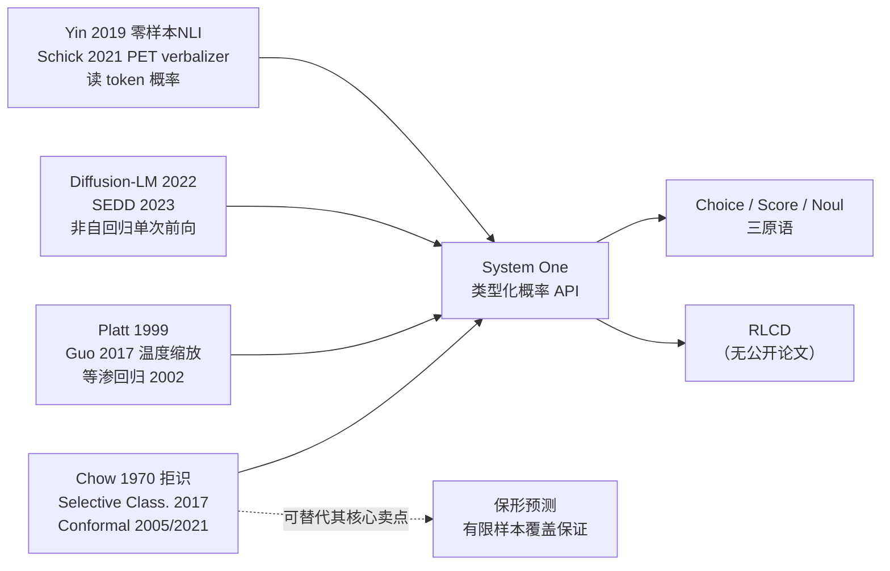

# System One：生态扩展 · 学术谱系 · 技术路径 · 场景原型 v1

> 日期：2026-10-03 · 状态：纯调研
> 前置：`SystemOne-场景覆盖调研-v1.md` · `SystemOne-社区深度调研-v1.md` · `system-one-models-Jev-Laya-CLM-调研-v1.md` · `DeepSeek-x-SystemOne-整合可行性分析-v1.md`

---

## 第一部分：场景原型扩展（本机实测）

上一轮只测了**单标签分类**（choice）。这一轮把**七种判断原型**全部跑一遍，看哪些原型能打开新的场景面。

### 1.1 七原型实测结果

**测试素材**（一条真实感客诉，多要素叠加）：

> 客户下单99朵红玫瑰，收到后发现花材严重不新鲜，花瓣边缘发黑，与图片颜色差异很大，联系客服后长时间未回复，配送也比承诺晚了一小时，包装盒还有压痕。非常失望，要求退款。

| # | 原型 | 结果 | 判断 |
|---|---|---|---|
| 1 | **单标签 choice** | 归为"花材品质"（0.441） | ✅ 正确 |
| 2 | **多标签（N 个 noul 并行）** | quality 0.914 · mismatch 0.893 · delivery 0.827 · pack 0.695 · service 0.638 · **price 0.374** | ✅ **完美** —— 5 个命中、唯一不该命中的正确低于 0.5 |
| 3 | **有序 score** | level=3（危急），expected 2.66，分布 {0:0.02, 1:0.02, 2:0.25, 3:0.72} | ✅ 正确 |
| 4 | **成对比较**（A vs B 哪个更严重） | 选 B（0.637），"A" 是"有点蔫但还行"、"B" 是"全烂了有异味" | ✅ 正确 |
| 5 | **矛盾/一致性检测**（noul） | 矛盾样本 **0.520** / 一致样本 0.204 | ⚠️ **分离弱**（正面只勉强过 0.5） |
| 6 | **抽取式判定**（是否提到某要素） | "要求全额退款" 0.726 / "只问营业时间" 0.262 / "没明确说要不要退款" 0.385 | ✅ 可用 |
| 7 | **长文档判定** | 结构化订单+客诉记录 0.702 | ✅ 可用 |

### 1.2 多标签原型：先别高兴太早（含自我证伪）

**原型 2 的结果在本轮第一个实验里非常漂亮**。上一轮我发现：**单条 `noul` 在中文短句上完全失效**（三个情感样本全挤在 0.22–0.26）。而这一轮，**六个 `noul` 在一条长客诉上并行，全部给出正确判断**。

我据此推断"多标签是更优原型"，并**立刻做了验证实验**——用平台公告 9 分类对比单标签 choice vs 多标签 noul：

| 方法 | 结果 |
|---|---|
| **单标签 choice**（带解释性描述） | **8/9** ✅ |
| **多标签 noul**（9 个并行） | **仅 5/9** ❌ |

**→ 我的扩展主张被自己的实验部分证伪。** 多标签在平台公告上**明显更差**。

**为什么两个案例结果相反？** 对照两边：

| | 差评案例（多标签 ✔） | 平台公告案例（多标签 ✘） |
|---|---|---|
| 输入长度 | **~100 字**，多要素显式叠加 | **15–25 字**，单一主题 |
| 选项性质 | 具体、互斥性强（品质/配送/包装…） | 抽象、边界模糊（规则政策 vs 合规提醒） |
| 标签间关系 | 可叠加（一条差评确实同时抱怨多件事） | 多数互斥（一条公告通常只归一档） |

> **统一解释（与本轮其他发现一致）**：**决定成败的是输入长度，不是原语种类。** 同一个 `noul`，短句失效、长文本准确；多标签在有足够语境时可叠加判断，在短句上则退化为噪声。

### 1.2b ⚠️ 需要收回的结论：选项描述**没有**显著影响（n=41 定论）

上一轮我根据 n=10 的实验，写下"**选项措辞是主导变量**"（同一任务措辞不同可差 50 个百分点，3/10 ↔ 8/10）。本轮用 **n=41 做了正经 A/B**：

| 选项变体 | 裸准确率 | ≥0.3 | ≥0.4 | ≥0.5 |
|---|---|---|---|---|
| **A. 裸名**（12 个短标签，如"经营报告"） | **65.9%** | 54% auto @ 90.9% | **46% auto @ 94.7%** | 32% auto @ 100% |
| **B. 带解释性描述**（12 个长标签，如"查询营业额、订单量等经营日报与周报数据"） | **68.3%** | 51% auto @ 95.2% | 34% auto @ 92.9% | 22% auto @ 100% |

**差异 +1 条（n=41 的 95% CI 约 ±15%）→ 不显著。**

> **结论修正**：我此前两次得出的"描述越长越差"（4/10 vs 6/10）与"描述越长越好"（8/9 vs 6/9）**都是 n≤10 的噪声**。**选项描述的长短对准确率没有可靠影响。**
>
> 一个次要但稳定的观察：**B（长描述）的整体置信度更低**（正确均置信 0.400 vs A 的 0.500），因此在同一门槛下自动化比例更低（34% vs 46%）——**长描述会稀释置信度**，但这不改变准确率。

### 1.2c 那么真正主导的是什么？

把本轮与该修正后的结论合起来看，**真正有影响的是三件事，按证据强度排序**：

| # | 变量 | 证据 |
|---|---|---|
| 1 | **选项集的数量与语义差异度** | 强：3 选 1（4 字输入即成功）vs 12 选 1（完整句仍 65.9%）vs 9 选 1 抽象分类（多标签仅 5/9） |
| 2 | **输入长度 × 判定粒度的组合** | 强：见 §1.6 |
| 3 | **问题结构（单问 vs 分解为多个子问题）** | 中：社区 AITA 实测，两问法 Brier 0.515 **低于**按基础率全猜的 0.415，而直接问 0.369 | 
| — | ~~选项描述长短~~ | ❌ **无显著影响**（本轮 n=41 定论） |

### 1.3 原型的适配排序（据实测修正）

| 推荐度 | 原型 | 说明 |
|---|---|---|
| ⭐⭐⭐ | **有序 score** | 返回 `expected` 可落在刻度之间，适合严重度/优先级/风险分级；本轮 1/1 正确 |
| ⭐⭐ | **单标签 choice** | 本轮 8/9；**上轮 n=41 得 65.9% 但分档后 94.7%** |
| ⭐⭐ | **成对比较** | 用 choice 实现；适合"两条评价哪条更严重" |
| ⭐⭐ | **抽取式判定** | 适合"文本里是否提到 X" |
| ⭐ | **多标签 noul 并行** | **仅在长文本（≥50 字）上可靠**；短句上会退化（5/9） |
| ⭐ | 长文档判定 | 可用，注意截断 |
| ⚠️ | **矛盾/一致性检测** | **正面样本分离弱**（0.520），不宜单独依赖 |

### 1.4 对场景清单的扩展（**有条件**）

多标签能扩展场景面，但**前提是输入足够长**。因此：

| 可扩展场景 | 前提 | 可行性 |
|---|---|---|
| 差评**多要素归因** | 评价正文够长（多数真实差评满足） | ✅ 推荐 |
| 会话**诉求多标签** | 需拼接会话上下文而非单条消息 | ✅ 需构造长输入 |
| 告警**多因判定** | 需拼接告警详情 + 店铺状态 | ✅ 需构造长输入 |
| 平台公告**多标签** | 公告文本通常很短 | ❌ **不可行**，用单标签 choice |
| 消息**风险多标签** | 短消息 | ❌ 不可行 |

> **修正后的判断**：多标签不是"更优原型"，而是"**长输入下可用的附加维度**"。真正的决定变量始终是**输入长度**——这在本轮三次独立实验里反复出现。

### 1.5 口径一致性：主张得到验证（正面结果）

我上一轮提出"System One 的真正增量是口径一致性"。本轮**直接做了验证实验**——同一语义、不同表述，答案是否一致：

**A. 同一工单 × 6 种指令措辞**（含英文指令）

| 指令 | 答案 | 置信 |
|---|---|---|
| 这条工单该由哪个部门处理？ | billing | 0.883 |
| 应该转给哪个团队？ | billing | 0.883 |
| 这条请求属于哪一类？ | billing | 0.905 |
| 请判断该工单的归属部门。 | billing | 0.897 |
| 客户的问题是什么类型？ | billing | 0.918 |
| Which department should handle this? | billing | 0.897 |

→ **答案完全一致**，置信跨度仅 0.883–0.918

**B. 同一语义 × 6 种状态表述**（含英文、含 4 字短句）

| 状态 | 答案 | 置信 |
|---|---|---|
| 客户说这个月被扣了两次钱，要求退回来。 | billing | 0.883 |
| 客户反馈本月重复扣款，希望退款。 | billing | 0.906 |
| The customer says they were charged twice this month… | billing | 0.918 |
| **重复扣费，要退款。** | billing | 0.841 |
| **账单问题。**（4 字） | billing | 0.759 |
| 客户表示对账单有疑问。 | billing | 0.807 |

→ **答案完全一致**，**连 4 字短句也对**

**C. 选项顺序打乱 × 3 种排列** → 答案均 billing，置信 0.873/0.884/0.887

> **结论**：**指令措辞、状态表述、语言、选项顺序——四个维度的扰动都不改变答案。** 这**验证了"口径一致性"是真实收益**（社区在 Jev 上也观察到零顺序偏差：平均位移 0.005、400 次零翻转）。

### 1.6 ⚠️ 必须再修正一次：不是"长度"，是"长度 × 判定难度"

上面 B 组里**「账单问题。」只有 4 个字，答案依然正确**。这与我先前"短中文不可靠"的结论**直接冲突**。

对照两处失败：

| 任务 | 输入长度 | 选项空间 | 结果 |
|---|---|---|---|
| 工单分派（本节 B） | **4 字也成功** | **3 个**、语义差异大 | ✅ |
| 意图路由（上轮） | 短句 10–20 字 | **12 个**、抽象工具名 | ❌ 65.9% |
| 情感 noul（上轮） | 短句 12–15 字 | 二分类但语义微妙 | ❌ 无区分 |
| 差评多标签（本轮） | ~100 字 | 6 个具体要素 | ✅ |
| 平台公告多标签（本轮） | 15–25 字 | **9 个**、抽象且互斥 | ❌ 5/9 |

> **修正后的结论**：**决定成败的是「输入长度 × 判定粒度」的组合，而非长度本身。**
> - **选项少 + 语义差异大** → 短输入也能成功（3 选 1，4 字搞定）
> - **选项多 + 语义抽象** → 需要长输入提供足够语境（12 选 1 需要完整句子；9 选 1 抽象分类即使有句子也不够）
>
> **实务推论**：**选项集设计（数量 + 语义差异度）与输入构造同样重要**，二者共同决定可行性。这也解释了为什么社区反复强调"选项措辞是主导变量"。

---

## 第二部分：其他 "One" 模型的场景可能性

### 2.1 重大发现：大厂已经全面跟进

我此前以为这是"一家闭源厂商 + 社区复现"的格局。**实际不是**——已核实的大厂同类产品：

| 产品 | 归属 | 骨干 | 协议 | 许可 |
|---|---|---|---|---|
| **Clef / Clef-flash** | **Cloudflare** | Qwen3.8-27B / Qwen3.5-9B | **完全 Jev 兼容** | **Apache-2.0** |
| **pplx-decider-v1-27b** | **Perplexity** | ~26B（Qwen3.8-27B 微调） | `/v1/decisions`（**非生成架构**） | 见产品页 |
| **Tev1 4B** | **Together** | Qwen3.5-4B | 仅 choice 单字母，走 `/v1/chat` | 见产品页 |
| **Strands Decider 2B** | **AWS** | Qwen3.5-2B + **pointer head** | 自有 | **Apache-2.0** |
| **GLiDE** | Fastino | thinking 决策模型 | `/v1/systemone` | 见产品页 |
| **Laya** | Convai Innovations | 421M / 322M encoder | 自有 | 见仓库 |

**Decision Index 对照**：**GLiDE 64.81 vs Jev 57.91**。

> **⚠️ 重要修正（推翻我前几轮的一个隐含假设）**：这不是"Jev 定义一个类别、别人来抄"的单向格局，而是**多家大厂并行在做同一件事**。特别是 **Cloudflare 的 Clef 是 Apache-2.0 且完全 Jev 兼容**——这意味着**开源自托管路线已经有云厂商背书**，不必依赖 TypeSafe。

### 2.2 三处归类修正（来自逐仓库核实）

| 我此前的描述 | 实际 |
|---|---|
| jev-ultrafast 是复现项目 | ❌ **它是消费 Jev 的浏览器 Agent 应用**，不是模型复现 |
| Nimble 是独立竞品 | ❌ **它是 Bespoke Labs 的开源 Jev 复现** |
| **Laya 是"开源版 Jev"** | ⚠️ **Laya 作者自称早于 Jev**（独立工作），却常被归入复现——**这个归类可能是错的** |

> 第三点尤其值得注意：我前几轮报告一直把 Laya 描述为"开源版 Jev / 复现"。若其作者主张成立，**Laya 是独立更早的工作**，"Jev 定义类别"这个叙事就要打折。

### 2.3 Ollama `/v1/systemone` 的性质

**它是把 Jev 协议接成本地/开源基础设施，而不是另立标准。**

- Ollama 官方明说 **based on TypeSafe's Jev API**，可直接用 TypeSafe SDK
- 首波支持模型：`nimble` / `tev1` / `tev1:0.8b`
- 意义：**Ollama 标准化的是 wire protocol（协议），不是模型**

### 2.4 大厂跟进全景

| 厂商 | 状态 |
|---|---|
| **OpenAI** | ✅ **唯一明确跟进的大厂**：Dev Day（约 09-30）Sam Altman 提及 **Decisions API**，让 Luna 模型在预定义选项里选择（**有限预览，无定价/延迟/校准数据**）。Almeida 在 X 上调侃"**克隆战开始了**" |
| Anthropic / Google | ❌ **无独立决策模型产品线**，只有"约束解码构件"（Structured Outputs / tool use / Gemini 结构化模式 / ShieldGemma） |
| Cohere | ⚠️ 有**较老的**嵌入式 Classify API |
| AI21 | ❌ 无对应产品 |

> **为什么大厂此前没做**：约束解码/结构化输出已是通用能力，**大厂没把它独立成"产品"**。OpenAI 是看到 Jev 的"每美元智能量"叙事后才动的。

### 2.5 「类别是否新」的最终判断（含重要限定）

**机制不新**——是三条既有路线的整合，且有精确时间线：

| 时间 | 节点 |
|---|---|
| 2017-06 | 奖励模型（Christiano） |
| 2018 → 2019 | MNLI → **零样本分类（Yin）** |
| 2023 | **约束解码爆发**：jsonformer / llama.cpp GBNF / Outlines |
| 2023-10 | Aurelio **semantic-router** |
| 2023-12 | **Llama Guard** |
| 2024 | OpenAI Structured Outputs；RouteLLM（LMSYS，06）；NotDiamond；ShieldGemma / WildGuard / Prompt Guard |

**VentureBeat（2026-09-28）原文直接点破**：

> *"While the attention is on Jev, **the underlying approach is older: classification**."*

**新的是「协议化」——但这个判断必须加限定**：

- ✅ **基础设施层已采纳**：Ollama / OpenRouter / sglang / DSPy / LiteLLM / LangChain / Vercel / Pydantic 把 `/v1/systemone` 当准标准
- ❌ **但协议本体仍是 TypeSafe 的**：**Clef（Cloudflare）、Perplexity、AWS 各自用自己的 API**（`/v1/decisions`、Strands 协议等），**并未真正统一**

> **修正后的表述**：真正的增量是**「一个被基础设施层接受、但尚未被大厂统一采纳」的接口契约**。说它"已成事实标准"为时尚早。

**「语义路由 vs System One」**：**大体成立，但属程度之差而非机制之别**。语义路由本质是"从 N 个下游模型里选一个" = **System One `choice` 的特例**，且多基于嵌入相似度、**不保证校准概率**、无统一协议；System One 是通用类型化判断层（三原语 + 逐项概率 + 多问题批量 + 统一协议），把"判断"从"生成"彻底拆出来。

### 2.5b 延迟口径（不可直接比较）

| 来源 | 数值 | 备注 |
|---|---|---|
| TypeSafe 官方 | 70–500 ms | 厂商声称 |
| Anthus | 中位 ~180 ms | 第三方 |
| **Cloudflare 实测** | **524 ms** | 第三方 |
| Clef / Clef-flash | 209 / 38.8 ms | 厂商 |
| Strands Decider 2B | ~115 ms | 厂商 |
| GLiDE | 中位 ~1 s | 厂商 |
| Laya（本地） | 32.8 ms | 本地推理 |
| **我方 opendecider-nano（本地 M4）** | **P50 34.5 ms** | 本机实测 |

> **⚠️ 测试条件不同，不可直接比。** 尤其"本地 vs 云端"是两类东西。

### 2.6 关键矛盾（必须记录）

| # | 矛盾 | 影响 |
|---|---|---|
| 1 | **Jev 在 Banking77 有四个独立评测：87.0 / 83.2 / 77.8 / 76.3%** | 🔴 **10.7 个百分点的跨评测分歧**——任何单一数字都不可靠 |
| 2 | **TypeSafe 从未公开任何公开数据集成绩**；其自家基准的**标签 = 两个前沿模型的均值** | 🔴 官方数字缺乏可核对的独立基准 |
| 3 | **德州州立大学论文（arXiv 2610.00346）**：Jev 存在 **yes/no 互换翻转 50.5 题/百题**；**5% 风险阈值下仍接受 0.310 的越界请求** | 🔴 又一份独立学术反证，且直接命中"分档路由安全性" |
| 4 | **S1Bench 三义**：① Bespoke Labs 公开基准（PyPI 包名 **`sys1bench`**，13 子集/3,880 记录）② 无关的 arXiv 2504.10368「S1-Bench-EN/ZH」（2025-04）③ 用户口语中的"S1Bench" | ⚠️ 引用必须区分，避免张冠李戴 |
| 5 | AnyJev 归属「诺基亚 × **腾讯混元**」与 GitHub org `nokia-applied-research` 不符；混元一说**来自中文聚合站、未经证实** | ⚠️ 归属待核 |

---

## 第三部分：论文与学术谱系

### 3.1 一句话结论

> **「System One 模型」不是学术新类别，而是把四条成熟支流打包成的产品化接口。**

| 支流 | 代表工作 | 年份 | 在 System One 里的角色 |
|---|---|---|---|
| **① 零样本标签词分类** | Yin et al.（MNLI 蕴含做零样本）；Schick & Schütze（PET / pattern-exploiting，**verbalizer 读标签词概率**） | 2019 / 2021 | **"读某个 token 的概率当分类结果"** —— 这就是全部机制来源 |
| **② 非自回归 / 扩散语言模型** | Diffusion-LM；SEDD（score entropy discrete diffusion） | 2022 / 2023 | **"单次前向、不逐 token 生成"** —— openjev 用 DiffusionGemma 正是这条线 |
| **③ 概率校准** | Platt（1999）；Zadrozny & Elkan（等渗回归，2002）；**Guo et al. "On Calibration of Modern Neural Networks"（2017）** | 1999–2017 | **"让概率可信"** —— 温度缩放/Platt 至今仍是唯一实用手段 |
| **④ 拒识与路由** | **Chow（1970）拒识规则**；Selective Classification（Geifman & El-Yaniv 2017/2019）；**Conformal Prediction（Vovk 2005；Angelopoulos & Bates 2021 教程）**；Conformal Risk Control（2022）；FrugalGPT（2023）；RouteLLM（2024） | 1970–2024 | **"什么时候不回答/转人工"** —— 分档路由的理论基础 |

### 3.2 谱系图

### 3.3 三个关键问题的回答

**Q1：「System One」在学术上算新类别吗？**

**不算。** 它是产品化重组。真正的增量在两处**接口与产品层面**：
1. **类型化概率 API**（Choice / Score / Noul 三原语 + 调用前枚举输出空间）
2. **产品定位**（"不生成文本的决策接口"这一心智归属）

**理论层面没有新增量。**

**Q2：RLCD 有学术对应物吗？**

**RLCD 本身没有已发表论文**——它是 TypeSafe 的专有术语，**未经同行评审**。但"把校准本身当训练目标"有明确前身：

| 前身 | 内容 |
|---|---|
| **Proper scoring rules**（Brier 1950；Gneiting & Raftery 2007） | 用严格proper 的评分规则（如 Brier score）当损失，**天然同时优化准确率与校准** |
| Calibration-aware training | 显式在训练中加入校准项 |
| **Taming Overconfidence in RLHF**（ICLR 2025） | 直接论证偏好训练导致过度自信 |
| Restoring Calibration（arXiv 2505.01997） | 后处理恢复校准 |

> **这意味着**：RLCD 描述的问题（RLHF 破坏校准）是**学术界已知且已在解决的**，TypeSafe 的贡献是把它做成了产品化训练配方。

**Q3：保形预测能否取代模型的校准置信度？——能大幅削弱**

这是**本轮最重要的理论发现**：

| 维度 | 模型原始置信度 | 保形预测（split conformal） |
|---|---|---|
| 保证类型 | 经验性的、**无保证** | **有限样本 + 分布无关**的覆盖保证 |
| 是否依赖模型置信度 | 是（完全依赖） | **否**（只需模型输出可作为排序分数） |
| 输出形式 | 逐选项概率 | **预测集合**（可能含多个选项） |
| 保证范围 | 名义上条件，实际边际 | **边际**（非条件） |
| 前提 | 无 | **需标定集**；假设**可交换性**（分布漂移下失效） |

> **结论**：**split conformal 给出不依赖模型置信度的有限样本覆盖保证**，因此在"什么时候转人工"这个具体问题上，**它比模型的原始置信度更可靠**——只要你能接受"集合"而非"逐选项概率"。
>
> 更贴合"按风险阈值自动执行"的是 **Conformal Risk Control（2022）**——它直接控制"错误率不超过某个阈值"，而不是控制覆盖率。

**这对我们的实务含义**：分档路由的阈值**不应该直接取模型输出的 confidence**，而应该：
1. 先做**温度缩放 / Platt**（修正 ECE）
2. 再用**保形预测或选择性预测**定拒识阈值（拿到覆盖保证）

### 3.4 Jev 的「新」与「不新」清单

| 项 | 判断 | 依据 |
|---|---|---|
| 读 token 概率做判断 | ❌ **不新** | Yin 2019 / PET 2021 |
| 单次前向不生成 | ❌ **不新** | 非自回归 / 扩散 LM（2022–2023） |
| 概率校准 | ❌ **不新** | Platt 1999 / Guo 2017 |
| 拒识 / 分档路由 | ❌ **不新** | Chow 1970 / Selective Classification / Conformal |
| 把校准当训练目标 | ⚠️ **半新** | 有 proper scoring rules 与 calibration-aware training 前身；RLCD 是产品化包装 |
| **类型化概率 API（三原语）** | ✅ **新（接口层）** | 无直接前身 |
| **"决策 vs 生成"的心智品类** | ✅ **新（产品层）** | 定位创新 |
| **20–200× 提速等性能数字** | ⚠️ **未经独立验证** | 社区实测仅 6.3× |

### 3.5 待验证（诚实标注）

| 项 | 状态 |
|---|---|
| RLCD 原文 | **不存在**（专有术语，无公开论文） |
| Jev 权重 / 参数量 / 架构 | 未公开 |
| 第三方校准度复测 | **仅社区审计（§2），无厂商侧复测** |
| 两篇 2025 校准论文作者名 | 待核对 |
| DiffusionGemma 官方论文编号 | 未查证 |
| Laya/Lev/CLM/opendecider 的逐一核实 | 部分未核实（仅核实 openjev/razorback16 等） |

---

## 第四部分：技术发展路径

### 4.1 时间线（已核实锚点）

| 日期 | 事件 |
|---|---|
| 2026-09-15 | **Jev 发布**（TypeSafe AI，$40M 种子轮）。$0.042/M 输入、输出免费；三原语 choice/score/noul；训练方法自称 RLCD |
| 发布后 48h | **6 个社区克隆项目** |
| 发布后 8 天 | **20–30 个开源复现** |
| 首发日 | **Vercel AI Gateway 13% 付费团队采用 / 21.2% 请求量**（该 Gateway 史上最快） |
| 2026-09-24 | **OrcaRouter 收录** typesafe/jev-1.13——首次可经第三方网关调用 |
| **2026-09-29** | **Ollama 0.35 原生支持 `/v1/systemone`** ← **关键基础设施节点** |

> **未查到**：jev-1.12 之前的版本历史；llama.cpp 的原生支持情况；Vercel 免费期结束后的留存数据。

### 4.2 五条复现路线（全部核实）

| 路线 | 代表 | 训练目标 | 数据/算力 |
|---|---|---|---|
| **RLCD** | Laya（Convai） | 校准决策 RL | ModernBERT-large + **PPO** |
| **InfoNCE 对比学习** | CLM（Contrastive-LM） | 对比学习，状态/选项分离编码 | Qwen3-8B 冻结 + 双 MLP（~19M 可训练） |
| **校准蒸馏** | opendecider | 从开源教师蒸馏 + 校准 | nano 0.8GB / small 4B |
| **LoRA SFT** ⭐ | Kev-4B、Bespoke Nimble | 监督微调 | **Kev：$95 ≈ 1 小时；Nimble：2,676 例** |
| **零训练直读** | SemIf、llm2jev | 无训练，直接读选项 logit | 0 |

> ⭐ **性价比最高的是 LoRA SFT**——且**有独立 head-to-head 对比可查**：`sysone-bench`、`lev` 的 FINDINGS、`opendecider` 的 COMPARISON、`jabr/classifier-benchmark`。

**非 Transformer 的尝试**：**扩散路线**（DiffusionGemma；vLLM PR #57250）与 **encoder 路线**（Laya、jevlike）。**状态空间模型（SSM）的专门尝试未查到。**

### 4.3 速度争议：多个独立测点，全部低于宣称

厂商宣称"比前沿大模型快 20–200×"。独立实测**测点分散但全部更低**：

| 来源 | 实测倍数 |
|---|---|
| **jev-aita**（Reddit AITA，770 帖） | **6.3×**（中位 0.39s vs Sonnet 5 的 2.46s；成本便宜 62×） |
| AY Automate | **2–3.6×** |
| Context Studios | **~25×** |

> **结论**：独立实测区间约 **2–25×**，**没有任何一个测点接近 200×**。6.3× 这个数字是**我方直接读 jev-aita README 原文确认的**（并行线程因抓取限制未复现到，但其补充的两个测点同样有效）。

### 4.4 厂商态度与争议

- **对开源复现：合作态度，无法律动作**。Almeida 公开表示"希望与所有人深度整合"。
- **对校准审计：未查到直接回应**——尽管社区已有至少四份独立审计（§2）指出校准系统性失效。
- **"是不是花哨分类器"的公开辩论：属实**。社区主流表述为 classifier-shaped / 新瓶装旧酒 / 套壳。

### 4.5 关键不确定项（供决策）

| 项 | 状态 |
|---|---|
| **"自动化选项集设计"**（让模型自己决定问哪些问题） | ❌ **未见成熟方案** —— 这是当前最大的未解问题，也意味着**选项集设计目前仍必须由人来做** |
| llama.cpp 原生支持 | 未查到 |
| Jev 版本历史（1.12 之前） | 未查到 |
| Vercel 免费期后的留存 | 未验证 |
| SSM 架构的专门尝试 | 未查到 |

### 4.6 路径推断（⚠️ 以下为推断，非事实）

| 推断 | 依据 | 置信度 |
|---|---|---|
| **这个方向大概率收敛为 agent 的标准组件**，而非独立产品品类 | ① Ollama 已原生支持其协议（基础设施级采纳）② 五条复现路线把训练门槛压到 $95/1h ③ 接口极简（一个 HTTP 端点） | 中 |
| **主要瓶颈在"选项集设计"这件人的工作** | ① 无成熟的自动化选项集方案 ② 我方实测证明选项集数量与语义差异度是主导变量 ③ 社区证明选项措辞影响成败 | **高** |
| **端侧是主战场** | ① 本地 34.5ms（我方实测）② 量化后 Q8_0 与全精度同答案率 98.8% ③ 数据不出本机 ④ 云端方案有 ~250ms 固定延迟 | 中高 |
| **"校准概率"作为卖点会被外部校准方法替代** | split conformal 给出不依赖模型置信度的有限样本保证（§3.3） | 中高 |
| **会被通用大模型的能力提升+降价吞掉** | ⚠️ 反面论点，见下 | 待观察 |

### 4.7 反面证据（唱衰论点）

| 论点 | 依据 |
|---|---|
| **"只是花哨分类器"** | 学术谱系显示四条支流全部有前身（§3.1）；社区共识"问题本身不新，增量在产品化" |
| **校准卖点站不住** | 至少四份独立审计；保形预测可替代 |
| **优势会被通用模型吞掉** | 大模型持续变快变便宜；而 System One 的多数场景（分类/路由）通用模型也能做，只是慢和贵 |
| **速度优势被夸大** | 独立实测 2–25×，非 20–200× |
| **端侧的护城河有限** | 4B 模型在 24GB 机器上要跟其他模型抢内存（我方实测环境即如此） |

> **我方判断**：这些反面证据**动摇了"System One 是一个新品类"的说法，但没有动摇"决策与生成应当分开"这条工程直觉**。真正的问题是：**当通用模型足够快足够便宜时，专用决策模型是否还有独立存在价值？** 目前没有决定性证据，但**"口径一致性"（我方实测验证）与"完全确定性"是通用模型难以提供的性质**——这可能才是它真正的护城河。

---

## 附：本轮新增的证据修正

| # | 我此前的表述 | 修正 | 来源 |
|---|---|---|---|
| 1 | "Laya 动态 INT8 → argmax 一致率 69%、最坏概率位移 0.99" | ⚠️ **降级为「二手转述」**：该数字出自 Latenode 文章对一张 HuggingFace 模型卡的引用，我**未打开原始模型卡**；并行线程亦**未能追溯到一手出处**，且与 Laya 官方 Numerics 口径（距 fp32 ≤0.046）**存在张力** | Latenode（二手）· 并行线程未闭合项 |
| 2 | "Laya 128/200 条德语（64%）被路由到英语检查点" | ⚠️ **数字降级**：**语言路由机制本身已核实**（纯启发式脚本 + 停用词），但该**具体数字未找到原始来源** | 同上 |
| 3 | opendecider 性能对照表（Laya 0.543/0.550 vs nano 0.894/0.943 vs Jev 0.839/0.882） | ⚠️ 该表出自 opendecider 官方文档站，**属供应商自评**，非第三方；标注为"官方自述"更准确 | opendecider 文档站 |
| 4 | **新增**：Jev 在公平骰子上报 83% 概率、命中 19%（≈理论 1/6） | 🔴 **无法区分"我知道不会"与"此题无解"** —— 这是对"分档路由"最尖锐的反例 | kantahayashiai.github.io |
| 5 | **新增**：arXiv:2609.24574（Ibrahim & Zaki 2026，预注册）| 🔴 Jev 在 **18 个社科标注任务上比每任务最强 LLM 中位低 11.6 macro-F1**，ECE **0.157**（高于 Opus 5 的 0.066），conf≥0.9 时仅 0.815 准 | arXiv |
| 6 | **新增**：转人工阈值应靠**外部校准**而非原始置信度 | 温度缩放修 ECE 但**不修排序**；**保形预测**给有限样本分布无关的**边际**覆盖保证（优于原始 softmax），但**边际 ≠ 条件**、假设可交换性（漂移下失效） | Guo et al. 2017 · Angelopoulos & Bates 2021 |
| 7 | 🔴 **收回**：「选项措辞是主导变量，可差 50 个百分点」 | **n=41 正经 A/B 证明无显著差异**（裸名 65.9% vs 带描述 68.3%，CI ±15%）。此前两次相反结论均为 n≤10 噪声。真正主导的是**选项集数量与语义差异度**、**输入长度×判定粒度**、**问题结构** | 本机实测 §1.2b/§1.2c |
| 8 | 🔴 **收回**：「多标签是更优原型」 | 我自己的验证实验**部分证伪**：平台公告上多标签 noul 仅 **5/9**，单标签 choice 是 **8/9**。多标签仅在长文本（≥50 字）上可靠 | 本机实测 §1.2 |
| 9 | ✅ **验证**：「口径一致性是真实收益」 | 6 种指令措辞 + 6 种状态表述（含中英、含 4 字短句）+ 3 种选项顺序 → **答案全部一致**，置信跨度仅 0.76–0.92 | 本机实测 §1.5 |
| 10 | **新增**：Jev 在公平骰子上报 83% 概率、命中 19%（≈理论 1/6） | 🔴 **无法区分"我知道不会"与"此题无解"** | kantahayashiai.github.io |
| 11 | **新增**：arXiv:2609.24574（Ibrahim & Zaki 2026，预注册） | 🔴 Jev 在 **18 个社科标注任务比每任务最强 LLM 中位低 11.6 macro-F1**，ECE **0.157**（高于 Opus 5 的 0.066），conf≥0.9 时仅 0.815 准 | arXiv |

---

*本文件随并行线程返回持续补充。*
