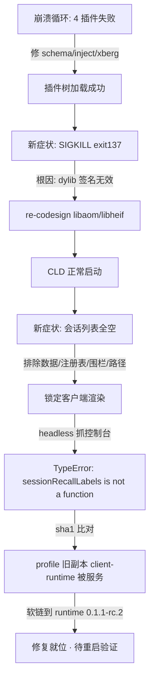
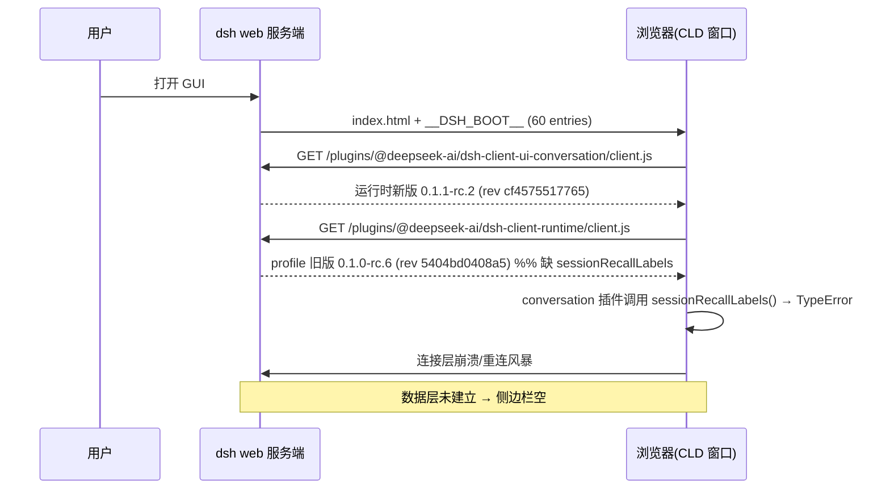

# CLD 启动崩溃 + 会话列表消失 —— 诊断与修复报告

- 日期：2026-10-06
- 范围：CLD（`/Applications/CLD.app`）web profile
- 状态：**修复已就位，待重启验证**
- 影响文件：`~/.dsh/profiles/web/node_modules/**`（就地修 + 1 处软链）

---

## 一、背景：两个前后相继、根因完全不同的故障

| # | 症状 | 性质 | 状态 |
|---|------|------|------|
| A | CLD 连续崩溃 4 次（超上限 3），卡在启动中 | 服务端：4 个插件加载抛错，整棵插件树加载失败 | ✅ 已修 |
| B | 能启动了，但**会话列表/历史全空**（本地 + 远程） | 客户端：浏览器拿到的插件版本错位 | ✅ 已修，待验证 |

> 关键判读：CLD 的 loader 用 `Promise.allSettled` **一次性收齐整组失败再抛** `AggregateError`，所以最新一次启动日志里的 `[errors]` 数组就是完整清单，不是"每次只坏一个"。



---

## 二、故障 A：启动崩溃循环

### 2.1 失败清单（最新一次启动 pid 72806）

任一插件 import 或 `apply()` 抛错 → 整棵插件树加载失败 → `installFailLoud` `exit(1)`。

| index | entry id | 根因 | 处置 |
|---|---|---|---|
| 170 | `dsh-doc` | 缺原生绑定 `@xberg-io/xberg-darwin-arm64` | 跑 profile 自带 `ensure-xberg-binding.js` 补入 8 个原生文件 |
| 171 | `gov` | output schema 根级用了 DSL 不支持的 `required` | 就地改 schema |
| 172 | `gate` | 同上 `schema.required` | 就地改 schema |
| 173 | `knowledge-tools` | 无 `inject`，且用了不存在的 3 参 `ctx.tools.register` | 重写为 `defineTool` |

### 2.2 关键 DSL 规则（源码实证，来自 profile 实际加载的 `dsh-tools`）

- `defineTool` 的 `output.render` **必需**；
- 值 schema DSL：**根节点禁止 `required`**；属性节点允许 `required:true`；
- `type:"object"` **必须显式声明布尔 `additionalProperties`**；
- `type` 只能是单个字符串（联合类型用 `oneOf`）；数组 `items` 禁止 `required`。

参考实现：`~/dsh-collab/devices/dsh-plugin-cldvoice-activate/lib/index.js`。

### 2.3 修 A 后暴露的第二坑：SIGKILL

插件树已能加载，但进程被 **SIGKILL**（pid 78256，表现为 `Timed out waiting for dsh web to announce its URL (120000ms)`）。

- **根因**：`libaom.3.dylib` / `libheif.1.dylib` 代码签名**无效**（早前 `install_name_tool` 改动未重签）。Apple Silicon 上 `dlopen` 到签名无效的 dylib → 内核/AMFI **立即 SIGKILL**（无报错、exit 137）。dsh-doc 在 import 期加载 xberg，xberg 链接 libheif→libaom，故整进程猝死。
- **处置**：`codesign --force -s - libaom.3.dylib libheif.1.dylib`（`node_modules/@xberg-io/xberg/` 与 `~/.dsh/profile-assets/xberg/` 两处）。
- **验证**：8 个文件全过 `codesign -v`；绑定可加载。

---

## 三、故障 B：会话列表全空（本次重点）

### 3.1 排除法（全部否定 → 锁定非数据问题）

| 检查项 | 结果 |
|---|---|
| 磁盘会话目录 | 442 个 |
| `workspace.json` 85 个 sessionIds 落盘 | 全部存在（缺失 0） |
| `session_projcache.json` 274 键落盘 | 全部存在 |
| 服务端 `POST /api/workspace.list` | `ok:true`，返回完整工作区 + sessionIds |
| 服务端 `POST /api/session.list` | `ok:true`，返回完整会话（标题/统计/投影） |
| 60 个客户端插件 `client.js` | 全部 HTTP 200 |
| jsonl persistence 前置校验（legacy/反向压缩/id 冲突） | 全部干净 |
| cwd 与 workspace path | 一致（`/Users/coreyleung`）；loopback 过信任围栏 |

结论：不是数据、不是注册表、不是信任围栏、不是路径。**问题在浏览器渲染半边。**

### 3.2 决定性证据：headless 渲染抓控制台

用 Playwright headless chromium 加载首页并 dump DOM，捕获：

```
Uncaught TypeError: (0 , _deepseek_ai_dsh_client_runtime_client.sessionRecallLabels) is not a function
   @ /plugins/@deepseek-ai/dsh-client-ui-conversation/client.js
[web-runtime] connection lost, retry #1 ... #6
```

即：UI 插件初始化即崩 → **客户端连接层死亡** → 数据层从未建立 → 侧边栏空。

### 3.3 根因：profile 与 runtime 的客户端插件版本错位

- CLD 运行时已升级到 **`0.1.1-rc.2`**；
- profile 的 `node_modules/@deepseek-ai/dsh-client-runtime` 是**旧的实体目录 `0.1.0-rc.6`**；
- 浏览器实际加载的正是**旧副本**：sha1 比对 `5404bd0408a5` = profile 旧副本（运行时新版为 `aba836a0c42d`）；
- 旧版**没有 `sessionRecallLabels`** 导出（新版有，2 处引用），而走运行时新版的 `dsh-client-ui-conversation` 会调用它 → `TypeError`。

**全量比对**（`__DSH_BOOT__` 每 entry 的 rev ↔ profile/runtime 两份 `client.js` 的 sha1）：
`dsh-client-runtime` 是**唯一**"客户端 bundle 走 profile 旧副本"的 `@deepseek-ai` 包。
（`cordis` / `dsh-api-gateway` / `dsh-base` / `dsh-web-app` 本就是软链到运行时；其余客户端插件也从运行时加载。）

### 3.4 修复

把 profile 里那个旧实体目录替换为指向运行时的软链（与既有做法一致、纯本地、可回滚，无需联网）：

```
node_modules/@deepseek-ai/dsh-client-runtime
  → /Applications/CLD.app/Contents/Resources/dsh-runtime/runtime/node_modules/@deepseek-ai/dsh-client-runtime
旧目录备份：dsh-client-runtime.bak-20261006-stale-rc6
```

**校验**：解析指向运行时；版本 `0.1.1-rc.2`；sha1 `aba836a0c42d`（=运行时）；`sessionRecallLabels` 命中 2 处。
旧→新为**新增**导出，对既有消费者向后兼容。

### 3.5 时序（因果链）



---

## 四、验证步骤

1. **由用户重启 CLD**（自动化不自行重启）。
2. 重启后用 headless 再渲染一次，确认侧边栏恢复会话列表。
3. 若远程仍空：`~/.cld` 的 tailnet 代理 PID 1192 仍挂在 `100.120.203.20:3081`，指向**旧 GUI 端口**，需刷新代理重指（本地/远程共用同一份客户端 bundle，先看本地是否恢复）。

---

## 五、附带发现（未处理，供决策）

- **profile 全体 `@deepseek-ai/*` 版本滞后**运行时（`0.1.0-rc.6/7` vs `0.1.1-rc.2`；`schemastery` 3.18.1 vs 3.18.2、`cosmokit` 1.8.2 vs 1.8.3）。当前服务端能启、API 正常，故不阻塞；根治需对齐依赖后 `pnpm install`（**联网、动 lockfile 338KB + 500+ 包，需确认**）。
- **就地改 node_modules 会被下次 `pnpm install/update` 覆盖**（含本次软链）。建议上游化或改用 patch 机制。
- 非启动性隐患：
  - `dsh-plugin-dock-cards` 用了 `ctx.agent?.id` 但 `inject` 未声明 `agent`（`?:` 挡不住 Proxy 抛错）；
  - `dsh-plugin-bus-bridge` 仍是旧式 3 参 `ctx.tools.register` + `inputSchema:`，被 try/catch 吞掉 → 静默无工具。

---

## 附：状态数据快照（调查时）

```
磁盘会话目录: 442
workspace.json: 1 workspace (path=/Users/coreyleung, title=coreyleung),
                sessionIds=85 (全部落盘), archived=74
session_projcache.json: 274 键 (全部落盘)
doctor: healthy=442, corrupt=2
  (session-fa1f9150 253MB "Failed to allocate memory";
   session-fb0e1ccb 同)
被服务但过期的客户端 bundle: @deepseek-ai/dsh-client-runtime (唯一)
```
