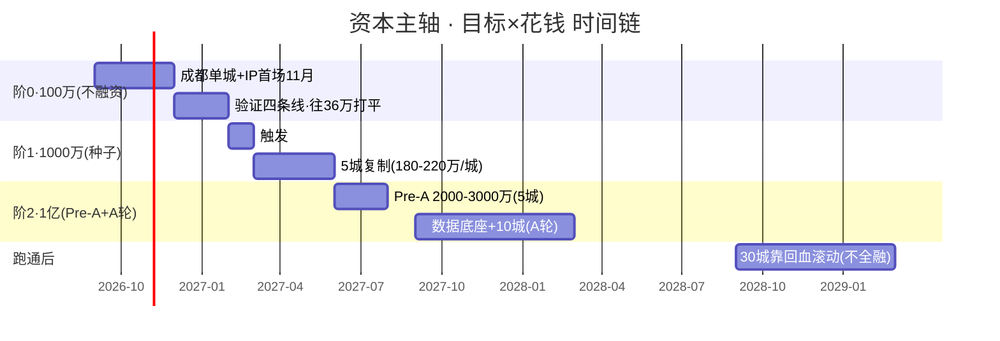

# Flowernet 资本主轴 · 融资路径与三档触发 v1

> 明鉴 · 2026-09-09 · 战略纲领配套（接《垄断地位战略推演》）
> 命题：**融资是一种做法，不融资也是一种做法。** 目标与花钱是两个坐标轴，展开成可行性路径；时间颗粒度细化三档触发点。
> 核心规律：**不是"想融多少"，是"目标规模到了哪一档，才触发哪一档融资"**——融资是里程碑的结果，不是前提（C分析：融资由里程碑触发，非现金枯竭触发）。
> 三档总股本：100万(不融资) → 1000万(种子) → 1亿(Pre-A+A轮)

---

## 〇、一句话

**100万靠现有资源打单城（不融资）；单城跑正才触发1000万种子（5城复制）；底座成型才触发1亿（10城→30城）。每一档融资都是前一档成果的"结果"，不是烧钱到头才去找钱。**

---

## 一、「目标 × 花钱」可行性矩阵

横轴=目标(单城→5城→10城→30城) · 纵轴=累计资本水位(100万→1000万→1亿)。每格 = 能否走通 + 打法。

| 目标 \ 累计资本 | **100万**(不融资) | **1000万**(种子) | **1亿**(Pre-A/A轮) |
|---|---|---|---|
| **单城(成都)** | ✅ **可走** 靠现有资源+轻资产 | ✅ 可走 更从容 | (过度,不必) |
| **5城** | ✗ 不够 单城≈180-220万 | ▲ **临界** 数据跑正才够 | ✅ 可走 复制 |
| **10城** | ✗ 远不够 | ✗ 不够 10城≈5000-7000万 | ✅ 可走 A轮 |
| **30城** | ✗ | ✗ 不够 30城≈1.5-2亿 | ▲ 需更大(靠回血滚动) |

**矩阵读数**：
- **100万 → 只够打单城**。边界=成都打透 + IP首场(11月)。不融资的起点。
- **1000万 → 由"单城跑正+平台数据亮眼"触发**。边界=5城复制。种子(自己人)。
- **1亿 → 由"数据底座成型+多城复制"触发**。边界=10城→30城。A轮。

**关键洞察**：100万和1000万之间、1000万和1亿之间，**不是拍脑袋定档，是里程碑瀑布**——每上一阶由前一阶成果触发。若目标永远停在单城，则100万够用、永不融资；若要全国，则必须逐档升级。

---

## 二、两个坐标轴拆开

### 2.1 横轴 = 目标（规模）
| 目标 | 数据锚点 | 里程碑 |
|---|---|---|
| 单城 | 成都15%份额 / 750动销 | 验证四条线, 打平线36万/月 |
| 5城 | 单城180-220万→复制 | 杭州/广州/合肥/南京 |
| 10城 | 10城≈5000-7000万 | 数据底座+IP链规模化, 月净1200万滚动 |
| 30城 | 30城≈1.5-2亿 | 全国网络→垂类第一, 靠回血滚动不全融 |

### 2.2 纵轴 = 要花的钱（累计资本）
| 阶 | 水位 | 性质 | 主体 |
|---|---|---|---|
| 阶0 | 100万 | 不融资 | 现有资源(声通/IP/双牌)+轻资产 |
| 阶1 | 1000万 | 种子(自己人) | 51%控盘+期权池 |
| 阶2 | 1亿 | Pre-A+A轮 | 外部资本进财务LP层(层②) |

---

## 三、时间颗粒度：三档触发链（月/季细颗粒）



| 阶段 | 时间 | 目标 | 花钱 | 融资 |
|---|---|---|---|---|
| 阶0 | 2026-09~12 | 单城打透+IP首场 | ~100万 | **不融资** |
| 阶1 | 2027-01~05 | 5城复制 | ~1000万 | **种子触发** |
| 阶2 | 2027-06~2028-03 | 10城+底座 | ~1亿 | **Pre-A+A轮** |
| 跑通 | 2028-09~ | 30城 | 回血滚动 | 不全融 |

---

## 四、三档触发点（细化到信号）

### 4.1 触发不是现金枯竭，是成果达标（C分析四信号）
| 信号 | 阈值 | 对应触发档 |
|---|---|---|
| ① 成都M1达标 | 动销 1200+(现值750) | 种子1000万 |
| ② 授权买回/作价落地 | 声通壳交割(预留200万) | 种子1000万 |
| ③ 现金流账成型 | 月毛利160-200万持续2-3月 | 种子/Pre-A |
| ④ 现金水位预警 | 账上<6个月成本→启动路演 | 提前调动，非枯竭 |

### 4.2 三种情形预案（不赌单一剧本）
| 情形 | 毛利 | 融资动作 |
|---|---|---|
| A 盈利跑正 | 毛利>支出 | **可晚融**(12-15月), 少稀释 |
| B 持平 | 毛利≈支出 | 按计划, M1达标即融 |
| C 亏损 | 毛利<36万 | **提前保命**(可转债过桥, 缓冲250万后推) |

---

## 五、资本决策守则（为什么这是对的）

1. **融资是里程碑的结果，不是前提**——成果达标→下一档才名正言顺
2. **每轮只干一轮的事**——1000万种子只做成都+端口P1; Pre-A只扩第二城; A轮只建多城+底座。逐段解锁，不超前花钱
3. **100万是"不融资"的实验舱**——靠声通/IP/双牌现有资源打单城，验证可行才考虑加码
4. **现金红线**——账上<6个月成本即启动下一轮路演，永不枯竭式融资
5. **出让纪律**——种子15-20%起步, 出让随里程碑绑定(达M1估值×出让%), 静态比例不谈
6. **不融资的真实代价不是没钱**——是丢四个时间窗(3·31返佣红利/声通授权窗口/杭州上海盘口/2029递表日历)

---

## 六、与垄断战略的咬合

```
大锚点(垄断型资源地位)
 ↓ 路径1: 地区→全国
目标轴: 单城(阶0·100万) → 5城(阶1·1000万种子) → 10城(阶2·1亿)
 ↓ 路径2: 底座垂类第一
花钱轴: 100万(现有资源) → 1000万(种子) → 1亿(A轮)
 = 每一档资本, 都对应让"垄断身份"更硬一步的里程碑
```

**结论**：**目标×花钱是两个坐标轴**，可行性路径 = 在"到什么目标就要花多少钱"之间找到**逐档水位**。100万→1000万→1亿，不是抽象数字，是**垄断身份三级跳对应的三档资本**；触发点永远是**成果达标那一刻**，不是钱快没了那一刻。

---
*Flowernet 资本主轴 · 融资路径与三档触发 v1 · 明鉴 · 2026-09-09 · 接《垄断地位战略推演》*
