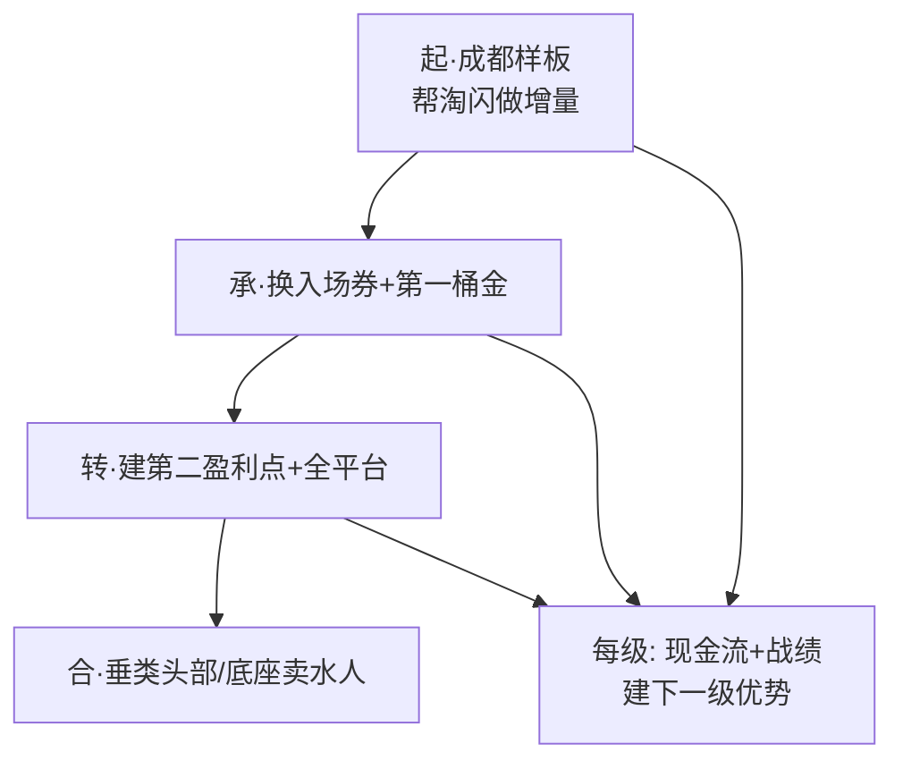

# Flowernet 终局叙事结构 · 整个故事怎么讲 v1

> 明鉴 · 2026-09-09 · 三件套之三：终局叙事（合）
> 用途: 从成都样板 → 全平台卖水人 → 垂类头部的递进story, 投资人/平台都能听懂
> 主线: **每一级的现金流+战绩, 建下一级的盈利点/优势** —— 现金流自转价值链的叙事化
> 节奏: 起-承-转-合 (成都样板→换入场券→全平台→垂类头部/底座)

---

## 〇、整个故事一句话

**从成都一个样板城，证明"我们能帮平台做鲜花增量"；用第一笔现金流建第二个盈利点(IP/工具)；拿战绩换全平台入场券；最终成为鲜花类目的全平台卖水人/底座——有差异化优势、竞争能力、稳定现金流、估值想象空间。**

---

## 一、叙事总览（起承转合）



| 段 | 阶段 | 做了什么 | 赚到什么 | 用于 |
|---|---|---|---|---|
| 起 | 成都样板 | IP首场+代运营+数据端口 | 帮淘闪增量战绩+第一笔现金流 | 换城市合伙人资格+管道 |
| 承 | 换入场券 | 用战绩谈更多平台 | 全平台地位 | 建第二盈利点(IP/工具) |
| 转 | 全平台 | 多平台借力(左右逢源) | 多平台战绩+多收入源 | 做大优势(4能力) |
| 合 | 垂类头部 | 卖水人/底座 | 稳定现金流+估值 | 服务战略蓝图 |

---

## 二、起·成都样板（证明能帮平台做增量）

- **故事**：成都15%份额+750动销，用IP首场(3-5店预售)帮淘闪创造新GMV来源——新注册用户+无消费习惯用户迁移+高客单
- **证明**：帮平台拿到可验证的增量财报和战绩（护城河④）
- **赚到**：平台信任 + 第一笔代运营现金流 + 城市合伙人资格/流量管道

## 三、承·换入场券 + 第一桶金

- **故事**：成都战绩是筹码 → 换城市合伙人资格+流量管道 → 从"成都专属"变"全国服务商"
- **投资**：第一笔现金流 → 建第二盈利点(IP+商品定价权/软硬件订阅)
- **赚到**：第二个盈利点 + 更强的身份

## 四、转·建第二盈利点 + 全平台

- **故事**：用IP/工具盈利点 → 拿到更多平台(美团/京东)入场券 → 每个平台都用别处战绩获益(左右逢源)
- **核心**：多平台"卖水人/工具/服务商"→ 每平台既是服务对象又是下一处筹码
- **赚到**：多平台战绩 + 多收入源(AI工具/商家/代运营产品线) → 做大4能力优势

## 五、合·垂类头部 / 底座

- **故事**：全平台战绩+4能力 → 垂类重要玩家 → 往头部挤
- **终局**：差异化优势(垂类know-how+多平台战绩) + 竞争能力(跨平台博弈) + **稳定现金流(多收入源)** + **估值想象空间(头部/底座叙事)**
- **对照**：对标再惠/微盟(垂类头部有资本叙事空间)

---

## 六、叙事的核心逻辑（投资人/平台都懂）

```
现金流自转：每一级的赚到 → 建下一级, 不靠烧钱空转
   ↓
帮平台增量：每级都帮平台拿到可验证战绩 → 平台依赖我们(护城河④)
   ↓
递进放大：样板→入场券→全平台→头部, 每级都更大
```

> **一句话让投资人记住**："我们不是烧钱买规模，是用现金流自转，每一级赚到的钱和战绩，都用来建更大的优势——最终成为鲜花垂类的卖水人/底座。"

---

## 七、三件套咬合

```
①战略方向(纲: 做什么/为什么赢/往哪走)
   ↓ 展开
②第一阶段BP(起手: 成都样板帮淘闪增量换管道) 
   ↓ 递进
③终局叙事(整个story: 样板→全平台→垂类头部, 每级现金流建下一级)
```

---
*Flowernet 终局叙事结构 v1 · 明鉴 · 2026-09-09 · 三件套之合(从样板到头部, 每级现金流建下一级)*
