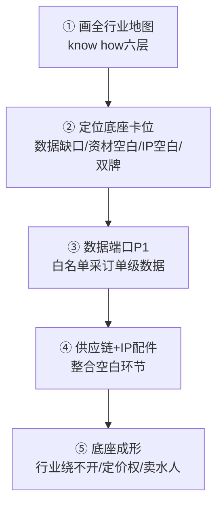

# Flowernet 行业地图 know-how · 底座成形方法论 v1

> 明鉴 · 2026-09-09 · 深化《垄断战略·数据必然性/底座》+ 用户洞察
> **用户核心洞察**: 行业底座的前提 = 先**完整 know how 整个行业地图**（行业结构/玩家/链路/数据在哪/谁在赚钱/该站哪采什么），底座才能形成。
> 纠正: 底座不是"采订单级数据"就能建, 是**先有行业地图的完整认知, 才能定位底座卡位**——数据端口只是底座形成后的采集手段。

---

## 〇、一句话方法论

**底座 = 先画全行业地图（know how 谁在赚钱、数据在哪、链路怎么走）→ 定位底座该站的位置 → 用数据端口把该位置的数据回流量吸进来 → 底座才真正成形。** 认知先行, 采集其次。

---

## 一、为什么底座的前提是行业地图

| 误区 | 纠正 |
|---|---|
| "采订单级数据→底座" | **数据只是采集手段**, 若不知道行业地图, 采来的数据不知道往哪堆、服务谁 |
| "有端口就是底座" | **端口是工具**, 底座是"行业绕不开的位置"——先知道位置才能卡位 |
| "我们垂直鲜花有数据" | 单店数据≠行业底座, **行业地图(全链/全玩家)才是底座的地基** |

**底层逻辑**: 底座的本质 = **行业地图的完整认知 + 据此选择不可替代的卡位**。数据端口让卡位变成"活的数据流", 但卡位本身靠 know how 行业地图决定。

---

## 二、行业地图的六个图层（know how 要覆盖什么）

```
   ① 平台层: 谁在主导(美团/淘闪), 份额差距, 政策窗口
   ② 商家层: 多少商家, 分布, 留存, 池子在哪
   ③ 数据层: 行业数据在哪, 谁掌握, 谁缺
   ④ 供应链层: 花材红海 vs 资材/包材空白
   ⑤ IP/商品层: 联名窗口, 授权门槛, 差异化空白
   ⑥ 竞争/风险层: 玩家矩阵, 已死案例(宜花/花加)红线
   ↓
   底座 = 在这六层里找到"别人拿不走、行业绕不开"的卡位
```

### 已掌握的 know-how（背景调研 V1，已证实/待核）
| 层 | 已掌握 | 可信度 |
|---|---|---|
| 平台层 | 美团20万+/100亿/1.5亿人次; 淘闪8625活动店(**差距≥20倍**); 淘闪2026仍在招服务商(窗口期非必然弃用) | S官方 |
| 大盘层 | 花卉零售2490亿(+13.18%), 电商1374亿55.2%; 礼品花破千亿 | S |
| 数据层 | 行业无单店订单级数据回流 → **底座的机会缺口** | 趋势 |
| 供应链层 | 花材=红海(花易宝/花伍/斗南); **资材/耗材/包材=空白无全国品牌** | ✅ |
| IP层 | roseonly×泡泡玛特/野兽派×HelloKitty已占高端; **面向花店生态的IP配件标准化=空白** | ✅ |
| 竞争层 | 花递10%抽佣(人效瓶颈)/外卖大师10万+(无纵深)/富泰科499-1099月(只采不执行)/抖音工具箱; **鲜花垂类×AI自动运营×自助平台交集=无已核验玩家** | 竞对情报 |

### 补全 · 数据层（谁有数据 / 谁缺）
| 数据维度 | 谁掌握 | 谁缺 | 底座机会 |
|---|---|---|---|
| 平台级GMV/品类数据 | 美团/淘闪 | 商家/中游 | 提供类目洞察 |
| 单店订单级数据 | **无(行业盲区)** | 全行业 | **底座主位: 白名单回流** |
| 供应链/价格数据 | 花易宝/斗南(KIFA拍卖) | 中小商家 | 价格弹性洞察 |
| 消费行为数据 | 平台(日常54.2%/女性68.5%) | 花店 | 选品/备货 |
| 运营效率数据 | 无 | 代运营/商家 | 人效20→50店/人 |

> **数据层结论**: 单店订单级回流=行业最大数据缺口(平台/商家/竞品都要) → **底座主位**。平台有GMV但无单店级, 花店有经验但无数据, 底座卡"单店订单级"这个真空位。

### 补全 · 竞争层（玩家矩阵完整）
| 层级 | 玩家 | 模式 | 我方优势 |
|---|---|---|---|
| 平台 | 美团(20万+/100亿)、淘闪(8625) | 流量+高耗材 | 双牌+数据端口+IP |
| 花材B端 | 花易宝/花伍/斗南(KIFA) | 批发/拍卖 | 不碰红海, 聚焦资材 |
| 重供应链 | 宜花/花加/爱尚(died) | 直营重仓 | 区仓轻资产+toB |
| 代运营 | 花递(花娃系, 10%抽佣) | 人力抽佣 | 人效20→50店/人 |
| 通用AI SaaS | 外卖大师(10万+) | 无鲜花纵深 | 鲜花垂类know-how |
| 数据工具 | 富泰科(499-1099/月) | 只采不执行 | 采+执行+AI自动 |
| IP高端 | roseonly/野兽派 | 联名高奢 | 花店生态IP配件(空白) |
| 灰产 | 抖音工具箱 | 违规改价 | 合规白名单 |

> **竞争层结论**: 「鲜花垂类×AI自动运营×自助/作业平台」交集**无已核验玩家**(相对蓝海)。美团/花易宝在平台/花材侧, 我方剑走偏锋卡"垂类AI+数据+IP配件"组合——与再惠差异化垂直同理。

---
| 风险层 | 宜花/花加/爱尚死于重供应链+节日价格过山车(锁店红线) | ⚠️ |

> ⚠️ 待核: 数字"成都750家/200万/400万"多为**内部口径未公开证实**, 行业地图应标注可信度分级(S官方/A实践/内部待核), 不拿未证实数字当底座地基。

---

## 三、底座该卡哪（基于行业地图的定位）

```
行业地图 → 底座卡位选择:
  ① 数据层缺口(无订单级回流) → 卡"订单级数据"位置(平台/商家都要)
  ② 供应链空白(资材/包材) → 卡"资材标准化"位置(整合无全国品牌)
  ③ IP配件空白(花店生态) → 卡"IP配件标准化"位置(品类上游)
  ④ 双牌身份 → 卡"平台官方服务商"位置(牌照稀缺)
  = 底座 = 数据端口(①) + 供应链(②) + IP链(③) + 双牌(④) 的**聚合位置**
```

**底座不是单一数据端口，而是「数据+供应链+IP+双牌」的行业地图聚合卡位。**

---

## 四、底座成形路径（know how → 卡位 → 数据化）



| 步 | 动作 | 承接 |
|---|---|---|
| ① | 画全行业地图（六层） | 背景调研V1已铺, 待补全/核数 |
| ② | 定位底座卡位 | 数据缺口→底座主位 |
| ③ | 数据端口P1 | 白名单50店>60% |
| ④ | 供应链+IP配件 | 声通省硬件, 钟总IP链 |
| ⑤ | 底座成形 | 行业绕不开→垂类第一 |

---

## 五、与垄断战略的咬合（底座=垄断根基）

```
垄断三必然性
  数据必然性(底座=行业绕不开) ← 行业地图know-how 决定底座卡位
      ↑ 底座成形的前提 = 先知道行业地图
  身份必然性(双牌) + IP授权必然性(定价权)
      = 三者都建立在"know how 行业地图"上
```

**结论**: 用户洞察把底座从"采数据"升维成"**know how 行业地图 → 定位卡位 → 数据化成形**"。行业地图是底座的地基，也是垄断身份的根基——**先吃透行业，才能形成绕不开的底座。**

---

## 六、行业地图完整版（✓ 已补全 2026-09-09）

### 6.1 校准可信度
| 数字 | 值 | 可信度 |
|---|---|---|
| 花卉零售大盘 | 2490亿(+13.18%) | S官方 |
| 鲜花电商 | **1279.5亿**, 日常消费占54.2% | S |
| 电商渠道 | 1374亿, 占大盘55.2% | S |
| 线上渗透率 | 25.4%(2022)→31.6%(2023) | S |
| 平台差距 | 美团20万+/淘闪8625(**≥20倍**) | S官方 |
| 成都内部口径 | 750家/200万/400万 | ⚠️ 内部待核(不当地基) |
| 渠道 | B2C 972.7亿/B2B 306.8亿; 直播326.4亿增速+60% | S |
| 消费结构 | 女性68.5%/一二线58.6%/日常54.2% | S |

> **地基铁律**: 行业地图用 S级官方锚点(2490亿/1279.5亿/美团20万+)做地基; 内部口径(成都750家等)仅标注意向, **不当底座地基**。

### 6.2 底座卡位确认
- **主位**: 数据缺口(单店订单级回流=最大真空, 平台/商家/竞品都要)
- **副位**: 供应链(资材/耗材/包材空白) + IP配件(花店生态标准化空白)
- **组合**: 数据端口(主) + 供应链/IP(副) + 双牌(身份) = **行业地图聚合卡位**

### 6.3 对齐资本（行业地图 = 懂行业的证据）
- 行业地图 know-how → 资本叙事"**懂行业**"的实证(投资人看重)
- 对标再惠: 差异化垂直(鲜花)比餐饮更聚焦(CR5仅3%分散中的整合机会)
- 卡片位: 数据缺口/资材空白/IP空白 = 可讲清楚的**结构性机会**(非虚胖市场)

### 6.4 剩余待补
- [ ] 商家层精确数(20万+美团/淘闪存量), 区域分布
- [ ] 数据缺口用 S级官方的"无单店订单级回流"口径补强(已有趋势级, 待官方佐证)

---
*Flowernet 行业地图 know-how 与底座成形 v1 · 明鉴 · 2026-09-09 · 深化垄断战略·数据必然性*
