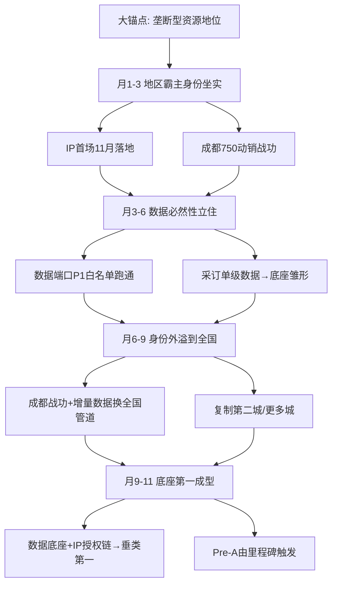

# Flowernet 垄断地位战略推演 · 大锚点纲领 v1

> 明鉴 · 2026-09-09 · 战略纲领（非执行排期）
> **大锚点（用户定调）**: 我们这个事情**服务于「垄断型资源地位」**——这是最开始展开的大锚点，不是做一家赚钱的公司，而是做成【整个行业绕不开的那个身份】。
> 路径(用户给定):
>   1. 借助这个身份地位，把优势从**地区扩展**到**全国**。
>   2. 通过这段时间的优势建立，获取**成为行业底座垂类第一**的可能性。
> 时间窗: 10-11个月(2026-09 → 2027年中) · 资金: 假设1000万(可铺开杠杆,非弹药)
> 性质: 这场仗的钱是**巩固垄断身份的东风**, 不是买规模; 真正的垄断靠①代运营毛利自体滚投 + 三个必然性立住。

---

## 〇、一句话战略

**用双牌身份 + 数据端口 + IP授权链这三个"必然性"，在10-11个月里把"地区身份"演成"全国身份"，再演成"行业底座垂类第一"。1000万是让这个身份更快被平台和行业看到的东风，真正的垄断靠①代运营毛利自体滚投 + 三个必然性立住。**

---

## 一、大锚点：垄断型资源地位（释义）

### 1.1 什么算"垄断型资源地位"
不是规模垄断（美团/花易宝钱比你多），而是**稀缺身份 + 不可替代角色**：

| 维度 | 含义 | 对比 |
|---|---|---|
| **稀缺身份** | 平台授予的双牌(全国服务商+成都全品类) | 别人买不到牌照 |
| **不可替代角色** | 平台要增量/商家要提效/行业要数据 → 都指向你 | 巨头缺鲜花垂直数据/信任 |
| **独占环节** | IP授权链(定制包材=正版锁) | 品类上游在你手里 |

### 1.2 为什么它是"大锚点"
- **它定方向**：所有动作(代运营/IP/数据/扩张)都服务于"让这个身份更硬、更早被看见"
- **它给定价权**：垄断地位=你能定价(IP专有花束/数据底座/代运营服务)，不是被挤压的中游
- **它抗竞争**：美团等巨头烧钱买规模，但买不走"平台身份+数据底座+IP链"——这三个是**必然性**累积

---

## 二、三个必然性：垄断地位的支柱（现有资源, 不用烧钱买）

> 用户的战略直觉正确：垄断地位靠**信息/内容/身份**这类复利资产建立，不是靠烧钱。

### 2.1 身份必然性（双牌=官方身份）
- 鲜花全国服务商 + 成都全品类城市合伙人 = **平台授予的身份**
- 平台要"新签门店+GMV"，你就是那个"能让平台达标"的身份
- **最硬的稀缺牌**，别人买不到、造不出

### 2.2 数据必然性（底座=行业绕不开）
- 垂直行业真实问题：**没人有鲜花数据**
- 你采订单级数据回流 → 平台要 / 商家要 / 甚至竞品要 → 你成**行业底座**
- 底座=别人想进也得用你的数据 → **垄断的实质**

### 2.3 IP授权必然性（链条=品类定价权）
- 定制包材=正版锁 + IP方绑定你渠道 → 你握**专有花束的定价权**
- 粉丝要买只能通过你 → **品类上游在你手里**
- IP授权≈零成本(钟总) → 高毛利贸易差

---

## 三、路径1：借身份地位，区域优势 → 全国

### 3.1 地区霸主阶段（立住身份）
- 成都15%份额 / 750在管商家池 → 做成"成都鲜花绕不开"的存在
- IP首场11月落地 → 成都战功 + 平台正向数据
- **目标**：让平台看到"双牌=能带来增量" → 坐实地区霸主身份

### 3.2 身份外溢阶段（地区 → 全国）
- 用成都战功 + 平台增量数据 → 向淘宝闪购提案：换**全国管道/更多城**
- 单城复制 180-220万（轻装100-130万）→ 成都→广州→杭州→合肥→南京
- **目标**：把"成都专属身份"外溢成"全国服务商身份"

---

## 四、路径2：行业底座垂类第一

### 4.1 底座成型
- 数据端口P1(白名单, 50店>60%接受) → 采订单级数据 → **底座雏形**
- 合规先行(50万) → 数据红利不因合规丢牌
- **目标**：平台+行业都绕不开你的数据 → 底座第一

### 4.2 垂类第一
- 数据底座 + IP授权链 + 双牌 → 垂直鲜花行业**统一定价/定规则**的玩家
- 10城月净1200万回血滚动 → 不靠外部大额融资
- **目标**：Pre-A(2000-3000万)由里程碑触发, 2030 IPO

---

## 五、1000万铺法：巩固垄断身份（非买规模）

> 关键：钱花在"让三个必然性更快/更硬/更早被看见"，不是铺规模。

| 方向 | 投入 | 为何巩固垄断身份 |
|---|---|---|
| 成都打透(身份战功) | ~200万 | 坐实成都霸主, 让平台看到双牌能带增量 |
| 数据端口P1 | 60-80万 | 采订单级数据→行业底座, 垄断数据来源 |
| IP首场+授权链 | 5-30万 | 首场落地→平台看到外部新用户, IP链定价权 |
| 合规+主体 | 50万 | 保住身份(数据/反诈), 不因合规丢牌 |
| 核心团队 | ~138万 | 让身份落地运转(操盘/现金账/IP/数据) |
| **弹性缓冲** | **~250万** | M1未达标前安全垫, 不因断粮失身份 |

> **关键洞察**: 1000万里 ~250万是弹性缓冲(不花, 等①跑正解锁), 真正烧的是 ~400-500万巩固身份方向。剩下靠①代运营毛利(160-200万/月)自体滚投——**垄断身份一旦立住, 第二城/数据底座扩建都不再靠这1000万**。

---

## 六、10-11个月：垄断身份三级跳

| 阶段 | 时点 | 优势里程碑 | 靠什么 |
|---|---|---|---|
| 地区霸主身份坐实 | 2026-09~11 | 成都15%份额+IP首场售罄 | 双牌身份+平台赛道 |
| 数据必然性立住 | 2026-12~2027-02 | 端口P1白名单跑通→底座雏形 | 数据端口+合规 |
| 身份外溢到全国 | 2027-03~05 | 换全国管道+复制第二城 | 成都战功+增量数据 |
| 底座第一成型 | 2027-06~07 | 垂类第一+Pre-A触发 | 数据底座+IP授权链 |

---

## 七、竞争优势总结(为什么这条路能成)

**垄断地位不是烧钱买来的，是三个必然性累积的**——平台给身份、数据做底座、IP给定价权，三者环环相扣。**10-11个月（到2027年中）足够把"地区身份"演成"全国身份"，再演成"行业底座垂类第一"。**

- 1000万 = 让身份更快被看见的**东风**（弹性缓冲为主）
- 真正垄断 = **①代运营毛利自体滚投 + 三个必然性立住**
- 路线图 = 地区霸主 → 全国身份 → 底座垂类第一 → Pre-A → 2030 IPO

---
*Flowernet 垄断地位战略推演 v1 · 明鉴 · 2026-09-09 · 大锚点纲领(用户定调) *
