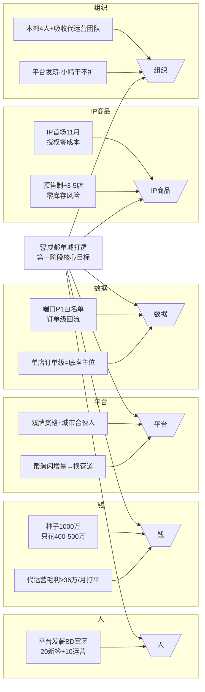
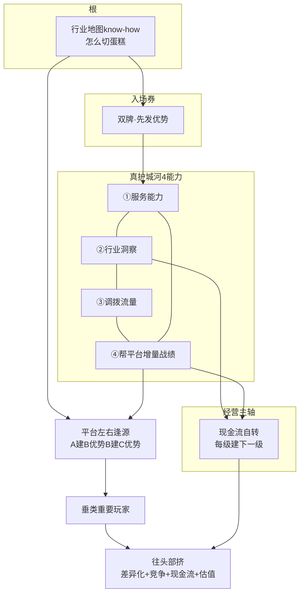

# Flowernet 战略推演演示套件 · 鱼骨图 + 力导向图 v1

> 明鉴 · 2026-09-10 · 战略推演"演示部分"：用鱼骨图(因果分析) + 力导向图(要素关系) 让推演逻辑可视化
> 用途: 给团队/投资人/自己 一眼看懂"影响关键目标的因素" + "各要素间的关系网络"
> 演示对象: 主推演目标 = 成都单城打透(第一阶段) → 全平台卖水人(终局)

---

## 一、鱼骨图 · 影响"成都单城打透"的因素（因果分析）



**鱼骨读法**：六大因（人/钱/平台/数据/IP/组织）共同决定"成都单城打透"能否成。核心：
- **钱**：种子只花400-500万，打平线36万/月（不烧钱）
- **平台**：双牌是入场券，"帮平台增量"换管道（护城河④）
- **数据**：单店订单级=底座主位（真空缺口）

---

## 二、力导向关系图 · 战略要素关系网络



**关系读法**：
- 根(行业know-how) → 入场券(双牌) → 真护城河(4能力循环)
- 4能力(尤其④帮平台战绩) → 平台左右逢源 → 垂类重要玩家 → 头部
- 经营主轴(现金流自转) 贯穿，每级盈利建下一级 → 最终头部

---

## 三、两图配合使用（推演演示流程）

```
1. 先鱼骨图: 拆"成都单城打透"关键因素 → 看哪根鱼刺薄弱(人/钱/平台/数据/IP/组织)
2. 再力导向图: 看要素间关系 → 怎么让4能力/平台/现金流形成合力
3. 对照评估坐标: 每档六轴打分 → 看做到/部分/未达
= 从"因素"到"关系"到"评估" 三层可视化推演
```

---
*Flowernet 战略推演演示套件 v1 · 明鉴 · 2026-09-10 · 鱼骨图(因果) + 力导向图(关系)*
