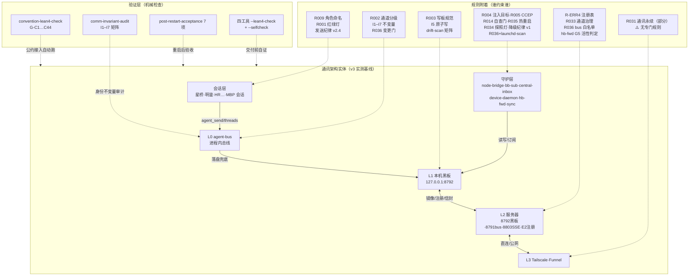

# 规则 ↔ 通讯架构 关系逻辑图（2026-10-02 重新梳理）

> 目的：回答「每条规则约束架构的哪个节点/哪条边，每个架构节点由哪些规则覆盖，哪里有空白」。
> 输入：RULES.md R001–R036（主账）+ R-ERR 防复发系列（rules.json）+ INVARIANTS I1–I7 + 通道规则 v2 + 降级纪律 v1 + R006 四工具。
> 状态：主账 R036 已含通道变更治理门；本图是「规则×架构」的覆盖矩阵，含 gap 清单。

## 1. 架构分层与规则附着（一图）

## 2. 覆盖矩阵（规则 → 架构节点 → 检查器）

| 规则 | 约束对象 | 架构节点/边 | 机械检查器 | 状态 |
|---|---|---|---|---|
| I1–I7 不变量 | 消息身份/回执/原子写/注入语义 | L0 agent-bus | comm-invariant-audit + selftest 65 条 | ✅ |
| R001 红绿灯 | 会话间同源操作 | 会话层 | agent-bus 实现（agent_light/lock） | ✅ |
| R002 通道分级 | 消息通道选择 | 会话→L0 边 | 无独立检查器（纪律+去重） | ⚠️ 靠自觉 |
| R003 写板规范 | 黑板写入 | L1 | 无（靠 bb-card-send G4 key 语法门） | ⚠️ 部分 |
| R004/R005 | 注入目标/心跳协议 | 守护层 | convention G-C 族 | ✅ |
| R-ERR4 | E2 注册表写入权 | L2 注册键 | hb-fwd 实现 | ✅ |
| R006 | 工具化标准 | 全部工具 | 各工具 --lean4-check | ✅（4 工具达标） |
| R014 | 插件自查门 | 插件 | selfcheck CLI | ✅ |
| R030 | 无验证不陈述 | 全局 | 各工具回读断言 | ✅ |
| R031 | 通讯永续/本地优先 | L0–L3 全链路 | 无独立检查器 | ⚠️ 靠架构 |
| R033 | 通道治理 | L2 | convention G-C 族 | ✅ |
| R034 | 探照灯活性 | 守护层 | G5 判定 + hb_age_s | ✅ |
| R035 | 热重启优先 | 守护/框架 | cldvoice-activate 门 | ✅ |
| **R036** | **通道变更治理门** | **全部通道** | **G-C43 channel-gate + G-C44 drift-scan** | ✅ 今日新增 |
| 降级纪律 v1 | 服务器故障时行为 | L2 故障面 | 无机械检查（纪律+求救通道） | ⚠️ 纪律 |
| 通道规则 v2 | 矩阵+变更语义 | 全部通道 | channel-gate + drift-scan | ✅（门已结构） |
| 发送纪律 v2.4 | 全文发送拦截 | agent-way 工具 | 工具内闸门 | ⚠️ 未入规则账本 |

## 3. Gap 清单（无覆盖/弱覆盖，按优先级）

1. **L3 Tailscale/Funnel 无专门规则**：只有 R031 提及。通道矩阵 v2 已把它列为通道，但无「L3 故障/降级」规则（现状依赖「服务器兜底」的隐式假设）。
2. **发送侧门禁未入账**：agent-way 的 v2.4 全文拦截（>50 字需先写黑板）是强闸门但无规则编号——建议并入 R002 详情或独立条目。
3. **D8 版本注册无规则**：E2 schema v2 services 版本字段（node-kit 方案）未落地 → 无「组件版本可远程核」的规则约束。
4. **R002/R003/降级纪律缺机械检查器**：三条靠纪律自觉，与 R036「结构门」标准不一致——补课方向：bb-card-send 已覆盖 R003 的 key 门，R002/降级纪律可参照 R036 模式工具化。
5. **SSE 真探测技术债务**：drift-scan 的 sse-8803 用键 ts 等价判活（node 环境 curl 对 SSE 流超时），矩阵已留 note，待修。
